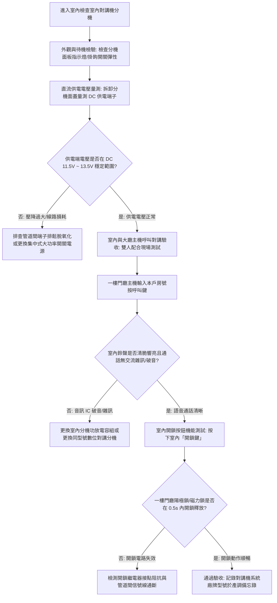

# 全案購屋實戰第八百二十一部：中古大樓社區各樓層電梯對講機室內分機音訊放大IC老化破音直流供電壓降雜訊干擾與主機面板通訊中斷體檢工序全書

## 壹、 導言與實務體檢核心概述

在集合住宅中古電梯大樓之弱電安全與生活門禁通信系統中，連接一樓門廳/警衛管理室、電梯車廂與各住戶室內之**對講機門禁通訊系統（Building Intercom & Access Control System）**，是全棟住戶出入管理、訪客視訊通話、緊急警報求救及梯廳遠端開門的**「神經傳導網絡」**。

在屋齡 20 至 35 年之中古社區中，弱電系統多採用**多芯匯流排匯接式類比系統（Multi-wire Bus Analog System，如 8 芯、10 芯或單軸影像複合線）**。系統依據音訊平衡傳輸與直流集中供電架構（DC 12V / 24V），經由公共弱電垂直管道間之端子排（Terminal Blocks）逐層跳接至各戶室內對講分機。

然而，歷經數十年的運行，室內對講分機內部之音訊功率放大晶片（如 LM386、TDA2822 等 Audio Amplifier IC）與電解電容產生**「乾涸容量衰減與高頻熱老化」**，導致通話產生劇烈交流蜂鳴聲（Hum Noise）、音量極微弱或尖銳破音；弱電管線在管道間受電梯動力電纜強大電磁場干擾（EMI），加之集中式直流電源供應器（Switching Power Supply）老化輸出電壓嚴重跌落；更甚者，門廳對講大樓主機之矩陣式按鍵導電橡膠磨損氧化、微處理器死機，導致全棟各戶頻繁遭遇「訪客按門鈴無反應」、「無法對講確認」、「無法按鎖鍵遠端開門」等重大困擾，嚴重侵蝕居住便利度與居家防衛安全性。

本手冊為買方提供各樓層室內分機與公共對講通訊系統之專項弱電體檢工序。

---

## 貳、 大樓對講系統與室內分機失效機理剖析

### 一、 分機音訊放大 IC 劣化、電解電容乾涸與聲頻失真
1. **電解電容等效串聯電阻（ESR）激增與濾波失能：** 分機主機板上之濾波與偶合電解電容，在機殼內部常年微熱環境下，內部電解液逐漸蒸發乾涸，容量自標稱 $470\ \mu\text{F}$ 跌落至數微法以下，ESR 暴增數十倍。直流電源紋波（Ripple）直接侵入音訊前級放大電路，在受話筒中產生持續刺耳的 $60\ \text{Hz} / 120\ \text{Hz}$ 低頻「嗡——」交流底噪。
2. **功放 IC 熱擊穿與輸出削波破音：** 音訊功率放大晶片在長期過壓或喇叭阻抗不匹配下，內部互補推挽輸出級三極管特性漂移，輸出信號產生嚴重「削波失真（Clipping Distortion）」。住戶接聽訪客聲音時發出嘶啞破裂雜音，嚴重時音量微弱至無法辨識。

### 二、 垂直幹線電磁干擾、直流供電壓降與主機按鍵氧化
1. **強弱電同槽並行引致電磁感應雜訊（EMI）：** 早期施工常將弱電通訊線路與電梯三相 380V 動力電纜混跑於同一個垂直管道間，且未使用具備鋁箔或不鏽鋼編織網之屏蔽雙絞線（STP）。電梯變頻器（VFD）高速開關產生的高頻 PWM 載波輻射，透過空間電磁耦合灌入通訊線，使對講系統伴隨電梯起停發出強烈的「嘶嘶」脈衝噪聲。
2. **幹線長距離直流電壓降（IR Drop）：** 集中式直流電源置於一樓或地下室。當線路老化接點氧化電阻增加，頂樓住戶分機端實測供電電壓由標準 DC 12V 暴跌至 8.5V 以下，低於數位解碼晶片最低工作電壓，引發通訊協議校驗失敗、分機隨機離線中斷。
3. **門廳大門主機導電橡膠按鍵接觸不良：** 一樓門廳大門主機長年受風吹雨淋與日曬紫外線侵蝕，金屬接點氧化、數字鍵盤導電橡膠層脫落，訪客按壓房號鍵時接觸阻抗突破數千歐姆，微電腦無法辨識鍵值，導致鈴聲無法呼叫進戶。

---

## 參、 現場實勘與機能檢測驗收標準工序（SOP）



### 一、 室內分機與對講機能實測四步法
1. **分機直流待機與通話工作電壓量測：**
   - 使用數位三用電表 DC 檔，量測分機背板端子排之 $+12\text{V}$ 與 $\text{GND}$ 兩端。
   - 合格標準：待機狀態電壓應在 **$\text{DC } 11.8\text{V} \sim 12.6\text{V}$**；當提起聽筒進行通話並啟動影像時，工作電壓跌落不得超過 **$0.5\text{V}$**（不得低於 $11.0\text{V}$）。若通話瞬間電壓暴跌至 $9\text{V}$ 以下，證明幹線線徑過細或垂直管道接頭嚴重氧化。
2. **雙向音訊清晰度與雜訊比評估：**
   - 一人於一樓門廳主機通話，買方於本戶室內分機接聽。
   - 仔細聆聽受話器背景底噪：在電梯上下運行時，聽筒內背景底噪必須安靜。若聽筒發出「嗡——」交流蜂鳴音，或訪客說話時伴隨金屬破碎雜音，判定分機板上音訊功放 IC（如 LM386）已熱衰竭損壞。
3. **遠端門禁陽極鎖/磁力鎖開鎖指令測試：**
   - 於通話建立狀態下，用力按下分機面板之「開鎖（UN-LOCK）」按鈕。
   - 一樓人員推拉大門檢驗開鎖反應。
   - 合格標準：一樓大門電鎖必須於 **$0.5$ 秒內瞬時彈開**，分機開鎖指示燈閃爍確認，門鎖釋放時間約維持 3 至 5 秒後自動復歸鎖定。若按壓多次大門無任何開鎖動作，代表分機開鎖按鍵氧化或開鎖控制繼電器損壞。
4. **大樓管理室緊急呼叫與求救按鈕連鎖：**
   - 測試分機上的「緊急呼叫（EMERGENCY / CALL）」鍵。
   - 檢核管理室總機是否能即時接收本戶房號警報，顯示幕是否正確跳出房號資訊，通話音量是否清晰雙向可達。

---

## 肆、 購屋合約防坑特約條款與修繕責任劃分

在中古成屋合約中，針對弱電門禁對講系統之專有與公用部分，應明訂專項特約條款：

```markdown
### 買賣契約防坑特別約定事項：室內弱電對講機分機與公共門禁通信機能保證

1. 【對講通訊機能完好保證】：賣方保證本買賣標的物室內之對講機分機運轉正常，本戶與一樓門廳主機及管理室警衛室之間呼叫鈴聲響亮、語音雙向通話清晰無劇烈破音雜訊，且室內遠端門禁開鎖功能動作敏捷可靠。
2. 【弱電故障排除與修繕責任】：買方於點交日前有權實測全套對講機能。若查出室內分機無法通話、按鍵接觸不良、受話器無聲或無法遠端開鎖者，賣方應負責於交屋前完成修繕或更換全新相容分機主機板；若因公共垂直幹線中斷導致全戶對講失靈，賣方應負責督促管委會於交屋前修復完成，費用由賣方全額負擔。
```

---

## 伍、 本專項工序體檢總結

對講機系統是維繫現代集合住宅「安居門戶」的第一道弱電咽喉。室內分機的破音雜訊或開鎖失效，不僅每日帶來極大生活困擾，更可能在發生緊急意外時阻斷黃金求救通道。買方在驗屋時落實直流電壓、通話音質與開鎖連鎖之深度體檢，方能確保新居享有真正安全、清晰與便利的高品質生活。
