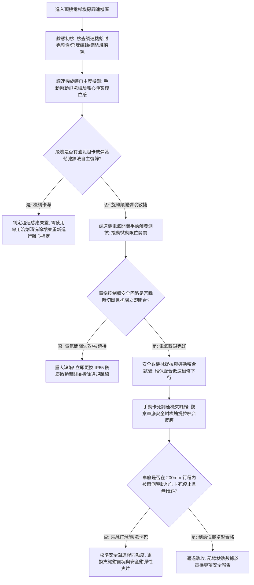

# 全案購屋實戰第八百二十七部：中古大樓社區電梯調速機夾繩鉗磨損飛塊離心彈簧疲勞失準與超速溜梯下墜安全鉗制動體檢工序全書

## 壹、 導言與實務體檢核心概述

在集合住宅中古高層電梯大樓之昇降設備安全防線中，當遭遇曳引鋼索斷裂、牽引輪槽磨損打滑失速、主機減速機齒輪斷齒或抱閘制動器完全失效時，防止電梯車廂以自由落體姿態暴衝下墜砸向底坑的**「終極物理機械煞車機構」**，是由位於機房的**離心式調速機（Over-speed Governor）**與安裝在車廂下樑底部的**安全鉗（Safety Gear）**所組成的機械連動制動系統。

依據中華民國 CNS 2866 昇降機檢驗標準及國際 EN 81-20 規範，對於額定速度 $V$ 之電梯，調速機必須具備兩階段漸進式保護響應：
1. **電氣超速保護開關（Electrical Overspeed Switch）：** 當電梯運行速度達到額定速度之 **$115\%$** 時，調速機之微動安全開關必須搶先動作，強制切斷牽引馬達動力回路與抱閘電源，實施第一階段電氣減速制動。
2. **機械式夾繩鉗超速動作（Mechanical Tripping & Gripping）：** 若電氣切斷後車廂仍持續加速，當下墜速度達到額定速度的 **$115\% \sim 125\%$**（但不得超過規範極限）時，調速機內部離心飛塊（Flyweights）在離心力克服彈簧預緊力下甩出，機械棘爪咬合卡死棘輪，**「夾繩鉗（Governor Rope Gripper）」**瞬間緊緊夾死調速機鋼絲繩。隨著下墜車廂與靜止鋼絲繩產生相對位移，拉動車底安全鉗拉桿機構，驅動漸進式安全鉗楔塊（Flexible Guide Clamps）以數十噸之正壓力咬死兩側垂直導軌（Guide Rails），將高速下墜之車廂硬生生卡死在導軌上，將減速度限制於 $0.2\ g \sim 1.0\ g$ 之人體安全承受範圍內。

然而，在屋齡 20 至 35 年之中古社區中，機房高溫積塵常使調速機飛塊轉軸油泥硬化、**調速機離心彈簧金屬疲勞失準**；加之夾繩鉗夾口（Jaws）受鋼索磨蝕拉溝磨損，夾緊摩擦力嚴重衰退；更甚者，車底安全鉗連動連桿受井道潮濕鏽死、楔塊導靴被油垢固化黏滯；一旦遭遇失控超速下墜，調速機飛塊無法甩出、鋼索打滑無法拉動安全鉗，安全防線徹底崩解，導致車廂直墜井底之毀滅性公安慘劇。

本手冊為買方提供調速機與安全鉗聯動制動系統之專項實戰體檢工序。

---

## 貳、 調速機與安全鉗聯動系統失效機理剖析

### 一、 調速機離心飛塊卡滯、彈簧疲勞與動作速度漂移
1. **飛塊旋轉轉軸（Pivot Pin）油泥碳化黏死：** 調速機長年暴露於機房空氣中，粉塵吸附機油蒸氣形成黑色硬質油垢，包裹住離心旋轉鉸接軸。飛塊甩出所需之靜摩擦阻力暴增，原本應在 $1.15\ \text{m/s}$ 甩出的飛塊，在達到 $2.0\ \text{m/s}$ 時仍被油泥牢牢黏住無法張開，超速動作嚴重延遲。
2. **調速彈簧（Calibration Spring）應力鬆弛與疲勞漂移：** 調速機動態平衡依據離心力公式 $F_c = m \cdot r \cdot \omega^2$ 與彈簧回位力 $F_s = k \cdot x$ 之平衡。長年處於微幅振動應力下，調速彈簧產生塑性蠕變，彈性係數 $k$ 衰退，或出廠鉛封螺栓被不合格技師擅自旋動破壞，導致機械夾繩速度嚴重偏離法規設計值。

### 二、 夾繩鉗口磨蝕打滑與安全鉗連動機構鏽蝕
1. **夾繩鉗齒面（Gripper Jaws）磨損打滑（Rope Slip）：** 調速機專用鋼絲繩（通常為 $6\ \text{mm} \sim 8\ \text{mm}$ 高韌性鋼索）在歷經數十年微幅擺動與歷次制動試驗中，夾繩鉗之鎢鋼齒面被磨平拉光，夾緊摩擦係數由 $0.35$ 暴跌至不足 $0.1$。當棘爪卡死時，高速下墜之鋼索直接在夾口中高速滑移拉絲，摩擦拉力無法達到拉動安全鉗所需的最小拉力（規範要求至少需具備安全鉗拉桿拉力之 $2$ 倍或 $\ge 300\ \text{N}$）。
2. **車底漸進式安全鉗楔塊（Wedge Clamps）鏽蝕硬化：** 安裝於車底之安全鉗箱長年面對井道潮濕水氣，導向斜面與滾柱/楔塊因潤滑脂硬化被鐵鏽咬死。即使調速機鋼索成功提拉連桿，楔塊無法沿斜面滑出楔緊導軌，安全鉗形同虛設。

---

## 參、 現場實勘與機能檢測驗收標準工序（SOP）



### 一、 調速機與安全鉗現場診斷四步法
1. **原廠調速機速度標定鉛封查核法（Tamper-evident Seal Audit）：**
   - 檢視調速機調節螺栓上之原廠檢驗鉛封（Lead Seal）與檢驗標籤。
   - 合格標準：原廠鉛封鋼絲必須完好無損，嚴禁有剪斷、重鉗或螺紋外露變動痕跡。若鉛封遭破壞，代表動作速度已被非專業人為更動，必須強制重新以專用轉速校準台進行離心校驗。
2. **飛塊轉軸靈活性與電氣開關聯鎖手動驗證：**
   - 在電梯待機狀態下，以手向外扳動離心飛塊，手感阻力應均勻且具備強勁彈力；鬆手後飛塊必須在 **$0.1$ 秒內瞬時彈回原位**。
   - 手動推動調速機本體之過速電氣安全開關滾輪，檢視機房控制櫃安全回路燈號：指示燈必須瞬間熄滅，且按壓任何外召按鈕主機絕對禁止啟動。
3. **夾繩鉗齒面磨耗與鋼絲繩直徑測量：**
   - 檢視夾繩鉗（Rope Gripper）合金夾塊表面。
   - 合格標準：夾面防滑齒紋深度應清晰可見（深度需 $\ge 1.0\ \text{mm}$），嚴禁磨成鏡面光滑；
   - 使用游標卡尺量測調速機專用鋼絲繩外徑：磨損減薄量不得超過公稱直徑之 **$10\%$**，表面嚴禁出現斷絲、波浪變形或紅色摩擦鏽粉（Rouging）。
4. **低速檢修動態安全鉗楔緊與導軌咬痕檢驗：**
   - 由合格維保人員站在轎頂操作電梯以檢修速度（約 $0.2 \sim 0.3\ \text{m/s}$）向下慢速運行。
   - 手動壓下調速機夾繩鉗卡死調速機鋼絲繩。
   - 合格標準：車底安全鉗拉桿必須立即被向上提起，安全鉗楔塊迅速咬入兩側 T 型導軌金屬面；車廂應在滑行 **$50 \sim 200\ \text{mm}$ 內平穩制動煞停**，牽引繩在牽引輪上打滑空轉，安全回路瞬斷；
   - 檢視兩側導軌咬痕：兩側導軌表面咬入壓痕深淺必須對稱一致（咬痕深度約 $0.5 \sim 1.0\ \text{mm}$），車廂底板水平傾斜度不得大於 $1\%$。

---

## 肆、 購屋合約防坑特約條款與修繕責任劃分

在中古成屋合約中，針對電梯昇降設備之終極防墜保護系統，應明訂專項特約條款：

```markdown
### 買賣契約防坑特別約定事項：公設電梯調速機與安全鉗超速防墜系統安全保證

1. 【超速防墜安全機能保證】：賣方保證本社區昇降機設備之調速機與安全鉗聯動防墜系統運轉正常，調速機原廠速度校準鉛封完好、電氣超速開關動作敏捷、夾繩鉗齒塊無磨耗打滑，且安全鉗在超速下墜時能確實機械咬死導軌制動，具備建築主管機關有效使用許可證及合格月檢紀錄。
2. 【重大防墜安全瑕疵排除義務】：買方有權會同具合格電梯檢查員證照之第三方檢核調速機與安全鉗系統。若查獲調速機鉛封被毀動作速度失準、飛塊轉軸油泥卡滯無法動作、夾繩鉗咬合打滑無法提拉安全鉗、或車底安全鉗連動連桿嚴重生鏽卡死者，賣方應於交屋前負責督促管委會完成全套除鏽校準、更換磨耗零件並通過實載防墜制動測試；若未完成修繕，買方得順延交屋尾款給付。
```

---

## 伍、 本專項工序體檢總結

調速機與安全鉗聯動系統是中古電梯大樓遭遇極限斷繩或失速下墜時，托舉住整車乘客寶貴性命的「最後一根救命稻草」。若因平日缺乏維護而油泥卡阻或齒塊磨損，這道終極安全網將在毫秒之間化為烏有。買方落實對調速機鉛封、飛塊彈跳敏捷度、夾繩鉗齒面與安全鉗咬痕之深度體檢，方能確保全家老小每日乘梯上下樓之絕對人身生命安全。
