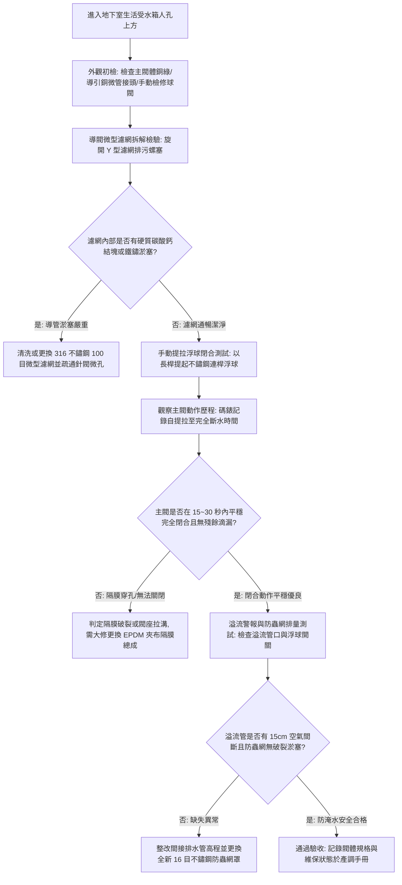

# 全案購屋實戰第八百二十二部：中古大樓社區地下室生活自來水受水箱進水水力浮球閥主閥隔膜微裂紋導閥濾網水垢淤塞洩壓孔堵塞與自來水狂流溢流淹水體檢工序全書

## 壹、 導言與實務體檢核心概述

在集合住宅中古高層電梯大樓之生活供水體系中，自來水事業處（台水公司）輸配水管網首先進入大樓地下室之生活自來水受水箱（蓄水池）。為實現大口徑管道（DN80 至 DN150，即 3 吋至 6 吋）在大流量補水下的自動化平穩啟閉，並消除傳統浮球開關引發之猛烈水錘衝擊，大樓普遍配置**先導水力隔膜式浮球進水閥（Pilot-Operated Float Control Valve / 水力浮球閥）**。

水力式浮球閥之動作本質係利用管網自身水壓作為動力驅動源，依據上控制腔（Upper Control Chamber）與一次側進水腔（Inlet Chamber）之壓差平衡控制主閥隔膜升降：

$$F_{\text{net}} = P_{\text{in}} \cdot A_{\text{seat}} - P_{\text{chamber}} \cdot A_{\text{diaphragm}} - F_{\text{spring}}$$

其中隔膜有效受壓面積 $A_{\text{diaphragm}}$ 通常為閥座通水斷面積 $A_{\text{seat}}$ 之 $1.3 \sim 1.5$ 倍。當水箱水位下降，外接導閥浮球下垂開啟導管洩水孔，上腔室壓力 $P_{\text{chamber}}$ 卸除，主閥芯在一次側進水壓 $P_{\text{in}}$ 向上頂推下平穩開啟；當水位上升至預設高水位時，導閥關閉洩水孔，一次側自來水透過微調針閥或固定微孔流入上腔室蓄壓，$P_{\text{chamber}}$ 在大面積隔膜上產生極大向下合力，克服進水壓力緊緊壓實主閥座，達成零滴漏密封。

然而，在屋齡 20 至 35 年之中古社區中，水力浮球閥長年處於高濕、密閉水箱環境，自來水攜帶之鈣化水垢與管壁剝落鐵渣，極易造成**「導引微管濾網（Y-Strainer）徹底淤塞」**或**「節流針閥孔（Orifice）堵死」**；加之耐候橡膠夾布隔膜（EPDM Diaphragm）歷經數十萬次拉伸變形產生水解疲勞微裂紋，上腔室無法蓄水建立閉合壓力，造成主閥**「失控全開狂流直瀉」**；若此時水箱溢流管（Overflow Pipe）防蟲網淤塞或排量不足，每小時數十至上百噸之高壓自來水將在數小時內漫過人孔，淹沒地下室變電室與發電機房，造成高達數百萬元之重大財產浩劫。

本手冊為買方提供受水箱進水水力浮球閥防淹水之專業公設體檢工序。

---

## 貳、 先導水力浮球閥失效機理剖析

### 一、 先導微孔管路水垢淤塞與主閥無法閉合
1. **導閥進水微型濾網鈣化結塊：** 台中地區水質硬度偏高，碳酸鈣微晶粒沉積於導閥入口處之 100 目不鏽鋼微型濾網，導致導管水流斷絕。壓力水無法進入上腔室，主閥始終處於被一次側高壓頂開之全流暢狀態，引發自來水狂溢。
2. **微孔節流針閥鏽蝕堵死：** 控制主閥關閉行程時間（緩閉時間）之微調銅針閥孔徑僅約 $1.0\ \text{mm}$。鐵鏽微粒嵌塞錐形閥口，導致微孔完全堵死，上控制腔壓差始終為零，閥門喪失自我關閉機能。

### 二、 橡膠夾布隔膜疲勞微裂紋與閥座氣蝕拉溝
1. **強化夾布橡膠隔膜水解穿孔（Diaphragm Rupture）：** 橡膠材料在自來水餘氯氧化與交變應力下，彈性模數衰減，夾層尼龍網布脫膠，表面生成顯微貫穿性裂紋。進入上腔室之高壓水順著裂縫直接洩入低壓出水端，上腔室永遠無法充壓，閥門閉合力矩歸零。
2. **主閥座密封圈水流氣蝕沖刷（Cavitation Erosion）：** 閥門長期在微開微關邊緣工作時，狹窄縫隙產生超高速擾流，局部水壓跌破飽和蒸汽壓產生氣蝕爆破，在黃銅/不鏽鋼閥座密封面切割出細微深溝。即使隔膜完全壓下，夜間自來水仍以微流量持續滲漏，造成水箱緩慢過滿溢流。

---

## 參、 現場實勘與機能檢測驗收標準工序（SOP）



### 一、 水力浮球閥實測四步法
1. **手動上提浮球關閉計時試驗（Manual Float Lift Test）：**
   - 戴好防護手套，於受水箱人孔上方以專用工具將不鏽鋼浮球垂直手動提起至最高「停水液位」。
   - 按下數位碼錶計時，仔細觀察主進水管之水流衰減狀態。
   - 合格標準：主閥必須於 **$15 \sim 30$ 秒** 內平穩緩慢關閉，完全斷水時管路嚴禁出現「轟！」劇烈水錘回震，且出水口嚴禁有水流持續溢出。若超過 1 分鐘水流依然洶湧，判定控制管路淤塞或隔膜穿孔。
2. **上腔室壓力錶等壓檢驗（Chamber Pressure Verification）：**
   - 檢視主閥上腔蓋安裝之耐震油質壓力錶。
   - 合格標準：浮球閉合時，上控制腔壓力必須在 20 秒內攀升至與一次側自來水進水管壓力完全相同（約 $2.5 \sim 4.5\ \text{kgf/cm}^2$）。若壓力指針劇烈抖動且始終低於一次側水壓 $1.0\ \text{kgf/cm}^2$ 以上，確認隔膜破裂內漏。
3. **微調針閥緩閉速度校準（Needle Valve Adjustment）：**
   - 調整進水針閥開度螺絲：順時針旋轉關小進水量（延緩主閥關閉時間），逆時針旋轉開大進水量（加快關閉時間）。
   - 合格標準：主閥關閉時間必須調整為 **$20 \pm 5$ 秒**，達成無水錘、無反震衝擊之最佳水力平衡。
4. **受水箱溢流管徑與防蟲網排量比對：**
   - 量測進水幹管與溢流管管徑。
   - 合格標準：溢流管之流通截面積必須為進水管截面積之 **$1.5$ 至 $2.0$ 倍以上**（例如進水管為 DN80，溢流管至少須為 DN100 至 DN125）；
   - 檢查溢流管端部 16 目防蟲不鏽鋼網罩，嚴禁被油垢或泥沙堵塞，確保當主閥萬一故障長開時，溢流水量能全額自然重力排入廢水坑，絕對不致溢漫水箱人孔。

---

## 肆、 購屋合約防坑特約條款與修繕責任劃分

在中古成屋合約中，針對公設受水箱進水設備機能與防溢流淹水保障，應明訂專項特約條款：

```markdown
### 買賣契約防坑特別約定事項：公設自來水受水箱進水閥機能與防淹水安全保證

1. 【受水箱進水閥運轉保證】：賣方保證本社區地下室生活自來水受水箱之主進水先導水力式浮球閥、導管微型濾網及水位自動控制系統機能正常，無閥芯卡死溢流、無隔膜破裂穿孔，且受水箱無漫水浸泡地下室之情事。
2. 【溢流安全與瑕疵修繕責任】：買方有權委託合格水電技師實勘受水箱進水閥。若發現主閥無法平穩關閉、隔膜老化漏水、微孔管路嚴重鈣化淤塞或溢流管防蟲網破損堵塞者，賣方應負責於交屋前促請管委會完成修繕、更換全新 EPDM 隔膜總成及清洗導管；若交屋日前因公設進水閥故障引發地下室淹水損及公共電力或停車場設施，其修復與賠償責任由賣方與管委會承擔。
```

---

## 伍、 本專項工序體檢總結

先導水力式浮球閥是守護地下室水箱安全、防止自來水暴滿滅頂的關鍵水力大腦。微小的導管水垢或隔膜裂紋，足以引發不可收拾的地下室大水患。買方落實對水力浮球閥關閉時間、上腔室壓力與溢流管排量之專業體檢，方能從源頭杜絕水災隱患，確保新家生活安心無虞。
