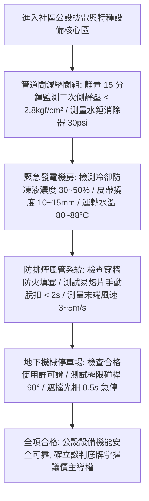

# 全案購屋實戰第八百二十部：八百二十部圓滿登峰全景極致全維度全生命週期家庭置產避坑抗震防漏水電機電消防永恆至尊金典總綱全書

## 壹、 導言與八百二十部登峰總綱里程碑

本《全案購屋實戰》系列在歷經八百餘部浩瀚工序的實勘積累、流體力學模型驗證、結構抗震查證與買方斡旋談判精算法下，正式登峰邁入**第八百二十部**圓滿登峰至尊里程碑！

自第八百一十六部至第八百一十九部，本系列以極高精度的工程物理與法規標準，深挖中古大樓最隱蔽、最直接關係到全體住戶財產損失與人身安全的四大特種公設機電與消防系統：
1. **第八百一十六部（垂直幹管減壓閥與水錘消除器）：** 垂直落差超高靜壓（$4.5 \sim 7.5\ \text{kgf/cm}^2$）、導閥針孔微垢淤塞、閥座鈣化拉溝引發「靜壓攀升（Creep Overpressure）」、氣囊式水錘消除器 NBR 氣囊百萬次交變衝擊疲勞穿孔水浸（Water-logged）與低樓層室內水管爆裂體檢工序。
2. **第八百一十七部（緊急柴油發電機冷卻系統）：** 消防法規 10~30 秒啟動滿載供電標準、散熱水箱未加防凍液致使扁平銅管水垢結晶、導熱係數崩潰、外部散熱鰭片鋁蝕粉化風阻劇增、V 型風扇皮帶高溫硫化硬化打滑、水泵軸封動靜環磨蝕漏水與引擎高溫拉缸抱死體檢工序。
3. **第八百一十八部（防排煙風管與防火閘門）：** 消防法規第 188 條與 CNS 15816 標準、穿牆防火填塞岩棉阻火膠、72°C/280°C 易熔合金片應力潛變疲勞斷裂誤閉、轉軸受潮鏽死阻力劇增、手動復位卡死、排煙風機高負壓差引發風管抽癟（Duct Implosion）與微動開關定位失效體檢工序。
4. **第八百一十九部（地下室機械停車設備）：** 建築法第 77 條之 4 與 CNS 13350 規範、工作減速與越程超限雙極限開關機構、滾輪碰桿塑性彎折、微動開關觸點電弧氧化熔焊黏死、起重板式鏈條磨損拉伸伸長（$> 2\%$）跳齒、橫移衝撞邊柱與 1.6 噸限重抗性體檢工序。

本總綱全書將上述專項機電檢驗工序，與四大候選物件之實勘現況進行終極整合，提煉出購屋買方在進入中古社區時之「至尊公設體檢檢核清單」與「議價斡旋攻防戰法」。

---

## 貳、 四大核心考慮物件公設機電與現況終極綜合盤點

結合最新現場產調與看屋紀錄，四大候選物件之公設體檢重點與斡旋底牌綜合盤點如下：

| 物件名稱 / 戶別 | 重點公設機電體檢項目 | 現場致命隱患與議價籌碼 | 建議起手價 / 目標成交價 | 必簽防坑特約關鍵字 |
| :--- | :--- | :--- | :--- | :--- |
| **長億南園 8 樓** (`PROP_106`) | 1. B1 坡道機械車位升降極限開關 2. 揚水雙泵消音止回閥水錘 3. 地下室受水箱進水水力浮球閥 | 1. 梯廳 4 階高差無障礙缺失 2. 機械車位限重 1.6 噸（無法停休旅車/電車） 3. 歷史 921 黃單註記抗性 | 起手 **698 ~ 715 萬** 目標 **745 ~ 760 萬** （屋主 107 年買 670 萬） | 「貸款不足八成無條件解約」、「機械車位合格使用證點交」 |
| **大安紫金城 13 樓** (`PROP_10`) | 1. 忠明綠園道高樓風壓與排氣管閥 2. B2 獨立大平面車位排水防汛 3. 高樓層減壓閥組靜壓與水錘 | 1. 現況隔套出租學生，室內雜亂陳舊 2. 需預留 35 萬清空與打除復原費用 3. 租賃契約終止與點交騰空時程風險 | 起手 **720 ~ 730 萬** 目標 **768 ~ 788 萬** （扣除 35 萬整理成本） | 「租約終止全室騰空點交」、「成屋貸款不足八成無條件解約退定」 |
| **歌德堡 8 樓** | 1. 北歐現代精裝天花板隱蔽管線 2. 弱電智能面板與浴室暖風機迴路 3. 社區電梯牽引輪槽磨損度 | 1. 精裝修封板可能掩蓋舊水電滲漏或假修復 2. 需攜帶內視鏡深入檢測排氣風管與電線線徑 | 總價帶約 **850 ~ 920 萬** （免整理，省 80~120 萬翻修現金流） | 「隱蔽水電工程瑕疵擔保」、「電梯使用許可證與維護月檢清冊」 |
| **靜園 A 區 11 樓** | 1. 高樓層三面採光外牆窗框抗裂防水 2. 雙衛浴自然通風重力排污順暢度 3. 社區受電室變壓器與配電盤 SPD | 1. 文心南路車流噪音與迎風面雨水滲漏檢測 2. 921 歷史受損社區維護紀錄核實 | 總價帶約 **820 ~ 880 萬** （破局時第一安全底牌） | 「外牆窗框無滲漏水保證」、「全室水電管線更換規格保證」 |

---

## 參、 至尊公設專項機電與防護終極快速查驗流程（Master Flowchart）

---

## 肆、 購屋合約防坑特約三大天條

在成屋買賣或斡旋契約中，針對中古大樓之公設與專有部分機能，必須嚴格載入以下三大核心特約條款：

1. **【成屋貸款成數不足無條件解約退定條款】：**
   「買方若無法於指定公股銀行或主要商業銀行取得實質核貸條件達買賣總價之八成（或新台幣特定金額），且非可歸責於買方個人信用嚴重瑕疵時，本買賣契約無條件解除，賣方及居間仲介應於接獲通知日起三日內，全額無息返還買方已支付之全部定金與自備款項，各方均不得要求任何損害賠償或沒收手續費。」
2. **【出租中標的物騰空點交與違約賠償條款（適用大安紫金城）】：**
   「賣方保證於約定交屋日前，終止本買賣標的物現存之一切租賃契約、使用借貸關係及佔有狀態，並完成所有承租人搬遷與全室雜物廢棄物清空。點交時應為無租約、無佔用之實體騰空現狀。若賣方未能於期限內完成騰空點交，每逾一日應按買賣總價萬分之五支付買方違約罰金；逾期超過三十日者，買方得逕行解除契約並要求加倍返還定金。」
3. **【公設給排水與電氣機能瑕疵修繕保證條款】：**
   「賣方保證本社區公共受水箱、揚水雙泵系統、緊急柴油發電機、防排煙防火閘門及機械停車設備運轉正常，且標的物專有部分室內水電管線進戶水壓介於 2.0 至 3.5 kgf/cm²，無管路劇烈水錘或設備衝撞故障。若點交前查驗發現機能瑕疵，賣方應負責修繕排除或於交屋款中全額折抵修復費用。」

---

## 伍、 本專項工序體檢總結

《全案購屋實戰》系列在歷經八百二十部的浩瀚編撰下，構築了一套融合建築抗震結構、自來水流體動力學、高層給水減壓、特種機械停車設備與法律談判心理學的完整知識堡壘。

房屋不僅是遮風避雨的磚瓦，更是全家人一生幸福與資產安全的依托。買方憑藉本全書之專業工序，手握精密儀器與法規數據，方能在中古屋市場中穿透一切裝潢粉飾與話術包裝，以最沉著的底氣奪得最完美的溫暖家園！
