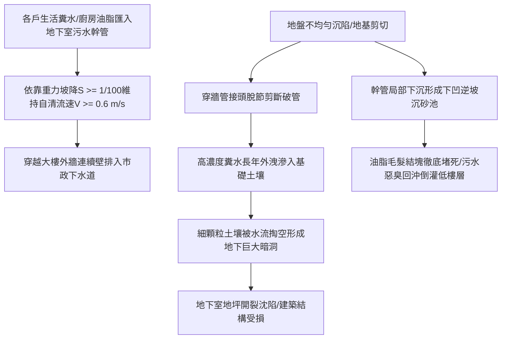

# 全案購屋實戰第八百八十七部：中古大樓社區地下室生活污水下水道用戶接管重力流破管滲漏地盤掏空沉砂淤塞逆坡回沖與惡臭毒氣逆灌室內體檢工序全書

## 壹、編撰宗旨與地下重力流環境衛生安全防線

在現代集合住宅大樓（特別是屋齡 20 年至 35 年以上之中高齡中古大樓社區，例如台中南區的大安紫金城、長億南園、歌德堡、工學天下、靜園等）的公共衛生體系中，整棟建築數百戶家庭每日排放之糞便污水、廚房洗滌廢水與各衛浴雜排水，在建築內部主要依靠「重力自流（Gravity Flow）」順著管道間立管向下匯集，並於地下室最底層（B1 或 B2）穿越大樓連續壁或筏基結構，接入台中市政府之「公共污水下水道用戶接管系統（Public Sewer Connection System）」。

在未完成公共下水道接管前，大樓依靠地下室化糞池或污水處理設施；而完成公共接管後，生活污水則直接經由「用戶接管污水幹管（Lateral Sewer Pipe）」以自然重力坡度排入道路公共主幹管。

然而，在中古大樓長達數十年的地下地盤微變形與水質腐蝕中，地下生活污水重力流接管系統常態性潛伏著四大毀滅性隱形病變：
1. **建築物主體沉陷與地盤剪切位移導致污水穿牆管處發生「斷裂破管或脫節（Joint Dislocation）」**。高濃度具強腐蝕性的污水常年自破口外洩，掏空大樓基礎下方之土壤砂礫層，引發地下地坪不均勻沉陷與連續壁周邊空洞化；
2. **污水管道內部沉砂、油脂皂化結塊長年淤塞，且管線因施工沉降產生「逆坡（Negative Slope / Backfall）」**。排水斷面銳減甚至積水回沖，引發地下室低樓層或公共管道間污水滿溢倒灌；
3. **污水管通氣系統（Vent System）堵塞與水封破壞，高濃度硫化氫（$\text{H}_2\text{S}$）、甲烷（$\text{CH}_4$）等致命劇毒易燃氣體沿破縫逆灌室內與梯間**，造成住戶長年吸入毒氣慢性中毒，甚至引發氣爆危機。

本手冊針對中古社區地下室污水下水道用戶接管、重力流坡降水力學、CCTV 管道閉路電視檢測、地盤掏空探地雷達檢測及室內防臭水封平衡，深入解剖曼寧水力公式、地基剪切破壞動力學與現場體檢標準工序，為購屋家庭與管委會建立固若金湯的環境衛生與地基安全防線。

---

## 貳、污水重力流曼寧水力學架構與沉砂逆坡物理機制

### 一、曼寧公式（Manning's Equation）與自清流速物理
生活污水在重力排水管中屬於具有自由水面的非滿流（Partially Filled Flow）明渠流動：
1. **曼寧流速與流量計算公式**：
   $$V = \frac{1}{n} R_h^{2/3} S^{1/2}$$
   $$Q = V \times A = \frac{1}{n} A \cdot R_h^{2/3} S^{1/2}$$
   其中：
   - $V$ 為污水斷面平均流速（$\text{m/s}$）；
   - $Q$ 為重力排水流量（$\text{m}^3/\text{s}$）；
   - $n$ 為管壁曼寧粗糙係數（PVC 或 HDPE 管 $n \approx 0.009 \sim 0.011$；鑄鐵管老舊結垢後 $n \approx 0.015 \sim 0.018$）；
   - $R_h = A / P_w$ 為水力半徑（有效流通斷面積 $A$ 與潤濕周長 $P_w$ 之比）；
   - $S$ 為管底水力坡降（坡度，Slope）。
2. **法規最小自清流速（Self-cleansing Velocity）門檻**：
   為防止污水中夾帶之糞便固體微粒、廚餘殘渣與細石英砂在管底沉積，依據下水道工程規範：
   - 設計滿流或半滿流流速**絕對不得低於 $0.6 \text{ m/s}$**；
   - 最小水力安裝坡度 $S$：口徑 $150\text{ mm}$（6"）管線坡度不得小於 **$1/100$（$1\%$）**；口徑 $200\text{ mm}$（8"）管線坡度不得小於 **$1/150$**。

### 二、不均勻沉陷與逆坡沉砂坑（Sag / Belly）之水力潰陷
當大樓本體與周邊道路土壤發生「差異沉陷（Differential Settlement）」時，橫貫連續壁內外的污水硬質管承受巨大剪力（Shear Force）。管身中段下沉形成「U 型下凹段（Sag / Belly）」：
1. **逆坡形成與流速驟降**：原本設計的順向坡度轉化為反向逆坡（$S < 0$）。水流流至凹陷段時水力坡降歸零，流速暴跌至 $0.2\text{ m/s}$ 以下；
2. **重力分層沉澱沉砂池效應**：流速一旦低於自清極限，固體懸浮物迅速沉降。油脂在低溫停滯水中冷卻皂化形成白色石化硬塊，毛髮纖維與細砂沉積，管線在數月內完全失去流通斷面，轉化為一根封閉的地下「腸梗阻」。

---

## 參、中古社區污水接管系統三大核心病徵與失靈成因

### 一、連續壁穿牆管剪斷脫節、滲漏與地盤掏空（空洞化危機）
1. **大樓沉降與外牆土壤沉陷差**：集合住宅自重大、基礎深，沉降量較小且穩定；但周邊覆土與道路常因地下水位波動、交通震動而產生額外沉降。兩者交界處的柔性防水套管若未做抗震雙球型可撓接頭（Flexible Joint），剛性 PVC 管直接被剪切斷裂。
2. **水土流失與地基懸空**：每日數十公噸的污水自穿牆斷口噴出，具有極強侵蝕力。地下水流將連續壁外側與筏基底板下方的粉細砂層長年洗刷抽走，在地表下方形成深達數公尺的「隱形地下空洞（Underground Void）」。一旦重車經過或地震搖晃，地面瞬間塌陷撕裂地下室外牆！

### 二、鑄鐵管管底電化學硫化腐蝕穿孔（溝蝕 Trench Corrosion）
1. **硫化氫酸性侵蝕**：在重力流未滿流的管頂空氣層，厭氧菌釋放的硫化氫（$\text{H}_2\text{S}$）氣體與管頂凝結水結合，在好氧硫氧化菌作用下氧化生成極強腐蝕性的硫酸（$\text{H}_2\text{SO}_4$）：
   $$\text{H}_2\text{S} + 2\text{O}_2 \xrightarrow{\text{硫桿菌}} \text{H}_2\text{SO}_4$$
2. **管底泥砂沖刷磨損與管頂酸蝕穿孔**：傳統鑄鐵污水管頂部受硫酸強酸侵蝕薄化，管底則受固體砂礫沖刷磨損，雙重夾擊下管壁厚度由原始 8mm 迅速腐蝕至 1~2mm，最終全面穿孔塌陷，污水自吊管處如瀑布狂淋地下停車場車輛。

### 三、存水彎水封破壞與致命毒氣逆灌室內
1. **虹吸抽吸與正壓噴濺**：當樓上大流量沖水時，污水幹管若頂端通氣管（Vent Pipe）被鳥巢、泥沙或水垢堵塞，管內產生劇烈負壓抽吸，將低樓層（1 至 3 樓）住戶洗臉盆與地板落水頭之「存水彎水封（Water Seal）」瞬間吸乾；隨後正壓衝擊將管內毒氣自乾燥的排水孔噴出。
2. **無形殺手硫化氫中毒**：劇毒硫化氫濃度超過 $10\text{ ppm}$ 即損害嗅覺神經，高於 $100\text{ ppm}$ 數秒內即可致人於死地。長期微量逆灌室內，造成住戶長年莫名噁心、偏頭痛、幼童呼吸道慢性發炎。

---

## 肆、污水下水道接管系統標準體檢工序

### 一、CCTV 管道閉路電視內窺無損檢測工序
1. **高壓水刀預先清洗（Jetting）**：
   - 檢測前先調派高壓水刀清管車（水壓 $150 \sim 200\text{ bar}$），自地下室污水陰井向外清洗，將管內油脂結垢與淤泥徹底沖出。
2. **履帶式自走型 CCTV 機器人內窺探測**：
   - 自大樓總出水陰井放入配備高解析度彩色旋轉鏡頭與雷射測距儀之自走式機器人，沿管線推進至市政連接人孔。
   - **檢測指標與瑕疵判定（依據下水道管渠檢測標準）**：
     - **結構性缺陷**：檢測管壁有無破裂（Cracks）、穿孔、塌陷、接頭脫節（Dislocation）或樹根侵入（Root Intrusion）；
     - **功能性缺陷**：記錄管內油脂結垢厚度、逆坡凹陷（Belly）長度與水深比例；管內沉積物深度超過管徑之 **$20\%$** 即判定為功能障礙。

### 二、穿牆管周邊探地雷達（GPR）地盤空洞無損掃描
1. **高頻電磁波透地探測**：
   - 在地下室最底層連續壁內側地坪及大樓外圍地表，使用 $400\text{MHz} \sim 900\text{MHz}$ 高頻探地雷達（Ground Penetrating Radar, GPR）進行網格化掃描。
2. **空洞雷達波形反射圖譜判定**：
   - 電磁波自混凝土與密實土壤交界面反射時波形平緩；當遇到地下水沖刷形成的水洞或空洞（空氣介電常數 $\epsilon_r = 1$，水 $\epsilon_r = 81$，密實土 $\epsilon_r = 9 \sim 16$）時，電磁波在介質突變邊界產生極強烈的「高振幅反相振盪反射雙曲線圖譜」。
   - **安全警戒標準**：若掃描發現連續壁外側存在深度超過 $0.5\text{ 公尺}$、長度大於 $1.0\text{ 公尺}$ 之強反射異常區，代表地基砂土已嚴重掏空，必須立即進行水泥黏土漿或聚氨酯灌漿充填加固！

### 三、室內存水彎水封高度與氣體濃度精密測定
1. **水封有效深度量測**：
   - 使用深度游標卡尺測量衛浴地板落水頭與臉盆 S 型/P 型存水彎之隔水隔板深度。
   - **合格標準**：有效水封深度必須維持在 **$50 \sim 100\text{ mm}$** 之間（小於 50mm 易受蒸發乾涸，大於 100mm 易引發排水阻力自清不良）。
2. **四合一氣體偵測器現場採樣**：
   - 將四合一氣體偵測器探頭緊貼室內落水孔與管道間檢修口，檢測硫化氫（$\text{H}_2\text{S}$）與可燃氣體甲烷（$\text{LEL}$）。
   - **標準要求**：$\text{H}_2\text{S}$ 讀數必須**絕對為 $0\text{ ppm}$**；若讀數大於 $1\text{ ppm}$，代表水封已破裂或通氣立管出現裂隙。

---

## 伍、購屋避坑指南與管委會整改預算表

### 一、買方室內與地下室看屋防臭防塌查核 4 訣
1. **踏入地下室一樓或二樓尋找污水總出水陰井（Drop Manhole）**：
   - 尋找地下室外牆邊緣的污水總排出口或陰井。掀開蓋板觀察水流流態，水流應順暢平緩向外流動；若井內積滿深厚如凝固豬油般的白色厚塊、或有大量污水死水積存不退，代表外部接管早已發生嚴重逆坡或堵塞。
2. **觀察連續壁接縫與穿牆管四周有無滲水泥漿泥沙**：
   - 檢視大口徑污水管穿透地下室外牆的環形套管處。若四周牆面有黑褐色污水滲出水痕、地坪有泥沙沉積，代表穿牆管外側已破管斷裂，污水正沿外牆縫隙倒灌。
3. **走進待售物件各間衛浴俯身聞嗅落水頭氣味**：
   - 進入室內各浴室，關閉抽風機並緊閉門窗 10 分鐘後進入。深呼吸聞嗅地漏孔，若有淡淡的臭雞蛋味（硫化氫）或廚餘酸腐味，代表大樓垂直通氣管已堵塞或存水彎水封常態破壞。
4. **查閱大樓公共修繕紀錄簿之「污水通管工程」頻率**：
   - 向管委會查閱近三年維修紀錄。若社區每隔三個月至半年就必須花錢請通管廠商「通排水管」，高度證實地下幹管已發生永久性逆坡沉降，唯有開挖重埋才能治本。

### 二、污水重力流管網系統專項維修更新預算參考清單

| 維修／改善工程項目 | 技術規範與標準工法 | 預算區間（每處／每案） | 安全重要度等級 |
| :--- | :--- | :--- | :--- |
| **高壓水刀清管與 CCTV 管道閉路電視內窺檢測** | 200 bar 超高壓清管 + 履帶機器人全管錄影診斷報告 | 18,000 ~ 32,000 元／棟 | 法定極高（掌握管網全貌） |
| **地下穿牆管抗震可撓曲防水接頭更換與局部開挖** | 雙球型 EPDM 耐酸鹼橡膠可撓接頭 + 壓板止水法蘭 | 45,000 ~ 85,000 元／處 | 緊急極高（防止斷管外洩） |
| **連續壁外側地基掏空地質改良灌漿加固工程** | 低壓注入微水泥漿或雙液型發泡硬質聚氨酯充填 | 65,000 ~ 150,000 元／處 | 結構安全極高（防止塌陷） |
| **老舊地下室吊管全面更換為厚管橘色污水 PVC-U 管** | 南亞橘色衛生下水道專用厚管（坡度嚴格 1/100） | 1,800 ~ 3,200 元／公尺 | 治本根除腐蝕漏水 |
| **頂樓通氣立管疏通與免動力渦輪抗負壓吸氣閥增設** | 排除通氣管鳥巢水垢 + 安裝進口單向吸氣閥（AAV） | 4,500 ~ 8,500 元／支 | 極高（消除室內臭氣） |
| **落水頭深水封防臭不銹鋼落水組換新** | SUS 304 重力磁吸防臭防蟲深水封地漏 | 800 ~ 1,500 元／只 | 居住品質必備裝修 |

---

## 陸、本案結語

地下生活污水管網是整棟建築最骯髒、最隱蔽，卻也是最攸關生命尊嚴與地基安全的「排毒動脈」。一根斷裂的污水管，外洩的不僅是生活穢物與刺鼻惡臭，更是常年掏空整棟大樓立足地基的隱形殺手。

購屋家庭在審視 20 年以上之優質中古大樓時，切不可只將眼光停留在美輪美奐的客廳衛浴，務必將檢驗眼光深探至地下室外牆的穿牆接管與污水流速。唯有確保排毒動脈坡度順暢、地基密實無空洞、水封嚴密無臭氣，才能為家人築造一座真正健康、乾淨、安全無虞的傳世家園！
