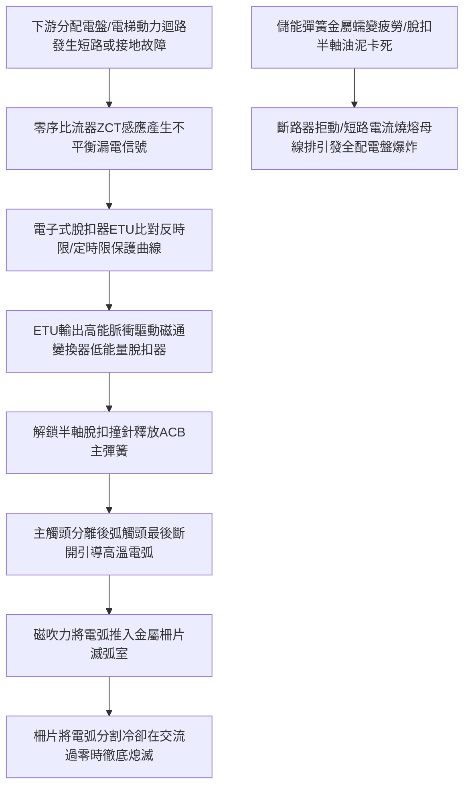

# 全案購屋實戰第八百八十三部：中古大樓社區低壓配電室空氣斷路器ACB過電流脫扣機構彈簧疲勞接地故障保護零序比流器失準與母線排過熱體檢工序全書

## 壹、編撰宗旨與低壓供電幹道之極限安全防禦

在台灣都會區集合住宅大樓（特別是屋齡 20 年至 35 年以上之中大型中古社區，例如台中南區的大安紫金城、長億南園、歌德堡、工學天下、靜園等）的電力分配樞紐中，台電高壓電經由地下變電室高壓變壓器降壓後，輸出的三相四線 $380\text{V} / 220\text{V}$ 超大電流（通常額定電流高達 $1000\text{A} \sim 3200\text{A}$），全數匯集於低壓主配電盤（Main Low Voltage Switchboard, MSB）的總開關——「空氣斷路器（Air Circuit Breaker, ACB）」。

低壓 ACB 是整棟建築公共機電與數百戶家庭用電的「總電源總閘門與主保護神」。它必須具備極高的分斷容量（Interrupting Capacity，通常需達到 $50\text{kA} \sim 85\text{kA}$ 以上），以承受下游母線排或分配電盤突發短路時產生的巨大電動力（Electrodynamic Force）與高溫電弧能量，並在數十毫秒（$0.02 \sim 0.04\text{ 秒}$）內迅速脫扣跳閘，防止火舌沿主配電盤母線排擴散。

然而，在中古大樓長達 20 至 35 年的常態運轉中，低壓配電盤與 ACB 長年承受著重載電流的熱應力、電磁震動、灰塵油泥與潮濕水氣的侵蝕，極其普遍地面臨三大毀滅性隱形病變：
1. **ACB 機械操作機構（Mechanism）儲能彈簧長期處於高壓受力狀態，產生嚴重的金屬蠕變（Creep）與彈性疲勞，連桿機構潤滑脂乾涸固化**。當下游管線發生接地短路時，脫扣螺線管雖發出跳閘指令，但機構卡死「拒絕跳閘（Failure to Trip）」，強烈短路電流持續轟擊，整座低壓配電盤在數秒內炸成焦黑廢鐵；
2. **接地故障保護（Ground Fault Protection, GFP）所依賴的「零序比流器（Zero-Sequence Current Transformer, ZCT）」因鐵芯磁飽和或感應線圈受潮老化而失準**，對微小的相線接地漏電毫無反應，漏電流在潮濕電纜溝內持續產生高熱電弧，最終引發全棟電纜大火；
3. **主配電盤純銅母線排（Copper Busbar）搭接螺栓在長年冷熱膨脹交替下發生「鬆弛（Bolted Joint Loosening）」**。搭接面接觸電阻劇增引發劇烈焦耳熱，母線排表面溫度飆升至 $120^\circ\text{C} \sim 180^\circ\text{C}$ 以上，絕緣支撐板碳化起痕，隨時引發全棟大停電與重大火警！

本手冊針對中古社區低壓主配電盤 ACB、電子式脫扣器（Electronic Trip Unit, ETU）、零序比流器接地保護及銅母線排體系，詳解電弧流體熄滅物理學、電磁電動力計算、紅外線精準熱診斷與標準現場體檢工序，為購屋家庭與管委會建立固若金湯的低壓強電安全屏障。

---

## 貳、空氣斷路器滅弧流力學與電子脫扣保護物理機制

### 一、滅弧室金屬柵片去離子滅弧物理機制
低壓大電流空氣斷路器利用常規大氣壓下的空氣作為介質進行滅弧：
1. **磁吹力與電動力拉長電弧**：
   當主觸頭（Main Contacts）與弧觸頭（Arcing Contacts）在大電流下分開時，兩觸點間產生高達數千度的高溫電弧。電弧電流本身產生的自感磁場（Self-induced Magnetic Field）以及兩側磁吹線圈產生的洛倫茲力（Lorentz Force $\vec{F} = I \vec{L} \times \vec{B}$），以極高的速度（超過 $100\text{ m/s}$）將高溫等離子電弧驅趕推入上方的「滅弧室（Arc Chute）」。
2. **金屬去離子柵片（De-ion Grid Plates）分割冷卻**：
   滅弧室內部排列著十數片厚度約 1~2mm 的鍍銅低碳鋼柵片。高溫電弧被強行切入金屬柵片後，單一大電弧瞬間被分割成十數個相互串聯的「短電弧」：
   $$V_{\text{total}} = \sum_{i=1}^{n} (V_{\text{anode}} + V_{\text{cathode}} + E_i \cdot d_i)$$
   在每個金屬柵片表面，近極壓降（陽極壓降約 10~15V，陰極壓降約 10~15V）迅速累加，使總電弧電壓瞬間飆升至數百伏特以上，超過電網系統峰值電壓，強迫短路電流急遽衰減。同時，高熱容量的金屬柵片迅速吸收電弧熱量，等離子體在金屬表面急遽複合去離子，電弧在交流電流首次過零點（Current Zero）徹底熄滅。

### 二、電子脫扣器（ETU）四段式保護特性（LSIG）
現代空氣斷路器配備微處理器核心的電子脫扣器，具備完整的「LSIG 四段保護曲線」：
1. **L（長延時過載保護 Long-time Delay）**：反時限特性 $I^2 t = \text{常數}$，保護電纜在持續過載下不致過熱老化（整定值 $I_r = 0.4 \sim 1.0 \ I_n$）；
2. **S（短延時短路保護 Short-time Delay）**：定時限或反時限，整定電流 $I_{sd} = (1.5 \sim 10) \ I_r$，延時 $0.1 \sim 0.4\text{ 秒}$，實現與下游無熔絲斷路器（MCCB）的「選擇性聯鎖保護（Selective Coordination）」，防止越級跳脫；
3. **I（瞬時大短路保護 Instantaneous）**：無延時（$< 20\text{ ms}$）瞬間切斷超過 $10 \sim 15 \ I_n$ 之毀滅性金屬短路電流；
4. **G（接地故障保護 Ground Fault）**：透過零序比流器感應向量和電流 $\vec{I}_R + \vec{I}_S + \vec{I}_T + \vec{I}_N \neq 0$。當漏電電流達到整定值（通常為 $100\text{A} \sim 500\text{A}$，延時 $0.1 \sim 0.4\text{ 秒}$）時精準跳閘，防止小電流接地引發局部電弧火災。

---

## 參、中古社區低壓主配電盤三大核心病徵與失靈成因

### 一、ACB 機械操作機構儲能彈簧蠕變與機構黏滯（拒動災難）
1. **常年待命金屬蠕變**：ACB 合閘後，其強大的分閘彈簧（Opening Spring）長年處於極限壓縮儲能狀態。在地下室 $35^\circ\text{C} \sim 40^\circ\text{C}$ 的高溫環境下，彈簧鋼產生結晶滑移與塑性應力鬆弛，釋放彈力衰減超過 $25\%$。
2. **脫扣半軸（Trip Shaft）油泥乾涸卡阻**：分閘脫扣半軸與連桿接觸表面，原廠潤滑脂在數十年揮發氧化後與炭黑粉塵混雜，凝固成如環氧樹脂般的硬塊。當短路事故發生、電磁脫扣器釋放微小撞擊力時，根本無法推開黏死的脫扣半軸，ACB 發生致命的「拒動（Failure to Trip）」，導致短路電流在配電盤內燃燒數秒，引發金屬銅排汽化爆炸！

### 二、母線排（Busbar）螺栓搭接面鬆弛與高溫起痕
1. **冷熱膨脹熱蠕變與扭矩衰減**：銅質母線排熱膨脹係數（$\approx 17 \times 10^{-6}/\text{K}$）與高強度鋼製螺栓（$\approx 12 \times 10^{-6}/\text{K}$）不一致。在大樓負載日夜波動的高低溫循環中，搭接處銅排受壓屈服產生局部塑性微變形。歷經數千次冷熱交替後，螺栓預緊力完全喪失，產生「螺栓鬆弛」。
2. **氧化膜惡性循環熱擊穿**：螺栓鬆弛使搭接面微觀接觸點銳減，銅表面在高溫潮濕空氣中迅速生成電阻率極高的氧化亞銅（$\text{Cu}_2\text{O}$）薄膜。接觸電阻劇增引發更劇烈的焦耳熱，母線搭接處溫度飆升至 $150^\circ\text{C}$ 以上，使支撐母線排之酚醛樹脂（電木）或 SMC 絕緣隔板碳化起痕，引發母線排相間短路大爆炸。

### 三、零序比流器（ZCT）鐵芯磁飽和與接地保護失靈
1. **鐵芯受潮鏽蝕與剩磁累積**：安裝於主進線端的環形零序比流器，其高導磁率矽鋼片或坡莫合金鐵芯在地下室潮濕環境中層間絕緣破壞生鏽。長期受雷擊或操作過電壓衝擊，鐵芯累積不可消除之剩磁（Remanence），導致磁導率大幅暴跌。
2. **漏電信號畸變**：當下游電纜發生單相接地漏電時，失準的 ZCT 二次側無法輸出足夠毫安培級電流驅動電子脫扣器，使接地保護完全癱瘓，電弧在電纜外皮持續燃燒引發全棟電氣大火。

---

## 肆、低壓配電盤與 ACB 斷路器標準體檢工序

### 一、停電安全防護、手車抽出與外觀無損檢測
1. **低壓安全斷電與驗電作業（LOTO）**：
   - 經合法申請後，切斷上游變壓器低壓側電源，並將 ACB 分閘（OPEN）。
   - 使用檢驗合格之數位驗電筆確認母線排 R-S-T 及中性線 N 完全無電壓。
   - 使用專用搖柄將抽出式 ACB 手車搖至「檢修斷開位置（Disconnected Position）」並完全移出盤體。
2. **弧觸頭與消弧室微觀查驗**：
   - 拆開滅弧罩，使用強光手電筒檢視滅弧柵片有無燒損變形、銅金屬飛濺珠或破裂。
   - 檢視主觸點與弧觸點合金表面燒蝕程度：
     - **優良狀態**：接觸面平整，弧觸點燒損長度 $< 20\%$。
     - **報廢標準**：弧觸頭銀鎢合金已完全燒失、露出底層紫銅基體，或動靜觸點閉合時主觸點無法維持至少 **$2.0\text{ mm}$ 之超程（Over-travel）**，必須立即更換觸頭組件或整台換新。

### 二、一次迴路微歐姆接觸電阻測量（Micro-ohmmeter Test）
1. **大電流壓降法精密測試**：
   - 使用數位式高精度微歐姆計，輸出穩定 **100A DC** 直流測試電流。
   - 分別夾在 ACB 單相進線端與出線端導電柱（測量內部動靜觸頭、軟連接導線及上下插頭接觸電阻總和）。
2. **標準判定閾值**：
   - 額定 1600A~3200A ACB 單相導電迴路電阻基準值通常為 **$15 \sim 35\text{ }\mu\Omega$**。
   - **檢驗標準**：實測值不得大於出廠基準值之 **$120\%$**，且三相阻值偏差必須在 **$10\%$ 範圍之內**。若單相電阻超過 $50\text{ }\mu\Omega$，代表觸頭壓力彈簧疲勞或接觸面嚴重氧化，通電將引發局部高溫。

### 三、母線排紅外線熱成像（免停電尖峰巡查）與扭矩校核
1. **帶電全載紅外線熱像掃描**：
   - 在社區晚間用電尖峰時段，打開配電盤後門，使用高解析度紅外線熱像儀掃描所有銅排搭接螺栓接頭。
   - **熱缺陷判定標準（依據 NETA / IEEE 準則）**：
     - 接頭溫度與相鄰正常母線溫差 $\Delta T \le 10^\circ\text{C}$：正常。
     - 溫差 $10^\circ\text{C} < \Delta T \le 30^\circ\text{C}$：中度過熱缺陷，列入短期排程檢修。
     - 溫差 $\Delta T > 30^\circ\text{C}$，或接頭絕對溫度 **$\ge 90^\circ\text{C}$**：嚴重熱缺陷，隨時有閃絡爆炸風險，必須立即安排停電搶修！
2. **螺栓扭矩扳手停電校核**：
   - 停電狀態下，使用校準之定扭矩扳手（Torque Wrench）逐一複緊母線螺栓：
     - M10 高強度螺栓標準緊固扭矩：**$45 \sim 50\text{ N}\cdot\text{m}$**；
     - M12 高強度螺栓標準緊固扭矩：**$75 \sim 85\text{ N}\cdot\text{m}$**。
   - 緊固後必須使用紅色油性防鬆標記筆（Torque Seal Marker）在螺帽與母線交界處劃上防鬆標記線。

### 四、電子脫扣器（ETU）二次電流注入模擬跳閘測試
1. **專用測試箱接入（Secondary Injection Test）**：
   - 採用原廠專用測試箱（如施耐德 Full Function Test Kit 或 ABB 測試儀），連接至 ACB 電子脫扣器測試通訊端口。
2. **四段保護曲線動作驗收**：
   - 模擬注入 $1.5 \ I_r$ 電流，檢驗長延時 L 脫扣時間是否精準落在反時限曲線誤差帶內（$\pm 10\%$）；
   - 模擬注入短延時 S 與瞬時 I 電流，驗證瞬時跳閘時間是否在 **$30\text{ ms}$ 之內**迅猛分閘；
   - 模擬注入接地故障 G 信號，確認脫扣螺線管在 $0.2\text{ 秒}$ 內擊發，脫扣指示紅鈕彈出。

---

## 伍、購屋避坑指南與管委會整改預算表

### 一、買方地下室低壓主配電盤查核關鍵 4 訣
1. **檢視配電盤門板電壓電流表與警報燈號**：
   - 走入低壓配電室，觀察主盤面板數位電表之三相電壓平衡度（$380\text{V} \pm 5\%$，相間電壓差應小於 $3\text{V}$）。
   - 檢視 ACB 面板是否有「Trip（跳脫故障）」黃色或紅色機械指示旗標彈出，手動儲能指示是否顯示為黃色「Charged（已儲能）」備用狀態。
2. **聞嗅配電室內部氣味與側耳傾聽母線震動異音**：
   - 站在安全護欄外深呼吸感受。若空氣中瀰漫著濃烈的「電木塑膠烤焦臭味」或「臭氧酸味」，代表盤內正有母線接頭或開關處於高溫烘烤狀態。
   - 側耳傾聽配電盤內部是否有劇烈沉悶的「120Hz 嗡嗡電磁共振聲」或「金屬放電吱吱聲」。
3. **查閱大樓每年委外「低壓主開關保護電驛校驗報告」**：
   - 向管委會調閱近 2 年由電機技師事務所出具之年度大保養報告，確認報告中是否有 ACB 電子脫扣器注入試驗紀錄與紅外線熱成像檢測照片。若全無數據，代表開關自交屋起數十年從未檢驗，可能早已卡死失效。
4. **檢查配電盤下方電纜溝防水防鼠封堵設施**：
   - 俯視配電盤底座電纜進出孔，所有孔隙必須以不燃防火泥、防火膨脹發泡劑緊密填死，防範地下室暴雨積水灌入或老鼠鑽入引發相間金屬短路。

### 二、低壓主配電盤與 ACB 斷路器專項整改預算參考清單

| 維修／改善工程項目 | 技術規範與標準工法 | 預算區間（每台／每面） | 安全重要度等級 |
| :--- | :--- | :--- | :--- |
| **低壓空氣斷路器（ACB）停電深度拆解大修保養** | 機構除泥清洗 + 觸頭研磨 + 二次注入測試 + 潤滑 | 18,000 ~ 32,000 元／台 | 極高（每3~5年必做） |
| **全組汰換進口一線抽出式智能型 ACB 總成** | 3P/4P 1600A~3200A 65kA（施耐德/ABB/三菱） | 180,000 ~ 320,000 元／台 | 緊急極高（機構卡死必換） |
| **全盤全載紅外線熱影像精準檢測與報告簽證** | 專業紅外線熱像檢測（含全盤搭接螺栓複緊校核） | 12,000 ~ 20,000 元／次 | 法定極高（年度必備） |
| **銅母線排過熱接頭拆解去氧化鍍錫與改裝碟簧** | 搭接面打磨去氧化 + 鍍錫處理 + 施加碟形彈簧墊圈 | 2,500 ~ 4,500 元／處 | 緊急極高（消除熱缺陷） |
| **微電腦多功能接地保護零序比流器系統換新** | 高精度環形 ZCT + 數位型漏電接地監控電驛 | 15,000 ~ 28,000 元／套 | 高度（防止漏電火災） |
| **低壓主配電盤溫升在線無線溫度監控系統增設** | 每個關鍵接點安裝無源無線表面溫度感測器 | 35,000 ~ 65,000 元／盤 | 專業推薦（24小時預警） |

---

## 陸、本案結語

如果說高壓變電系統是大樓的深層心臟，那麼低壓空氣斷路器與母線排就是承載整座社區數百戶生息動脈的「主動脈血管橋樑」。在 365 天日夜不息的大電流奔流中，這座金屬巨擘承擔著無與倫比的熱力與機械壓力。

購屋家庭在評估優質中古大樓時，務必將體檢視角深探至這座藍灰色的低壓配電中樞，以嚴謹的工程數據查驗 ACB 儲能機構、紅外線母線溫度與接地保護靈敏度。唯有確保這道低壓總防線堅不可摧、進退自如，才能讓家園的每一盞明燈常亮不滅，為世代置產構建永恆安穩的電力生命護城河！
