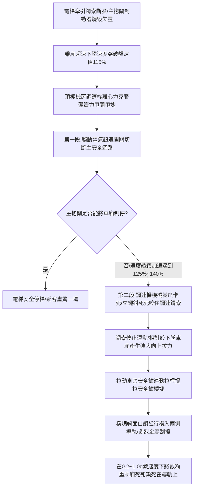

# 全案購屋實戰第八百八十九部：中古大樓社區電梯調速機夾繩鉗磨損飛塊離心彈簧疲勞失準與超速溜梯下墜安全鉗制動體檢工序全書

## 壹、編撰宗旨與垂直昇降被動安全終極防線

在現代高層集合住宅大樓（特別是屋齡 20 年至 35 年以上之中大型中古社區，例如台中南區的大安紫金城、長億南園、歌德堡、工學天下、靜園等）的垂直交通體系中，電梯是維繫全棟住戶每日出入起居、長輩孩童行動自由無可替代的垂直生命線。

然而，電梯本質上是一座被鋼索懸吊於數十米至上百米深邃垂直井道中的「懸空載人箱體」。若因主機牽引鋼索打滑斷股、蝸輪蝸桿減速箱斷齒、主抱閘制動器（Main Brake）電磁線圈燒毀或機械卡阻，導致乘廂失去牽引控制而發生「向下自由落體墜落（Free Fall）」或「向上失控衝頂（Uncontrolled Upward Movement）」時，能夠在毫秒之間拯救整車乘客生命、避免粉身碎骨慘劇的「最後一道機械被動救命防線」，正是「調速機（Overspeed Governor）與安全鉗（Safety Gear）連動制動系統」。

依據 CNS 10594（電梯製造與安裝安全規範）及國際 EN 81 標準，當電梯運行速度超過額定速度之 **$115\%$** 時，調速機必須依序觸發「電氣安全開關切斷主電源」與「機械夾繩鉗死死咬住調速鋼索」，進而拉動車廂下方的安全鉗楔塊，在數十公分距離內將整座數噸重的車廂強行楔死在兩側堅硬的垂直導軌（Guide Rails）上！

然而，在中古大樓長達數十年的維運盲區中，調速機與安全鉗長態潛伏著三大致命隱形病變：
1. **調速機離心甩塊（Flyweights）回位彈簧金屬蠕變疲勞，或轉軸軸銷被粉塵油泥黏滯**，導致調速機整定動作速度嚴重漂移，電梯在高速失控時「調速機拒動」，無法及時觸發安全保護；
2. **調速機鋼製夾繩鉗（Rope Gripper / Jaw）表面受調速鋼索數十年摩擦磨損，齒槽磨平磨光**，當機構觸發時，夾繩鉗無法提供足夠的靜摩擦夾緊力（Grip Force），調速鋼索在鉗口中滑脫打滑，根本無法拉動車底沉重的安全鉗拉桿；
3. **安全鉗楔塊（Safety Wedge）長年暴露於井道油垢水氣中，表面生鏽黏死在導靴座內部**，或楔塊與導軌工作面間隙失調，即使鋼索提拉，楔塊亦無法咬入導軌，整座車廂如同無煞車的鐵棺材直墜底坑！

本手冊針對中古社區電梯調速機、調速鋼索、安全鉗連動機構及導軌摩擦制動體系，深入解剖離心動力學、楔形斜面自鎖力學、超速落體減速度分析與現場實務體檢工序，為購屋家庭與管委會建立固若金湯的垂直昇降終極生命屏障。

---

## 貳、調速機與安全鉗連鎖力學架構與摩擦制動物理機制

### 一、離心式調速機物理動力學方程式
調速機通常安裝於電梯頂部機房或無機房井道頂端，其轉輪由封閉循環的調速鋼索（Governor Rope）驅動，轉輪旋轉角速度 $\omega$ 與車廂線速度 $v$ 嚴格成正比（$v = \omega \cdot R$）：
1. **離心力與回位彈簧力平衡方程**：
   調速機內部對稱配置一對質量為 $m$ 的離心甩塊，質心迴轉半徑為 $r$。當轉輪旋轉時，甩塊承受向外的離心力：
   $$F_{\text{centrifugal}} = m \cdot r \cdot \omega^2 = m \cdot r \cdot \left(\frac{v}{R}\right)^2$$
   阻止甩塊向外甩開的，是一組經過精準標定校準的精密螺旋回位彈簧力：
   $$F_{\text{spring}} = k \cdot (x_0 + \Delta x)$$
2. **雙段階梯式動作特性**：
   - **第一段：電氣超速保護（$115\%$ 額定速度）**：
     當電梯速度達到 $v_1 = 1.15 \ V_{\text{nominal}}$ 時，離心力克服第一級彈簧預緊力，甩塊向外張開觸動微動極限安全開關，切斷控制迴路接觸器電源，電梯主抱閘失電抱死進行常規煞車；
   - **第二段：機械夾繩安全鉗觸發（$125\% \sim 140\%$ 額定速度）**：
     若主抱閘失效車廂持續失控加速達到 $v_2$，甩塊進一步完全甩開，棘爪卡入外圈棘輪，釋放重載機械夾繩鉗，以極大夾緊力咬死調速鋼索。

### 二、漸進式安全鉗（Progressive Safety Gear）斜面自鎖力學
對於額定速度 $V > 0.63\text{ m/s}$ 的乘客電梯，法規強制要求採用「漸進式安全鉗（耗能滑動型）」，嚴禁使用瞬時式安全鉗（防止衝擊力過大折斷乘客頸椎）：
1. **楔形自鎖條件（Self-locking Condition）**：
   安全鉗楔塊與導軌接觸面傾角為 $\alpha$。當安全鉗拉桿向上提拉時，楔塊被帶入導靴與導軌工作面之間的錐形狹縫中。為保證楔塊能被自動吸入夾緊，傾角 $\alpha$ 必須滿足摩擦角自鎖條件：
   $$\tan \alpha < \mu_1 + \mu_2$$
   其中 $\mu_1, \mu_2$ 分別為楔塊兩側之摩擦係數。
2. **碟形彈簧恆定夾緊力與平均減速度**：
   漸進式安全鉗背面配置一組重載碟形彈簧（Belleville Springs）。當楔塊楔入後，碟簧被壓縮產生恆定彈性法向力 $F_N$。兩側產生的總摩擦制動力為：
   $$F_{\text{brake}} = 2 \times \mu \times F_N$$
   依據 CNS 10594 標準，在額定載重與自由落體狀態下，安全鉗制動過程之平均減速度 $a$ 必須嚴格限制在：
   $$0.2\,g \le a \le 1.0\,g \quad (1.96\text{ m/s}^2 \le a \le 9.8\text{ m/s}^2)$$
   此受控的減速度既能保證在數十公分滑動行程內平穩停梯，又絕不致使人體承受超過 $1\,g$ 的極限制動衝擊。

---

## 參、中古社區電梯調速機與安全鉗三大核心病徵與失靈成因

### 一、調速機離心彈簧疲勞蠕變與整定動作速度漂移
1. **彈簧金屬蠕變失準**：頂樓電梯機房常年西曬高溫（夏季常達 $45^\circ\text{C}$ 以上）。調速機螺旋彈簧在長達數十年的微振與熱應力下產生金屬晶界蠕變，彈性係數 $k$ 衰減。
2. **超速拒動或頻繁誤動作**：整定動作速度若向上漂移過高（例如原本 105m/min 漂移至 160m/min 才能動作），電梯在超速下墜時調速機形同虛設；若整定速度向下漂移，電梯正常全速運行時調速機突發誤鎖死，將整車乘客狠狠頓煞在半空中。

### 二、夾繩鉗齒面磨光與調速鋼索滑脫（拉力不足）
1. **夾繩鉗齒紋磨損**：調速機夾繩鉗為硬質合金鋼製成，表面刻有防滑細齒。在數十年間歷次維保試車或誤動作中，高速運動的調速鋼索在鉗口中滑擦，將鉗口齒紋磨光磨平。
2. **提拉力跌破臨界值**：依據法規，調速機夾繩鉗咬合後，所產生的拉拔力（Tension Force）必須**至少大於安全鉗動作所需提拉力的 2 倍，且絕對不得小於 $300\text{ N}$（約 30 kgf）**。磨平的鉗口夾緊力急劇暴跌至 100 N 以下，鋼索在鉗口中瘋狂打滑拉不出火花，車底安全鉗根本無法被拉起！

### 三、安全鉗楔塊油泥鏽死與導軌間隙失調
1. **井道油泥與鐵鏽膠結**：電梯導軌長年塗抹機械潤滑油，油滴與空氣中的水泥粉塵混合，在車底安全鉗座內部堆積硬化成厚厚的油泥黑垢。楔塊被牢牢黏滯在原位，即使上方拉桿受力，彈簧亦無法將楔塊頂起咬合。
2. **楔塊與導軌工作面間隙超標**：正常狀態下，安全鉗兩側楔塊與電梯導軌工作面的單側間隙應維持在 **$2.0 \sim 3.0\text{ mm}$**。若間隙因導靴磨損擴大至 $6\text{ mm}$ 以上，楔塊升至最高行程頂點仍無法接觸夾緊導軌，安全鉗徹底喪失制動功能。

---

## 肆、調速機與安全鉗系統標準體檢工序

### 一、調速機離心動作速度精密儀表校驗工序
1. **調速鋼索脫開與專用驅動校驗儀接入**：
   - 切斷電梯主電源並進行 LOTO 安全掛鎖。
   - 將調速鋼索自調速機輪槽中取下並牢固固定。
   - 採用可調速手持式「電梯調速機測試儀（驅動橡膠摩擦輪配備高精度雷射光電轉速計）」，貼合調速機輪緣。
2. **雙段動作轉速測定與紀錄**：
   - 驅動測試儀由低速平穩升速：
     - **電氣超速開關動作速度 $V_1$ 測定**：觀察數位轉速表，當聽到微動開關跳脫聲且指針斷路瞬間，記錄線速度 $V_1$，合格標準必須落在 **$115\% \ V_{\text{nominal}} \pm 5\%$** 之內；
     - **機械夾繩鉗落鎖速度 $V_2$ 測定**：繼續平穩升速，直至調速機內部棘爪咬死、夾繩鉗迅猛落鎖瞬間，記錄線速度 $V_2$。合格標準必須落在 **$125\% \sim 140\% \ V_{\text{nominal}}$** 之內。
   - 若動作速度超出法規公差帶，必須透過調速機原廠標定螺栓調整彈簧預緊力，或全組更換已標定新品。

### 二、調速機夾繩鉗夾緊拉拔力（Tension Test）實測工序
1. **拉力計（Dynamometer）串接測試**：
   - 手動觸動調速機使其處於機械夾繩鎖死狀態。
   - 在調速機下方的調速鋼索上夾附專用鋼索緊線夾，串接一只量程 0~2000 N 之高精度數位拉力計。
2. **靜態拉拔力判定標準**：
   - 使用手動鏈條吊車向下勻速施加拉力，直至鋼索在調速機鉗口中開始產生相對滑移。
   - 讀取滑移瞬間之峰值拉力值 $F_{\text{pull}}$：
     - **合格標準**：實測夾拔力必須 **$\ge 2 \times F_{\text{safety\_gear}}$ 且絕對 $\ge 300\text{ N}$**（通常中高速梯要求達到 **$800 \sim 1200\text{ N}$**）。若拉力小於 500 N 鋼索即打滑，必須立即更換夾繩鉗塊。

### 三、安全鉗空載與實載聯動制動試驗（Safety Gear Drop Test）
1. **安全鉗楔塊自由活動度檢驗**：
   - 維護人員進入電梯底坑，使用手動拉桿直接向上提拉安全鉗連動機構。
   - 觀察兩側楔塊動作：楔塊必須能在滑槽內**毫無卡阻地平順向上滑動**，左右兩側楔塊動作必須**絕對同步**；鬆手後依靠復位彈簧應在 $0.2\text{ 秒}$ 內瞬間彈回原位。
2. **檢修速度聯動咬合試驗**：
   - 乘廂內空載，以檢修速度（約 $0.25 \sim 0.3\text{ m/s}$）向下行駛。
   - 在機房手動觸發調速機夾繩機構：
     - **合格標準**：安全鉗必須立即動作將車廂牢固咬死在兩側導軌上，曳引輪在牽引鋼索上打滑空轉，馬達安全電氣迴路立即斷開；
     - 檢查導軌工作面：兩側咬痕深淺必須均勻對稱，咬痕長度通常在 **$30 \sim 80\text{ mm}$ 之內**，車廂水平傾斜度不得大於 $5/1000$。

---

## 伍、購屋避坑指南與管委會整改預算表

### 一、買方看屋電梯主動與被動安全查核 4 訣
1. **查核電梯機房年度安全檢驗標籤與調速機封印**：
   - 走訪電梯機房（或請管委會出示報告），檢視調速機本體鉛封（Lead Seal）是否完好無損。鉛封若被私自拆開或調速機彈簧長滿厚鐵鏽，代表未經專業機構標定校準。
   - 確認主管機關核發之「電梯使用許可證」是否在一年有效期限內。
2. **走進電梯車廂體驗急停制動體感**：
   - 搭乘電梯時，感受加速、等速與減速全過程有無劇烈水平晃動或金屬刮擦異音。若平層停止瞬間有如金屬打滑般的下沉感，代表主抱閘或導軌間隙存在潛在隱患。
3. **查閱電梯維保紀錄單中「安全鉗試驗」簽認欄**：
   - 依據法規，電梯每三年必須進行一次載重安全鉗制動試驗。向管理室調閱近三年紀錄，確認維保公司是否有確實執行該項檢驗，而非長年「只勾選、不做試驗」。
4. **檢查井道導軌潤滑油質與清潔度**：
   - 透過電梯車廂頂部或乘場門隙縫觀察垂直鋼製 T 型導軌。導軌工作面應塗抹清澈專用導軌油；若導軌兩側堆積如黑色瀝青般的乾燥油垢與金屬屑，代表安全鉗隨時可能因油泥而卡阻失效。

### 二、電梯調速機與安全鉗系統專項整改預算參考清單

| 維修／改善工程項目 | 技術規範與標準工法 | 預算區間（每台／每梯） | 安全重要度等級 |
| :--- | :--- | :--- | :--- |
| **電梯調速機離心動作速度現場精密儀表校驗** | 專業測試儀校準電氣超速與機械夾繩雙段速度 | 6,500 ~ 12,000 元／台 | 法定極高（三年必檢） |
| **全組汰換符合 CNS 認證進口/一線調速機總成** | 包含全新鉛封標定調速機、夾繩鉗與電氣開關 | 28,000 ~ 45,000 元／組 | 極高（速度漂移必換） |
| **全線更換全新專用鋼心調速鋼索（Governor Rope）** | 8mm 6×19S+FC 電梯專用高強度抗旋轉鋼索 | 8,500 ~ 15,000 元／梯 | 高度（磨損斷股必換） |
| **車底漸進式安全鉗拆解大修、除泥與彈簧換新** | 楔塊超音波除泥清洗 + 碟形彈簧全組更換與校準 | 18,000 ~ 32,000 元／座 | 極高（消除卡死隱患） |
| **電梯井道 T 型導軌全線校直、打磨與除垢保養** | 導軌接頭平整度校正（$<0.05\text{mm}$） + 清洗換油 | 15,000 ~ 25,000 元／梯 | 中度 |
| **加裝電梯防非正常移動（UCMP）雙向雙重保護** | 符合最新法規要求之防開門溜梯夾人安全裝置 | 45,000 ~ 85,000 元／梯 | 終極推薦（徹底消除溜梯） |

---

## 陸、本案結語

在垂直穿梭於高空中的每一秒鐘，全車乘客的生命安全，完全託付給這套隱匿於機房與車底的「調速機與安全鉗連動系統」。它是電梯遭遇極限機械崩潰時，唯一的被動救命降落傘；夾繩鉗的每一次死死咬合、安全鉗楔塊的每一次剛性切入，都是在千鈞一髮之際挽救數條寶貴生命的終極力量。

購屋家庭在評估中古集合住宅時，切不可被鏡面車廂與液晶面板的表象所迷惑，務必以嚴苛的工程標準查核調速機的標定速度與安全鉗的制動靈敏度。唯有確保這道最後防線隨時能爆發出強悍的剎車咬合力，才能讓家人在每日的每一次升降起居中，享有真正固若金湯、安如泰山的生命安全庇護！
