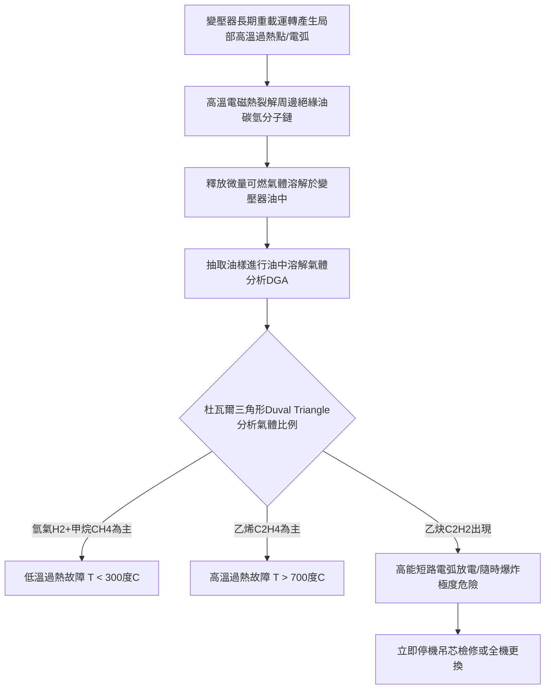

# 全案購屋實戰第八百八十二部：中古大樓社區地下室高低壓配電室油浸式變壓器絕緣油酸價超標擊穿電壓崩跌氣相色譜總可燃氣體分析與內部局部放電高溫爆炸體檢工序全書

## 壹、編撰宗旨與重電心臟終極毀滅性災難防線

在台灣都會區集合住宅大樓（特別是屋齡 20 年至 35 年以上之中大型中古社區，例如台中南區的大安紫金城、長億南園、歌德堡、工學天下、靜園等）的供電架構中，「變壓器（Power Transformer）」是整座大樓電力供應體系無可替代的「降壓能量心臟」。

台電高壓配電網輸入的 $11.4\text{ kV}$ 或 $22.8\text{ kV}$ 交流高壓電，全賴設置於地下變電室內的高壓變壓器組，透過電磁感應連續降壓為適合大樓公共設施與各住戶室內使用的 $3\phi 4W \ 380\text{V} / 220\text{V}$（動力用電）及 $1\phi 3W \ 220\text{V} / 110\text{V}$（一般照明插座用電）。

早期（民國 75 年至 90 年代建造）之大型集合住宅，受限於當時材料技術與建造成本，高達 $80\%$ 以上普遍採用「油浸式變壓器（Oil-immersed Transformer）」。數百公斤至數千公斤的礦物絕緣油（Mineral Insulating Oil），長年密封於變壓器油箱內部，同時擔當「強電氣絕緣」與「高效率循環散熱冷卻」兩大核心使命。

然而，在中古大樓長達 20 至 35 年的封閉高溫地下室運轉中，油浸式變壓器正經歷著無可逆轉的物理與化學衰退：
1. **絕緣油受長年高溫、殘存微量水分、溶解氧及電磁場催化，發生深度熱氧化裂解，生成有機酸、過氧化物與固態油泥（Sludge）**。絕緣油酸價（Acid Value）嚴重超標，導致油介質擊穿電壓（Breakdown Voltage, BDV）斷崖式崩跌；
2. **高壓繞組匝間絕緣牛皮紙（Kraft Paper）受高酸性油泥浸潤腐蝕，纖維素聚合度（DP）大幅劣化**，在突發短路電動力衝擊下脆化粉碎，引發繞組匝間短路（Turn-to-turn Fault）；
3. **更具毀滅性的是，內部微弱的局部放電（Partial Discharge）或局部過熱，會將碳氫化合物絕緣油高溫裂解為氫氣（$\text{H}_2$）、甲烷（$\text{CH}_4$）、乙烷（$\text{C}_2\text{H}_6$）、乙烯（$\text{C}_2\text{H}_4$）以及極度危險的乙炔（$\text{C}_2\text{H}_2$）等「可燃性氣體」**。當氣體累積壓力突破油箱極限，或突發高能量短路電弧點燃油氣混合物時，高達數千度的高溫燃油混合高壓氣體將瞬間引發「油浸變壓器大爆炸與猛烈火災」，狂暴的火浪與有毒黑煙將沿垂直電纜管道間直衝全棟住宅，造成無可挽回的滅頂浩劫！

本手冊針對中古社區油浸式變壓器，詳解絕緣油熱氧化動力學、油中溶解氣體分析（DGA, Dissolved Gas Analysis）診斷準則、絕緣油耐壓擊穿試驗及微水含量檢測，並制定一套高標準之全流程現場體檢與維護工序，為購屋家庭與管委會建立固若金湯的重電機電生命防線。

---

## 貳、絕緣油電氣熱力學特性與氣相色譜 DGA 診斷物理機制

### 一、絕緣油介電擊穿力學與酸價劣化反應
油浸式變壓器通常灌裝符合 IEC 60296 或 CNS 2320 規範之環烷基（Naphthenic）未加抑制劑或加抑制劑礦物絕緣油：
1. **擊穿電壓（Breakdown Voltage, BDV）與油隙雜質電極力學**：
   在均勻交變電場作用下，純淨絕緣油之介電強度取決於油分子的電離能量。但當油中混入微量水分、碳粒或游離金屬粉塵時，雜質在高電場中被強烈極化並沿電力線排列成「高導電度小橋（Conductive Bridge）」。當電場強度超過臨界值時，小橋局部放電引發熱氣泡，引發雪崩式介質電氣擊穿：
   $$E_{\text{breakdown}} = \frac{V_{\text{BDV}}}{d_{\text{gap}}}$$
   - **優良新油**：標準球蓋電極間距 $2.5\text{ mm}$ 下，擊穿電壓 $V_{\text{BDV}} \ge 40 \sim 50\text{ kV}$；
   - **劣變老油**：當微水含量超過 $35\text{ ppm}$ 且酸價偏高時，擊穿電壓斷崖式跌破 $20\text{ kV}$，遠低於運行安全門檻。
2. **絕緣油熱氧化酸價生成化學反應**：
   在高溫與銅金屬催化下，碳氫化合物分子與微量溶解氧反應生成過氧化自由基（$\text{ROO}\cdot$），進一步鏈式反應轉化為有機酸、醇、醛類物質：
   $$\text{R-H} + \text{O}_2 \xrightarrow{\text{Cu, 熱}} \text{R}\cdot + \cdot\text{OOH} \longrightarrow \text{R-COOH (低分子脂肪酸)}$$
   酸價（中和 1 克絕緣油中游離酸所需氫氧化鉀 $\text{KOH}$ 之毫克數，單位 $\text{mg KOH/g}$）隨運轉年份呈指數級上升。高酸價絕緣油不僅腐蝕金屬油箱內壁，更會直接化學水解變壓器紙絕緣層。

### 二、油中溶解氣體分析（DGA）與杜瓦爾三角形（Duval Triangle）診斷
內部微小潛伏性故障產生的熱量與電弧能量，將絕緣油分子裂解為不同特徵氣體：
1. **主要故障特徵氣體分佈**：
   - **氫氣（$\text{H}_2$）**：通常伴隨局部放電（Partial Discharge）或電暈；
   - **甲烷（$\text{CH}_4$）、乙烷（$\text{C}_2\text{H}_6$）**：中低溫熱裂解（$150^\circ\text{C} \sim 300^\circ\text{C}$）；
   - **乙烯（$\text{C}_2\text{H}_4$）**：高溫過熱（$>700^\circ\text{C}$，通常發生在分接開關或鐵芯接地不良處）；
   - **乙炔（$\text{C}_2\text{H}_2$）**：高能量電弧放電（Arcing Fault，電弧溫度超過 $1,000^\circ\text{C}$，金屬熔化時唯一特徵氣體）；
   - **一氧化碳（$\text{CO}$）、二氧化碳（$\text{CO}_2$）**：固態纖維絕緣紙熱老化降解。
2. **總可燃氣體（Total Combustible Gas, TCG）標準準則**：
   依據 IEEE C57.104 國際診斷規範：
   $$\text{TCG} = [\text{H}_2] + [\text{CH}_4] + [\text{C}_2\text{H}_6] + [\text{C}_2\text{H}_4] + [\text{C}_2\text{H}_2] + [\text{CO}]$$
   - **狀態 1（正常）**：$\text{TCG} \le 720\text{ ppm}$，乙炔 $[\text{C}_2\text{H}_2] < 1\text{ ppm}$；
   - **狀態 4（極度危險）**：$\text{TCG} > 4630\text{ ppm}$，或乙炔 $[\text{C}_2\text{H}_2] \ge 35\text{ ppm}$，代表內部正持續發生高能火花放電，必須立即緊急停電隔離，嚴防爆炸！

---

## 參、中古社區油浸變壓器三大核心病徵與失靈成因

### 一、絕緣油酸價超標、深色泥化與紙絕緣聚合度崩潰
1. **油泥沉積引發散熱惡性循環**：當酸價超過 $0.20\text{ mg KOH/g}$ 時，絕緣油開始析出不溶性黑褐色膠狀油泥。油泥沉積並黏附於散熱散熱鰭片與繞組油道內部，阻礙熱對流交換，導致變壓器溫升進一步失控上升，加速油紙老化。
2. **絕緣紙聚合度（DP）斷裂與匝間擊穿**：變壓器線圈所包覆之絕緣牛皮紙，其原始纖維素平均聚合度 $\text{DP} \approx 1000 \sim 1200$。在酸性油泥與高溫水氣侵蝕下，纖維素大分子水解斷鏈。當 $\text{DP}$ 跌破 **$200$** 時，絕緣紙完全喪失機械抗張強度，如燒焦的脆餅般脆裂脫落，導線裸露直接引發高壓相間爆裂短路。

### 二、油箱密封膠墊硬化微漏油與微水受潮入侵
1. **丁腈橡膠（NBR）油封硬化開裂**：油箱頂蓋法蘭、高低壓絕緣套管（Bushing）根部及放油閥門之橡膠密封圈，在 20 多年高溫烘烤與酸性油接觸下，發生交聯硬化（邵氏硬度由 60 度飆至 90 度以上）並龜裂。
2. **大氣呼吸效應吸入凝結水**：非全密封型油浸變壓器（配有吸濕呼吸器 Conservator 者），其吸濕矽膠早已變色失效（粉紅或飽和白）。當變壓器負載波動溫度升降時，冷卻時將地下室高達 $85\%$ 濕度的潮濕空氣吸入油箱，水氣在油面冷凝沉入油底，使絕緣油耐壓強度瞬間崩解。

### 三、多氯聯苯（PCB）劇毒致癌殘留歷史遺毒
民國 70 年代以前製造之部分老舊變壓器，曾廣泛使用不燃性多氯聯苯（PCB, Aroclor）作為絕緣液。依據我國《毒性及關注化學物質管理法》，絕緣油中 PCB 含量**絕對不得大於 $50\text{ ppm}$**。若中古大樓從未進行 PCB 專項送檢，其內部可能仍殘留此等戴奧辛同級劇毒致癌物，一旦發生火災燃燒將釋放高毒戴奧辛氣體，整棟大樓將遭衛生環保機關永久封閉！

---

## 肆、油浸變壓器全流程標準體檢與油品取樣工序

### 一、帶電紅外線熱成像（Thermography）巡檢工序
1. **免停電無損熱像掃描**：
   - 使用校正合格的高解析度紅外線熱像儀（解析度 $\ge 320\times 240$，熱靈敏度 $\le 0.05^\circ\text{C}$）。
   - 在社區用電尖峰時段（例如晚間 19:00~21:30），掃描變壓器整體外觀。
2. **溫度場異常判定**：
   - **高低壓絕緣套管樁頭**：三相接線端子溫差 $\Delta T$ 不得大於 **$5^\circ\text{C}$**；若單相樁頭溫度超過 $85^\circ\text{C}$ 且溫差達 $15^\circ\text{C}$ 以上，代表內部引出線夾接觸電阻過高。
   - **散熱鰭片對流分佈**：正常狀態下油箱自上而下應呈現平順降溫梯度；若個別散熱管呈現異常低溫，代表該管已被固態油泥完全淤塞，失去冷卻循環功能。

### 二、專用注射器真空取樣與理化性能檢測工序
1. **標準取樣作業規範（IEC 60567 / ASTM D923）**：
   - 佩戴防護眼鏡與耐油丁腈手套。
   - 旋開變壓器底部專用採樣放油閥，先排放並廢棄約 $1 \sim 2\text{ 公升}$ 底層死油與沉澱物。
   - 使用氣密性全玻璃磨砂專用注射器（$50\text{ mL}$）或不銹鋼雙閥採樣瓶，在完全隔絕空氣的狀態下平穩抽取油樣，嚴防氣泡進入。
2. **理化關鍵參數實驗室檢驗標準**：
   - **介電擊穿電壓（BDV, IEC 60156）**：施加工頻交流電壓以 $2\text{ kV/s}$ 勻速升壓直至擊穿，連續測試 6 次取平均值。**標準判定**：運行中 11.4kV 變壓器油擊穿電壓必須 **$\ge 30\text{ kV}$**；若 $< 25\text{ kV}$ 判定為不合格。
   - **酸價量測（Neutralization Number）**：**標準判定**：運轉中油酸價必須 **$\le 0.15\text{ mg KOH/g}$**；若 $> 0.20\text{ mg KOH/g}$ 必須進行換油或油再生過濾。
   - **微水含量（Karl Fischer Titration, 卡爾費休滴定）**：標準判定必須 **$\le 25\text{ ppm}$**（$25\text{ mg/L}$）。
   - **界面張力（IFT, Interfacial Tension）**：反映油泥生成傾向，標準值應 **$\ge 25\text{ mN/m}$**。

### 三、油中溶解氣體分析（DGA）氣相色譜法
1. **實驗室氣相色譜儀（GC）全成分測定**：
   - 萃取油中溶解氣體，測定 $\text{H}_2, \text{CH}_4, \text{C}_2\text{H}_6, \text{C}_2\text{H}_4, \text{C}_2\text{H}_2, \text{CO}, \text{CO}_2$ 各組分濃度（ppm）。
2. **多重故障比值法診斷（IEC 60599 / 杜瓦爾三角形）**：
   - 若乙炔 $[\text{C}_2\text{H}_2] > 2\text{ ppm}$，或總可燃氣體 $\text{TCG} > 1500\text{ ppm}$ 且增長速率超過 $10\text{ ppm/天}$，系統立即標定為「**內部嚴重放電性異常**」，必須列入一週內停電檢修汰換。

---

## 伍、購屋避坑指南與管委會整改預算表

### 一、買方地下室變電設備查核關鍵 4 訣
1. **查看變壓器油箱外觀與底部接油槽**：
   - 走入變電室，檢視油浸變壓器底部是否有嚴重油漬油泥流淌痕跡。法定規範油浸變壓器下方必須設有「**防溢接油托盤或事故排油防護卵石溝**」，以防止數百公升燃油外洩擴大火災。若地面黑油遍布且無任何防護措施，安全隱患極大。
2. **查核油位計（Oil Level Gauge）指針位置**：
   - 觀察變壓器頂部玻璃油位表，指針應精準對應環境溫度標線（通常在 $25^\circ\text{C}$ 刻度區間）。若油位已跌破「最低警戒線（MIN）」，代表油封已長期漏油，繞組頂部隨時有暴露於空氣中產生高壓擊穿的極端危險！
3. **查閱大樓社區「油浸變壓器定期油品試驗檢驗報告」**：
   - 向管委會調閱近 2 年之電機技師定期檢驗紀錄，確認報告中是否有「耐壓試驗（BDV）」、「酸價」與「DGA 色譜分析」數據。若報告僅勾選外觀正常而無任何油品化驗報告，代表管委會長期省事敷衍。
4. **確認是否為「非 PCB 變壓器（PCB-Free）」確認標籤**：
   - 檢視變壓器銘牌四周有無張貼環保局認證之「非多氯聯苯設備合格綠色標籤」。未送檢合格之老舊變壓器，隨時面臨環保機關裁罰百萬元與限期強制拆除之高額公設支出。

### 二、油浸變壓器系統專項維修更新預算參考清單

| 維修／改善工程項目 | 技術規範與標準工法 | 預算區間（每台／每座） | 安全重要度等級 |
| :--- | :--- | :--- | :--- |
| **絕緣油全項目實驗室檢驗分析（含 DGA/耐壓/酸價）** | 專業實驗室氣相色譜分析 + 卡爾費休微水滴定 | 6,500 ~ 12,000 元／次 | 法定極高（每1~2年必做） |
| **真空高溫濾油脫氣除水與油泥清洗工程** | 移動式雙級高真空濾油機現場循環過濾脫水 | 25,000 ~ 45,000 元／台 | 極高（耐壓偏低必做） |
| **全機絕緣油全面抽換全新未用環烷基油** | 依容量灌注 500~1500 公升全新未加抑制劑絕緣油 | 45,000 ~ 85,000 元／台 | 極高（酸價超標必換） |
| **油箱全密封耐高溫耐油膠墊組全面更換** | 氟橡膠（FKM/Viton）或優質耐油丁腈密封墊 | 18,000 ~ 32,000 元／台 | 高度（根治滲漏油） |
| **汰舊換新為現代高安全「乾式模鑄變壓器（Cast Resin）」** | 100kVA~300kVA 阻燃F級/H級環氧樹脂模鑄新品 | 180,000 ~ 350,000 元／台 | 治本根除（消除火災爆炸） |
| **高壓套管（Bushing）及無激磁分接開關大修** | 24kV 級純瓷或複合絕緣高壓套管組換新 | 35,000 ~ 60,000 元／組 | 極高 |

---

## 陸、本案結語

油浸式變壓器是整座社區大樓最沉默、卻也最致命的龐然大物。數百公升滾燙的絕緣油，在地下室的幽暗深處日夜奔流。如果說電力是大樓的生命血液，那麼這座重電心臟的油品健康，就直接決定了整座社區數百戶家庭的生死安危。

購屋家庭在審視中古大樓物件時，切不可因變電室深鎖就略過這道至關重要的公設體檢。親自查閱絕緣油耐壓報告、確認油中溶解氣體指標，方能為珍貴的家庭資產築起最堅固的防火防爆金盾，確保家園世代祥和、歲月靜好！
