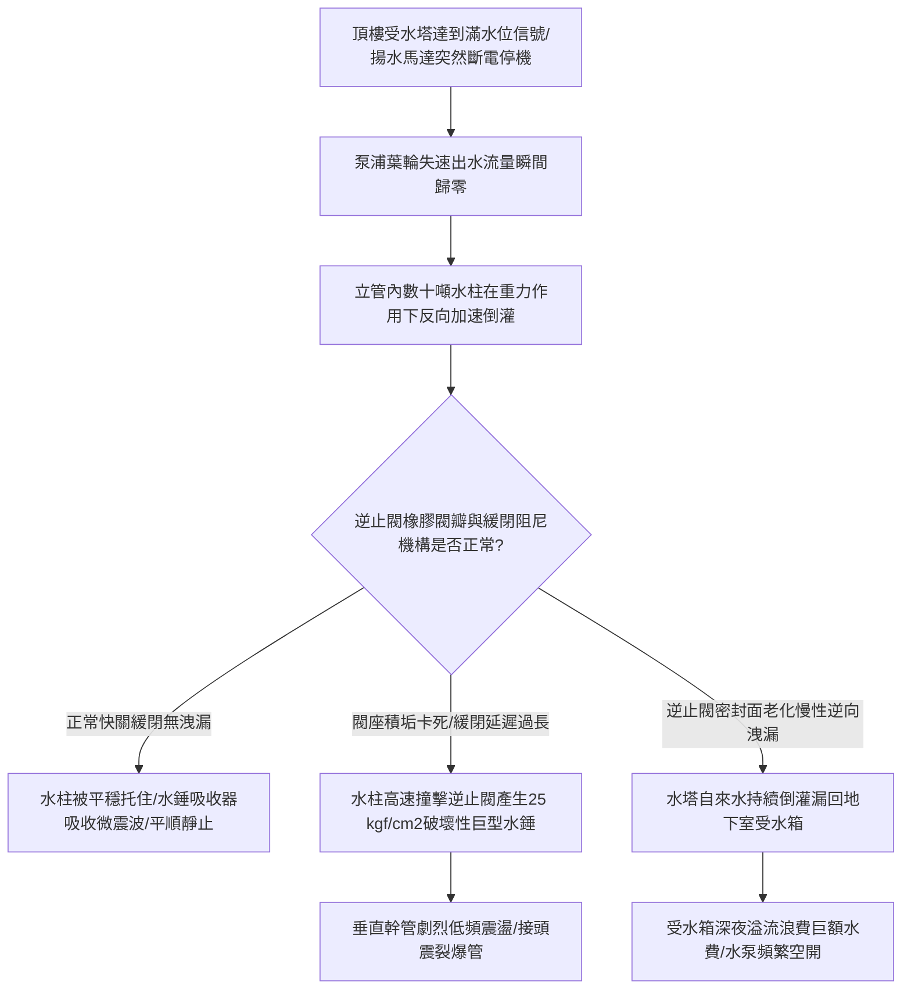

# 全案購屋實戰第八百八十六部：中古大樓社區地下室生活自來水雙泵揚水系統止回閥逆向洩漏低頻水錘震盪雙泵自動交替控制器故障與高樓層水塔溢流體檢工序全書

## 壹、編撰宗旨與垂直水柱重力破壞力學

在現代都會高層集合住宅大樓（特別是屋齡 20 年至 35 年以上之中古大樓，如台中南區的大安紫金城、長億南園、歌德堡、工學天下、靜園等）的重力給水體系中，整棟建築日常數百人生命之所繫，全靠地下室揚水泵浦將生活自來水自底層受水箱克服數十米至上百米的垂直落差，加壓揚送至大樓頂樓水塔。

在此垂直給水管網中，當揚水馬達全速運轉時，揚水垂直立管內充滿著由下而上高速流動的水柱；而一旦頂樓水滿停機瞬間，垂直管道內高達數十噸的懸空水體，將在地球重力加速度（$g = 9.8\text{ m/s}^2$）牽引下以極高動量瞬間倒灌回流。

負責抵擋這股龐大回流水柱重力、保護底層揚水泵浦免遭逆轉摧毀的關鍵機械屏障，正是安裝於泵浦出水端之「揚水系統專用緩閉逆止閥（Check Valve）」。

然而，在中古大樓長達數十年的頻繁啟停與水垢沖刷下，此系統長態潛伏著三大致命破壞病徵：
1. **逆止閥橡膠閥瓣（Rubber Disc）老化硬化、銅閥座被泥沙水垢刮傷，或緩閉阻尼缸活塞漏油卡死**，在停泵瞬間無法嚴密逆止，產生極端破壞性的「回流水錘波（Water Hammer Surge）」，震盪波沿管道間劇烈傳遞，引發全棟低頻金屬撞擊爆震，並震裂管線接頭；
2. **逆止閥逆向持續慢性洩漏（Reverse Leakage）**，停泵期間頂樓水塔的珍貴自來水沿垂直立管不斷倒灌漏回地下室受水箱，引發受水箱滿溢，地下室常年浪費巨額水費；
3. **雙泵自動交替控制器內部邏輯混亂或固態繼電器穿孔短路**，引發雙泵同時啟動或高水位停泵信號無效，造成頂樓水塔狂流溢流、水漫電梯機房與頂樓各戶。

本手冊針對中古社區地下室生活揚水管網逆止閥組、雙泵交替控制盤、水錘消減機制及頂樓防溢流體系，深入解剖水錘非定常流動力學、閥座洩漏流力特性與現場實戰體檢工序，為購屋家庭與管委會建立固若金湯的垂直水理防禦線。

---

## 貳、揚水管網非定常流流體力學與水錘衝擊波物理機制

### 一、水柱分離與直接水錘衝擊力學
揚水泵浦將水送至高度為 $H$ 的屋頂水塔，出水立管靜態壓力即為 $P_0 = \rho g H$。當揚水馬達突然斷電停機時：
1. **水流減速與慣性斷流**：
   泵浦葉輪轉速驟降，出口水流在自身強大動量慣性下繼續向上運動，在泵浦出口處形成極低壓的「負壓區（Negative Pressure Zone）」。若局部壓力低於自來水的飽和蒸汽壓（$P_{\text{vap}} \approx 2.34\text{ kPa}$ 於 $20^\circ\text{C}$），水體內部將發生汽化，形成「水柱分離（Water Column Separation）」。
2. **水柱再彌合與破壞性水錘壓峰（Joukowsky Equation）**：
   隨後，上方水柱因重力加速度停止上升並開始向下反向加速墜落，撞擊關閉遲緩的逆止閥瓣或與下端水體猛烈彌合（Rejoining）。依照流體彈性衝擊理論，產生的水錘增壓峰值為：
   $$\Delta P_{\text{hammer}} = \rho \cdot a \cdot \Delta v_r$$
   其中 $\rho$ 為水密度（$1000\text{ kg/m}^3$），$a$ 為壓力波在管壁中的傳播速度（約 $1000 \sim 1200\text{ m/s}$），$\Delta v_r$ 為水流逆向倒灌回流時與閥瓣碰撞的相對流速。
   - 若逆止閥無緩閉阻尼、延遲 1 秒關閉，倒流速度可達 $\Delta v_r = 2.0\text{ m/s}$；
   - 瞬態水錘衝擊增壓高達：
     $$\Delta P = 1000 \times 1000 \times 2.0 = 2.0\text{ MPa} \approx 20\text{ kgf/cm}^2$$
   - 疊加原本之靜態水壓 $P_0$（如 15 樓大樓約 $5\text{ kgf/cm}^2$），管網承受之瞬間破壞峰值壓力高達 **$25\text{ kgf/cm}^2$（約 2.5 MPa）**！此等超高壓震盪波會以音速在立管內劇烈來回震盪，直接將管路固定支架震斷、法蘭墊片震穿、甚至將鑄鐵閥體震裂！

### 二、靜音彈簧式逆止閥與微阻緩閉逆止閥構造差異
1. **靜音式彈簧逆止閥（Silent Check Valve）**：
   利用內置不銹鋼彈簧在水流流速降為零的「正向水流微停瞬間（Zero Flow Velocity）」提前推動閥瓣閉合，完全不給水柱產生反向倒流速度的機會，從物理根源上消除水錘。
2. **液壓微阻緩閉逆止閥（Slow-closing Hydraulic Check Valve）**：
   利用閥瓣連桿外接之小型油壓或水壓緩衝阻尼缸，閥瓣前 $80\%$ 行程快速閉合切斷大部水流，最後 $20\%$ 行程緩慢閉合（耗時 $3 \sim 8\text{ 秒}$），平緩釋放水錘波能量。

---

## 參、中古社區揚水系統三大核心病徵與失靈成因

### 一、逆止閥橡膠老化、水垢卡死與水錘管震
1. **碳酸鈣水垢夾渣與閥座點蝕**：中部地區高硬度水質在逆止閥密封環處沉積結垢，閥瓣無法達到 $100\%$ 平面貼合；大樓生鏽脫落的鐵渣卡在閥瓣轉軸處，使閥門動作卡頓遲緩。
2. **停泵劇烈金屬撞擊聲（Slamming）**：每次揚水泵停止時，地下室機房與低樓層住戶管道間傳出如重鎚砸擊金屬般的沉悶巨響「咚！咚！」，伴隨管道劇烈晃動，長期引發管壁疲勞撕裂。

### 二、逆向持續慢性洩漏（倒灌引發受水箱溢流）
1. **閥座密封面磨損微縫**：當兩台揚水泵浦互為備援時，若 1 號泵出水端的逆止閥存在微小洩漏，當 2 號泵運轉打水時，高壓水流有一部分會經由 1 號泵之逆止閥逆向短路漏回地下受水箱，導致實際送上頂樓的水量折損 $30\% \sim 50\%$。
2. **深夜無人用水時水錶自轉**：深夜所有住戶停止用水時，頂樓水塔存水順著洩漏的逆止閥不斷回流至地下室受水箱，受水箱浮球閥隨之溢流，形成水費無底洞。

### 三、雙泵自動交替控制器故障與高樓水塔溢流
1. **雙泵控制盤步進繼電器觸點熔焊或電子板死機**：受水箱或頂樓水塔的液位浮球訊號傳回控制盤時，若交替繼電器因觸點氧化卡死，可能引發「雙泵同時啟動」，造成立管水流超載激增；
2. **高水位停泵信號丟失**：若頂樓高水位極限電極棒或浮球開關線路斷線，控制盤未接收到停機指令，揚水泵浦將通宵達旦持續強打，數百公噸自來水自水塔通氣孔與溢流管瘋狂漫溢，水流淹沒頂樓住戶天花板並沿電梯昇降管道狂瀉，引發電梯電子基板全部泡水報廢！

---

## 肆、生活自來水揚水系統標準體檢工序

### 一、逆止閥密封氣密性與逆向洩漏停泵保壓測試
1. **系統保壓觀察法（免拆管無損體檢）**：
   - 啟動揚水泵將頂樓水塔打滿水，待泵浦自動停機。
   - 關閉揚水泵浦入口進水閘閥，保持出口逆止閥與立管相通。
   - 觀察泵浦出水端與逆止閥之間安裝之壓力表讀數：
     - **正常標準**：停機後壓力表指針應維持在靜態立管壓力（例如 10 樓高約 $3.5\text{ kgf/cm}^2$），**持續 15 分鐘指針完全不下降**。
     - **嚴重洩漏判定**：若停泵後壓力表指針在 3 分鐘內迅速跌落歸零，或在泵浦吸水側排氣閥（Air Vent）處有持續自來水噴出，代表**逆止閥閥瓣密封已徹底損壞或卡死**，正處於嚴重逆向漏水狀態！
2. **雙泵互洩短路測試**：
   - 保持 1 號泵停機狀態，啟動 2 號揚水泵運轉打水。
   - 用手觸摸 1 號泵的泵體與出口管路，若 1 號泵管道傳出強烈水流震動聲或管體發熱，代表 1 號逆止閥已失去逆止阻斷能力，2 號泵的高壓水正大量倒灌短路回地下室。

### 二、停泵水錘震盪波實測與緩閉阻尼校準
1. **動態水錘峰值壓力檢測**：
   - 在逆止閥前置與後置測壓孔接入「高頻數位壓力感測器（採樣頻率 $\ge 1\text{ kHz}$）」及數位示波器。
   - 操作揚水泵進行全載啟動與突然斷電停機。
   - **水錘峰值判定標準**：
     - 停泵瞬間之最高瞬態壓力增量 $\Delta P$ **絕對不得大於穩定工作壓力的 $1.3\text{ 倍}$**。
     - 管道晃動位移量必須小於 **$2.0\text{ mm}$**，且機房內不得聽到金屬敲擊聲（Slam）。
2. **液壓緩閉阻尼缸行程調校**：
   - 若為緩閉式逆止閥，調節阻尼缸下端之針閥開度螺栓：
   - 順時針旋轉增加阻尼（延長關閉時間，消除水錘）；逆時針旋轉加快關閉（防止過量倒流）。標準調節至閥瓣總關閉時間為 **$3 \sim 5\text{ 秒}$** 為最佳平衡點。

### 三、頂樓水塔防溢流三重保護連鎖驗收
1. **第一重：常規停泵水位浮球校驗**：
   - 爬上屋頂水塔，手動提起正常停泵浮球，確認地下室控制盤對應綠燈熄滅、揚水泵立即停機。
2. **第二重：高水位警報（High Level Alarm）浮球驗收**：
   - 手動提起位置稍高之第二道極限浮球，中控室與警衛室必須在 **$3\text{ 秒}$ 內響起蜂鳴警報**，且控制盤上紅色警示燈持續閃爍。
3. **第三重：物理溢流管（Overflow Pipe）暢通度與口徑查驗**：
   - 丈量溢流管管徑，必須**大於揚水管管徑至少一級（如揚水管 2.5"，溢流管必須為 3" 或 4"）**。
   - 檢查溢流管末端防蟲網無泥沙堵塞，排水動線直接導入屋頂雨水落水孔，嚴禁對著電梯機房外牆或通風百葉漫流。

---

## 伍、購屋避坑指南與管委會整改預算表

### 一、買方看屋垂直供水安全查核 4 訣
1. **實地走訪地下室揚水泵浦機房傾聽停泵聲響**：
   - 看屋時請房仲或管委會陪同進入地下室給水泵房，現場手動啟動揚水泵運轉 1 分鐘後按下停止鈕。
   - 親自聆聽停機瞬間機房內有無震耳欲聾的金屬重鎚爆震聲（「轟！咚！」）；若有強烈水錘震盪，代表逆止閥已嚴重老化失效。
2. **檢視屋頂水塔溢流管四周青苔與水漬痕跡**：
   - 走訪大樓頂樓水塔，觀察溢流管出水口周圍地面。若地面乾淨乾燥代表運作正常；若出水口周圍長滿厚綠色青苔、地面有深褐色常態水痕，代表頂樓水塔頻繁溢流漫水。
3. **摸垂直給水管道間幹管有無低頻脈衝震顫**：
   - 在各樓層梯廳打開給水管道間檢修門，手掌貼於大口徑鍍鋅揚水立管上。在泵浦啟動與停止時感受管壁震顫；若管壁劇烈跳動甚至拉扯固定角鐵支架，代表立管未安裝水錘消除器。
4. **查閱大樓公共用水水費帳單與管線維修紀錄**：
   - 向管理室查閱近一年社區公共水費帳單。若水費在非清洗水塔月份常態性居高不下，往往正是地下室逆止閥逆漏導致的無形水費黑洞。

### 二、生活自來水揚水管網系統專項整改預算參考清單

| 維修／改善工程項目 | 技術規範與標準工法 | 預算區間（每台／每處） | 安全重要度等級 |
| :--- | :--- | :--- | :--- |
| **全銅/不銹鋼靜音彈簧式高壓逆止閥更換** | 2"~3" DN50~DN80 耐壓 16~20 kgf/cm² 靜音止回閥 | 5,500 ~ 9,500 元／只 | 極高（消除水錘必做） |
| **液壓微阻緩閉橡膠瓣逆止閥大修或換新** | 球墨鑄鐵粉體塗裝含外置油壓阻尼缸總成 | 12,000 ~ 22,000 元／組 | 極高（高樓必備） |
| **立管專用充氮不銹鋼活塞式水錘吸收器增設** | SUS 304 充氮預壓式氣囊水錘消除器 2"~3" | 6,500 ~ 12,000 元／支 | 極高（保護管網抗裂） |
| **屋頂水塔超高水位緊急強制斷電機制增設** | 雙迴路獨立機械浮球 + 緊急遮斷接觸器 | 4,500 ~ 8,000 元／套 | 緊急極高（防止淹電梯） |
| **揚水泵浦出水端耐震橡膠防震軟管（Flex Joint）換新** | 雙球型耐高壓夾層 EPDM 橡膠防震接頭 | 2,500 ~ 4,500 元／只 | 高度（隔離泵體振動） |
| **屋頂大口徑溢流管修改與不銹鋼防蟲網改善** | 3"~4" 鍍鋅鋼管配 SUS 304 網目間接排水管線 | 6,500 ~ 11,000 元／處 | 中度 |

---

## 陸、本案結語

在高樓集合住宅的生活網絡中，自來水垂直揚升數十公尺的過程，充滿了重力流體與機械動力的精妙博弈。一座小小的揚水逆止閥，日夜默默承受著數十噸水柱由高空俯衝的狂暴衝擊；而一套運作精準的雙泵交替控制系統，則是守護頂樓水庫不致氾濫滅頂的中樞大腦。

購屋家庭在審視 20 年以上之優質中古大樓時，務必將體檢視角深探至地下機房的止回閥門與頂樓水塔的溢流體系。唯有確保逆止閥密閉堅固、水錘消解於無形、交替控制滴水不漏，才能讓家庭生活的每一泓清泉皆伴隨著踏實與安寧，為世代置產構建永不妥協的居住品質！
