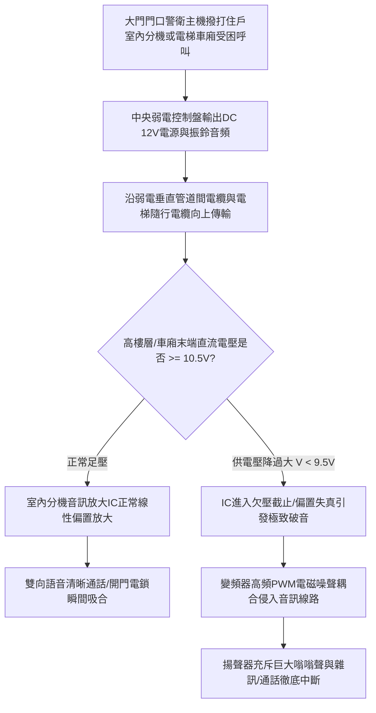

# 全案購屋實戰第八百八十四部：中古大樓社區各樓層電梯對講機室內分機音訊放大IC老化破音直流供電壓降雜訊干擾與主機面板通訊中斷體檢工序全書

## 壹、編撰宗旨與垂直弱電神經網絡之生命安全意涵

在現代集合住宅大樓（特別是屋齡 20 年至 35 年以上之中高齡中古大樓社區，例如台中南區的大安紫金城、長億南園、歌德堡、工學天下、靜園等）的弱電安防體系中，設置於「警衛管理室」與「各住戶室內客廳壁面」及「電梯車廂內部」的社區對講機系統（Intercom System），是維繫全棟住戶日常門禁訪客辨識、公設安全聯鎖、警報呼叫以及火警緊急廣播的「中樞神經神經網絡」。

特別是電梯車廂內部的「電梯對講機（Elevator Emergency Intercom）」，更是依據 CNS 10594 電梯安全規範強制設置之「法定義務救命裝置」。當住戶、老人或幼童因颱風暴雨跳電、機械故障或地震受困於黑壓壓的電梯車廂深處時，壁面上的對講機按鈕是車內受困乘客與外界警衛室、中控室或電梯公司 24 小時值班台取得語音通聯的唯一生命線。

然而，在中古大樓長達數十年的維運盲區中，傳統類比式（Analog）或多線式（4芯/8芯/共用多芯）社區對講系統面臨極嚴重的系統性崩潰：
1. **室內分機內部音訊功率放大晶片（如 LM386、TDA2822 等音訊 IC）及周邊電解電容器長年高溫通電老化乾涸，產生容量衰減與高漏電流**，通話時發出尖銳刺耳的交流「嗡嗡噪聲（Hum Noise）」或極度破音失真，甚至完全無聲；
2. **弱電垂直幹管電源供應器（DC 12V/24V Power Supply）在經歷數十年電容老化後，直流供電電壓嚴重偏低，加上線路長距離傳輸產生巨大的直流線路壓降（DC Voltage Drop）**，高樓層分機工作電壓跌破極限門檻，引發信號調製混亂、開門電鎖拒動；
3. **電梯隨行電纜（Traveling Cable）內部對講音訊雙絞線在歷經數百萬次往復彎折疲勞後，產生微觀斷股（Strand Breakage）與屏蔽網氧化**，電梯變頻器（VVVF Inverter）高頻 PWM 載波強烈干擾對講線路，導致電梯一運轉即通話中斷，受困時「按了沒人理、聽得到講不出」，造成受困者陷入極端恐慌與休克危機。

本手冊針對中古社區對講機主機面板、各樓層分機電路、電梯緊急通訊介面及直流供電網絡，深入解剖類比弱電音訊傳輸原理、阻抗匹配抗干擾技術與實務體檢工序，為購屋家庭與管委會建立通暢無阻的家庭通訊與避險防線。

---

## 貳、社區對講機系統電氣動力學架構與信號傳輸物理機制

### 一、類比多線式對講系統架構與音訊放大物理
傳統中古大樓對講系統主要包含以下核心信號線路：
1. **信號定義分組**：
   - 電源正負極（$\text{Vcc} / \text{GND}$）：直流供電（通常為 $\text{DC } 12\text{V} \pm 10\%$ 或 $\text{DC } 24\text{V}$）；
   - 音訊通話發話線（$\text{TX}$）與收話線（$\text{RX}$）或雙向半雙工音訊復用線（$\text{Audio Line}$）；
   - 振鈴呼叫線（$\text{Call/Bell Line}$）；
   - 開門觸發線（$\text{Door Release Line}$）。
2. **音訊功率放大與阻抗匹配電路**：
   室內分機麥克風（駐極體電容式 ECM）將人聲聲壓轉換為毫伏級（$\text{mV}$）微弱交流音訊信號，經隔直電容耦合至微型音訊運算放大器放大。其增益公式為：
   $$A_v = 20 \log_{10}\left(\frac{V_{\text{out}}}{V_{\text{in}}}\right) \quad (\text{dB})$$
   放大後的音訊電流驅動揚聲器（通常阻抗為 $8\,\Omega$ 或 $16\,\Omega$）。當反饋電阻或旁路電容老化時，電路工作點漂移進入非線性飽和區，波形產生頂部削波（Clipping），輸出聲波產生嚴重諧波失真（THD $> 10\%$），人耳聽覺表現即為刺耳「破音」。

### 二、長距離直流供電線路壓降力學（歐姆定律）
在總高 15 至 25 層樓之中古大樓中，自地下室或一樓警衛室至頂樓住戶分機，弱電電纜單程長度常達 $60 \sim 100\text{ 公尺}$：
1. **導線直流電阻計算**：
   依照導體電阻公式：
   $$R_{\text{line}} = \rho \cdot \frac{L}{A}$$
   若採用傳統 $0.65\text{ mm}$ 直徑銅芯對講線（截面積 $A \approx 0.33\text{ mm}^2$），銅率 $\rho \approx 0.0175\,\Omega\cdot\text{mm}^2/\text{m}$。雙程迴路長度 $2L = 160\text{ 公尺}$，則線路總電阻高達：
   $$R_{\text{line}} = 0.0175 \times \frac{160}{0.33} \approx 8.5\,\Omega$$
2. **端點壓降效應**：
   當頂樓分機振鈴或按下開門按鈕（電解鎖瞬間電流 $I \approx 0.5 \sim 1.0\text{ A}$）時，線路壓降為：
   $$\Delta V = I \times R_{\text{line}} = 0.8 \times 8.5 = 6.8\text{V}$$
   若集中供電電源原輸出為 $12.0\text{V}$，扣除壓降後頂樓分機端電壓瞬間暴跌至：
   $$V_{\text{terminal}} = 12.0 - 6.8 = 5.2\text{V} \ll 10.5\text{V}$$
   此電壓遠低於分機與電鎖動作之最低門檻，引發開門按鈕按壓無效、分機振鈴啞音！

---

## 參、中古社區對講系統三大核心病徵與失靈成因

### 一、室內分機電解電容漏電乾涸與音訊 IC 燒蝕
1. **電解液高溫揮發蒸乾**：室內分機 24 小時全年 365 天插電待機，內部低階鋁電解電容器（特別是電源濾波電容與輸出耦合電容）在長年通電微熱下，橡膠塞密封老化，內部導電電解液完全揮發乾涸，等效串聯電阻（ESR）激增數十倍。
2. **電源紋波噪聲與削波破音**：濾波失效後，直流電源中混入高達數百毫伏之 $60\text{Hz} / 120\text{Hz}$ 交流紋波，直接竄入音訊通道，在通話中產生震耳欲聾的低頻嗡嗡雜音；音訊放大晶片因偏置電壓失調產生直流自激振盪，輸出端產生持續削波破音，音質完全無法辨識。

### 二、公共弱電管道間線路氧化接頭接觸不良與串音干擾
1. **傳統接線帽（Wire Nut）與排線端子生鏽**：中古大樓垂直弱電管道間各樓層端子箱，常年受地下室水氣與高濕空氣侵蝕。傳統銅線纏繞接頭產生綠色銅鏽，接觸電阻增加且形成非線性「二極體效應（Diode Effect）」。
2. **多線路接地環路（Ground Loop）與串音（Crosstalk）**：公共幹管內多戶分機共用同一條接地線（GND）。當某戶通話時，音訊迴流電流在共用高電阻地線上產生電位波動，調製疊加到其他相鄰戶的音訊通道上，引發「隔壁通話全梯聽得到」的嚴重複雜串音現象。

### 三、電梯隨行電纜隨行動態疲勞折損與變頻電磁干擾（EMI）
1. **隨行電纜銅絲疲勞斷股**：懸吊於電梯井道中的扁平隨行電纜，隨車廂每日數千次上下升降。內部對講雙絞線因反覆彎折產生金屬疲勞，多股細銅絲逐一脆斷。斷股處時通時斷，造成電梯行駛至特定樓層時對講機突然斷音、平層停止時又短暫恢復。
2. **高頻 PWM 載波電磁耦合**：現代中古大樓若將電梯主機改造為 VVVF 交流變頻驅動，變頻器產生的 $2\text{kHz} \sim 16\text{kHz}$ 高頻脈衝寬度調製諧波，極易透過空間輻射感應至未做嚴密屏蔽的隨行對講線路，引發強烈刺耳的尖叫嘯叫聲，通訊完全癱瘓。

---

## 肆、對講系統全流程標準體檢與電氣量測工序

### 一、末端高樓層分機供電直流電壓與紋波檢測
1. **靜態與動態端電壓測量**：
   - 攜帶校正合格之高精度數位三用電表，前往整棟大樓最頂層（最遠端）住戶室內分機。
   - 拆開分機壁掛底座，表筆量測 $\text{Vcc}$ 與 $\text{GND}$ 端子間之直流電壓：
     - **待機靜態電壓**：必須維持在 **$\ge 11.5\text{V}$**（$12\text{V}$ 系統）或 **$\ge 23.0\text{V}$**（$24\text{V}$ 系統）。
     - **動態通話與開門電壓**：按下開門按鈕瞬間，動態跌落電壓**絕對不得低於 $10.5\text{V}$**；若跌落至 $9.0\text{V}$ 以下，代表主電源供應器容量不足或垂直幹線線徑嚴重偏細。
2. **交流紋波噪聲（AC Ripple Voltage）量測**：
   - 將數位電表切換至「AC mV」微伏交流檔位（隔絕直流成分），測量電源兩端之交流紋波峰峰值。
   - **標準判定**：交流紋波電壓應小於 **$20\text{ mV}$**；若實測紋波超過 **$100\text{ mV}$**，代表中央電源供應器內部濾波電容已徹底乾涸失效，必須更換開關電源。

### 二、室內分機音訊放大品質與失真度查驗
1. **標準語音發話與接收測試**：
   - 一名工程人員於一樓管理大廳門口主機呼叫，另一人於待檢室內分機接聽。
   - 進行標準音頻數字發音（1 至 10），確認受話與發話雙向語音無任何破音、破裂金屬震動音、嘯叫或交流嗡嗡聲。
2. **電路板電容 ESR 與元器件無損檢驗**：
   - 使用在線等效串聯電阻測試儀（In-circuit ESR Meter），免焊錫直接量測主板音訊耦合電容之 ESR 值。
   - **判定標準**：$100\mu\text{F} \sim 470\mu\text{F}$ 電解電容之 ESR 應小於 **$0.5\,\Omega$**；若 ESR 超過 **$3.0\,\Omega$**，判定為電解液乾涸，必須更換耐高溫長壽命固態電容。

### 三、電梯車廂緊急通訊系統動態連通全行程驗收
1. **五方通話功能查核（法規標準）**：
   - 依據最新建築設備法規，高層大樓電梯緊急通報必須具備「車廂內、車頂、底坑、電梯機房與警衛管理室」之五方通話功能。
2. **升降全行程連續通話干擾測試**：
   - 維護人員進入車廂，按下「緊急呼救（Alarm/Intercom）」按鈕，與警衛室建立通話。
   - 在通話保持狀態下，操作電梯自最底層（地下室）全速上升至最頂層，再全速下降。
   - **合格標準**：電梯在加速、全速巡航、減速平層全過程中，對講語音必須**始終保持清晰連貫**，背景雜訊不得有明顯變頻高頻嘯叫，無任何斷字或通訊中斷現象。

---

## 伍、購屋避坑指南與管委會整改預算表

### 一、買方室內看屋弱電安防查核關鍵 4 訣
1. **實測室內分機通話與大門電鎖開啟反應**：
   - 看屋時請房仲或家人在一樓大門操作門口主機撥打該戶分機號碼。拿起話筒親自聆聽，確認通話聲音清脆宏亮、無刺耳雜訊；按下「開門（Door Release）」按鈕，確認一樓大門電鎖能在 $1\text{ 秒}$ 內清脆解鎖彈開。
2. **實測電梯車廂內部緊急對講按鈕**：
   - 搭乘社區電梯時，向陪同之管理員報備後，長按車廂壁面之黃色或紅色「緊急對講鈕（約 3~5 秒）」。確認警衛室能在 10 秒內應答接通，且車廂揚聲器發出的管理員聲音清晰可辨。若按鈕按了毫無反應或充斥刺耳雜音，代表電梯隨行通訊線路早已斷裂失修。
3. **檢視公共樓層管道間弱電端子箱內部整潔度**：
   - 走訪梯廳弱電管道間，打開弱電箱。若內部電線如蜘蛛網般雜亂打結、端子排佈滿厚厚灰塵與綠色銅鏽，代表社區長年缺乏專業弱電維護，隨時面臨通訊斷線。
4. **查閱管委會是否曾討論「全棟對講系統數位化更新」議題**：
   - 向管理室了解社區近幾年是否有因「對講機老化無法修理」而頻繁接獲住戶投訴，以及社區是否有編列「類比改數位 IP 網路對講系統」之公共修繕基金。

### 二、社區對講機系統專項維修更新預算參考清單

| 維修／改善工程項目 | 技術規範與標準工法 | 預算區間（每戶／每台） | 安全重要度等級 |
| :--- | :--- | :--- | :--- |
| **室內對講分機全機汰舊換新（原廠相容款）** | 具備防破音放大晶片與可調音量按鍵分機新品 | 1,800 ~ 3,200 元／戶 | 高度（住戶單獨維修） |
| **一樓大門門口警衛總機面板大修或換新** | 不銹鋼金屬防水防暴數字按鍵 + 廣角攝像鏡頭 | 25,000 ~ 45,000 元／台 | 極高（門禁樞紐必修） |
| **電梯隨行電纜對講屏蔽音訊雙絞線更換** | 專用耐彎折電梯隨行扁平電纜（含高密屏蔽網） | 15,000 ~ 28,000 元／梯 | 緊急極高（防止受困失聯） |
| **中央穩壓電源供應器換新（含蓄電池備援）** | DC 12V/24V 10A 醫療級低紋波開關電源 + 鉛酸電瓶 | 4,500 ~ 8,000 元／組 | 極高（消除供電壓降） |
| **全棟弱電管道間端子箱端子排重組除鏽配線** | 鍍金/鍍錫阻燃接線模組 + 壓接防水端子膠套 | 12,000 ~ 22,000 元／棟 | 中度 |
| **全棟現代化升級為數位 TCP/IP 雲端可視對講** | 網路光纖到樓 + 室內彩色液晶觸控螢幕 + 手機App | 15,000 ~ 25,000 元／戶 | 終極推薦（徹底根治雜訊） |

---

## 陸、本案結語

社區對講機系統看似只是壁面上一只微小的塑料通話器，但在危難降臨的極端時刻，它卻是受困電梯者的「救命熱線」、阻絕不法之徒於門外的「安全耳目」，以及連結家庭與社區管委會的「神經中樞」。

購屋家庭在評估台中成熟型中古大樓時，務必將查核視角延伸至室內分機音質、供電電壓穩定度與電梯車廂緊急通訊系統。唯有確保這條隱形的神經網絡通暢無阻，才能讓家庭在日夜起居與垂直穿梭中，享有真正從容、安心與有尊嚴的現代化生活保障！
