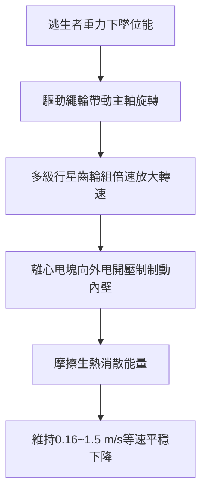

# 全案購屋實戰第八百六十七部：中古大樓社區消防避難逃生設備緩降機支架錨固深度不足調速器齒輪咬死與編織繩碳化斷裂體檢工序全書

## 壹、編撰宗旨與生命避難最後防線意涵

在台灣都市集合住宅的消防安全架構中，當建築物遭遇惡性火災、濃煙封鎖梯間或水平逃生動線中斷之極限危急時刻，「緩降機」（Slow-down Machine / Descending Life Line）常是高樓住戶在無雲梯車即時抵達情況下，唯一的重力自救避難器具。

然而，在屋齡 20 年至 35 年以上之中古大樓社區（如台中南區的大安紫金城、長億南園、工學天下等），設置於各樓層陽台、走廊或安全梯逃生口的緩降機設備，長年暴露於日曬雨淋、高溫濕熱及酸雨侵蝕環境中。其常態性存在固定金屬膨脹螺栓（壁虎）鏽蝕錨固力不足、固定支架轉軸卡死、調速箱內部齒輪機件油泥咬死，以及編織鋼索中心芯線與外層纖維老化碳化脆裂等致命隱患。

本手冊詳解緩降機之力學構造、阻尼調速原理、錨固負載試驗、繩索碳化無損檢測與現場體檢實務工序，為購屋家庭與社區管委會提供最高規格之避難設備安全保障依據。

---

## 貳、緩降機力學機制與阻尼調速核心原理

### 一、法規性能與等速下墜物理力學
依據我國《各類場所消防安全設備設置標準》及 CNS 13038《緩降機》國家標準：
1. **額定使用載重**：緩降機之標準乘載重量通常設定為 $100\text{ kg}$（單人使用型，合格測試範圍 $25\text{ kg} \sim 100\text{ kg}$），部分新型雙人載重為 $150\text{ kg}$。
2. **下降速度限制**：在額定載重下，人體自高空勻速下落之安全著地速度必須嚴格控制於：
   $$16\text{ cm/s} \le V_{\text{descend}} \le 150\text{ cm/s} \quad (0.16\text{ m/s} \sim 1.5\text{ m/s})$$
   若速度低於 $0.16\text{ m/s}$，將導致逃生時間過長而在半空中吸入有毒濃煙窒息；若速度高於 $1.5\text{ m/s}$，則著地時撞擊動能過大（$E_k = \frac{1}{2}mv^2$），將造成雙腿粉碎性骨折甚至臟器破裂身亡。

### 二、離心摩擦阻尼調速器（Centrifugal Governor）構造
緩降機主機內部並無任何電力驅動，完全依賴人體下墜之重力位能轉換為機械動能：
1. **行星齒輪增速機構**：當穿著安全帶之人體下墜帶動繩輪旋轉時，透過內部多級行星齒輪組將轉速放大 20 至 30 倍。
2. **離心摩擦制動塊**：高速旋轉的轉軸帶動左右兩側離心摩擦塊（配備耐熱煞車來令片），摩擦塊在離心力作用下克服回位彈簧阻力向外張開，緊密壓迫主機外殼內壁。
3. **自調平衡穩態**：下墜速度越快，離心力與摩擦阻力越大，最終動態達到重力與摩擦力平衡，實現人體以極平穩之等速度安全垂降至地面。

---

## 參、中古社區緩降機常見病徵與潛在致命風險

### 一、安裝基座固定螺栓（膨脹螺栓）鏽蝕與混凝土強度不足
1. **錨固剪力與拉拔力劣化**：安裝於陽台女兒牆或梁柱側邊之金屬支架，依規定其錨固端必須承受至少 **$3,920\text{ N}$（約 400 kgf）** 以上之靜態試驗載重。
2. **女兒牆打底空心化**：部分中古社區將支架固定於僅厚 10~12 公分之輕質磚或低強度 RC 女兒牆上，加之外牆滲水导致膨脹螺栓孔內部碳化膨脹粉碎，一旦人體懸空重力加載，整組金屬固定架極易連根拔起翻落墜樓。

### 二、調速箱內部潤滑脂乾涸、齒輪氧化卡死
大樓外廊陽台之緩降機長年處於高溫烘烤，主機內部高黏度潤滑脂（Lithium Grease）氧化、乳化或完全乾涸固化。行星齒輪與中心軸承產生紅鏽卡死，逃生時繩輪完全無法轉動，使設備瞬間變成死結，逃生者被迫懸掛於火場外牆動彈不得。

### 三、複合編織繩索芯線鏽蝕與外層纖維碳化
緩降機吊繩通常由「航空級不鏽鋼／鍍鋅鋼索芯線」外包覆「聚酯（Polyester）或芳綸纖維（Kevlar）」複合編織而成：
1. **紫外線脆化**：陽台西曬使外層保護編織層紫外線光解老化，觸摸時產生大量纖維粉塵，耐磨抗拉強度降低 $70\%$ 以上。
2. **鋼心電化學鏽蝕**：水氣滲入編織層內部，不鏽鋼鋼絲發生應力腐蝕破斷（SCC），外觀看似完整，實質抗拉極限已低於 $200\text{ kgf}$（標準要求不得低於 $1,000\text{ kgf}$），承重即刻脆斷。

### 四、自救胸帶（安全帶）縫線脆裂與金屬扣環變形
安全穿著帶使用尼龍高強紗縫合，在長年環境老化下，縫線斷裂強度大幅退化。金屬調節環若經酸雨侵蝕氧化，施加人體體重後可能自縫線處完全撕裂脫落。

---

## 肆、緩降機全流程專業體檢工序

### 一、安裝支架與結構錨固力查驗工序
1. **外觀與基座剛性量測**：
   - 檢查支架旋轉關節軸銷（Pivot Pin），手動展開固定架，確認轉軸靈活無卡滯，展開角度是否能確保緩降機下墜垂線距外牆面至少 **$50\text{ cm}$ 以上**，防止逃生者撞擊外凸鐵窗或冷氣室外機。
   - 使用扭矩扳手（Torque Wrench）抽檢膨脹螺栓緊固扭矩，不得有任何螺帽鬆弛晃動。
2. **基座拉拔試驗（Pull-out Test）**：
   - 利用專用油壓千斤頂拉拔測試儀，對支架吊環端施加 $3,920\text{ N}$（400 kgf）垂直方向拉力，持續維持 5 分鐘，檢查基座錨固螺栓有無拔出、位移或周邊混凝土開裂現象（容許位移量 $\le 1.0\text{ mm}$）。

### 二、調速器主機機械性能與轉動檢驗
1. **空載手動迴轉測試**：
   - 雙手交替拉動主機兩端鋼索，確認內部齒輪運轉聲音平順均勻，無金屬尖銳摩擦異音或咬死頓挫阻力。
2. **限速功能動態載重測試（抽檢）**：
   - 在具備安全防墜網之專用檢測架上，懸吊 $75\text{ kg}$ 測試配重塊釋放自由下墜，利用光電計時器測定 5 公尺下降秒數，計算平均速度是否落在法規要求的 $0.16 \sim 1.5\text{ m/s}$ 範圍內。

### 三、複合繩索與安全帶非破壞性查核
1. **全行程繩索展開檢驗**：
   - 將整捆捲盤繩索完全拉出，使用顯微放大鏡與厚薄規沿線檢查。
   - 檢查外層包覆纖維有無起毛、變色、發霉、燒灼痕跡；以手彎曲繩索檢查鋼心有無硬折痕、局部鼓包或斷股現象。
2. **有效長度核對**：
   - 核對緩降機銘牌標示長度（如：L=25m 對應約 8 樓），計算「樓層高度 $\times 3\text{ 公尺} + 1\text{ 公尺}$」是否足以安全觸及地面著地區域；長度不足者視同嚴重缺失。
3. **安全帶拉力縫線查核**：
   - 檢查胸帶縫線交叉處有無斷線；扣環閉鎖機構彈簧是否完好彈性充足。

---

## 伍、購屋避坑指南與管委會整改預算表

### 一、買方看屋避坑關鍵 3 步驟
1. **確認專用逃生開口無阻礙**：
   - 陽台若加裝鐵窗，**必須留設淨寬 $50\text{ cm}$ 以上、淨高 $100\text{ cm}$ 以上之逃生開口**，且逃生門鎖不可上鎖（或鑰匙必須常態固定於開口旁專用玻璃保護盒內）。
2. **檢查緩降機金屬保護外箱**：
   - 緩降機箱體應為防雨抗 UV 之不銹鋼或工程塑膠箱，箱內必須保持乾燥無積水，禁止堆放雜物、花盆或冷氣管線。
3. **核對大樓消防安檢申報書**：
   - 調閱社區年度《消防安全設備檢修申報書》，確認避難逃生器具項目是否列為「合格」；若有「緩降機鋼索生鏽需更換」或「支架鬆動」之限期改善通知，應作為向屋主議價之實質籌碼。

### 二、避難逃生設備專項改善維修預算清單

| 檢修／更新項目 | 技術規範與標準 | 預估工程單價（含工料） | 評估優先級別 |
| :--- | :--- | :--- | :--- |
| **緩降機專用固定支架加固／換新** | 304不銹鋼折疊式加長臂架（載重400kgf） | 4,500 ~ 7,500 元／處 | 緊急極高 |
| **緩降機主機及複合鋼索全組換新** | 經消防署認可新品（以 8~10 樓長度計） | 8,000 ~ 13,500 元／組 | 極高 |
| **外牆不銹鋼緩降機防水收納保護箱** | 304不銹鋼烤漆防雨密封箱 | 2,500 ~ 4,000 元／只 | 中度 |
| **鐵窗避難逃生開口修改與安全鎖安裝** | 開設淨寬50cm*高100cm防護逃生門 | 3,500 ~ 6,000 元／處 | 緊急極高 |
| **外牆女兒牆膨脹螺栓植筋化學錨栓補強** | 喜利得（Hilti）化學錨栓 M12 深度10cm | 1,200 ~ 2,000 元／孔 | 極高 |

---

## 陸、本案總結與全生命週期防護叮嚀

緩降機是建築生命保障體系中「備而不用、用之必靈」之關鍵設施。無論是置產自住或長期出租，切不可因平日無火災風險而漠視陽台逃生器具之保養。每一次標準化的結構拉拔試驗與鋼索檢驗，都是對家人生命最堅實的守護承諾。
