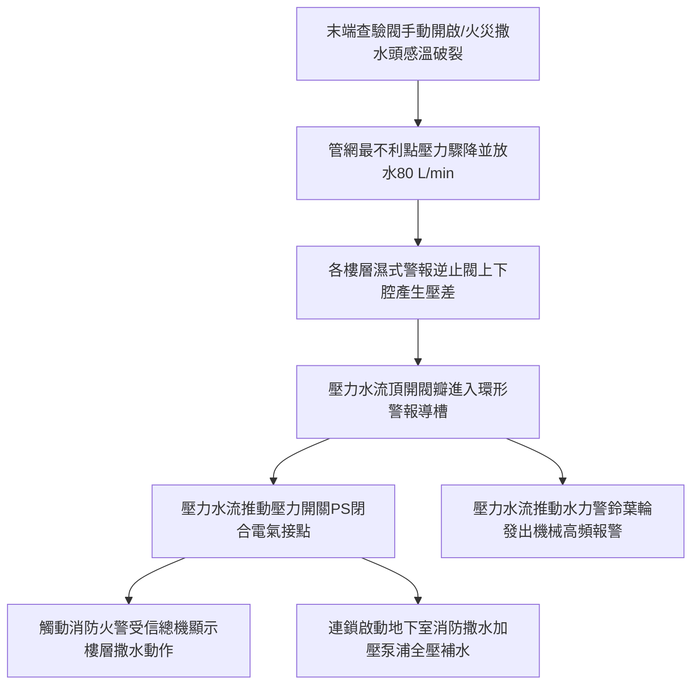

# 全案購屋實戰第八百六十九部：中古大樓社區消防自動撒水系統末端查驗閥壓力測試管壁電化學點蝕穿孔與警報逆止閥誤報體檢工序全書

## 壹、編撰宗旨與高樓消防核心安全意涵

在台灣都市集合住宅建築法規中，凡樓高達 11 層以上之集合住宅大樓（如台中南區的大安紫金城、長億南園、歌德堡、工學天下等），為防止火災時高溫濃煙在垂直管道間與天井引發「煙囪效應」並突破外牆阻隔，依據《各類場所消防安全設備設置標準》，各戶室內天花板均強制全面配置「閉式自動撒水設備」（Automatic Sprinkler System）。

然而，在屋齡 20 年至 35 年以上之中古大樓社區中，自動撒水管網（通常為鍍鋅鋼管或無縫鋼管）長年處於 24 小時連續滿水加壓（靜水壓通常維持在 $5 \sim 10\text{ kgf/cm}^2$）狀態。在經歷數十年水質酸鹼腐蝕、微量溶氧電化學反應、水力空化衝擊以及管網末端死水沉積後，管網系統常衍生出三大致命病徵：
1. **濕式警報逆止閥（Alarm Check Valve）閥瓣橡膠老化脆裂或止回密封面積垢**，引發管網微漏或社區警報蜂鳴器長鳴誤報；
2. **撒水垂直幹管與水平分歧管管壁發生局部電化學點蝕（Pitting Corrosion）與穿孔漏水**，一旦突發爆管，每分鐘數百公升的高壓水流將在數十分鐘內徹底毀滅住戶百萬裝潢與電梯機電設備；
3. **各樓層「末端查驗閥（Inspector's Test Valve）」手動球閥鏽蝕卡死、壓力表失準或排水管路阻塞**，導致社區消防年度安檢淪為形式虛應，在真正遭遇火警時無法即刻啟動消防撒水泵浦射水滅火。

本手冊針對中古大樓社區自動撒水管網、濕式報警閥組與末端查驗體系，深入解析流力水力學原理、管壁腐蝕穿孔機制、非破壞性超音波測厚技術，並制定一套高標準之全流程現場體檢與維護工序，為購屋家庭與管委會建立固若金湯的消防水防線。

---

## 貳、自動撒水系統物理力學架構與水力警報連鎖機制

### 一、管網水力壓力分區與放水性能標準
依據 CNS 1244 及內政部消防署規範：
1. **防護射水性能指標**：
   - 撒水頭（Sprinkler Head）放水壓力：各樓層最不利點（最末端最高處）之撒水頭，放水壓力不得小於 **$1.0\text{ kgf/cm}^2$（0.1 MPa）**。
   - 額定放水量公式：
     $$Q = K \sqrt{10 P}$$
     其中 $Q$ 為放水量（$\text{L/min}$），$P$ 為放水壓力（$\text{MPa}$），$K$ 為放水流量係數（標準閉式撒水頭 $K \approx 80$）。在 $0.1\text{ MPa}$ 壓力下，單只撒水頭標準放水量為：
     $$Q = 80 \times \sqrt{10 \times 0.1} = 80\text{ L/min}$$
2. **末端查驗閥之水力等效性**：
   末端查驗閥之出水口內徑必須配置一只與現場撒水頭等徑之節流孔口（標準口徑為 $15\text{ mm}$，即 $1/2\text{ 英吋}$）。當開啟末端查驗閥時，其放水流量與水壓降幅度能完全模擬「單只撒水頭破裂動作」之最真實水力工況。

---

## 參、中古大樓自動撒水管網三大核心腐蝕與失靈病理

### 一、封閉式管網電化學氧腐蝕與微生物腐蝕（MIC）
1. **溶解氧濃差電池（Differential Aeration Cell）**：
   撒水管網在歷次抽水保養或補水過程中，引入富含溶解氧的新鮮自來水。管壁微觀粗糙面因含氧量差異形成微局部陽極與陰極，鐵元素在陽極失去電子溶解：
   $$\text{Fe} \to \text{Fe}^{2+} + 2e^{-}$$
   氧氣在陰極獲得電子生成氫氧根離子：
   $$\text{O}_2 + 2\text{H}_2\text{O} + 4e^{-} \to 4\text{OH}^{-}$$
   沉澱產生之氫氧化鐵與氧化鐵（鐵鏽結瘤）將形成「閉塞電池」，酸性水在結瘤下方加速富集，管壁年腐蝕穿孔率可高達 $0.2 \sim 0.5\text{ mm/年}$。
2. **硫酸鹽還原菌（SRB）引發之點蝕坑洞**：
   在長年不流動之死水段，厭氧菌與硫酸鹽還原菌大量繁殖，分泌高腐蝕性硫化物，直接在無縫鋼管內壁蝕穿針孔狀漏水點。

### 二、濕式警報逆止閥閥瓣沉垢與微漏誤報
1. **水質泥砂刮傷密封面**：配水管網長年累積的鐵鏽碎片沉積於濕式閥之橡膠閥瓣與銅閥座之間，導致閥瓣無法嚴密閉合。
2. **延遲室（Retard Chamber）排水孔淤塞**：為防止自來水市政水壓波動造成誤報，濕式閥下方設有水力緩衝延遲室。若其微型節流排水孔（口徑約 $3\text{ mm}$）被鐵鏽泥沙堵塞，任何細微水壓震盪將使延遲室持續蓄水，誤觸發壓力開關長鳴警報，造成社區住戶恐慌。

### 三、末端查驗管組球閥生鏽咬死與無排水動線
許多 20~30 年中古大樓在當初裝修時，木作天花板直接將末端查驗閥密閉封死未留維修孔；或查驗閥排水端未正確配接至陽台落水頭或排水立管，導致消防檢驗時無處放水，管委會與消檢廠商索性長年略過實測，一旦發生火災，管內沉水死泥完全堵塞撒水噴孔。

---

## 肆、全流程標準檢測與實戰體檢工序

### 一、末端查驗閥動態水力與連鎖機能檢測工序
1. **查驗孔位與靜水壓確認**：
   - 尋找各樓層（通常設置於公共走廊末端或最邊間陽台）之末端查驗閥箱。
   - 讀取查驗閥前級壓力表之「靜態水壓值」（$P_{\text{static}}$），正常標準應維持在 $4.0 \sim 8.0\text{ kgf/cm}^2$。
2. **全開查驗閥放水測試**：
   - 緩慢將 $1/2\text{ 英吋}$ 手動球閥扳至全開位置，導水軟管牢固接入排水溝。
   - 觀測查驗閥動態放水壓力表（$P_{\text{dynamic}}$），**動態壓力必須穩定維持在 $\ge 1.0\text{ kgf/cm}^2$ 以上**。
3. **警報連鎖反應計時測定**：
   - 使用精密碼表計時：自查驗閥完全打開瞬間起，至火警受信總機接收到該樓層「撒水動作警報燈亮起」之時間。
   - **法規合格標準**：濕式警報閥壓力開關動作時間必須在 **$15 \sim 60\text{ 秒}$** 之間（小於 15 秒易受水壓波動誤報，大於 60 秒則反應過於遲緩）。
4. **泵浦自動啟動查核**：
   - 確認地下室消防撒水加壓泵浦已自動連鎖啟動，控制盤上運轉綠燈亮起，幹管水壓穩定提升至額定工作揚程。

### 二、配水管網超音波非破壞性測厚（NDT）體檢
1. **測點佈設原則**：
   - 在各樓層梯廳、管道間進口處以及管網低窪凹彎死水段，選定關鍵測點。
2. **超音波測厚儀精度校準**：
   - 使用耦合劑將超音波探頭貼附於管壁（需先局部刮除外層氧化皮與脫落油漆），測量鋼管殘餘壁厚。
3. **管壁厚度安全臨界閾值判定**：
   - 標準 2" 鍍鋅鋼管（Sch 40）原始公稱壁厚為 $3.91\text{ mm}$。
   - **優良等級**：殘餘壁厚 $\ge 3.2\text{ mm}$（腐蝕損耗小於 $18\%$）。
   - **注意警戒**：殘餘壁厚介於 $2.5 \sim 3.1\text{ mm}$ 之間，應列入 3 年內局部換管清單。
   - **嚴重危險**：殘餘壁厚 $< 2.2\text{ mm}$，管壁隨時有因水錘震盪而破裂穿孔之高風險，必須立即切管更新。

### 三、濕式警報逆止閥分解檢修工序
1. **閥組隔離與排水洩壓**：關閉濕式閥前級主閘閥，開啟閥組底部主排水閥，將閥腔內存水完全排空。
2. **閥蓋開啟與內部清淤**：卸下閥蓋高強螺栓，檢查橡膠閥瓣彈性與銅座環密封面有無環狀刻痕；清除延遲室底部過濾網之鐵鏽殘渣。
3. **密閉試驗**：重新組裝復原後注水加壓至 $10\text{ kgf/cm}^2$，靜置 10 分鐘，確認外殼與接合面零滲漏。

---

## 伍、購屋避坑指南與管委會整改預算表

### 一、買方室內看屋消防撒水查驗關鍵 4 訣
1. **切勿違規截斷或包覆撒水頭**：
   - 裝修時若木作天花板直接包覆撒水頭、或將撒水頭塗上油漆，感溫玻璃球（熔點通常為 $68^\circ\text{C}$）將失去熱傳導感溫靈敏度；依規定撒水頭迴避障礙物半徑不得小於 $30\text{ cm}$。
2. **撒水管接頭有無白色結晶或黃褐色鏽斑**：
   - 仰頭巡視各個撒水頭與管線接合之螺牙處，若出現碳酸鈣白色鹽結晶或紅褐色掛滴水痕，代表螺紋止漏膠帶（鐵氟龍）已脆化老化，隨時有脫牙爆水之危險。
3. **查驗各樓層管道間消防閘閥開關狀態**：
   - 檢查該樓層樓梯間之「撒水控制閘閥」（OS&Y 閥），閥桿外露刻度必須處於「全開（Open）」狀態，並施加防誤關鏈條鎖或電氣監控開關（Tamper Switch）。

### 二、自動撒水系統專項整改預算參考清單

| 維修／改善工程項目 | 技術規範與標準工法 | 預算區間（每戶／每組） | 安全重要度等級 |
| :--- | :--- | :--- | :--- |
| **末端查驗閥組更新（含壓力表與球閥）** | 304不銹鋼 1" 球閥 + 精密耐震壓力表組 | 3,500 ~ 5,500 元／組 | 極高（消檢必驗） |
| **濕式警報閥組大修更換橡膠閥瓣與延遲室** | 4"~6" 濕式警報逆止閥專用修復套件 | 12,000 ~ 22,000 元／組 | 極高（消除誤報警） |
| **室內天花板老舊撒水頭更新** | 消防署認可 $68^\circ\text{C}$ 齊平型/下垂型新品 | 600 ~ 1,200 元／只 | 高度（裝修必做） |
| **超音波管壁厚度無損檢測與安全評估** | 專業 NDT 檢驗（每棟每梯 15~20 測點） | 25,000 ~ 45,000 元／棟 | 中度（掌握資產壽命） |
| **局部穿孔腐蝕撒水鋼管高壓卡箍搶修** | 不銹鋼雙弧型高壓管道修補器（應急） | 2,500 ~ 4,000 元／處 | 緊急極高 |
| **腐蝕嚴重撒水水平分歧幹管更新** | 無縫鍍鋅鋼管配滾槽式壓接機械接頭 | 1,800 ~ 2,800 元／公尺 | 治本根除漏水風險 |

---

## 陸、本案結語

高樓層集合住宅的自動撒水系統，是當火勢突發時無可替代之「第一時間壓制水源」。一滴自天花板滲漏的銹水，往往正是整套消防管網內部遭受點蝕穿孔的冰山一角。

購屋者在評估台中南區與南屯區各大成熟型大樓時，務必將天花板撒水頭的完好度、樓層控制閥開度以及末端查驗閥的水力反應納入核心查檢清單，以科學工程標準守護全家人的居住安全與資產尊嚴！
