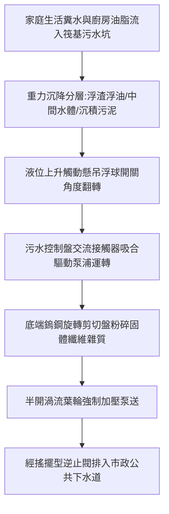

# 全案購屋實戰第八百六十八部：中古大樓社區地下室筏式基礎深水坑沉水絞碎式污水泵浦浮球開關油污包覆卡阻機械軸封磨損滲漏與廢水倒灌體檢工序全書

## 壹、編撰宗旨與地下公設衛生安全意涵

在現代集合住宅大樓（尤其屋齡 20 年至 35 年以上之中古社區，如台中南區的大安紫金城、長億南園、歌德堡、靜園等）的排水體系中，整棟建築日常數百戶家庭所排放之生活糞便污水與雜排水，皆依靠建築管道間垂直幹管以重力流排入地下最底層的筏基污水處理池或污水收集坑（Sump Pit）。

由於地下室地盤標高遠低於市政公用污水下水道管頂標高，必須仰賴設置於污水坑內的「沉水式污水絞碎泵浦（Submersible Grinder Sewage Pump）」進行強制加壓提升揚水。

然而，地下污水坑長年處於高濃度硫化氫（$\text{H}_2\text{S}$）、甲烷（$\text{CH}_4$）強腐蝕氣體、餐飲油脂皂化結塊、固態異物與濕熱環境中。實務上極常發生：
1. **重錘浮球液位開關受固化油脂包覆卡死**，導致泵浦無法感知水位上升而無法自動啟動，造成惡臭糞水漫溢淹沒地下室配電室與停車場；
2. **沉水泵浦機械軸封（Mechanical Seal）磨損滲漏**，高導電度污水侵入電機定子繞組引發相間短路燒毀；
3. **絞碎刀盤卡阻異物**導致馬達過載跳脫或主軸扭斷。

本手冊針對中古社區地下室污水揚水泵浦系統，深入剖析物理構造、機電控制迴路、機械磨耗機制與實務體檢標準工序，為購屋家庭與管委會建立滴水不漏的地下公設體檢指引。

---

## 貳、沉水絞碎式污水泵浦構造原理與揚程流體力學

### 一、構造特徵與絞碎機構
沉水絞碎式污水泵浦結合了流體機械與高速旋轉剪切機械：
1. **前置高速鎢鋼旋轉絞刀（Cutter Blade）與固定剪切盤（Cutter Ring）**：
   - 轉速通常達 $1750 \sim 3450\text{ RPM}$。
   - 硬度達 HRC 55~60 之合金鋼刀盤，能在固態物（毛髮、衛生棉、濕紙巾、抹布纖維、廚餘骨頭）進入泵浦葉輪前，在 $0.1$ 秒內將其高速剪切粉碎成微小顆粒（粒徑小於 $6\sim 10\text{ mm}$），防止堵塞後端止回閥與管線。
2. **渦流式或半開式葉輪（Vortex / Semi-open Impeller）**：
   - 旋轉產生強力渦流水壓，使泥水混合流體順利通過泵殼排入揚水管。
3. **雙重機械軸封與油室隔離系統（Double Mechanical Seals in Oil Chamber）**：
   - **外側軸封（水側）**：碳化矽（Silicon Carbide, SiC）對碳化矽，具備超強耐磨耗與抗固態顆粒刮擦能力。
   - **內側軸封（馬達側）**：碳化鎢（Tungsten Carbide）或碳對陶瓷，浸潤於潤滑冷卻用白礦物油室中，隔絕任何微漏水氣，保護電機絕緣。

### 二、污水揚程與有效有效淨正吸入水頭（NPSH）
依據流體力學與建築排水設計：
$$\text{總揚程 } H_{\text{total}} = H_{\text{static}} + H_{\text{friction}} + H_{\text{velocity}}$$
其中：
- $H_{\text{static}}$：自污水坑底至市政管網頂部之垂直高度差（一般中古大樓約 $6 \sim 15\text{ 公尺}$）。
- $H_{\text{friction}}$：管壁沿程阻力與彎頭、逆止閥、閘閥之局部水頭損失。
當污水坑過深或液位過低時，若有效吸入水頭不足，泵浦易發生吸入氣蝕（Cavitation），引發葉輪局部金屬剝落與強烈劇震。

---

## 參、中古社區污水坑系統三大核心病徵與失靈成因

### 一、浮球液位感知器油脂包裹卡死（盲目失控）
1. **皂化油塊附著**：大樓廚房含油廢水排放至污水坑後，動物油脂與界面活性劑冷卻皂化，形成厚達數公分之堅硬浮油結塊。
2. **懸吊微動浮球動作失效**：傳統水銀／微動開關型懸吊浮球長年受油塊覆蓋，自重增加且擺動受阻。當液位上升時，浮球無法依重力重心翻轉傾斜 $45^\circ$，導致控制盤「看不見水滿訊號」，引發嚴重溢流淹水慘劇；反之，若浮球卡死於高水位狀態，泵浦將無法停機造成連續乾抽空轉（Dry Running），馬達數小時內高溫燒毀。

### 二、機械軸封磨耗與水氣滲入電機
1. **砂礫微粒割傷**：污水中夾帶之石英細砂侵入機械軸封動環與靜環接觸面，產生微米級縱向拉痕。
2. **油室油質乳化變黑**：潤滑油室內進水，油水乳化失去潤滑降溫作用。高壓水氣隨後穿透內側軸封滲入馬達內部，定子絕緣阻抗驟降（低於 $1\text{ M}\Omega$），造成相間短路或外殼漏電跳脫。

### 三、止回閥卡死逆流與水錘撞擊
污水出水幹管通常安裝重力式橡膠瓣搖擺型逆止閥（Check Valve）。若抹布毛髮等異物夾在閥瓣與閥座之間，當泵浦停機時，高達十數公尺管柱內的污廢水將全數倒灌回流污水坑，造成泵浦反向超速旋轉，且下次啟動時引發破壞性逆流水錘震盪。

---

## 肆、沉水絞碎泵浦標準體檢與維護工序

### 一、安全防護與局限空間危害預防
1. **氣體偵測（Gas Monitoring）**：下坑前必須使用四合一氣體偵測器測定坑口環境：
   - 氧氣濃度（$\text{O}_2 \ge 19.5\%$）；
   - 硫化氫（$\text{H}_2\text{S} < 10\text{ ppm}$）；
   - 一氧化碳（$\text{CO} < 35\text{ ppm}$）；
   - 可燃性氣體（$\text{LEL} < 10\%$）。
2. **強制通風與一人作業禁令**：開啟防爆送風機連續送風至少 15 分鐘，坑外必須派專人守護並配置三腳架救援吊升防墜器。

### 二、控制盤電氣特性查驗
1. **絕緣電阻測試（Megger Test）**：
   - 使用 500V 高阻計量測馬達三相繞組（U-V-W）對地（PE）絕緣電阻。
   - **標準判定**：新機 $\ge 50\text{ M}\Omega$；中古維運合格值必須 $\ge 5\text{ M}\Omega$；若絕緣電阻低於 $1\text{ M}\Omega$，代表內部軸封滲漏進水，絕不可繼續送電通電，必須吊升吊出檢修。
2. **負載運轉電流測量**：
   - 啟動泵浦時使用鉤表量測三相運轉電流，檢查三相電流不平衡率是否小於 $5\%$，且運轉電流不得超過名牌標定之額定滿載電流（FLA）。
3. **熱動過載繼電器（O/L）與自動交替控制測試**：
   - 手動觸發過載跳脫機構，確認控制盤警報蜂鳴器與閃爍警示燈正常動作。
   - 模擬兩部泵浦（1號泵與2號泵）交替運轉邏輯，確認主備切換正常。

### 三、浮球液位計清潔與校正
1. **四浮球控制標準高度檢查**：
   - **第 1 浮球（停止水位 Stop）**：設定於泵浦馬達頂部上方 10cm（保持馬達浸水水冷，嚴禁乾燒）。
   - **第 2 浮球（單泵啟動 Lead Pump Start）**：達到水坑深 $50\%$ 時啟動第一台。
   - **第 3 浮球（雙泵並聯啟動 Lag Pump Start）**：達到水坑深 $75\%$ 時雙泵全開強排。
   - **第 4 浮球（滿水警報 High Level Alarm）**：達到水坑深 $85\%$ 時觸發中控室緊急警報。
2. **浮球除油除污清洗**：
   - 定期將浮球拉出，使用高壓水槍沖洗清除包覆之皂化油脂與衛生紙團，手動搖晃聽內部鋼珠或微動接點切換聲音是否清脆。

### 四、絞刀間隙調整與機械吊檢
1. **絞刀刀隙量測**：使用厚薄規檢測旋轉動刀與固定剪切盤之間的軸向間隙，標準間隙應維持在 **$0.15 \sim 0.25\text{ mm}$**。間隙過大（$>0.5\text{ mm}$）將失去剪切纖維功能，造成纖維纏繞軸心。
2. **油室潤滑油品質抽樣檢查**：
   - 鬆開油室螺塞，用透明油杯引出少量潤滑油。若油色清澈呈淡黃色即為正常；若呈乳白乳化狀，表示外側機械軸封已磨損破裂，必須立即更換雙組機械軸封與全新白礦物潤滑油。

---

## 伍、購屋決策避坑指引與管委會整改預算表

### 一、買方地下室實地看屋查驗秘訣
1. **氣味與通風感知**：進入地下室最底層（B2或B3），若空氣中瀰漫濃烈硫化氫臭蛋味或酸腐廚餘味，通常代表污水坑密閉人孔蓋密封墊圈硬化劣化，或通氣幹管破裂。
2. **地坪水漬與油垢痕跡**：巡視污水坑人孔周圍、泵浦控制盤下方及地下室集水明溝，若有黃褐色油漬水痕或乾涸泥渣印記，高度暗示該社區曾發生污水溢流倒灌慘劇。
3. **控制盤面板燈號與運轉紀錄**：檢視地下室污水控制盤，確認自動／手動選擇開關（Auto/Manual）是否切在「Auto」；是否有「警報燈亮起」或「故障跳脫（Trip）」標籤貼紙。

### 二、地下室污水泵浦系統整改與維護預算表

| 檢修／工程項目 | 規格標準 | 預算區間（每組／座） | 優先級別 |
| :--- | :--- | :--- | :--- |
| **沉水絞碎式泵浦吊起大修更換軸封與油** | 雙重 SiC 機械軸封 + 白礦物絕緣油 | 8,500 ~ 15,000 元／台 | 中度（每2~3年保養） |
| **全組汰換進口／台灣一線絞碎污水泵** | 3HP~5HP 高鉻合金刀盤三相 220V/380V | 38,000 ~ 65,000 元／台 | 緊急（馬達燒毀或卡死） |
| **抗油污重型不銹鋼/陶瓷微動浮球組更換** | 廣角耐酸鹼耐油型（一套四支） | 6,000 ~ 10,000 元／套 | 極高（浮球卡油必做） |
| **靜音搖擺型防錘全包橡膠污水逆止閥更換** | 鑄鐵粉體塗裝 3"~4" 內襯耐磨橡膠 | 6,500 ~ 12,000 元／口 | 高度 |
| **污水坑專用密閉式防臭氣密人孔蓋更換** | 鑄鐵雙層氣密槽含耐候防臭迫緊墊圈 | 9,000 ~ 16,000 元／組 | 極高（改善地下室惡臭） |
| **污水坑污泥油脂高壓清淤水肥抽取工程** | 專業環保水肥車抽乾清洗底坑結塊 | 12,000 ~ 25,000 元／次 | 年度常態必備公設工程 |

---

## 陸、本案結語

地下室生活污水揚水系統是整座建築「新陳代謝」的核心循環臟器。當它正常運作時，住戶感受不到它的存在；但一旦沉水泵浦燒毀或浮球卡死，整棟大樓生活立刻陷入癱瘓，惡臭與環境污染將重創資產價值。

購屋者在挑選心儀物件時，將查驗目光由室內向地下室延伸，洞悉沉水絞碎泵浦與浮球感知系統的健康狀態，方能在置產決策中立於不敗之地，確保長遠居住品質與家族資產的卓越穩健！
