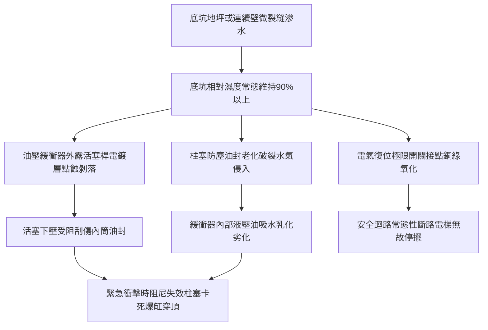

# 全案購屋實戰第八百六十六部：中古大樓社區電梯昇降路井道底坑油壓緩衝器液壓油乳化活塞桿鏽蝕微動極限開關接觸不良與安全防護體檢工序全書

## 壹、編撰宗旨與機電結構安全核心意涵

在中古集合住宅（屋齡 20 年至 35 年以上）的立體垂直運輸系統中，電梯底坑（Elevator Pit）位於整棟建築物結構之最底層（通常位於地下二層至地下四層之間），是整棟大樓重力沈降水氣匯集、地盤滲水與油泥雜質沈積之最嚴峻微氣候環境。電梯乘廂與配重側在衝頂或蹲底時，油壓緩衝器（Hydraulic Buffer）是電梯被動安全防護的「最後一道生命防線」。

本手冊針對台中南區與南屯區各大中古大型指標社區（例如：大安紫金城、長億南園、歌德堡、靜園等）之垂直電梯設備，詳解電梯底坑油壓緩衝器之構造原理、油封老化滲漏、液壓油乳化劣變、活塞桿鏽蝕卡阻、復位微動極限開關接點氧化，以及底坑防水防潮與保養體檢之標準工序，提供購屋家庭、社區管委會及機電監理人員最具前瞻性之專業指引。

---

## 貳、電梯底坑油壓緩衝器物理構造與阻尼耗能機制

### 一、油壓緩衝器之規格配置與法規要求
依據 CNS 10594（電梯製造與安裝安全規範）及內政部營建署相關建築設備規定：
1. **額定速度門檻**：
   - 額定速度 $V \le 1.0\text{ m/s}$（60 m/min）之低速電梯，得採用彈簧緩衝器（Spring Buffer）。
   - 額定速度 $V > 1.0\text{ m/s}$（90 m/min、105 m/min 以上）之高速中高樓層電梯，**必須強制採用油壓緩衝器（耗能型緩衝器）**。
2. **行程計算標準**：
   油壓緩衝器之有效行程 $S$ 必須滿足當乘廂以 $115\%$ 額定速度衝擊時，平均減速度不得大於 $1.0\,g$（$9.8\text{ m/s}^2$），且減速度大於 $2.5\,g$ 的持續時間不得超過 $0.04\text{ 秒}$。其最小理論行程公式為：
   $$S \ge 0.0674 \times V^2 \quad (\text{行程 } S \text{ 單位為公尺，速度 } V \text{ 為公尺/秒})$$
   例如額定速度 $1.75\text{ m/s}$（105 m/min）之電梯，其緩衝器衝程至少需達到 $206\text{ mm}$ 以上。

### 二、油壓阻尼構造與內部孔流特性
1. **多孔節流柱柱塞構造**：緩衝器內部包含缸筒、活塞桿（Plunger）、回位彈簧、阻尼油液孔與油孔變截面套筒。
2. **定減速流力平衡**：當乘廂或對重以高速撞擊緩衝器頂部柱塞時，活塞被迫下壓，將油室內部液壓油以超高壓強制擠過錐度節流孔，藉由液體分子剪切摩擦力將龐大的動能瞬間轉化為熱能消散，確保乘廂平穩減速制停，避免剛性撞擊造成車廂結構崩裂與乘客頸椎骨折。

---

## 參、中古社區電梯底坑常見隱形病徵與劣化機制

### 一、底坑地下水滲透與極度潮濕
中古大樓底坑常因連續壁施工縫防水毯劣化、底板二次澆置縫滲水或沉水泵浦排水不良，導致坑底長年積水或濕度高達 $90\% \sim 98\%$。高濕環境加速鋼件電化學腐蝕。

### 二、活塞桿（Plunger）電鍍層鏽斑與剝落
長期暴露於潮濕空氣中之緩衝器柱塞桿，其表面鍍硬鉻層若出現微小砂眼或刮傷，電解質水膜將使底層碳鋼產生紅鏽點。當活塞桿下壓時，鏽蝕毛刺會瞬間割破丁腈橡膠（NBR）油封，引發液壓油大量洩漏。

### 三、液壓油乳化與阻尼系數崩解
緩衝器內通常填充 ISO VG 46 或 VG 68 級耐磨抗水液壓油。當大氣呼吸作用吸入高濕水氣後，油水乳化形成白色乳膠狀液體，導致黏度指數驟降、抗磨耗添加劑水解失效。遇高速衝撞時，乳化油無法提供額定剪力阻尼，極易產生氣蝕空化爆震。

### 四、電氣復位安全極限開關接觸不良
依據安全法規，油壓緩衝器必須配備「柱塞復位確認開關」（Buffer Return Safety Switch）。當緩衝器受壓後未回位至原點時，此極限開關強制切斷電梯安全迴路主接觸器電源，防止電梯在緩衝器失效下運轉。然而在潮濕底坑中，該微動開關之銀合金接點極易氧化積碳，導致電梯無預警當機或停跳保護。

---

## 肆、全流程標準體檢與保養工序

### 一、底坑安全環境確認與斷電作業
1. **派梯懸空**：將乘廂駛離底坑至 2 樓或 3 樓位置，切斷主電源開關並施加安全掛鎖（LOTO, Lockout/Tagout）。
2. **底坑急停鎖定**：維保人員進入底坑前，必須先在乘場外側按下底坑緊急停止開關（Pit Stop Switch），開啟底坑照明燈，確認底坑無有害氣體、積水深未超過 5 公分。
3. **乘場圍籬警戒**：一樓昇降路乘場門設置安全警示護欄與維護告示牌，防止人員墜落。

### 二、油壓緩衝器機械本體檢測
1. **外觀油漬與油位查驗**：
   - 透過液位觀測窗（Oil Level Sight Glass）檢查油位是否介於最高（MAX）與最低（MIN）標線之間。
   - 檢查油色是否清澈透明（淡金黃色）；若呈乳白色混濁狀、咖啡色酸化泥狀，必須徹底更換新油。
2. **柱塞桿表面精度檢驗**：
   - 使用乾淨無塵棉布擦拭活塞桿表面。
   - 檢查硬鉻層有無凹坑、鏽斑、剝落或縱向拉傷痕跡。表面粗糙度需達到 $Ra \le 0.4\,\mu\text{m}$。
3. **回位彈簧與防塵套完整性**：
   - 檢視活塞桿伸縮防塵套（Bellows）有無破損、硬化、龜裂；防塵套箍環是否緊固。

### 三、電氣安全開關與迴路測試
1. **導通電阻量測**：使用高阻數位萬用電表量測復位開關接點接觸電阻，阻值應低於 $0.5\,\Omega$。若阻值偏高，應使用電氣接點活化劑清洗或直接更換全密封 IP67 防水防塵等級極限開關。
2. **動作模擬測試**：手動下壓極限開關搖臂，確認電梯控制主機安全迴路燈號（Safety Circuit LED）立即熄滅並跳脫安全接觸器。

### 四、緩衝器實載回位能力試驗（Return Test）
1. **機械式壓縮或手動頂壓**：利用千斤頂或專用手動壓桿將油壓緩衝器柱塞完全壓入底部行程。
2. **自由復位秒數測定**：迅速釋放壓力，使用精密電子碼表計時柱塞由全壓縮狀態回彈至完全伸展定位之時間。
3. **合格標準判定**：依 CNS 10594 標準，緩衝器自全行程壓縮釋放後，**完全自動復位時間必須小於 90 秒**；若回位遲緩、卡死或超過 90 秒，判定為內部活塞卡阻或回位彈簧永久金屬疲勞，必須立即停機檢修或全組汰換。

---

## 伍、購屋實戰談判與管委會公設體檢評估手冊

### 一、購屋者看屋查驗重點（避坑金律）
1. **機房保養紀錄卡審閱**：調閱電梯每月定期保養紀錄單，確認維保公司是否有定期針對「底坑清潔」、「緩衝器油位」及「復位開關測試」確實打勾簽名。
2. **年度安全檢查合格標章**：確認昇降設備安全檢查合格證是否在有效期限內，並向管理室確認最近 3 年是否有「電梯底坑淹水」或「緩衝器更換」之請款報修紀錄。
3. **一樓乘場搭乘垂直震動感知**：若電梯停靠一樓或地下室平層時有明顯金屬頓挫感、沉底超程下墜感，往往代表平層感應器與底坑限位連鎖調校失準。

### 二、公設專項體檢與整改預算估算表

| 檢修／更換項目 | 規格標準 | 預算區間（每台電梯） | 嚴重程度與改善時效 |
| :--- | :--- | :--- | :--- |
| **緩衝器液壓油全面抽換與清洗** | ISO VG 46/68 耐磨抗乳化液壓油 | 3,000 ~ 5,500 元 | 中度（每 3~5 年常態保養） |
| **活塞防塵套更換與防鏽拋光** | 耐油丁腈橡膠伸縮防塵套 | 2,500 ~ 4,000 元 | 中度（發現破損即時更換） |
| **防水型復位極限開關更換** | IP67 防水防爆雙斷點微動開關 | 1,500 ~ 3,000 元 | 重度（故障引發停梯立即處置） |
| **油壓緩衝器總成汰舊換新** | 額定速度 105 m/min CNS 認證新品 | 38,000 ~ 65,000 元 | 極高（活塞刮傷卡死必須立即換新） |
| **電梯底坑連續壁高壓灌漿防水** | 雙液型親水性聚氨酯（PU）發泡樹脂 | 15,000 ~ 35,000 元 | 極高（治本根除底坑濕氣積水） |

---

## 陸、本案結語與維運行動清單

電梯底坑油壓緩衝器平時靜止不動，但在系統發生超越極限行程（Over-travel）之千鈞一髮之際，卻是挽救整車乘客生命之終極制動防線。購屋者在評估 20 年以上之優質中古社區時，不僅要關注室內裝潢與採光，更應深入了解社區管委會對此類隱蔽公設之維護嚴謹度。

透過科學化、數據化與標準化的底坑油壓緩衝器體檢工序，方能確保家庭置產歷久彌堅，為家人打造全方位零死角的安居家園。
