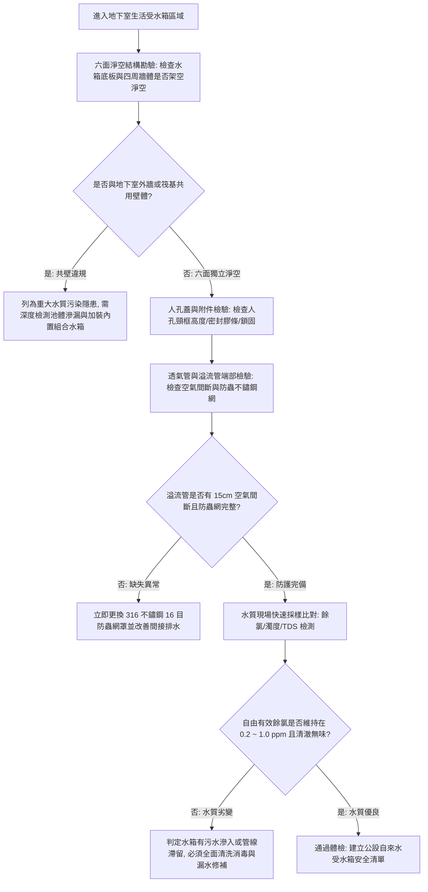

# 全案購屋實戰第八百零七部：中古大樓社區地下室生活自來水受水箱蓄水池池體裂縫滲水進水浮球閥卡阻無效溢流管防蟲網破裂與水質二次污染體檢工序全書

## 壹、 導言與實務體檢核心概述

在集合住宅中古電梯大樓之自來水給水供應鏈中，地下室生活受水箱（蓄水池 / Underground Water Cistern）承接自來水事業處（台水公司）幹管輸配之第一手水源，再經由揚水泵浦抽送至頂樓水塔。受水箱儲水量通常依據全棟住戶 1 至 2 日之尖峰總用水量設計（約數十至百餘立方公尺）。其結構型式在 20 至 35 年屋齡之大樓中，主要分為**鋼筋混凝土（RC）池體內襯防水層**或**組合式不鏽鋼（SUS304/SUS316）水箱**。

依據中華民國自來水法第 49 條、自來水用戶用水設備標準及內政部營建署相關建築設備規範，自來水蓄水池與受水箱之設置必須維持嚴格之**「六面淨空（Six-sided Clearance）」**，即水池之上、下及四周均不得與建築物結構外牆、地板或化糞池共用壁體，四周需保留至少 $60\ \text{cm}$ 以上之巡檢走道，水箱頂部與梁底需留有 $70 \sim 100\ \text{cm}$ 之檢修空間，以防止地下水、土壤污水或污水管漏水沿混凝土毛細孔及裂縫反向滲入，引發致命之水質二次污染。

然而，在屋齡逾 20 至 35 年之中古社區中，受水箱普遍存在「與地下室地樑共用底板」、「外牆共壁」之早期違規施工弊端；歷經數十年地盤不均勻沉陷與多次地震拉扯，池體產生貫穿性裂縫；加之透氣管與溢流管端部防蟲不鏽鋼網罩鏽蝕破洞、維修人孔蓋未密閉防雨，造成地下室蚊蟲、蟑螂、老鼠甚至富含大腸桿菌群之地下污水直接滲入蓄水池，導致全棟飲用水遭受二次污染。

本手冊為買方提供受水箱池體結構與水質衛生安全之專業公設體檢工序。

---

## 貳、 受水箱結構滲漏與水質二次污染失效機理

### 一、 混凝土池體貫穿性裂縫與污水負壓滲入
1. **共壁結構與剪力裂縫：** 早期大樓為節省開挖成本，直接將受水箱底板澆置於筏基基礎底板上，兩側直接借用地下室擋土壁。當周邊地下水位高漲或降雨土壤水壓升高時，若水池內部水位下降至低水位，池內外形成極大水壓差（$\Delta P = \rho g h$）。地下污水順著混凝土冷縫（Cold Joints）與毛細微孔被強力「擠入」受水箱內，使自來水受到大腸桿菌、重金屬與氨氮污染。
2. **內襯防水層水解脫落（Epoxy / FRP Delamination）：** RC 池體內部塗刷之環氧樹脂（Epoxy）或玻璃纖維（FRP）防水層，在水中餘氯與高濕度環境下歷經 15 年以上產生化學水解，防水膜起泡、龜裂並大面積剝落，露出底部碳化發黑之混凝土骨材，滋生厭氧菌與軍團菌。

### 二、 溢流管、透氣管與人孔附件失效
1. **溢流管（Overflow Pipe）間接排水失效：** 依規範溢流管末端排入地下室集水坑時，必須保持至少 $15\ \text{cm}$ 以上之「空氣間斷（Air Gap）」，嚴禁直插集水坑液面下。若現場排水管直接連通污水管且無空氣間斷，集水坑暴滿時污水將直接倒灌回吸入受水箱。
2. **防蟲銅網/不鏽鋼網鏽蝕破洞：** 溢流管與透氣管末端之 16 目防蟲網長期處於潮濕環境，金屬網絲電化學腐蝕破裂，蟑螂與蛾蚋沿管壁爬入產卵，箱內水源遭到生物毒素污染。
3. **人孔蓋（Manhole Cover）密閉防水失效：** 傳統鑄鐵或白鐵人孔蓋邊緣缺乏 EPDM 彈性密封膠條，且未高出水箱頂面 $10 \sim 15\ \text{cm}$（未設頸框）。地下室地面沖洗水、機房漏油順著人孔縫隙直接滴入池中。

---

## 參、 現場實勘與機能檢測驗收標準工序（SOP）



### 一、 受水箱衛生安全實勘四步法
1. **六面淨空與共壁排查法（Clearance & Common-wall Audit）：**
   - 攜帶強光手電筒巡視受水箱周圍與底部維修走道。
   - 合格標準：水箱池體四周必須具備完整巡查空間（距離牆面至少 $60\ \text{cm}$，水箱架空於墩座上離地至少 $45\ \text{cm}$）。若水箱一側直接為山壁擋土牆，或底部直接為地下室最深層筏基地面，即為存在地下水滲入風險之高危共壁結構。
2. **溢流管空氣間斷量測（Air Gap Verification）：**
   - 找到受水箱溢流排管出口（通常導引至地下室廢水坑）。
   - 量測溢流管口與廢水坑最高溢流水位（或地面排水格柵）之垂直淨距。
   - 合格標準：垂直間隔距離必須大於管徑之 $2$ 倍且不得小於 **$15\ \text{cm}$**。若管口埋入水溝中，判定為嚴重排水逆灌缺失。
3. **透氣管防蟲網罩完整性查驗：**
   - 檢查所有通風透氣管（U 型彎頭向下）末端防蟲罩。
   - 合格標準：必須安裝耐腐蝕 304/316 不鏽鋼材質、孔目為 **$16 \sim 24$ 目** 之金屬濾網，且周圍以白鐵束環緊固，無鬆脫、破洞或灰塵油脂完全糊死情況。
4. **自來水現場快速理化檢測（On-site Water Quality Test）：**
   - 自水箱採樣閥或底層住戶龍頭採集新鮮水樣。
   - 使用 DPD 試劑檢測「自由有效餘氯」：標準值必須維持在 **$0.2 \sim 1.0\ \text{ppm}$（$\text{mg/L}$）**。若餘氯為 $0\ \text{ppm}$，代表水箱容積過大水質滯留變質，或池內存在大量有機物/地下水將氯耗盡。
   - 檢測濁度（NTU）與總溶解固體量（TDS）：TDS 不得大幅高於當地台水出廠均值（台中約 $150 \sim 250\ \text{ppm}$）。若暴增至 $500\ \text{ppm}$ 以上，高度懷疑地下水滲漏灌入。

---

## 肆、 購屋合約防坑特約條款與修繕責任劃分

在中古成屋合約中，針對全棟自來水生活水質安全與公設水箱維護，應明訂以下專項條款：

```markdown
### 買賣契約防坑特別約定事項：公設自來水受水箱結構衛生與飲用水安全保障條款

1. 【受水箱衛生合格保證】：賣方保證本社區生活自來水受水箱無結構性滲水、無地下水逆滲污染，且管委會每半年均依規定委託具合格自來水水池水塔清洗執照業者完成清洗與水質檢驗合格。
2. 【水質重大污染瑕疵排除】：買方有權委託第三公正水質檢驗單位（SGS 或環保局認可實驗室）進行水質採樣。若檢出總大腸桿菌群超標、重金屬異常，或現場查核受水箱存在共壁裂縫滲漏、溢流管無空氣間斷倒灌之情事者，賣方應督促管委會於交屋前完成修繕與全池清洗消毒；若無法修復達自來水飲用標準，買方得順延交屋尾款給付或無條件解除買賣契約。
```

---

## 伍、 本專項工序體檢總結

水是維繫全家人每日健康之生命源泉。中古大樓受水箱若因年久失修裂縫滲漏、防蟲網破裂或共壁污染，將無聲無息地摧毀全家人的消化道與免疫防線。買方在簽約與驗屋階段，落實對地下室受水箱六面淨空、防蟲網與餘氯水質之深度體檢，方能為家人的飲用水安全築起最堅固的堡壘。
