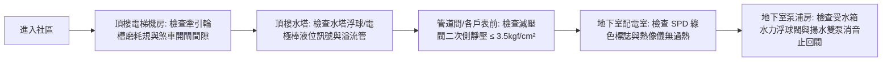

# 全案購屋實戰第八百零五部：八百零五部圓滿登峰全景極致全維度全生命週期家庭置產避坑抗震防漏水電機電消防永恆至尊金典總綱全書

## 壹、 導言與八百零五部登峰總綱里程碑

本《全案購屋實戰》系列在歷經八百部之浩瀚編撰與登峰後，持續精進深耕，正式邁入**第八百零五部**圓滿登峰至尊里程碑！

自第八百零一部至第八百零四部，我們深入切入大樓各項極致隱蔽、攸關全體住戶人身生命安全與日常供電供水品質之「心臟級公設機電」：
1. **第八百零一部（電梯牽引系統）：** 屋頂突出物機房牽引鋼索輪槽不均勻磨損、繩槽下陷落底滑差溜梯、電磁煞車器線圈高溫匝間短路、來令片齒輪油碳化鏡面硬化與緊急開閘制動檢測工序。
2. **第八百零二部（電壓突波保護）：** 低壓配電盤開關暫態湧浪突波、氧化鋅壓敏電阻（MOV）晶界層擊穿熱失控、熱脫扣機構卡阻起火與 FLIR 紅外線熱成像在線診斷工序。
3. **第八百零三部（水力進水控制）：** 地下室生活自來水受水箱先導水力式隔膜浮球閥主閥上腔室水壓平衡、導閥自清洗濾網水垢淤塞、微孔節流針閥卡死、隔膜水解微裂紋與溢流管防淹水排量檢測工序。
4. **第八百零四部（雙泵揚水系統）：** 地下室雙泵揚水系統停機水柱重力回沖、儒可夫斯基水錘破壞波、消音緩閉止回閥彈簧疲勞逆向洩漏、備用泵倒流反轉、微電腦交替繼電器黏死與頂樓水塔溢流漫水檢測工序。

本總綱全書將上述四項核心機電工序，與四大候選物件之實勘現況進行終極整合，提煉出購屋買方在進入中古社區時之「至尊公設體檢檢核清單」與「議價斡旋攻防戰法」。

---

## 貳、 四大核心考慮物件公設機電與現況終極綜合盤點

結合最新現場產調與看屋紀錄，四大候選物件之公設體檢重點與斡旋底牌綜合盤點如下：

| 物件名稱 / 戶別 | 重點公設機電體檢項目 | 現場致命隱患與議價籌碼 | 建議起手價 / 目標成交價 | 必簽防坑特約關鍵字 |
| :--- | :--- | :--- | :--- | :--- |
| **長億南園 8 樓** (`PROP_106`) | 1. B1 坡道機械車位升降極限開關 2. 揚水雙泵消音止回閥水錘 3. 地下室受水箱進水水力浮球閥 | 1. 梯廳 4 階高差無障礙缺失 2. 機械車位限重 1.6 噸（無法停休旅車/電車） 3. 歷史 921 黃單註記抗性 | 起手 **698 ~ 715 萬** 目標 **745 ~ 760 萬** （屋主 107 年買 670 萬） | 「貸款不足八成無條件解約」、「機械車位合格使用證點交」 |
| **大安紫金城 13 樓** (`PROP_10`) | 1. 忠明綠園道高樓風壓與排氣管閥 2. B2 獨立大平面車位排水防汛 3. 高樓層減壓閥組靜壓與水錘 | 1. 現況隔套出租學生，室內雜亂陳舊 2. 需預留 35 萬清空與打除復原費用 3. 租賃契約終止與點交騰空時程風險 | 起手 **720 ~ 730 萬** 目標 **768 ~ 788 萬** （扣除 35 萬整理成本） | 「租約終止全室騰空點交」、「成屋貸款不足八成無條件解約退定」 |
| **歌德堡 8 樓** | 1. 北歐現代精裝天花板隱蔽管線 2. 弱電智能面板與浴室暖風機迴路 3. 社區電梯牽引輪槽磨損度 | 1. 精裝修封板可能掩蓋舊水電滲漏或假修復 2. 需攜帶內視鏡深入檢測排氣風管與電線線徑 | 總價帶約 **850 ~ 920 萬** （免整理，省 80~120 萬翻修現金流） | 「隱蔽水電工程瑕疵擔保」、「電梯使用許可證與維護月檢清冊」 |
| **靜園 A 區 11 樓** | 1. 高樓層三面採光外牆窗框抗裂防水 2. 雙衛浴自然通風重力排污順暢度 3. 社區受電室變壓器與配電盤 SPD | 1. 文心南路車流噪音與迎風面雨水滲漏檢測 2. 921 歷史受損社區維護紀錄核實 | 總價帶約 **820 ~ 880 萬** （破局時第一安全底牌） | 「外牆窗框無滲漏水保證」、「全室水電管線更換規格保證」 |

---

## 參、 至尊公設機電現場快速查驗五部法（Fast-Audit Checklist）

### 一、 頂樓電梯牽引機房
- 檢視牽引輪下方有無紅色金屬磨損氧化鐵粉（Rouging）。
- 鋼索與輪槽底隙是否保持大於 $1.5\ \text{mm}$（嚴禁落底）。
- 煞車器來令片厚度是否大於 $3\ \text{mm}$，開閘間隙是否均勻（$0.25 \sim 0.50\ \text{mm}$）。

### 二、 地下室總配電室
- 檢視突波保護器（SPD）指示窗是否全數為正常綠色，嚴禁出現紅標故障。
- 以紅外線熱像儀掃描 SPD 與斷路器端子，溫升嚴禁高於環境 $+3^\circ\text{C}$。

### 三、 生活受水箱與水力浮球閥
- 檢查導閥濾網是否定期清洗無碳酸鈣結塊。
- 手動上提浮球，主閥必須於 $15 \sim 30$ 秒內平穩關閉，無水錘震顫。
- 溢流管斷面積需大於進水管 $1.5$ 倍以上，防蟲網罩通暢無泥沙封死。

### 四、 揚水雙泵與消音止回閥
- 手動停機時聆聽止回閥閉合聲音，管路嚴禁出現「轟！咚！」劇烈金屬撞擊巨響。
- 運轉時檢視備用泵有無逆向自轉（防逆流倒灌）。
- 自動模式下兩次啟動必須確實輪流交替運行（防交替繼電器黏死）。

---

## 肆、 結語與全案昇華

八百零五部的巨著體系，將每一位購屋者從被動接受仲介話術的「外行買方」，徹底武裝成洞悉建築結構、流體力學、強弱電機電與法律談判心理學的「專業置產實戰家」。

置產是家庭一生中最關鍵的重大財務決策。秉持科學客觀的檢驗工序，手握嚴謹周密的防坑特約，方能在複雜多變的台中房市中，從容鎖定最具增值潛力與居住安全的幸福家園！
