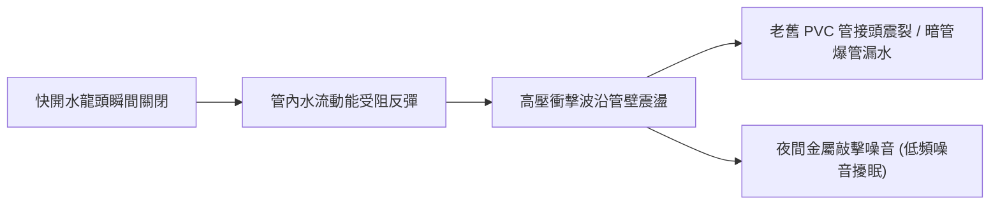
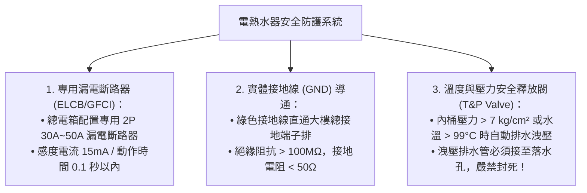

# 全案購屋實戰第六十一部：老屋冷熱水管水錘吸收器安裝工序與電熱水器安全維護全書

## 核心主旨
本篇為購屋實戰指引第六十一部，聚焦於中古大樓（28~29年屋齡）裝修翻新時，針對高樓層水錘效應之物理阻斷工法，以及自住安全不可或缺之儲熱/瞬熱式電熱水器漏電斷路維護標準。

---

### 一、中古大樓高樓層「水錘效應 (Water Hammer)」成因與物理阻斷工法

在台中南區 28~29 年中古大樓中，高樓層戶（如大安紫金城 13 樓、靜園A區 11 樓）常因加壓泵浦運轉或單把手快開陶瓷閥水龍頭瞬間關閉，導致管內高速流動之水流因慣性反彈，產生極高之瞬間衝擊波（水錘壓力可達正常水壓之 3~5 倍）。

#### 🛠️ 專業水電四大水錘消除標準施工規範：
1. **全不鏽鋼機械活塞式水錘吸收器（Water Hammer Arrester）安裝**：
   - 於各衛浴冷熱水混合龍頭進水端、洗衣機電磁閥進水口、以及熱水器冷水進口處，各安裝一組通過 ANSI/ASSE 1010 認證之不鏽鋼活塞式水錘吸收器。
2. **安裝位置原則**：
   - 水錘吸收器必須安裝於「快速關閉閥門之上游 15~20 公分處」，且採垂直向上或 45 度向上角度安裝，確保內部氣室緩衝功能永久有效。
3. **主幹管定壓減壓閥 (PRV)**：
   - 戶內總進水閥後方加設黃銅膜片式減壓閥，進屋靜態水壓恆定調校於 2.0~2.3 kg/cm²。
4. **管路固定防震管夾**：
   - 暗管與吊管每隔 1.2 公尺必須使用附橡膠防震墊之不鏽鋼管夾緊固於 RC 牆體，防止水流脈衝引發管線共振敲擊。

---

### 二、儲熱式 / 瞬熱式電熱水器安全防護與專用迴路工序

若因格局配置或天然瓦斯配管動線限制而採用電熱水器，安全防護必須達到醫療級標準：

---

### 三、買方隨身談判金句：針對屋況老舊設備之議價防線

當房仲試圖淡化屋齡管線問題時，買方應對話術：

> 「周小姐，大安紫金城屋齡已經 29 年了，以前又改裝成多間學生套房，暗管承受過無數次水錘震盪與改裝切割。我們買來自己住，全室水電必須全部打掉抽換成不鏽鋼壓接管並加裝全套水錘吸收器與減壓閥，這些隱蔽工程的現金支出都是算在我們的購屋預算內。這就是為什麼我們堅持起手 730 萬、目標 768 萬的原因，這才是實事求是的自住買方出價！」
