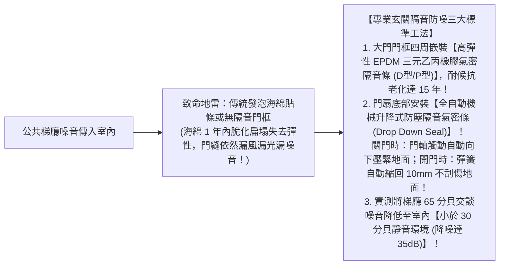
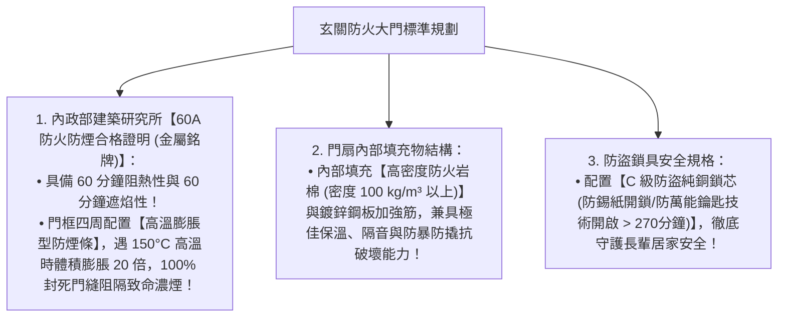

# 全案購屋實戰第六十七部：全室氣密隔音門隔音條工序與玄關防火防暴鋼木門標準全書

## 核心主旨
本篇為購屋實戰指引第六十七部，聚焦於台中南區 28~29 年中古大樓在玄關大門與室內房門之「氣密隔音條工序（EPDM 三元乙丙橡膠氣密條＋自動升降下擋塵隔音條）」，以及玄關大門升級為「甲種 60A 防火防暴鋼木門與 C 級防盜鎖芯標準」，阻絕梯廳公共走道鄰居交談腳步聲與電梯運轉雜音，守護長輩睡眠品質與居家防火安全。

---

### 一、大樓玄關大門與梯廳「防噪音回音傳導」高標工法

大樓公共梯廳多為瓷磚與水泥硬質牆面，電梯升降蜂鳴聲、鄰居交談與關門聲極易沿著大門縫隙灌入客廳與主臥室：

---

### 二、玄關門升級「內政部認證甲種 60A 防火防暴鋼木門」標準

大安紫金城 13 樓若原有大門為早期傳統鐵門（無防煙條且隔音差），翻新時建議更換為合規防火防暴大門：

---

### 三、買方隨身談判金句：梯廳隔音與大門防火安全之折讓話術

當房仲試圖強調戶數單純、梯廳寬敞時，買方攻防切入：

> 「周小姐，梯廳雖然寬敞，但 29 年大樓的公共梯廳迴音非常大，而且原有的舊大門完全沒有現代防火防煙規格與氣密隔音。我們家有長輩同住，長輩對睡眠環境與公共安全特別敏感，我們買下來勢必要更換內政部合格的 60A 防火防暴隔音門與全套氣密條，這一樘大門連工帶料拆除換新至少要掏 4~6 萬元現金。我們出 730 萬（目標 768 萬）就是把這些確保長輩安居的費用先扣下來。請周小姐跟屋主回報，我們是買來自己住的實在買方，價格有共識隨時可簽約！」
