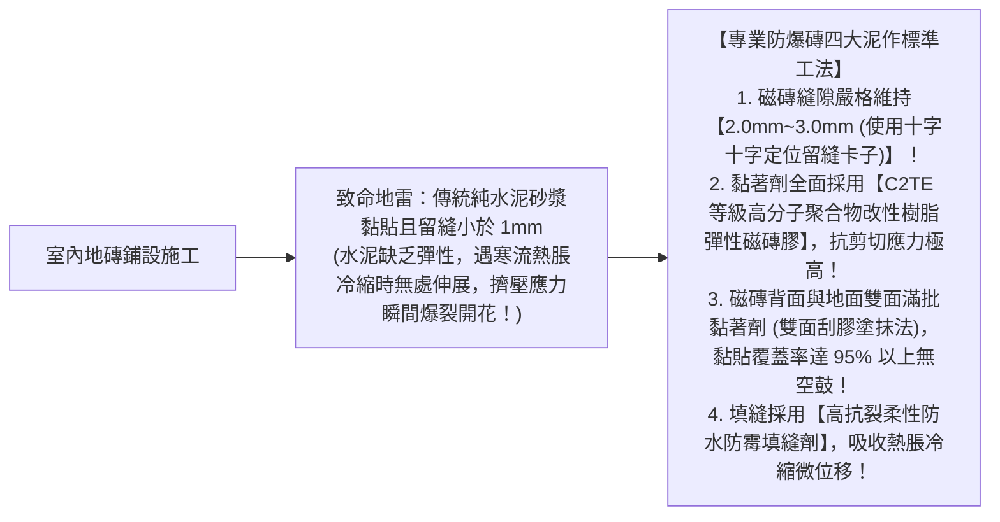
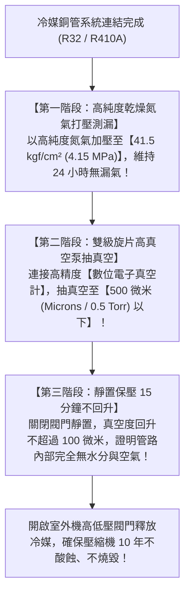

# 全案購屋實戰第六十三部：全室地暖與地磚澎拱預防工序暨空調冷媒管抽真空保壓全書

## 核心主旨
本篇為購屋實戰指引第六十三部，聚焦於台中南區 28~29 年中古大樓在室內地坪翻新時之「地磚膨拱（爆磚）預防工法與高分子彈性黏著劑選用」，以及冷暖變頻冷氣冷媒銅管「電子真空計抽真空保壓檢驗標準」，確保長輩居住安全與冷氣壓縮機十年高效運轉。

---

### 一、中古大樓地坪翻新「防地磚膨拱（澎拱 / 爆磚）」高標泥作工序

台灣冬季常遇強烈大陸冷氣團，氣溫驟降時，中古大樓常發生客廳地磚「整排隆起爆裂（俗稱膨拱）」的慘劇：

---

### 二、全室冷暖變頻冷氣「冷媒銅管抽真空與數位壓力錶保壓」標準

學生套房拆除翻新標準三房後，安裝冷氣室內機與室外機，**「抽真空與抓漏」是決定冷氣製冷效率與壓縮機壽命的命脈**：

---

### 三、買方隨身談判金句：針對老屋空調重配與地坪整修之預算抗辯

當房仲試圖說服買方「現況地磚擦一擦就能住」時，買方攻防切入：

> 「周小姐，大安紫金城現況是學生套房，地面經過多次隔間鑽孔破壞，而且 29 年前的舊磁磚已經大面積空鼓老化，我們自住不可能每天提心吊膽等著它冬天爆磚。我們必須全室打掉重新施作無障礙防膨拱地坪，加上全室冷氣銅管全部重拉抽真空，這些都是白紙黑字的硬性安全支出。我們出 730 萬是很有誠意接手整修，屋主如果要堅持 8 開頭，那請屋主自己先花 30 萬把全室空鼓磁磚拆除重鋪再來談。」
