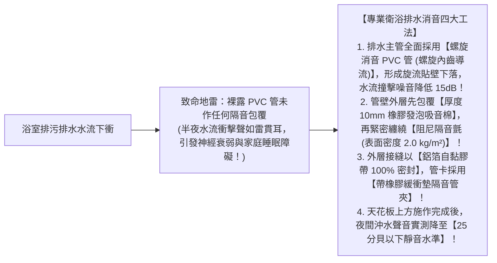
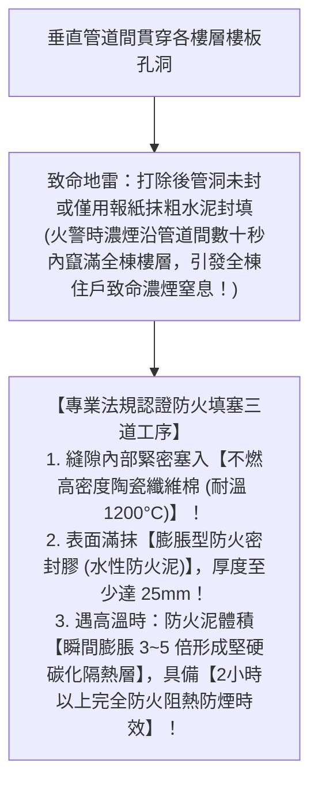

# 全案購屋實戰第六十九部：衛浴同層排水降板工序與管道間防火防煙填塞標準全書

## 核心主旨
本篇為購屋實戰指引第六十九部，聚焦於台中南區 28~29 年中古大樓在衛浴翻新之「同層排水與架高降板防噪工序」，以及大樓貫穿垂直管道間之「防火填塞（Firestopping）與防煙密封標準」，徹底解決老屋上下樓層沖水水流噪音擾眠，並封堵垂直管道間煙囪效應引發的火災濃煙擴散與臭氣回湧問題。

---

### 一、中古大樓衛浴「隔音減震排水管與防噪包覆」高標工序

中古大樓傳統排水管多為薄壁硬質 PVC 管，樓上住戶深夜沖馬桶或洗澡時，水流高速撞擊管壁產生的高達 50~60 分貝噪音，會直接穿透天花板干擾臥室安寧：

---

### 二、貫穿垂直管道間「防火填塞與耐火泥密封」標準

大樓貫穿各樓層的共同管道間，在建築法規中屬於「垂直防火區劃貫穿孔道」。28~29 年中古屋在套房改建時，管道間孔隙往往被敲破亂開孔而未封死，形成致命的**「煙囪效應」通道**：

---

### 三、買方隨身談判金句：管道間消防合規與防噪工程之價格攻防

當房仲試圖強調格局好改、水電很好做時，買方攻防切入：

> 「周小姐，大安紫金城原本被隔成多間學生套房，前屋主私自開孔走管，大樓原本垂直管道間的防火區劃與防煙填塞早已被嚴重破壞，而且老水管完全沒有消音包覆。我們自住買下來，必須請合格消防工班將管道間全部重新施作合規的膨脹型防火泥填塞，並把全室排污管線重新做隔音包覆，這筆為了全家人生命安全與睡眠品質的硬支出又是幾萬塊現金。我們出 730 萬（目標 768 萬）就是要把這些前屋主破壞的消防結構復原成本扣下來。請周小姐跟屋主好好談，我們是真正有誠意接手解決問題的買方，價格有共識隨時可簽約！」
