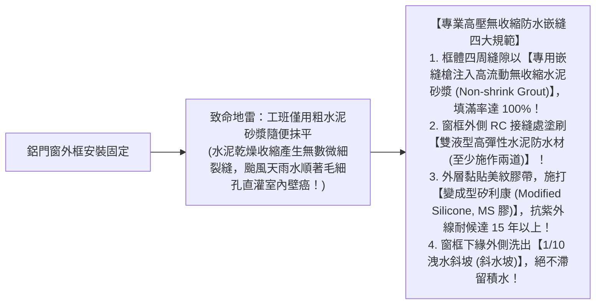
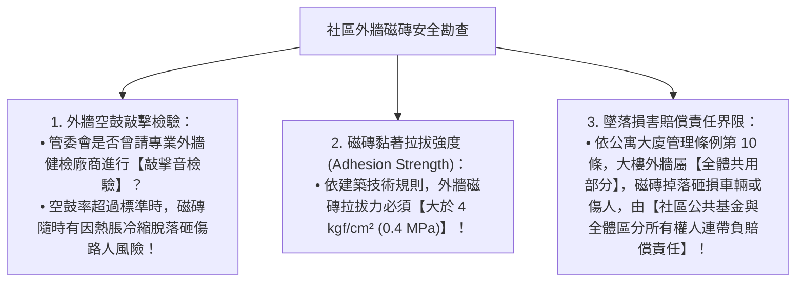

# 全案購屋實戰第六十二部：全室鋁窗防水嵌縫工序與外牆磁磚拉拔檢驗全書

## 核心主旨
本篇為購屋實戰指引第六十二部，聚焦於 28~29 年中古大樓在窗戶更新、外牆開口防水嵌縫之關鍵泥作水密工序，以及社區外牆丁掛磚/二丁掛磁磚拉拔力檢驗與外牆防墜安全責任判準。

---

### 一、中古大樓外牆鋁門窗「防水嵌縫 (Grouting) 與彈性水泥密封」高標工法

中古屋翻新換窗時，漏水往往不是發生在窗戶本體，而是**「鋁框與 RC 牆體之間的嵌縫水泥沒有灌飽、或防水層斷裂」**：

---

### 二、中古大樓外牆磁磚「拉拔測試 (Pull-off Test) 與管委會安全責任」

台中南區 28~29 年中古大樓（包括大安紫金城、長億南園等），外牆多為二丁掛磚或方塊磚。交屋前需檢視大樓外牆安全：

---

### 三、買方隨身談判金句：外牆與窗框老舊之折讓話術

當房仲強調高樓層通風採光好時，買方攻防切入：

> 「周小姐，大安紫金城 13 樓採光確實很棒，但 13 樓是迎風面，29 年的老外牆與舊鋁窗框已經歷過無數次颱風地震。我們買下來自己住，全室窗戶必須全部重新做高規格乾式包框與無收縮防水嵌縫，甚至室內窗邊都要重做斷水塗層，這筆窗框防水工程款又是十幾萬現金。我們出 730 萬是完全把這些老屋防颱抓漏的硬成本考慮進去，屋主如果理解自住客的謹慎，這個價格就能成交！」
