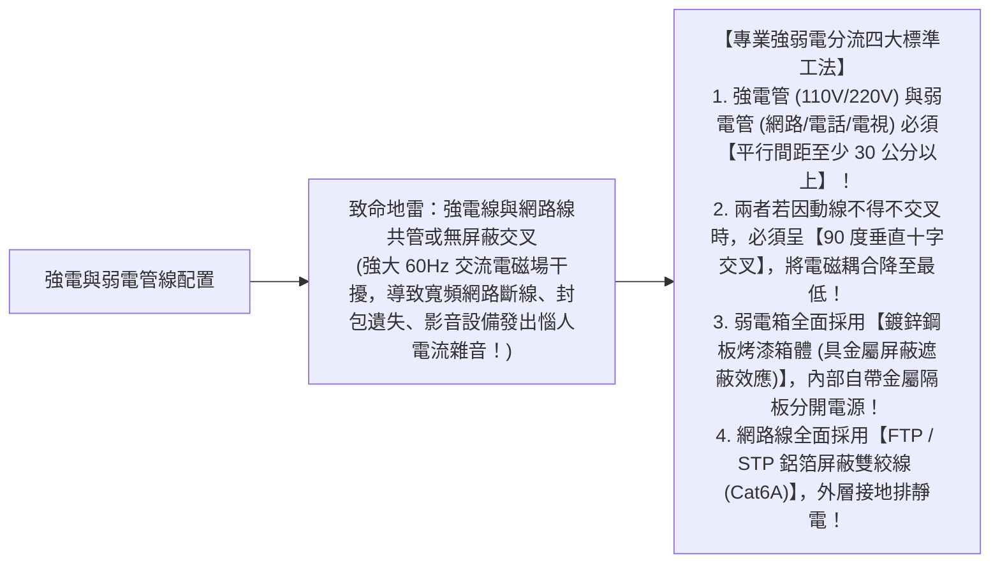
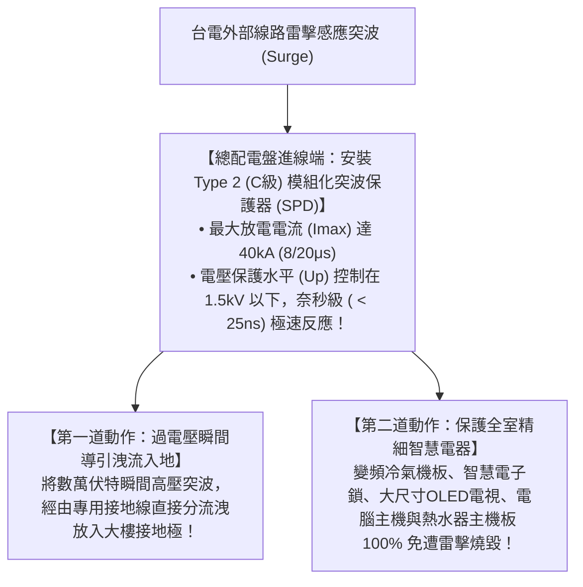

# 全案購屋實戰第六十五部：室內玄關強弱電分流工序與智慧配電箱防突波全書

## 核心主旨
本篇為購屋實戰指引第六十五部，聚焦於台中南區 28~29 年中古大樓在室內玄關與總配電箱之「強弱電分流隔離工法（防止高壓交流電電磁干擾弱電網路與音響訊號）」，以及配電盤加裝「B+C 級突波保護器 (Surge Protection Device, SPD)」，全面防範台中夏季雷擊突波燒毀全室百萬智慧家電與電腦設備。

---

### 一、玄關弱電箱與總配電箱「強電 vs 弱電物理隔離」高標工序

在老屋翻新中，劣質水電工班常為了圖省事，將 110V/220V 電線與 Cat6A 網路線、電視同軸電纜穿在同一個管道或緊貼配置：

---

### 二、總開關箱加裝「電源突波保護器 (SPD)」抗雷擊標準

台中南區夏季常有強烈雷陣雨與雷擊事件。高樓層大樓（如大安紫金城 13 樓）即使有避雷針，大氣雷擊感應過電壓仍會經由台電外線直接灌入室內電箱：

---

### 三、買方隨身談判金句：電箱老舊安全升級之折讓話術

當房仲試圖強調房子開價合理時，買方攻防切入：

> 「周小姐，大安紫金城是 29 年大樓，玄關配電盤還是當初老舊的黑鐵開關箱，線路混雜沒有強弱電分流，更完全沒有抗雷擊的突波保護設備。我們自住買下來，必須全室重新規劃標準獨立強弱電箱、重新做線槽隔離與加裝專業突波保護器，這筆水電升級費用又是幾萬塊實打實的現金支出。我們出價 730 萬（目標 768 萬）就是要把全家人的用電安全與耐用性徹底做好。請周小姐向屋主轉達我們自住客的誠意，有共識我們隨時出來下斡旋！」
