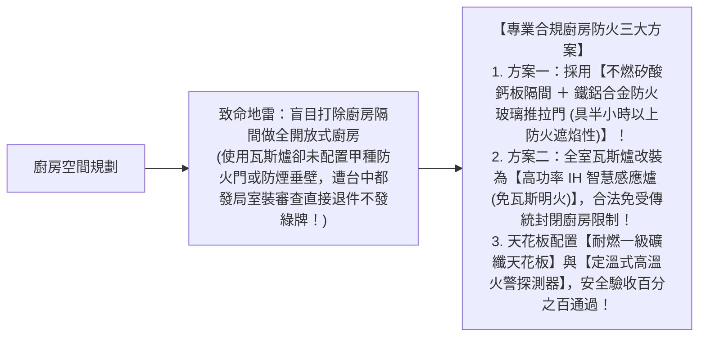
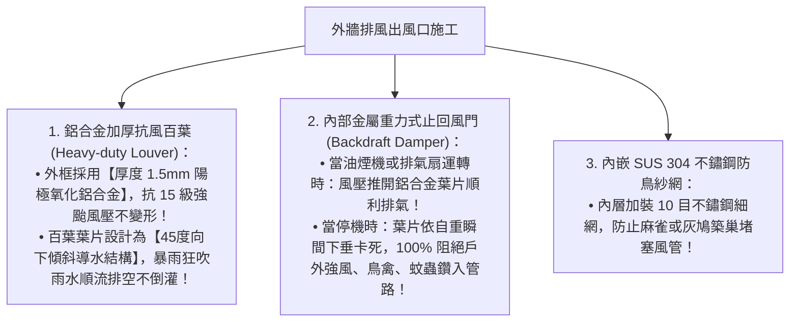

# 全案購屋實戰第六十八部：全室鋁合金百葉排氣閥與廚房防火區劃煙霧阻隔全書

## 核心主旨
本篇為購屋實戰指引第六十八部，聚焦於台中南區 28~29 年中古大樓在廚房與後陽台區域之「防火區劃防煙壁與防火門規範」，以及「全室鋁合金百葉排氣閥 (Louver Dampers) 阻煙防蟲工序」，確保老屋重新規劃標準開放或獨立廚房時，兼具消防法規合規與高樓層強風氣密安全。

---

### 一、中古大樓廚房翻新「防火區劃與防煙壁 (Smoke Barrier)」施工規範

學生套房拆除重新規劃為標準自住三房後，廚房若使用天然瓦斯明火設備，依現行建築技術規則，防火區劃要求極為嚴格：

---

### 二、後陽台通風百葉「防風防蟲防倒灌重力排氣閥」工序

大安紫金城 13 樓屬於高樓層戶，後陽台熱水器排氣口與抽油煙機排煙管穿出外牆時，外牆百葉必須具備抗風防回流功能：

---

### 三、買方隨身談判金句：廚房防火合規與外牆排風改造之價格攻防

當房仲強調廚房寬敞、動線自由時，買方攻防切入：

> 「周小姐，大安紫金城原本隔成多間套房，動線雜亂且破壞了原本的廚房防火區劃。我們自住買下來，依法必須向台中市政府申請室裝審查（簡審）。為了符合消防法規，廚房的防火門、耐燃建材與外牆重力排風閥全部都要按法規重新施作，這筆防火合規簽證與泥作水電款又要多花好幾萬。我們堅持出價 730 萬（目標 768 萬）就是為了把這間房子合法、安全地恢復為能住一輩子的標準好宅。請周小姐向屋主轉達我們實實在在的出價誠意，屋主若願意在交屋前騰空排除所有租約，我們隨時可簽約！」
