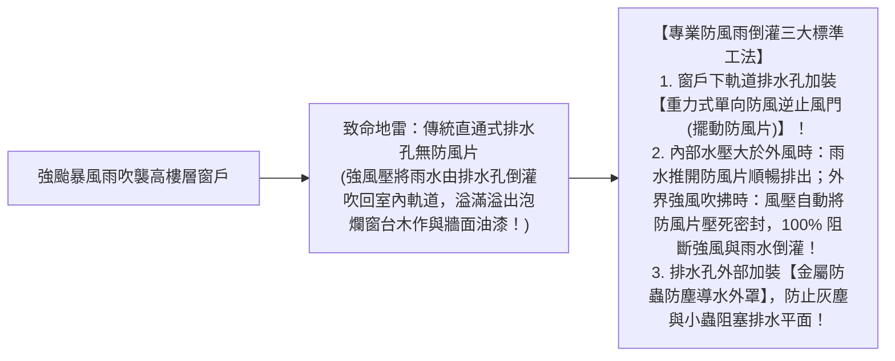
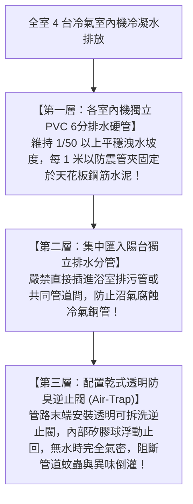

# 全案購屋實戰第六十六部：全室鋁窗洩水孔防風雨倒灌工序與冷氣冷凝水立管排水專利全書

## 核心主旨
本篇為購屋實戰指引第六十六部，聚焦於台中南區 28~29 年中古大樓在窗戶工程之「鋁門窗下框隱形排水孔單向防風逆止閥工序（防颱風強風倒灌雨水）」，以及冷暖空調多聯機之「冷凝水獨立立管防虹吸與防臭氣專利工法」，杜絕高樓層颱風天窗台漏水與老舊管道排水不良導致之天花板受潮發霉問題。

---

### 一、中古大樓高樓層鋁門窗「下框洩水孔單向防風逆止閥」防颱工序

大安紫金城 13 樓屬於高樓層迎風面戶。颱風或強降雨時，外界強風會在窗戶下軌道產生強大正風壓，導致軌道積水無法順利排出，反而被強風吹回室內：

---

### 二、全室冷氣多聯機「冷凝水獨立集中立管」防臭防漏工法

學生套房拆除重新規劃為自住標準三房後，客廳與三間臥室共 4 台室內機之冷凝水排出是隱藏工程的重中之重：

---

### 三、買方隨身談判金句：高樓層防颱與空調排水工程之價格抗辯

當房仲試圖強調高樓層景觀無敵、採光極佳時，買方攻防切入：

> 「周小姐，13 樓高樓層景觀雖然好，但迎風面的風壓與颱風天雨水倒灌風險比低樓層大好幾倍。29 年的老鋁窗完全沒有現代防風雨逆止排水設計，而且套房改回三房後，全室冷氣冷凝水管必須全部重新開槽走天花板獨立排放，這些高樓層專屬的防颱與排水管路工序，隨便算都是十幾萬的額外工程款。我們堅持 730 萬起手、目標 768 萬，就是實打實把這些看不見的整修成本扣下來。請周小姐向屋主講明我們是很有誠意接手的好買方，只要屋主願意在交屋前騰空排除租約，我們隨時簽約！」
