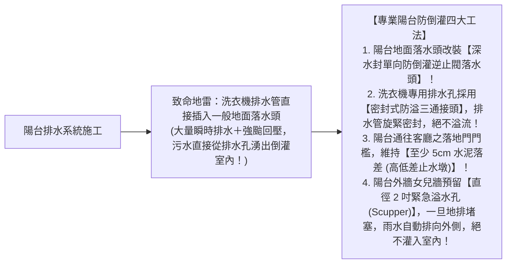
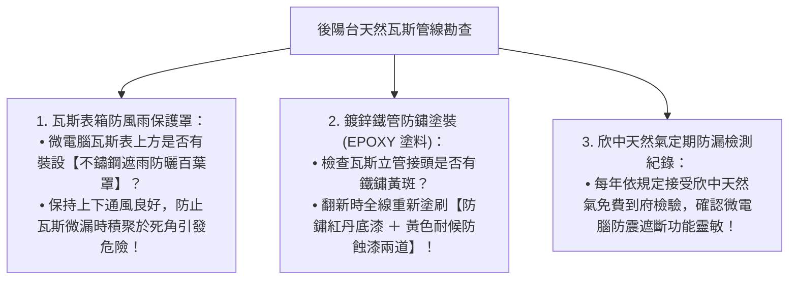

# 全案購屋實戰第六十四部：陽台排水防倒灌高低差工序與瓦斯表箱防銹通風全書

## 核心主旨
本篇為購屋實戰指引第六十四部，聚焦於台中南區 28~29 年中古大樓在陽台區域之「洗衣機與暴雨排水防倒灌斷水工法」，以及欣中天然氣「微電腦瓦斯表箱外罩防鏽通風與定期氣密巡檢標準」，杜絕陽台積水倒灌客廳木地板與老舊瓦斯管線鏽蝕漏氣之居家安全隱患。

---

### 一、中古大樓前後陽台「暴雨與洗衣機排水防倒灌」高標工序

中古大樓在強颱豪雨或高水位排水時，常因公共立管回壓導致陽台地面「咕嚕咕嚕冒水，污水直接漫過客廳大門泡爛全室木地板」：

---

### 二、欣中天然氣「微電腦瓦斯表箱防鏽通風與室內管防蝕」標準

大安紫金城與長億南園瓦斯管線多設置於後陽台，由於常年晾衣濕氣重，金屬管件容易鏽蝕：

---

### 三、買方隨身談判金句：陽台管線與水電老舊之價格攻防

當房仲強調該戶通風採光好、陽台很大時，買方攻防切入：

> 「周小姐，後陽台空間大確實很實用，但 29 年中古大樓的後陽台也是最容易踩雷的地方。水管公共排污立管老化、下大雨容易倒灌，而且瓦斯管線長年受潮鏽蝕，我們買來是自住，陽台泥作高低差、專用防溢落水頭跟瓦斯防蝕重拉全部都要做，這些零零總總的工班費用加起來都是十幾萬的預算。我們堅持出 730 萬（目標 768 萬）就是要把全家人的安全基底打好。請周小姐跟屋主好好溝通，我們是有備而來的實客，只要價格合理、租客騰空，我們隨時可簽約！」
