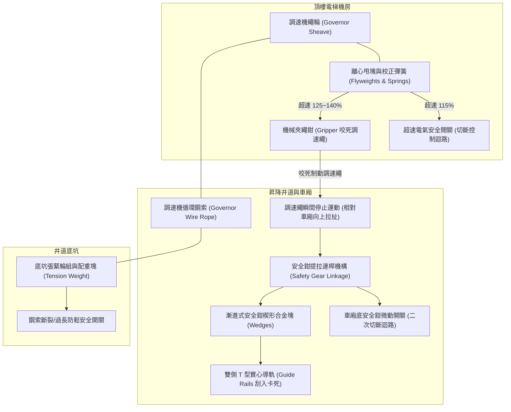
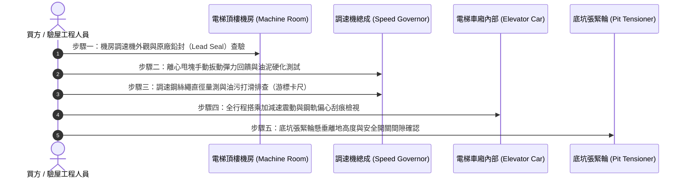

# 全案購屋實戰第六百一十七部：中古大樓社區電梯調速機夾繩鉗磨損飛塊離心彈簧疲勞失準與超速溜梯下墜安全鉗制動體檢工序全書

---

## 序章：超速防護與機械制動——垂直昇降最後一道絕境生命防線

在中古大樓所有安全機構中，「調速機（Speed Governor / Overspeed Governor）」與「安全鉗（Safety Gear）」共同構成了電梯在遭遇鋼索斷裂、煞車抱閘打滑、主機減速箱齒輪崩齒或變頻失控時，**唯一完全不仰賴電力、純靠機械物理慣性鎖死車廂於導軌上**的終極防下墜系統。

依據中華民國國家標準 **CNS 10594（電梯）** 及國際通用標準 **EN 81-20/50** 規範：
1. **電氣超速開關動作速度（Electrical Tripping Speed）**：當電梯運行速度達到額定速度（Rated Speed, $V$）之 **115%** 時，調速機上的微動安全開關必須立即切斷主控制安全迴路與驅動馬達電力，並觸發主機機械煞車抱閘。
2. **機械夾繩安全鉗動作速度（Mechanical Tripping Speed）**：若電氣斷電後車廂因重力仍持續加速，當下墜速度達到額定速度之 **115% 至 140%** 之間（依梯速階梯分級，通常不得超過 $1.25V + 0.25/V$），調速機之離心飛塊必須完全甩開，機械夾繩鉗（Governor Rope Gripper）必須瞬間卡死調速機鋼絲繩，透過拉動車廂底部之連桿安全總成，強制迫使「漸進式安全鉗（Progressive Safety Gear）」之合金楔塊咬入昇降導軌，於 0.2 至 1.0 秒內將重達數噸之電梯車廂牢牢鉚死在鋼軌上，杜絕失速墜井。

然而，在屋齡 20 至 35 年的中古社區中，調速機長年置放於頂樓機房或井道頂端，極易面臨「離心飛塊轉軸油泥硬化」、「調速彈簧金屬疲勞導致動作速度大幅漂移」、「夾繩鉗刃口磨損打滑」以及「車廂底安全鉗連動拉桿鏽蝕咬死」等隱形致命盲區。一旦大樓發生主纜繩打滑溜梯，最後一道防線若徹底癱瘓，後果將不堪設想。

本冊《全案購屋實戰第六百一十七部》深度剖析電梯調速機、調速鋼索、張緊輪與安全鉗制動聯動系統之內部力學機制與劣化徵兆，並制訂買方於現場看屋與公設查驗時之實戰驗證工序。

---

## 第一章：調速機與安全鉗聯動系統物理架構與失控失效機理

### 一、系統拓撲與動作邏輯傳遞鏈
電梯超速保護總成由「頂端調速機」、「閉環調速鋼絲繩」、「底坑張緊輪」與「車廂底安全鉗組」四大組件構成閉環拓撲：

---

### 二、調速機與安全鉗四大致命失效機制

#### 1. 離心飛塊軸心鏽死與調校彈簧金屬疲勞（速度漂移或拒動）
- **劣化機制**：頂樓機房因防水不良或通風百葉窗滲雨，潮濕環境加上數十年揮發變質的牛油黃油，使調速機內部之離心旋轉鉸鏈軸心嚴重卡滯。另一方面，控制飛塊開度的精密測速彈簧長年承受高頻震動，產生金屬鬆弛疲勞（Creep & Relaxation）。
- **致命後果**：當電梯超速達到 150% 時，飛塊仍無法正常甩開，調速機「拒動（Failure to Trip）」，車廂以自由落體加速度直衝底坑撞擊緩衝器！

#### 2. 調速機夾繩鉗鉗口磨損與調速鋼索油化打滑（拉力不足）
- **劣化機制**：調速鋼索一般為直徑 6 mm 或 8 mm 之特種鋼絲繩。若鋼索沾染機房滴落之主機齒輪油，或夾繩鉗口之淬火合金齒槽磨損變平，當調速機動作夾緊鋼絲繩時，繩索在鉗口中高速打滑滑移。
- **致命後果**：調速繩無法產生足夠的向上拉拔力（CNS 規範要求拉力須達安全鉗動作所需力量的 2 倍以上，且不得低於 **300 N**）。拉桿拉不到定位，安全鉗楔塊根本無法咬住鋼軌。

#### 3. 底坑張緊輪傾斜卡滯與斷繩保護開關短接（鋼索跳槽脫軌）
- **劣化機制**：底坑環境潮濕積水，張緊輪軸承鏽蝕卡死，配重滑動導軌積垢。當調速鋼索隨季節溫差熱脹冷縮時，張緊輪無法垂直自由浮動以維持固定張力，導致鋼索跳出輪槽甚至被井道凸起物割斷。
- **致命後果**：若底坑「防鬆繩微動開關」被惡質廠商短接，鋼索斷裂而主機毫無警覺，調速系統徹底形同虛設。

#### 4. 車廂底安全鉗楔塊生鏽咬死或左右不同步（單邊偏載側翻）
- **劣化機制**：中古大樓車廂底部常年積塵受潮，安全鉗同步扭力橫軸（Synchronizing Shaft）左右軸承生鏽。
- **致命後果**：一旦觸發制動，僅一側楔塊咬入鋼軌，另一側不動，高速行進的車廂瞬間承受巨大偏心扭矩，導致車廂骨架扭曲變形、導靴崩裂，乘客在車廂內遭受嚴重撞擊骨折！

---

## 第二章：四大候選物件之超速保護系統實體特徵與風險剖析

| 物件編號與社區名稱 | 額定梯速與系統特點 | 調速機與安全鉗潛在風險評估 | 現場看屋檢驗重點 | 談判籌碼與修繕折讓指引 |
| :--- | :--- | :--- | :--- | :--- |
| **大安紫金城 13 樓 (`PROP_10`)** | 13 層超高樓層，梯速達 105 m/min（1.75 m/s），必須配備**「漸進式安全鉗」**。 | 高梯速下動能與速度平方成正比（$E_k \propto V^2$）。28~30 年老舊調速機是否曾依規定實施「全載額定速度下墜煞車試驗」為極大疑點。 | 1. 查看電梯使用許可證之檢查項目欄。 2. 搭乘下行時感受電梯制動減速曲線是否平順無金屬抖動。 3. 檢視梯井底部有無鋼軌刮傷深痕（曾異常咬軌紀錄）。 | 調速機校正、調速鋼索更換與安全鉗拉桿防鏽翻新工程，每台費用約 **4~6 萬元**，列為總價協商扣減基礎。 |
| **長億南園 8 樓 (`PROP_106`)** | 8 樓中層建築，梯速約 60~90 m/min（1.0~1.5 m/s），大社區高頻繁使用。 | 社區管理費相對吃緊，電梯月保養單多半僅做表面清潔潤滑，調速機離心甩塊彈簧往往超過 25 年未曾更換，存在彈簧疲勞導致誤動作或動作遲緩。 | 1. 詢問管理員電梯近期有無「無故急停跳脫」通報。 2. 檢視昇降機保養紀錄中「調速機封印鉛封（Lead Seal）」是否完好無被人為私自破壞扭動。 | 鉛封若遭破壞，代表廠商曾擅自調鬆彈簧以掩蓋誤跳問題，屬重大安全違規，要求限期由第三方公證機構重新檢測。 |
| **歌德堡 8 樓** | 屋況維護較佳社區，機房管理規範較為嚴謹。 | 留意頂樓戶上方機房防水隔音。若機房受潮，調速機軸承與電氣微動開關接點易氧化。 | 檢視公共梯廳最高層天花板有無滲水痕跡，確認上方電梯機房乾燥無虞。 | 機況若保養良好，可作為標準對照組，牽制大安紫金城與長億南園之議價。 |
| **靜園 A 區 11 樓** | 優質中型社區，高樓層採光通風良好。 | 11 樓處於昇降井道上部，調速機運轉聲響與鋼索震動感受最為直接。 | 在梯廳靜聽電梯高速運行時有無鋼索拍打井道壁之「啪啪」鞭擊聲（張緊輪張力失衡）。 | 梯井安靜無雜音，證明鋼索張力與導軌垂直度良好。 |

---

## 第三章：購屋現場與公設踏勘調速系統五步快篩工序（SOP）

買方或其驗屋代表在陪同仲介勘查公設機房與搭乘電梯時，可遵循以下 5 步關鍵工序檢驗超速防護系統：

### 具體步驟實操手冊：
1. **原廠調校鉛封查驗（Lead Seal Integrity）**：
   - 進入機房，直奔調速機。合規且安全的調速機，其調速彈簧調整螺栓上必定有一枚原廠或檢驗機構之**「防竄改鉛封與鋼印」**。
   - **重大警訊**：若鉛封脫落、鋼絲被剪斷，或螺栓有明顯板手轉動痕跡，代表該調速機曾被非法調整動作轉速，可能已喪失超速保護功能！
2. **手動微動扳動回彈測試（Manual Freedom Test）**：
   - 在電梯處於靜止鎖定狀態下，以戴手套的手指輕輕推動調速機之離心飛塊。正常狀態下應動作順暢、無卡澀感，放手後在精密彈簧拉力下應**「瞬間清脆回彈復位」**。
   - 若推動感覺乾澀生鏽、回彈緩慢延遲，表示內部軸承潤滑油已碳化，超速時無法及時制動。
3. **調速鋼索油化與磨耗檢測**：
   - 檢視調速鋼索表面。標準狀態應保持微薄防鏽油膜，且絕對不得有黑色黏稠油泥或由主機甩出的齒輪潤滑油。
   - 拿游標卡尺測量鋼索直徑，磨損縮小量若超過公稱直徑之 **6%**（例如 8 mm 鋼索磨損至低於 7.5 mm），夾繩鉗將無法有效咬合。
4. **全載急停與鋼軌咬痕檢視**：
   - 搭乘電梯自最底層連續直達頂層，再由頂層直降底層。仔細體會煞車制動瞬間是否乾脆俐落。
   - 從電梯門縫或機房井道開孔觀察 T 型實心導軌表面。正常導軌應光亮平整均勻；若導軌兩側有深達 1~2 mm 之嚴重鋸齒狀金屬咬痕或凹槽，代表該電梯曾發生「超速安全鉗強行咬軌事故」，且事後未重新研磨更換鋼軌！
5. **底坑張緊輪懸空高度檢視**：
   - 底坑張緊輪應自由懸掛，張緊輪框架底部距離底坑地面應保持在 **100 至 200 mm** 之正常活動行程。
   - 若張緊輪已觸碰到底坑地面（或墊塊），表示調速鋼索長年受拉伸長已達極限，鋼索失去張力，夾繩時將因鋼索垂軟打滑而無法拉動安全鉗！

---

## 第四章：電梯超速防護與安全鉗體檢驗收表

本表供買方於看屋公設勘查或委託專業驗屋公司時逐項核對：

| 檢驗項目 | 國家規範標準 | 實測紀錄現況 | 合格判定 | 缺陷風險與處置要求 |
| :--- | :--- | :--- | :---: | :--- |
| **1. 調速機鉛封完整性** | 原廠/檢驗單位鉛封完整無損，無私拆轉動痕跡。 | ［　　］狀態 | □合格 □異常 | 鉛封破壞者必須強制重新委託甲級廠商上機台校驗。 |
| **2. 離心飛塊活動性** | 推動靈活自如，彈簧回彈瞬間歸位無延遲。 | ［　　］狀態 | □合格 □異常 | 清除氧化碳化黃油，注入專用合成儀表潤滑油。 |
| **3. 電氣超速微動開關** | 觸點開閉靈敏，常閉接點阻抗 < 0.5 Ω，無跳線短接。 | ［　　］Ω | □合格 □異常 | 嚴禁短接跳線，接點氧化應立即更換原廠微動開關。 |
| **4. 夾繩鉗口合金狀態** | 夾繩齒紋清晰無磨平，無油污積垢卡阻。 | ［　　］狀態 | □合格 □異常 | 以去漬油清洗鉗口，磨耗超標者更換全新夾繩模組。 |
| **5. 調速鋼索外觀直徑** | 鋼絲無斷絲、無扭結、無黑泥，磨耗率 ≤ 6%。 | ［　　］mm | □合格 □異常 | 更換整組電梯專用鋼心（IWRC）鍍鋅調速鋼索。 |
| **6. 安全鉗聯動軸承** | 車廂底同步連桿無嚴重鏽蝕，轉向關節活動自由。 | ［　　］狀態 | □合格 □異常 | 徹底除鏽除漆，加注高黏度耐水防鏽黃油潤滑。 |
| **7. 底坑張緊輪離地間距** | 張緊輪距底坑地面 100~200 mm，防鬆開關正常。 | ［　　］mm | □合格 □異常 | 截短過長調速鋼索並重新以巴氏合金或索節固定。 |

---

## 第五章：總結與後續工序推進

電梯調速機與安全鉗制動系統，是全社區大樓抵抗重力失控的最後屏障。在老舊大樓置產談判中，將機電安檢報告與調速設備檢測列為要件，不僅能在價格上取得絕對優勢，更是捍衛家人每日上下出入安全的崇高職責。

下一部實戰手冊將依序開展：**《全案購屋實戰第六百一十八部：中古大樓社區消防送水幹管排氣閥橡膠塞老化洩漏立管水錘震盪末端放水試驗壓力不足與管壁穿孔體檢工序全書》**，持續構築完整堅韌的家庭置產防線！

---
*全案購屋實戰第六百一十七部・全書完・版本控管確認*
