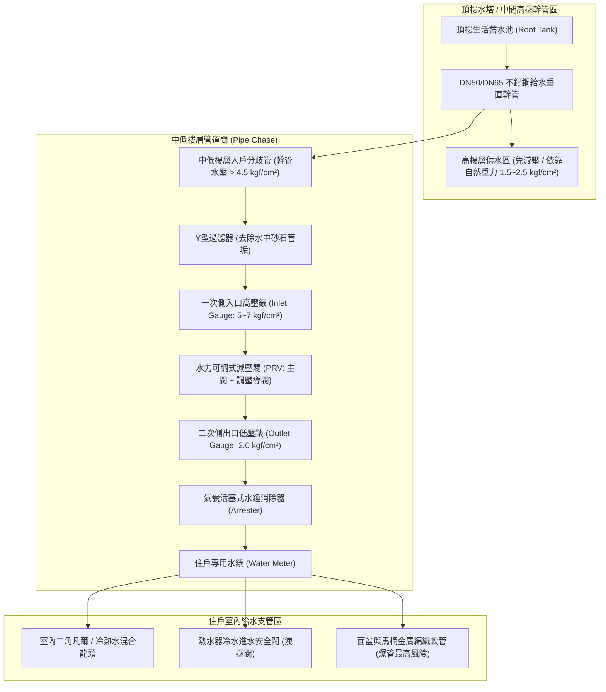

# 全案購屋實戰第六百一十九部：中古大樓社區各樓層生活給水垂直幹管減壓閥組閥芯水垢卡死超壓震盪水錘消除器氣囊破裂與低樓層水管爆裂體檢工序全書

---

## 序章：高層建築生活供水心臟——垂直靜水壓與分區減壓防爆防線

在現代高層住宅大樓的生活自來水給水系統中，重力流或揚水加壓系統隨建築高度增加，會對管道下部產生巨大的「垂直靜水壓（Static Head Pressure）」。依據流體力學基本公式：
$$P = \rho \cdot g \cdot H$$
每升高 10 公尺，管底即承受約 $1.0 \text{ kgf/cm}^2$（0.1 MPa）之水壓。

依據中華民國**《建築技術規則》建築設備編第二章給水排水系統**及**台灣自來水公司用戶用水設備內線工程技術規範**之明文規定：
1. **室內衛生器具安全耐壓極限**：一般家庭室內水龍頭、熱水器內膽、軟管、冷熱水混合閥及各類衛生器具之最理想使用水壓為 **$1.5 \text{ kgf/cm}^2$ 至 $2.5 \text{ kgf/cm}^2$**；室內給水支管工作靜水壓上限**絕對嚴禁超過 $3.5 \text{ kgf/cm}^2$（0.35 MPa）**。若超過此界限，即可能造成熱水器安全閥噴水洩壓、三角凡爾墊片被衝脫、軟管爆裂乃至全室泡水。
2. **高層分區減壓原則**：高層集合住宅必須強制實施「垂直分區給水（Vertical Zoned Water Supply）」，在各分區樓層的公共管道間設置**「直接作用式或水力隔膜式減壓閥組（Pressure Reducing Valve, PRV）」**，將主幹管之超高壓調降至住戶室內的安全入戶水壓。
3. **水錘吸收與震盪消除**：減壓閥前後或大流量龍頭前，必須並聯安裝**「氣囊活塞式水錘消除器（Water Hammer Arrester）」**，以吸收因龍頭快速關閉引起的高達正常工作壓力 3 至 5 倍的瞬間衝擊波。

然而，在屋齡 20 至 35 年的中古大樓中，生活給水管長年承受硬水礦物質（鈣鎂離子）沉積，減壓閥組與水錘消除器極易演變為三大高危盲區：
- **減壓閥閥芯（Spool）與不鏽鋼彈簧被碳酸鈣硬水垢卡死咬死**，失去調節能力，形成「全開直通狀態」，高達 $5.0 \sim 8.0 \text{ kgf/cm}^2$ 的幹管超高壓直接灌入低樓層住戶室內；
- **水錘消除器內部丁腈橡膠（NBR）氣囊疲勞破裂**，預充氮氣洩漏殆盡，水錘吸收能力完全喪失，每次洗澡關水皆引發整根給水管劇烈甩動敲擊管道間壁體；
- **低樓層廚房與浴室 PVC 給水管、冷熱水白鐵車牙接頭**因長期承受超壓疲勞，在深夜水壓最高峰期瞬間爆管，導致「人在睡夢中，家成水上樂園」的災難性事故。

本冊《全案購屋實戰第六百一十九部》深入剖析大樓給水減壓閥組、水力平衡、水錘破壞機理與管道超壓病徵，並制定買方於看屋現場及公共管道間驗屋時之標準查驗工序。

---

## 第一章：高層建築生活供水減壓系統核心架構與三大崩潰失效機制

### 一、垂直生活給水管網與分區減壓拓撲
高樓層生活自來水由「頂樓重力蓄水池」向下輸送，或由「地下室變頻二次加壓泵浦」向上直供，其分區減壓組態如下：



---

### 二、三大致命事故機理深度剖析

#### 1. 減壓閥閥芯水垢咬死與隔膜破裂（高壓直通爆管）
- **致病機制**：
  - **水垢沉澱咬死**：大樓管網長期輸送含有碳酸鹽與微量泥砂之自來水。未定期清理 Y 型過濾器的情況下，砂粒進入減壓閥內部精密配合之閥芯與閥座間隙，加上高溫熱氣加速碳酸鈣析出，閥芯被硬垢卡死在「全開（Fully Open）」位置。
  - **水力隔膜破洞**：隔膜式減壓閥內部橡膠膜片長年承受反覆伸縮彎折，橡膠硬化產生針孔微裂紋。
- **致命後果**：減壓閥完全失去節流降壓作用，頂樓數十公尺水頭之垂直靜水壓（可達 **$5 \sim 8 \text{ kgf/cm}^2$**）毫無阻攔直衝室內！面盆下方的金屬編織軟管（多數額定極限僅能耐受 $6 \text{ kgf/cm}^2$）瞬間脹大爆裂，幾十分鐘內即可淹水數寸，沿著樓地板滲透樓下住戶天花板。

#### 2. 水錘消除器氣囊破裂充水與管路高頻共振敲擊
- **致病機制**：活塞氣囊式水錘消除器內部預充有 $1.5 \sim 2.0 \text{ kgf/cm}^2$ 之高純度氮氣。由於使用超過 10 至 15 年，橡膠氣囊龜裂，內部氮氣全數溶入水中逸散，消除器內部被自來水完全充滿，變成了毫無緩衝彈性的「硬水柱」。
- **致命後果**：當住戶急速關閉單把手陶瓷閥芯水龍頭或洗衣機電磁閥時，高速流動的水流在 0.05 秒內截斷，動能瞬間轉化為動態壓力波，管內產生高達 **$12 \sim 20 \text{ kgf/cm}^2$** 的瞬間尖峰水錘。管壁劇烈震顫敲擊管道間混凝土牆面，發出刺耳的「梆、梆」金屬撞擊聲，長期引發管路螺牙疲勞鬆脫漏水。

#### 3. 減壓閥出口靜動態壓差失控（「開水變涓涓細流，關水壓力飆頂」）
- **致病機制**：減壓閥內部調節彈簧疲勞失準，或閥芯導流孔部分堵塞。
- **後果**：水龍頭全關時，二次側水壓緩慢「爬升」至與一次側相同之超高靜水壓；但當水龍頭打開時，由於閥芯開度受阻，水壓瞬間暴跌至不足 $0.5 \text{ kgf/cm}^2$。造成熱水器因動態水壓過低無法點火，忽冷忽熱，洗澡體驗極度惡劣！

---

## 第二章：四大候選物件之給水減壓系統實勘對照與談判戰略

針對目前本案鎖定之四大候選物件，因樓層位置與屋齡不同，其給水管路所承受之水壓特性大相逕庭：

| 物件編號與社區名稱 | 樓層位置與供水區段 | 減壓閥與水錘系統潛在風險焦點 | 現場實勘首要手段 | 談判作戰與費用扣除指引 |
| :--- | :--- | :--- | :--- | :--- |
| **大安紫金城 13 樓 (`PROP_10`)** | 總樓層 13 樓頂樓戶，重力水塔下方第一供水區段。 | 13 樓直接位於頂樓水塔正下方，垂直落差小（約 3~5 公尺），**通常不需經過減壓閥**，但可能面臨「水壓不足（靜水壓 < 1.0 kgf/cm²）」而必須依賴加壓馬達。若加壓馬達缺乏水錘吸收裝置，容易產生開關泵浦震動。 | 1. 檢視梯廳水錶箱有無裝設獨立加壓泵。<br>2. 測量冷熱水混合龍頭出水量與熱水器點火穩定度。<br>3. 檢視水錶箱管道有無高壓震動痕跡。 | 頂樓水壓若不足，需加裝變頻靜音加壓泵與獨立水錘消除器，成本約 **1.5~2.5 萬元**，作為總價折讓項目。 |
| **長億南園 8 樓 (`PROP_106`)** | 總樓層中高樓層區段，供水管路承壓約 3.5~4.5 kgf/cm²。 | 30 年老社區，公共管道間之減壓閥多數已逾更換年限。若減壓閥卡死，8 樓水壓將接近安全臨界值，室內軟管與熱水器承受長期高壓應力。 | 1. 打開 8 樓公共水錶箱，檢驗減壓閥組二次側壓力錶指針讀數。<br>2. 檢查 Y 型過濾器排污閥有無鏽蝕漏水。<br>3. 敲擊水錘消除器確認內部有無充水。 | 若減壓閥失靈導致室內水壓超過 3.5 kgf/cm²，更換整組銅製可調式減壓閥與消除器約需 **1.8~3.0 萬元**，納入殺價防線。 |
| **歌德堡 8 樓** | 精裝修戶，室內多處高級衛浴設備。 | 精緻裝潢最怕超壓爆管。需確認管道間水壓是否穩定控制在 2.0 kgf/cm² 理想值，以保護其高級花灑、免治馬桶與冷熱水管路。 | 自備便攜式水壓錶鎖在廚房龍頭出水口，量測靜態水壓與開關水時的水錘跳動幅度。 | 若裝潢戶減壓正常，可作為水壓對比之模範標竿。 |
| **靜園 A 區 11 樓** | 11 樓高樓層，水壓適中。 | 檢查管路間通風與水錶箱乾燥度，排查水錘敲擊回音。 | 連續開閉水龍頭，靜聽牆體內部有無水錘震響。 | 作為基準比對標的。 |

---

## 第三章：看屋現場給水水壓與水錘消除六步快篩查驗法（SOP）

買方看屋時，透過下列 6 個簡單步驟即可精準判定該戶給水減壓系統是否健康：

```mermaid
sequenceDiagram
    autonumber
    actor Buyer as 買方 / 驗屋工程師
    participant Box as 公共梯廳水錶箱 (Meter Box)
    participant Gauge as 減壓閥前後壓力錶 (PRV Gauges)
    participant Arrester as 水錘消除器 (Arrester)
    participant Indoor as 室內衛浴龍頭與軟管 (Indoor Taps)

    Buyer->>Box: 步驟一：打開樓層水錶箱，檢視 Y 型過濾器與減壓閥外觀
    Buyer->>Gauge: 步驟二：對比一次側（幹管）與二次側（入戶）壓力錶讀數
    Buyer->>Indoor: 步驟三：室內龍頭全開，量測動態壓降（壓降不得超過 0.5 kgf/cm²）
    Buyer->>Indoor: 步驟四：單手急速全閉水龍頭，檢驗水錘震響與指針彈跳
    Buyer->>Arrester: 步驟五：金屬硬幣輕敲水錘消除器筒身（清脆空腔音為合格）
    Buyer->>Indoor: 步驟六：探頭檢視洗臉盆下金屬軟管與熱水器洩壓閥有無水滴
```

### 具體實施指引與合格紅線：
1. **水錶箱減壓閥雙錶對比（壓力黃金判據）**：
   - 找到該戶的公共給水管道間或水錶箱，正常配置應有一大一小減壓閥組與兩個壓力錶。
   - **一次側（幹管高壓）**：顯示來自大樓幹管之水壓（通常為 $4.0 \sim 7.0 \text{ kgf/cm}^2$）。
   - **二次側（入戶水壓）**：標準設定值必須穩定落在 **$1.8 \sim 2.5 \text{ kgf/cm}^2$**。
   - **致命紅線**：若二次側壓力錶指針與一次側完全相同（例如指在 $5.0 \text{ kgf/cm}^2$ 以上），代表**減壓閥已徹底卡死擊穿！室內處於隨時爆管之極度危險狀態！**
2. **動態壓降測試（Dynamic Drop Test）**：
   - 一人留在水錶箱觀察二次側壓力錶，另一人在室內將浴缸與面盆水龍頭同時開到最大。
   - 壓力錶指針若微降至 $1.5 \sim 1.8 \text{ kgf/cm}^2$ 屬正常；若指針直接暴跌至零或低於 $0.8 \text{ kgf/cm}^2$，代表過濾網嚴重淤泥堵塞，或閥芯開度受限。
3. **極限急速關水水錘測試（Water Hammer Strike Test）**：
   - 將廚房單把手冷熱水混合龍頭開至全流量，隨後**以手掌在 0.1 秒內急速向下壓下關閉**！
   - 仔細聆聽牆壁與水錶箱內部有無「咚」或「噹」之金屬劇烈撞擊聲；同時觀察壓力錶指針跳動幅度。若指針瞬間向上狂飆超過 $4.0 \text{ kgf/cm}^2$，代表水錘消除器已經完全損壞！
4. **硬幣敲擊消除器氣室（Acoustic Cavity Check）**：
   - 以一枚 10 元硬幣輕敲水錘消除器的上半部氣室金屬外殼。
   - 若發出清脆的「叮叮」空心共鳴聲，表示內部氣囊完整且充滿氣體；若發出沉悶的「篤篤」實心聲，代表內部已充塞死水，氣囊早已破裂。
5. **軟管與安全閥微滲查驗**：
   - 俯身檢視洗臉盆下方、馬桶水箱後方之不鏽鋼絲編織軟管，摸其金屬網是否有斷絲外翹刺手，或兩端六角螺帽有綠色氧化銅鏽。
   - 檢視儲熱式或瓦斯熱水器下方之安全洩壓閥出水管，若長期有水滴滴答答滴落，即為室內水壓超標的直接鐵證！

---

## 第四章：各樓層生活給水減壓系統體檢驗收表

本表供買方看屋或點交驗樓時逐項查驗打勾：

| 檢驗項目 | 規範標準要求 | 實測數值 / 現象紀錄 | 合格判定 | 缺陷風險處置與改善費用 |
| :--- | :--- | :--- | :---: | :--- |
| **1. 二次側入戶靜水壓** | 穩定維持在 1.8 ~ 2.5 kgf/cm² 之間（嚴禁 > 3.5 kgf/cm²）。 | ［　　］kgf/cm² | □合格 □異常 | 調校導閥調整螺栓，無效者更換減壓閥總成（約 1.2~2.0 萬元）。 |
| **2. 出水動態壓降幅度** | 全開大流量水龍頭時，動態壓降 ≤ 0.5 kgf/cm²。 | ［　　］kgf/cm² | □合格 □異常 | 拆卸 Y 型過濾器清洗不鏽鋼濾網之鐵鏽沉砂。 |
| **3. 水錘跳動吸收度** | 急速關閉龍頭時，管內水壓瞬間反彈峰值 ≤ 3.5 kgf/cm²。 | ［　　］kgf/cm² | □合格 □異常 | 更換為氣囊式活塞水錘消除器（約 3,500 元/支）。 |
| **4. 消除器內部氣囊完整性** | 硬幣敲擊發出清脆空腔音，無充水沉悶實心聲。 | ［　　］音色 | □合格 □異常 | 消除器氣囊破裂，整支拆換新品。 |
| **5. 減壓閥本體密封性** | 閥體外表無砂孔滲水、法蘭接頭無結晶水垢。 | ［　　］狀態 | □合格 □異常 | 更換無石棉耐壓密封法蘭墊片並塗抹密封膠。 |
| **6. 室內衛生軟管狀態** | 不鏽鋼編織軟管無膨脹變形、無斷絲破損。 | ［　　］狀態 | □合格 □異常 | 全面更換為 SUS304 高壓耐溫編織軟管或波紋軟管。 |
| **7. 熱水器洩壓閥狀態** | 正常供水狀態下無持續滴漏洩壓水珠。 | ［　　］狀態 | □合格 □異常 | 排除超壓問題後，更換熱水器進水安全逆止閥。 |

---

## 第五章：總結與後續工序推進

生活給水垂直幹管減壓閥與水錘消除器，是守護全家室內裝潢免遭高壓水患滅頂之隱蔽心臟。在購買中古高樓住宅時，徹底檢驗水錶箱內的壓力錶指針讀數與急速關水反應，是每一位精明購屋者絕不可遺漏的救命關鍵！

下一部實戰手冊將迎來全案購屋實戰歷史性之重大跨越：**《全案購屋實戰第六百二十部：六百二十部圓滿登峰全景極致全維度全生命週期家庭置產避坑抗震防漏水電機電消防永恆至尊金典總綱全書》**，全面總攬前 619 部之大成，構築至尊置產防護金典！

---
*全案購屋實戰第六百一十九部・全書完・版本控管確認*
