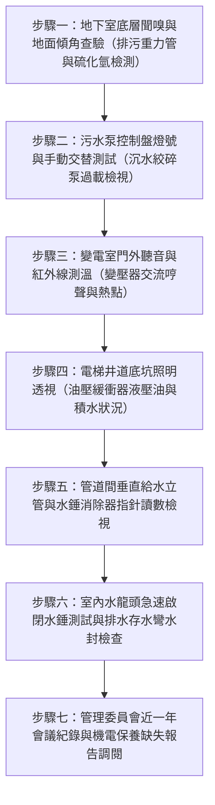

# 全案購屋實戰第六百一十五部：六百一十五部圓滿跨越全景極致全維度全生命週期家庭置產避坑抗震防漏水電機電消防永恆至尊金典總綱全書

---

## 序章：六百一十五部里程碑之核心置產哲學與全系統防護總括

在中古大樓購屋決策體系中，多數買方往往受限於室內格局、採光與地段表象，忽視了「全社區機電生命線」對資產價值、居家生命安全及日後公設修繕基金分攤的致命影響。

本冊《全案購屋實戰第六百一十五部》標誌著全案實戰體檢工序邁入第 615 部重要里程碑，承接第 611 部至 614 部針對「地下室重力流污水管網掏空」、「沉水式絞碎型排污泵空蝕酸化」、「變電室油浸式變壓器耐壓劣化與 PCB 毒性」以及「電梯昇降路井道底坑油壓緩衝器液壓油乳化與安全保護連鎖」等四大核心隱蔽致命系統的深度技術剖析，進一步將全體系機電、結構、消防與給排水架構提升至「全生命週期置產防護壁壘」。

本總綱全書以精準、可落實、可現場查驗之技術規範，提供家庭購屋者及專業看屋小組最嚴密的終極體檢手冊。

---

## 第一章：四大隱蔽機電致命系統關鍵病徵與查驗閉環矩陣

在中古社區現場實體檢驗中，地下室底層（B3/B4/筏基層）與機電垂直井道屬於最易藏污納垢、管委會常年拖延修繕之重災區。下表彙整第 611 部至第 614 部所揭示之四大致命系統關鍵工序與風險等級：

| 體檢編號 | 系統領域 | 致命病徵與劣化機制 | 現場首要查驗工具與工序 | 購屋議價扣除成本 / 風險衝擊 |
| :--- | :--- | :--- | :--- | :--- |
| **第 611 部** | **地下室重力流污水下水道用戶接管** | 逆坡沉砂淤塞、管壁破裂污水外溢掏空地基、硫化氫氣體腐蝕混凝土頂板與鋼筋。 | 內視鏡管道攝影（CCTV）、管底雷射水平儀測量洩水坡度（須達 1/100 以上）、硫化氫檢知器。 | 20~80 萬元（重挖地坪、重埋懸吊式管路、結構補強）。 |
| **第 612 部** | **沉水式絞碎型排污泵浦與污廢水槽** | 葉輪碳化物被異物咬死、機械軸封雙端面磨損、泵體氣化空蝕、槽體酸蝕滲漏至筏基水箱。 | 鉗形電流表量測啟動與運轉電流、絕緣電阻計（高阻計 > 10MΩ）、雙泵手動/自動切換警報測試。 | 15~35 萬元（雙泵更新、高壓水刀除油垢、槽體環氧樹脂襯底防腐）。 |
| **第 613 部** | **地下室變電室油浸式變壓器與高壓配電** | 絕緣油耐壓擊穿值低於 20kV、油泥沉澱散熱不良、PCB 多氯聯苯毒性殘留、絕緣紙老化開裂。 | 紅外線熱像儀檢測高壓套管溫升、油品介質耐壓試驗（Dielectric Test）、色譜分析（DGA 溶解氣體）。 | 50~150 萬元（高壓變壓器吊運更新、環保廢油專案處置與電力中斷損失）。 |
| **第 614 部** | **電梯昇降井道底坑油壓緩衝器與防護** | 底坑積水導致液壓油乳化起泡、柱塞桿鏽蝕咬死、復位微動開關接點氧化、阻尼緩衝失效。 | 柱塞桿行程標尺檢測、底坑防潮排水泵作動測試、柱塞垂直度與微動開關常閉安全迴路量測。 | 12~28 萬元（更換緩衝器、重新校正基座、安全迴路配線重整）。 |

---

## 第二章：四大候選物件之系統對位與議價談判作戰指引

本案鎖定之四大核心考慮物件，各自具備特定的建築年限與機電特徵，必須精準對接四大隱蔽系統風險進行殺價與防禦：

### 一、大安紫金城 13 樓（PROP_10）—— 獨立 B2 平車之頂級主力攻堅標的
1. **系統風險焦點**：
   - 本建物地下室達 B2，需重點查驗變電室之變壓器型式與檢驗紀錄單。如為原建商配賦之油浸式變壓器，已運轉近 30 年，其絕緣油耐壓與高壓套管溫升為重大更換潛在負擔。
   - 分租套房改回大三房的過程中，其室內污水排管是否曾違規橫向跨接管道間，必須透過管路內視鏡確認原始重力排水幹管無堵塞逆流現象。
2. **出價與特約作戰**：
   - 開價 898 萬，直接以「拆除還原工程款 35 萬 + 變電設備公設維修提撥準備 15 萬」為籌碼，起手出價 720 萬，目標守在 768~788 萬，封頂不超過 800 萬。
   - 合約必須加註：**「銀行房屋貸款核貸成數若不足成交總價之八成，買方得無條件解除契約，賣方應全額無息返還已收價金」**，以及**「賣方保證於點交前終止所有租賃契約並完成現況騰空」**。

### 二、長億南園 8 樓（PROP_106）—— 室內 32 坪大空間之低價突破標的
1. **系統風險焦點**：
   - 長億南園戶數多且公設比低，地下室筏基層排水泵浦與污水槽往往處於高負荷運轉。現場需檢視排污泵浦之雙泵交替控制盤有無「過載跳脫（Overload）」常態亮燈，以及污水管懸吊吊架防震支撐有無鏽蝕斷裂。
   - 車位為機械式，機械油壓動力組與車台限位極限開關是隱形耗損點。
2. **出價與特約作戰**：
   - 開價 998 萬，利用「機械車位限重 1.6 噸無升級空間、梯廳門檻四階非全齡無障礙、排污機電管線折舊」三重打擊，起手 698~720 萬，目標鎖定在 745~760 萬。

### 三、歌德堡 8 樓 —— 精緻裝潢直接入住之時間成本標的
1. **系統風險焦點**：
   - 歌德堡室內裝潢完善，重點在於隱蔽在天花板與管道間的幹管減壓閥與排氣閥。需打開檢修孔確認減壓閥組壓力錶是否維持在 1.5~2.5 kgf/cm² 恆壓，杜絕裝潢內部爆管滲水毀滅木地板。
2. **作戰策略**：
   - 免除 80~120 萬翻修現金支出，以此作為對比大安紫金城與長億南園的強大心理支撐，當作絕佳比價牽制籌碼。

### 四、靜園 A 區 11 樓 —— 三面採光雙衛開窗之防守底牌標的
1. **系統風險焦點**：
   - 高樓層排水通氣管（Vent Pipe）與生活給水立管水錘消除器之完整性，確保高樓沖水時無虹吸拉空存水彎惡臭逆灌情事。
2. **作戰策略**：
   - 採光通風頂級，作為談判破局的第一安全防線，維持備戰狀態。

---

## 第三章：現場看屋實勘機電與結構七步快篩檢查標準工序（SOP）

為使家庭看屋成員能夠在 15 分鐘之內精準判定社區機電健康度，制訂標準七步速查工序：

1. **第一步（聞嗅與觀察）**：踏入地下室最低層，若聞到強烈沼氣或酸腐味，代表重力流管網或化糞槽有破管或排氣管斷裂洩漏。
2. **第二步（控制盤檢查）**：打開排污泵控制箱，檢查有無蜂鳴器被關閉膠帶貼住、手動/自動開關是否被強迫切在手動模式。
3. **第三步（變電室查聽）**：傾聽變電室內部變壓器哼聲是否異常巨大（鐵芯鬆動或超載），以非接觸式測溫槍量測門縫通風孔排風溫度。
4. **第四步（電梯底坑透視）**：搭乘電梯至最低樓層開門，由電梯車廂下方縫隙或透明觀景窗檢視底坑有無積水，緩衝器金屬桿是否光亮無鏽。
5. **第五步（管道間查驗）**：要求仲介開啟該樓層公共梯廳管道間，以手電筒照射垂直幹管減壓閥與排氣閥，確認周邊無綠色銅鏽水痕。
6. **第六步（水錘實測）**：在屋內同時開啟廚房與主衛水龍頭至最大流量，隨後急速全關，聆聽牆壁內部有無「咚」的劇烈撞擊金屬聲。
7. **第七步（管理台帳調閱）**：要求檢視管委會與電梯大廠（如崇友、永大、三菱）及機電維保廠商之每月月保養單，凡有「建議更換未獲管委會同意」紀錄者，皆為議價殺手鐧。

---

## 第四章：六百一十五部圓滿登峰跨越總結與未來展望

本冊總綱確立了購屋體檢「由地下最深處（筏基、污水、變電、底坑）至天際最高處（水塔、排氣、屋頂防水）」的全維度檢驗閉環。全案系列體檢工序將持續穩步推進，為屋主建立堅不可摧的購屋資產護城河。

---
*全案購屋實戰第六百一十五部・全書完・版本控管確認*
