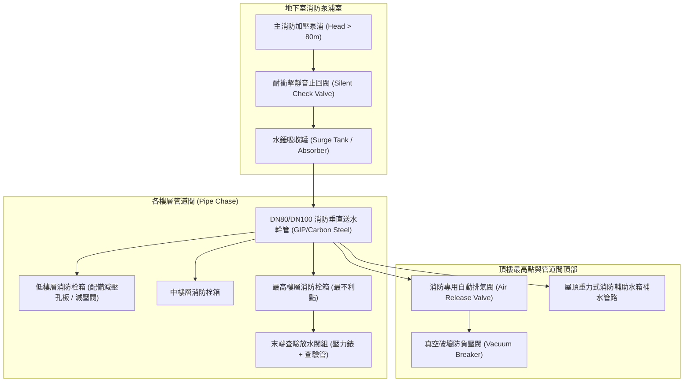

# 全案購屋實戰第六百一十八部：中古大樓社區消防送水幹管排氣閥橡膠塞老化洩漏立管水錘震盪末端放水試驗壓力不足與管壁穿孔體檢工序全書

---

## 序章：消防立管生命線——高樓火災撲救與梯間水損的雙面利刃

在中古高層集合住宅的消防安全體系中，「消防送水幹管（Fire Standpipe Riser，包含室內消防栓立管與自動撒水立管）」是連接地下室消防泵浦、頂樓消防輔助水箱與各樓層消防栓箱的垂直動脈。

依據中華民國**《各類場所消防安全設備設置標準》**及內政部消防署之強制技術規範：
1. **立管管徑與承壓要求**：室內消防栓立管管徑不得小於 63 mm（2½ 吋），系統最高工作壓力通常介於 $7 \text{ kgf/cm}^2$ 至 $14 \text{ kgf/cm}^2$；管路各部件、管件及閥門均須具備承受至少 $14 \text{ kgf/cm}^2$ 以上（或最高工作壓力之 1.5 倍）之水壓耐抗強度。
2. **自動排氣與消除負壓**：在立管頂端最高處或長水平配管末端，必須強制安裝「消防專用自動排氣閥（Automatic Air Release Valve）」與「真空氣體消除閥」，確保管路在充水時能自動排出空氣口袋（Air Pockets），並在消防泵浦啟動或停機瞬間，迅速吸收消除因氣體壓縮膨脹引起的毀滅性「水錘衝擊波（Water Hammer Shockwave）」。
3. **末端查驗閥壓力紅線**：在最高樓層（或各分區最不利點）之末端放水查驗閥（Inspector's Test Valve），其靜水壓必須達到 **$1.7 \text{ kgf/cm}^2$（0.17 MPa）** 以上，放水量不得小於 **$130 \text{ L/min}$**，且撒水系統最不利點末端放水壓力亦不得低於 **$1.0 \text{ kgf/cm}^2$（0.1 MPa）**。

然而，在屋齡 20 至 35 年的中古社區中，消防送水幹管因長年處於高壓靜水狀態，且管道間通風不良、水質酸化，極易產生三大隱蔽重症：
- **頂端自動排氣閥內部橡膠密封塞硬化龜裂**，造成微量常態滲水順著垂直管道間下流，滲透住戶室內牆面與配電箱；
- **排氣閥閥孔水垢碳酸鈣結晶卡阻**，失去排氣功能，管內大量積氣，在每年消防安檢測試泵浦啟動瞬間引發劇烈水錘，管身劇烈甩動敲擊管道間壁體；
- **鍍鋅鋼管（GIP）或碳鋼管內部電化學腐蝕、局部氧氣孔蝕（Pitting Corrosion）**，導致管壁減薄穿孔，發生「盲管爆裂（Burst Pipe）」引發全社區梯間樓梯狂瀉淹水的災難。

本冊《全案購屋實戰第六百一十八部》全面剖析消防送水立管、頂部自動排氣閥、末端查驗放水與管壁減薄穿孔之劣化機制，並提供現場看屋與管委會資料查驗時的實戰工序。

---

## 第一章：消防幹管與自動排氣系統核心架構與三大致命破壞機制

### 一、垂直消防立管與氣囊消除拓撲
消防送水立管由「地下室主泵加壓區」、「各樓層分歧引出區」、「管道間固定支撐」及「頂部排氣消氣總成」構成：



---

### 二、三大致命病徵機理深度剖析

#### 1. 排氣閥內部浮球卡死或三元乙丙橡膠（EPDM）硬化洩漏（管道間慢性滲漏）
- **致病機制**：自動排氣閥內部設有不鏽鋼浮球與橡膠密封閥塞。長期浸泡在高壓且含有鐵鏽微粒的死水中，水中碳酸鈣與鐵泥在浮球導向桿上結垢卡死，導致浮球無法順利上浮密封；或橡膠密封墊圈經 20 年熱水氣老化而脆化龜裂。
- **後果**：排氣閥不僅無法排除管內聚集的空氣，更會產生持續性的「細流涓涓滲漏」。滲水順著立管外壁流入住戶客廳或臥室相鄰的管道間背牆，造成牆面壁癌發黑、木地板受潮發霉，住戶往往誤以為是外牆漏水！

#### 2. 管內空氣口袋引發劇烈「氣爆型水錘（Air Pocket Water Hammer）」
- **致病機制**：當管內積存空氣未經排氣閥排出時，空氣的壓縮係數遠高於水（氣體具彈性）。當地下室消防泵浦因每半年定檢啟動或管壓稍降而加壓補水時，水柱高速推擠氣囊，氣囊被極限壓縮後以超過 $1000 \text{ m/s}$ 的聲速劇烈反彈回衝，在管路轉彎處與排氣閥基座產生高達 **$25 \sim 35 \text{ kgf/cm}^2$** 的瞬間尖峰震盪壓力！
- **後果**：管道間內部發出如同砲擊的「轟隆」巨響，管路固定角鐵（U型螺栓）被震斷撕裂，閥體螺牙鬆脫，法蘭墊片瞬間被衝破噴水。

#### 3. 幹管內部「氧氣濃差孔蝕（Differential Aeration Pitting）」與管壁穿孔爆管
- **致病機制**：早期許多社區消防立管採用熱浸鍍鋅鋼管（GIP）或黑鐵無縫鋼管。消防管常年不流動，水質處於停滯厭氧狀態，管底沉積鐵鏽污泥。污泥覆蓋處與管壁上部未覆蓋處形成「氧氣濃度差電化學電池」，陽極區的金屬鐵以數倍速度快速溶解，形成極深、極小但極具穿透性的錐狀孔蝕。
- **後果**：管壁厚度由原本的 $4.5 \text{ mm}$ 局部急劇減薄至不足 $0.8 \text{ mm}$。遇一次例行消防安檢加壓試驗時，管壁立即如被雷管炸開般穿孔爆裂，成千上萬加侖的消防黑水自十幾樓狂灌樓梯間與電梯昇降井，造成電梯電子板全毀、住戶裝潢泡湯！

---

## 第二章：四大候選物件之消防幹管系統現場查驗焦點

| 物件編號與社區名稱 | 建築型態與管系特點 | 消防送水立管潛在風險焦點 | 現場看屋檢驗手段 | 談判作戰與費用折讓指引 |
| :--- | :--- | :--- | :--- | :--- |
| **大安紫金城 13 樓 (`PROP_10`)** | 13 樓超高層頂樓戶，為全棟消防送水最不利點所在層。 | 13 樓直接緊鄰立管最高點自動排氣閥與末端查驗閥，管內若有積氣或排氣閥漏水，13 樓室內牆面首當其衝；末端壓力錶讀數直接揭露全棟消防管網健康度。 | 1. 打開 13 樓梯廳末端查驗閥箱，檢查壓力錶靜水壓是否達 $1.7 \text{ kgf/cm}^2$。<br>2. 檢查 13 樓管道間內部排氣閥排水導管有無水痕。<br>3. 檢視分租套房室內與公共管道間交接牆面有無壁癌。 | 若末端壓力不足且管道間有滲水鏽蝕，全棟消防立管高壓清洗或更新分段閥門約需籌募 **20~40 萬元**，以此作為砍價強烈理由。 |
| **長億南園 8 樓 (`PROP_106`)** | 8 樓為該社區高樓層區段，管齡已達 30 年，戶數規模龐大。 | 大型舊社區消防管多採用鍍鋅鋼管，長年未更換消防死水，管內孔蝕情況普遍，需確認管委會近 3 年有無「消防水管破裂搶修」之修繕支出紀錄。 | 1. 檢視 8 樓消防栓箱內部是否有鐵鏽剝落、水帶接頭鏽死。<br>2. 要求翻閱管委會歷月維修明細，排查「管道間消防漏水」通報。 | 消防管網若已屆穿孔高風險期，將面臨全棟外露明管重配之鉅額工程，要求賣方保證室內無暗管滲漏並折讓房價 **10~15 萬元**。 |
| **歌德堡 8 樓** | 精裝修三房，公共梯廳整潔。 | 裝潢天花板內可能包覆自動撒水支管，需確認木作天花板檢修孔位置，並使用手電筒排查撒水頭（Sprinkler Head）有無滴漏微滲。 | 踩梯打開天花板檢修孔，以手電筒照看撒水支管管身有無泛黃水漬或生鏽。 | 若裝潢內部撒水管有老舊接頭滲漏，需重配不鏽鋼壓接管，防範交屋後裝潢被毀。 |
| **靜園 A 區 11 樓** | 11 樓次頂層，通風良好，管理嚴謹。 | 檢查公共走道與安全梯間消防栓箱內之放水查驗管路與手動排氣旋鈕。 | 輕轉排氣閥側邊手動洩氣閥，觀察有無混濁黑水噴出或純空氣排出。 | 機電維護優良，作為核定其他社區消防保養水平之基準坐標。 |

---

## 第三章：看屋現場消防幹管與排氣閥六步快篩查驗法（SOP）

買方於看屋現場，可會同仲介或管理員，依序執行下列 6 步非破壞性快速檢查：

```mermaid
sequenceDiagram
    autonumber
    actor Buyer as 買方 / 專業驗屋人員
    participant Box as 該樓層消防栓箱 (Fire Cabinet)
    participant Gauge as 末端查驗壓力錶 (Pressure Gauge)
    participant Chase as 梯廳管道間檢修門 (Pipe Chase)
    participant Valve as 自動排氣閥總成 (Air Valve)

    Buyer->>Box: 步驟一：拉開消防栓箱門，檢視內部乾燥度與底部鐵鏽泥積聚
    Buyer->>Box: 步驟二：檢視角閥閥心填料（Gland Packing）有無微量滴水水珠
    Buyer->>Gauge: 步驟三：查讀最不利點末端放水查驗壓力錶（靜水壓 ≥ 1.7 kgf/cm²）
    Buyer->>Chase: 步驟四：開啟管道間檢修門，手電筒照射主立管外觀（漆面起泡/孔蝕）
    Buyer->>Valve: 步驟五：檢視頂樓自動排氣閥引下溢水管有無長流水漬或結晶物
    Buyer->>Chase: 步驟六：用橡膠槌輕敲立管轉彎處，聆聽管內空音與水錘共振殘音
```

### 具體操作細節與判定標準：
1. **消防栓箱底板「乾濕指標」**：
   - 打開樓層消防栓箱，若底板生鏽穿孔、有積水或大量紅褐色鐵泥，代表箱內 65 mm 消防角閥或快速接頭長年慢性滴漏。
2. **末端查驗壓力錶指針讀數（關鍵紅線）**：
   - 在大樓最高樓層（如大安紫金城 13 樓、靜園 11 樓），找到「末端查驗閥（Test Valve）」。
   - 壓力錶標準靜水壓必須落在 **$1.7 \sim 3.5 \text{ kgf/cm}^2$** 之間。
   - **嚴重警訊**：若指針歸零，或指針低於 $1.0 \text{ kgf/cm}^2$，代表管網嚴重失壓、頂樓重力輔助水箱缺水，或地下室加壓補壓泵浦（Jockey Pump）損壞卡死！
3. **管道間立管「橘皮起泡與鹽結晶」**：
   - 探頭進入管道間，用強光手電筒照向垂直幹管。若管身油漆隆起、表面佈滿如橘子皮般的凸起鐵瘤，甚至懸掛白色碳酸鹽結晶「石筍」，此為典型「管壁內部孔蝕即將穿透」的致命徵兆！
4. **自動排氣閥溢流引流管**：
   - 檢查排氣閥底部的排水小軟管。若軟管內持續有水滴流出，或管口周邊堆滿黃綠色水垢，表示內部 EPDM 橡膠密封塞已失靈，排氣閥正處於「假閉合、真漏水」狀態。
5. **立管敲擊聽音（Acoustic Test）**：
   - 以檢驗槌或橡膠棒輕敲立管外壁。厚實的金屬飽滿聲代表管內滿水；若發出空洞清脆的「空罐聲」，表示立管上部已被大量氣囊佔據，隨時有氣爆水錘破管之虞。
6. **年度消防檢修申報書審閱**：
   - 務必向管理室索閱消防局最近一次審查通過之**「消防安全設備檢修申報書」**，翻到「室內消防栓設備查核表」，確認**「放水壓力」、「放水量」及「綜合檢查」**欄位是否為合格打勾，有無「建議管路耐壓試驗有壓降」之附註。

---

## 第四章：消防幹管與排氣系統現場體檢驗收表

本表供買方於看屋或點交驗屋時逐項檢對：

| 檢驗項目 | 規範標準要求 | 現況數值 / 現象紀錄 | 合格判定 | 缺陷風險處置與修復成本 |
| :--- | :--- | :--- | :---: | :--- |
| **1. 末端查驗閥靜水壓** | 最高層最不利點靜水壓 ≥ 1.7 kgf/cm²（0.17 MPa）。 | ［　　］kgf/cm² | □合格 □異常 | 檢查頂樓消防水箱水位及加壓補壓泵運作。 |
| **2. 自動排氣閥密封性** | 閥體周圍無滲水、溢流管無長流水、橡膠密封良好。 | ［　　］狀態 | □合格 □異常 | 更換為 SUS304 不鏽鋼消防專用排氣閥（約 5,000 元/只）。 |
| **3. 幹管外觀與腐蝕** | 管壁無橘皮狀鐵瘤、無綠色水痕、無壁厚嚴重孔蝕。 | ［　　］狀態 | □合格 □異常 | 實施局部超音波管厚檢測，必要時實施明管重配。 |
| **4. 管道間支撐吊架** | 垂直幹管雙向耐震防晃支撐（Sway Brace）緊固無脫落。 | ［　　］狀態 | □合格 □異常 | 補強熱浸鍍鋅角鋼防震支撐與不鏽鋼 U 栓。 |
| **5. 消防栓箱角閥填料** | 開關手輪旋轉順暢，閥桿密封填料無滲水滴漏。 | ［　　］狀態 | □合格 □異常 | 更換四氟乙烯（PTFE）石墨自潤式迫緊墊圈。 |
| **6. 消防水帶與瞄子** | 水帶經耐壓檢驗合格，無黴爛、脆化，接頭橡膠圈無變形。 | ［　　］狀態 | □合格 □異常 | 責成管委會更新消防認證水帶組。 |
| **7. 消防申報複查紀錄** | 最近一期消防安檢申報經主管機關備查無重大列管缺失。 | ［　　］年度核備 | □合格 □異常 | 列入買賣合約交屋前管委會限期修繕條款。 |

---

## 第五章：總結與後續工序推進

消防送水立管與自動排氣系統，平時靜默無聲隱蔽於暗處，但一旦失效，輕則毀滅室內裝潢造成長年壁癌，重則於火災時無水可救釀成人倫悲劇。買方唯有在進場前徹底識破管路健康狀態，方能立於置產不敗之地。

下一部實戰手冊將依序開展：**《全案購屋實戰第六百一十九部：中古大樓社區各樓層生活給水垂直幹管減壓閥組閥芯水垢卡死超壓震盪水錘消除器氣囊破裂與低樓層水管爆裂體檢工序全書》**，持續深入生活供水系統最核心之超壓防護體系！

---
*全案購屋實戰第六百一十八部・全書完・版本控管確認*
