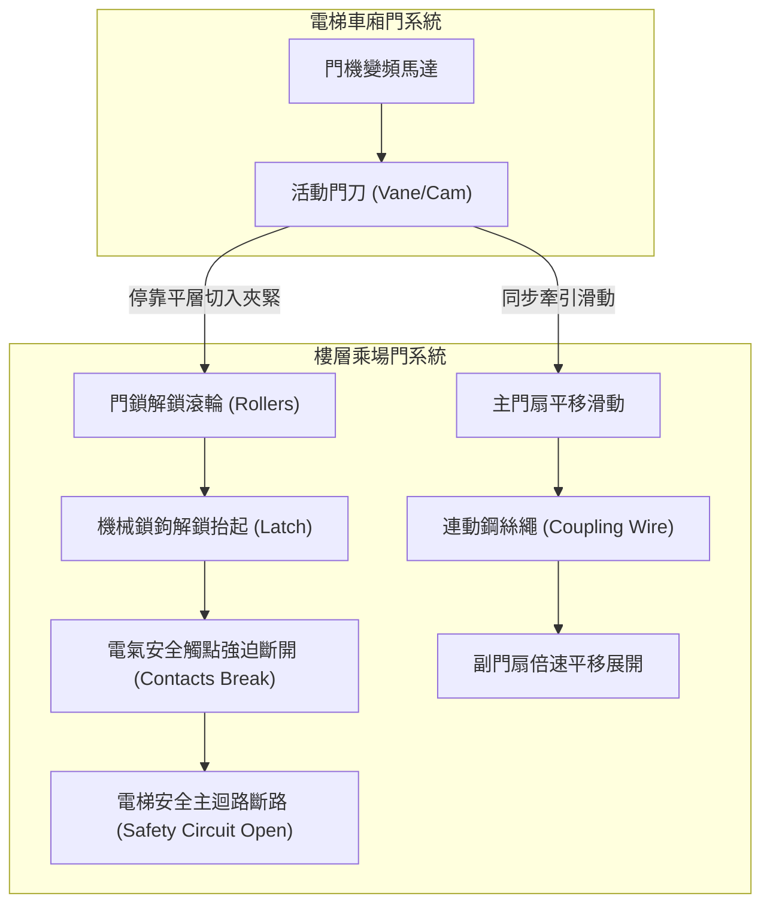
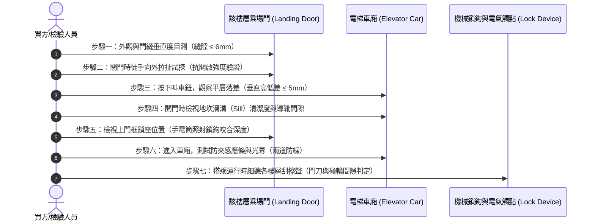

# 全案購屋實戰第六百一十六部：中古大樓社區電梯乘場門門鎖裝置機械咬合嚙合深度不足電氣安全觸點氧化積碳與剪切夾人事故體檢工序全書

---

## 序章：電梯乘場門安全聯鎖——大樓生命防護第一道實體物理防線

在中古大樓的所有垂直交通設備中，「乘場門（Landing Door，俗稱各樓層電梯外門）」與「門鎖保護裝置（Door Lock Safety Device）」構成了整部昇降機防止人員墜落井道及杜絕剪切夾人慘劇的核心安全總成。

依據中華民國國家標準 **CNS 10594（電梯）** 與內政部國土管理署**《建築物昇降設備設置及檢查管理辦法》**之明文強制規範：
1. **電氣與機械雙重連鎖原則**：電梯在未抵達該樓層平層區（Leveling Zone）且乘場門處於閉合鎖定狀態之前，昇降機之控制主回路與驅動馬達嚴禁啟動；反之，若外門未完全達到機械鎖閉之安全嚙合深度，電氣安全迴路絕不允許導通。
2. **防墜與防開門運轉**：任何以手推動、非授權鑰匙開啟或機械咬合不到位之狀況下，電梯車廂絕對禁止運轉；電梯如在開門狀態下產生非預期移動（UCMP, Unintended Car Movement Protection），門鎖安全迴路必須在 0.1 秒內強制切斷主接觸器並迫使煞車器（Brake）抱閘抱死。

然而，在屋齡 20 至 35 年的中古大樓中，乘場門系統常年遭受住戶推車撞擊、垃圾車推擠、裝潢工料刮碰，加上梯廳潮濕、油垢灰塵積聚與日常維護經費短缺，極易衍生出「機械鎖鉤磨損嚙合不足」、「電氣觸點拉弧積碳打火」、「副門聯動鋼絲繩鬆弛斷裂」以及「門刀碰輪間隙失準導致運行中刮門爆停」等極高危險隱患。

本冊《全案購屋實戰第六百一十六部》深入剖析電梯乘場門機械鎖扣、電氣安全聯鎖開關、副門聯動鋼索與門刀嚙合系統之劣化機理，並制訂現場看屋時買方與檢驗小組可親自驗證之實戰快篩工序，建立杜絕剪切夾人墜井事故的防護壁壘。

---

## 第一章：乘場門安全連鎖裝置之核心結構與三大失效剪切機制

### 一、乘場門鎖總成核心組件物理拓撲
乘場門門鎖裝置通常安裝於各樓層昇降路門框內側上橫樑處，其主要組件包括：
1. **機械鎖鉤（Locking Hook / Latch）與鎖座（Lock Box）**：由強化合金鑄造，負責在門扇閉合時提供實體物理扣合，CNS 規定其最小嚙合深度不得小於 7 mm（重型乘場門建議維持在 8~10 mm）。
2. **電氣安全觸點（Electrical Safety Contacts）**：具備強迫斷開（Positive Break）機制之銀合金觸點，只有在機械鎖鉤深入鎖座達規範深度後，連動推桿方能壓合觸點，將 110V/48V 之電梯安全迴路（Safety Circuit）導通。
3. **副門連動鋼絲繩與重錘機構（Door Coupling Wire Rope & Counterweight）**：針對雙折向側開門（2S）或中分雙折門（2CO），主門扇透過門機連桿帶動，副門扇則由內建直徑 3~4 mm 之鍍鋅鋼絲繩與轉向滑輪牽動，並配備重錘或自閉彈簧確保失電時門扇自動閉合。
4. **開門門刀（Car Door Vane / Cam）與聯鎖碰輪（Door Lock Rollers）**：車廂門上的活動門刀伸入乘場門的雙滾輪夾縫中，帶動乘場門鎖開鎖並實現主副門同步啟閉。

---

### 二、三大致命事故機理深入剖析

#### 1. 機械鎖鉤磨損變形與嚙合深度不足（墜井與假性鎖閉風險）
- **致病原因**：因長期關門撞擊或地坎（Sill）沉陷，門扇下垂，導致上橫樑鎖鉤插入鎖座之垂直與水平公差偏離。鎖鉤嚙合深度原本應大於 7 mm，因磨損或固定螺栓鬆動退縮至 2~3 mm。
- **事故型態**：在電梯車廂離開該樓層時，住戶若倚靠外門或以推車撞擊外門，淺層嚙合之鎖鉤瞬間滑脫跳脫，外門被推開，人員直接墜落深達十數公尺之昇降路底坑！

#### 2. 電氣安全觸點氧化積碳、熔焊黏連或人為短接（剪切夾人致命罪魁）
- **致病原因**：
  - **氧化與拉弧積碳**：梯廳灰塵、水氣與直流/交流微動電弧交互作用，使銀觸點表面形成高電阻之氧化硫化物與碳化物黑斑。電阻過大導致安全迴路誤判斷路，電梯頻繁發生「無故卡樓、急停停機」。
  - **惡質維保短接跳線（Fatal Jumper Bypass）**：不良保養廠商因查不出某樓層門鎖接觸不良原因，為免被住戶投訴，竟在控制機房主機板上以導線**「直接短接門鎖安全迴路」**！
- **事故型態**：安全迴路被短接後，電梯即使外門大開，電腦仍判定外門已鎖死，驅動馬達照常啟動運轉，造成進出乘客慘遭電梯地板與門框頂部「上下剪切腰斬」，為電梯歷史上最慘烈的死傷肇因！

#### 3. 副門連動鋼絲繩鏽蝕斷裂與脫軌（外扇卡死或懸空敞開）
- **致病原因**：副門連動鋼線長年缺乏潤滑油或遭梯廳清潔水劑滲入，內部鋼絲鏽蝕疲勞斷股。
- **事故型態**：主門正常關閉並鎖定，但副門因鋼索斷裂卡在半途或敞開，形成巨大缺口，孩童或寵物極易跌入昇降井道。

---

## 第二章：四大候選物件之電梯門系統體檢實戰對照

針對本案目前鎖定之四大候選物件，其社區年齡與電梯使用情境各異，必須採取針對性的乘場門檢驗策略：

| 物件編號與社區名稱 | 屋齡與梯型特徵 | 乘場門系統潛在劣化焦點 | 現場實勘首要工序 | 談判作戰與費用扣除指引 |
| :--- | :--- | :--- | :--- | :--- |
| **大安紫金城 13 樓 (`PROP_10`)** | 約 28~30 年，超高樓層大樓（13F），梯速 105~120 m/min，中分或側開式門機。 | 曾作為多間學生套房出租，人口流動大、各樓層外門推擠撞擊頻繁；高樓層風壓（煙囪效應）常使門扇關閉受阻或撞擊地坎。 | 1. 檢視 13 樓及地下 B2 停車場外門門縫平行度。 2. 雙手在外門中央施加 15kg 推力，測試鎖鉤是否異常位移。 3. 聆聽電梯離層瞬間有無機械鎖鉤沉重咬合聲。 | 機房控制盤安全迴路若有外接跨接跳線，屬重大安全瑕疵；整套門鎖更新與門刀調校約需提撥 **5~8 萬元/台**。 |
| **長億南園 8 樓 (`PROP_106`)** | 約 30 年，大型集合住宅，戶數眾多，梯井各樓層門鎖磨損率極高。 | 長年維護預算緊縮，門鎖接點容易積碳，梯廳清潔拖地廢水易流入地坎溝槽導致下導靴（Guide Shoes）磨損咬死。 | 1. 用手電筒照射 8 樓外門地坎鋁合金溝槽，檢查有無淤塞砂石與溝槽變形。 2. 關門狀態下強拉門扇，縫隙是否超過 6 mm。 | 若門扇搖晃劇烈且有雜音，要求賣方出具近半年昇降設備安檢合格證之乘場門查驗明細，殺價折讓 **3~5 萬元**。 |
| **歌德堡 8 樓** | 精裝修戶，梯廳維護水準相對良好。 | 需注意裝潢施工期間重型建材搬運是否曾撞擊乘場門框，造成開門門刀與門鎖碰輪間隙偏心。 | 搭乘電梯升降過程中，貼近車廂門聆聽有無「金屬微碰擦刮聲（門刀擦碰各樓外門滾輪）」。 | 精緻裝潢外表下，若電梯行進間刮門，代表井道垂直導軌或門鎖偏位，列為合約前限期調校條款。 |
| **靜園 A 區 11 樓** | 雙衛開窗均質社區，梯廳相對單純。 | 頂樓附近受屋頂通風排氣氣流影響，門扇自閉重錘拉力與回彈彈簧是否疲勞。 | 電梯在 11 樓打開後，以手動輕擋外門測試防夾敏感度，並確認全開後門扇平齊無突出。 | 作為基準比對標的，評估其他物件電梯品質之參考坐標。 |

---

## 第三章：看屋現場乘場門機械咬合與電氣安全七步查驗法（SOP）

買方或陪同看屋專業人員，無需專業儀器，依據以下 7 個標準步驟即可在 3 分鐘內判斷該樓層乘場門之安全性：

### 具體實施指引：
1. **外觀門縫閉合度**：門扇在完全閉合時，左右兩扇門之間以及門扇與門柱之間的間隙不得大於 **6 mm**（CNS 標準）。若縫隙過大，代表偏心滾輪或偏心吊輪鬆脫。
2. **手動推拉測試（假性鎖扣檢查）**：在電梯未到達該樓層時，雙手置於門扇中縫處，施加約 10~15 kgf 往外側拉開或往內側推擠的力量，**門扇絕對不應產生超過 10 mm 之位移，更不得被扳開縫隙**。若能扳開超過 2 公分，表示鎖鉤僅微幅搭接，極易發生推門墜井意外！
3. **平層精度檢查（Leveling Accuracy）**：電梯停穩開門後，立即低頭檢視車廂地板與樓層地板之高低落差。合格標準應在 **±5 mm 以內**。若落差達 1.5 公分以上，不僅容易絆倒長輩孩童，更代表平層感應器或煞車抱閘磨損。
4. **地坎導向槽（Bottom Sill）狀態**：拿手機手電筒照射下方的地坎鋁合金溝槽。若溝槽內塞滿裝潢泥沙、硬幣或果核，會造成門扇下導靴卡死或脫軌；下導靴晃動游隙若大於 3 mm，遇強震時門扇易跳出脫軌。
5. **門鎖咬合觀察**：抬頭觀察上門框內部，正常鎖鉤在門關妥時應呈深沉咬合角度，金屬碰觸面無嚴重挫傷削肉現象。
6. **安全觸板與紅外線光幕測試**：在門即將關閉時，以手掌（切勿用身體）輕觸防夾安全觸板，門扇應立即無延遲反轉打開；同時測試多道紅外線光線遮斷功能。
7. **機房安檢紀錄表核對**：於管理室翻閱最近一次電梯月維保紀錄，特別確認**「門鎖裝置接點阻抗」、「門鎖嚙合深度檢查」**項目是否有勾選「正常」並有合格專業昇降設備技術人員簽名蓋章（非大樓保全代簽）。

---

## 第四章：電梯乘場門全面體檢驗收檢核表

本表供買方於看屋或交屋前實體檢驗逐項打勾確認：

| 檢驗項目 | 標準規範要求 | 實測現況紀錄 | 合格判定 | 改善措施與防範要求 |
| :--- | :--- | :--- | :---: | :--- |
| **1. 乘場門閉合間隙** | 門扇中縫及四周門框縫隙 ≤ 6 mm。 | ［　　］mm | □合格 □異常 | 調校上門機懸吊偏心輪與偏心導軌。 |
| **2. 機械鎖鉤嚙合深度** | 鎖鉤垂直嚙合深度 ≥ 7 mm（實測建議 8~10 mm）。 | ［　　］mm | □合格 □異常 | 重新校正鎖盒基座位置並鎖緊防鬆螺帽。 |
| **3. 電氣安全觸點狀態** | 銀觸點光亮無氧化黑斑，壓入行程正常，無跨接短接線。 | ［　　］狀態 | □合格 □異常 | 以專用接點清潔劑清洗或更換全新微動聯鎖開關。 |
| **4. 徒手推拉抗開門強度** | 施加 15kgf 推拉力，門扇位移 ≤ 10 mm 且絕不開鎖。 | ［　　］狀態 | □合格 □異常 | 排除假性鎖扣，調整門鎖壓簧彈力。 |
| **5. 副門連動鋼索張力** | 雙折門鋼絲繩無鬆弛、斷股、鏽蝕，開閉同步。 | ［　　］狀態 | □合格 □異常 | 更新 7x19 結構不鏽鋼鍍鋅門機專用鋼絲繩。 |
| **6. 平層落差精度** | 車廂地板與樓層地面高度差在 ±5 mm 以內。 | ［　　］mm | □合格 □異常 | 重新調校磁簧平層感應器與變頻器減速曲線。 |
| **7. 運行擦碰異音** | 全行程運行中，門刀與各樓門鎖滾輪間隙維持 5~10 mm 無刮擦。 | ［　　］狀態 | □合格 □異常 | 校正井道垂直導軌及車廂門刀水平開度。 |

---

## 第五章：總結與後續工序展望

電梯乘場門機械鎖與電氣安全聯鎖，是杜絕「踏空墜井」與「剪切夾人」的唯一實體防護機制。購屋者務必在看屋現場透過細膩的手動與目視檢驗，拆穿仲介與賣方華麗裝潢下的潛在危險。

下一部實戰手冊將依序開展：**《全案購屋實戰第六百一十七部：中古大樓社區電梯調速機夾繩鉗磨損飛塊離心彈簧疲勞失準與超速溜梯下墜安全鉗制動體檢工序全書》**，持續為小寶全家構建最嚴密的家庭購屋安全防禦體系！

---
*全案購屋實戰第六百一十六部・全書完・版本控管確認*
