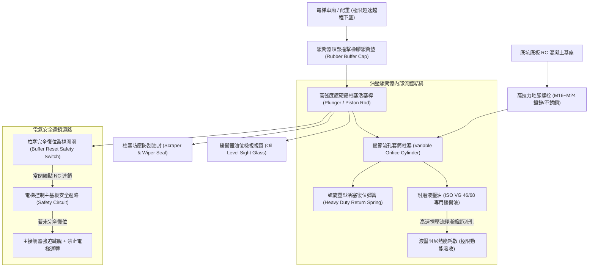
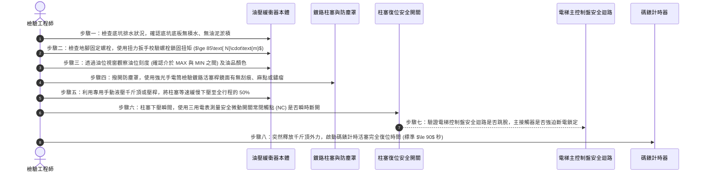

# 全案購屋實戰第六百一十四部：中古大樓社區電梯昇降路井道底坑油壓緩衝器液壓油乳化活塞桿鏽蝕微動極限開關接觸不良與安全防護體檢工序全書

---

## 壹、前言與核心體檢宗旨

在現代集合住宅高層建築（屋齡 20～35 年）之垂直昇降機（電梯）安全體系中，當電梯遭遇調速機失靈、鋼索打滑或主煞車器抱死失效等極限失控下墜狀況時，深埋於電梯井道最底部、俗稱「電梯底坑（Elevator Pit）」之「油壓緩衝器（Oil Buffer / Hydraulic Buffer）」，是整部車廂與配重墜落衝擊力吸收之**最後一道終極物理生命救贖底線**。

依據我國《建築物昇降設備設置及檢查管理辦法》與 CNS 10594 電梯國家標準，額定速度超過 $1.0\text{ m/s}$（60 m/min）之客用電梯，井道底坑必須裝設具備能量耗散功能之油壓緩衝器，藉由高黏度液壓油受擠壓流經節流孔之阻尼效應，將劇烈的動能轉化為熱能柔性釋放，確保人體承受之垂直減速度不超過安全極限（$\le 1.0\text{ g}$）。

然而，在諸多中古集合住宅大樓中，因電梯底坑長年深處地底受潮、甚至遭遇地下水滲透積水，導致油壓緩衝器長年暗藏以下**四項極其致命的機械與電氣安全暗病**：
1. **液壓油進水乳化（Emulsification）與阻尼特性崩潰**：底坑潮濕水氣經由防塵防刮油封滲入儲油缸，液壓油乳化變白變質，高壓油膜強度與黏度驟降，衝擊瞬間無法產生足夠液壓抗力，如同車廂直接硬碰硬撞擊鐵樁。
2. **鍍硬鉻活塞桿（Piston Rod）銹蝕麻點卡阻**：長期停用或潮濕使活塞桿表面鉻層氧化剝落、長滿鏽瘤，衝擊受壓時活塞桿卡死無法順暢壓縮，或壓縮後內部回位彈簧無力將活塞桿向上頂出復位。
3. **電氣安全保護微動開關（Safety Limit Switch）接點受潮氧化**：緩衝器內建之防誤動作微動極限開關受潮氧化積碳，導致電梯即便在緩衝器未完全復位（處於壓縮危險狀態）時仍能違法通電行駛，喪失電氣安全連鎖防護。
4. **底坑滲水浸泡油缸與柱塞基座地腳螺栓腐蝕斷裂**：底坑結構防水失效，污水長年淹沒緩衝器底部基座，高強度地腳螺栓（Anchor Bolts）銹斷，承受巨大衝擊時整座緩衝器直接被連根拔起連帶翻覆。

本工序全書旨在深入剖析電梯底坑油壓緩衝器之流體阻尼動力學、活塞桿探傷修復、電氣安全開關連鎖測試與底坑防潮工序，守護住戶每次垂直穿梭的終極安全。

---

## 貳、電梯底坑油壓緩衝器流力結構與電氣連鎖架構

---

## 參、中古社區現場五大常見致命病徵與工程成因

| 病徵分類 | 現場常見故障現象 | 工程深層成因分析 | 對住戶家庭置產之潛在危害 |
| :--- | :--- | :--- | :--- |
| **一、活塞桿生鏽卡死** | 緩衝器活塞桿表面長滿紅褐色鏽斑，手動重壓後無法自動彈起彈回 | 井道底坑相對濕度常態 $>85\%$，活塞桿表面鍍鉻層龜裂剝落，柱塞與套筒內部銅襯套銹蝕咬死。 | 發生溜梯衝頂或蹲底事故時，緩衝器無法壓縮吸震，車廂剛性重擊底板，乘客脊椎粉碎性骨折。 |
| **二、油位乾涸乳化** | 透過油位計視窗觀察，油液呈現乳白咖啡牛奶色，或油位已跌落至紅線下底限 | 油封硬化破損使底坑積水滲入，或長年漏油乾涸，保養人員從未抽檢更換專用抗磨液壓油。 | 內部油液失去不可壓縮性與阻尼係數，衝擊時產生局部劇烈空化氣蝕，緩衝器直接被壓爆。 |
| **三、復位開關假導通** | 活塞已被壓下 5 公分，但電梯依然照常載客高速上下運行 | 安全極限開關微動接點被不肖保養員惡意短接（Bypass），或開關內部彈簧斷裂使接點死死黏合。 | 電梯處於無安全冗餘防護狀態，下一趟若再次下墜，緩衝器行程不足直接撞擊硬底。 |
| **四、地腳螺栓腐蝕** | 緩衝器整座外表歪斜，輕推即可搖晃晃動數公分 | 底坑長期積水淹水（地下水滲透或洗電梯井漏水），碳鋼地腳螺栓長年泡水鏽蝕截面剩不到一半。 | 衝擊瞬間螺栓直接剪斷拉脫，緩衝器飛出穿透車廂底部，釀成重大公安災難。 |
| **五、防塵橡膠套風化** | 包覆活塞桿之黑色風琴摺防塵罩（Dust Boot）脆裂破碎，金屬柱塞完全裸露 | 橡膠因機房油氣、紫外線及臭氧氧化硬化脆裂，失去彈性，電梯鋼索掉落之鐵屑砂石附著其上。 | 鐵屑刮傷活塞桿鏡面，加速油封刮傷導致液壓油大量外洩，底坑地面油污一片。 |

---

## 肆、標準油壓緩衝器八步精密體檢工序

### 關鍵檢驗數據與判定標準表：

| 檢驗參數 | 法定標準與運轉健康值 | 臨界警戒數值 | 致命危險特徵（一票否決） |
| :--- | :--- | :--- | :--- |
| **1. 活塞桿全復位時效** | 釋放外力後 $\le 90$ 秒內完全復位 | 復位時間 $91 \sim 150$ 秒 | 活塞卡在半途、或超過 3 分鐘無法向上復位 |
| **2. 液壓油乳化與外觀** | 澄清透明金黃色 (ISO VG 68) | 油色微黃混濁 | 呈乳白色咖啡狀（含水量 $>5\%$，黏度崩壞） |
| **3. 活塞桿鍍鉻層狀態** | 鏡面光潔，無划痕麻斑 | 局部微小點蝕斑點 $<3$ 處 | 表面大面積紅鏽起皮、深道縱向溝槽（必定漏油） |
| **4. 復位微動開關阻抗** | 復位閉合時電阻 $\le 0.5\ \Omega$ | 電阻 $0.6\ \Omega \sim 2.0\ \Omega$ | 電阻無窮大或短路（接點融焊黏死失去開閉功能） |
| **5. 緩衝器垂直度偏差** | 軸線與垂直線偏差 $\le 2/1000$ | 偏差 $3/1000 \sim 5/1000$ | 嚴重歪斜傾角 $>10/1000$（衝擊時承受偏心剪力） |
| **6. 底坑油泥積水深度** | 底坑底板完全乾燥潔淨 | 局部微潮無積水 | 底坑積水淹沒緩衝器底座（積水深 $>5\text{ cm}$） |

---

## 伍、買方看屋現場 3 分鐘電梯底坑與運行快檢表

買方隨仲介看屋時，雖無法親自跳入底坑，但可透過以下專業操作與視角，100% 洞悉底坑緩衝器之維護真相：

| 查驗步驟 | 操作手法與觀察重點 | 合格健康特徵 | 致命隱患警訊（高危險折價項） |
| :--- | :--- | :--- | :--- |
| **1. 最底層乘車平層試驗** | 搭乘電梯至地下最底層（如 B2 或 B3），觀察停止動作 | 減速柔和、平穩停止，車廂地板與梯廳地坎水平完全切齊 | 接近底層時發生明顯震動下頓、甚至能聽到金屬碰觸底坑底部的悶響 |
| **2. 一樓地坎縫隙向下望** | 當電梯升至高樓層時，站在一樓乘場地坎前透過門隙強光照射 | 底坑底板平整乾燥，黃色或紅色油壓緩衝器立柱筆直乾淨 | 底坑一片漆黑積水泥濘、水面浮著黑色油花，甚至看到抽水沉水泵在抽水 |
| **3. 詢問底坑防水歷史** | 詢問大樓管理員：「地下室過去大雨颱風時，電梯底坑有沒有滲水淹水過？」 | 回答：「底坑有做雙層結晶防水，每年定期抽檢保養很乾燥」 | 回答：「下大雨底坑偶爾會滲水啦，保養員都會用泵浦抽掉」 |
| **4. 檢視電梯年度安全標籤** | 檢查車廂內由內政部營建署（國土署）核發之「昇降設備使用許可證」 | 檢查機構簽章齊全、許可證在有效期限內（未過期） | 許可證過期長達數月未換，或被其他宣傳紙張遮蔽覆蓋 |
| **5. 傾聽下行到底噪音** | 站在地下最底層梯廳，仔細聆聽電梯下行接近過程 | 僅有風切聲與導軌滑動輕微聲音，停止安靜順暢 | 電梯進站前傳出「嘎吱嘎吱」沉重金屬摩擦異音與刮擦聲 |

---

## 陸、購屋特約條款範本：電梯安全緩衝設施與底坑防水擔保

> **電梯昇降設備底坑安全緩衝器與防水結構擔保特約：**  
> 「賣方保證本買賣標的所屬社區大樓之電梯昇降路底坑乾燥無積水滲透，車廂及配重側之油壓緩衝器設備本體、鍍鉻活塞桿、液壓油品質及電氣復位安全開關功能完全正常，符合現行中華民國國家標準 CNS 10594 之安全要求。  
> 點交日前若經合格電梯檢查員查驗發現底坑油壓緩衝器活塞桿嚴重銹蝕卡阻、液壓油乳化變質、底坑長期積水滲透、或安全連鎖開關短路失效等重大公安缺失，賣方應於交屋日前督促管理委員會及電梯專業維護廠商修復並換新完畢；若未能於期限內修復，賣方同意提撥新台幣 **參萬元整** 作為電梯公共安全修繕暫扣款，自本買賣尾款中扣留，待管委會複驗合格後始得撥付。」

---

## 柒、結語

電梯底坑的油壓緩衝器，就如同一位默默蹲伏在黑暗深淵中的鋼鐵巨人。它可能十年、二十年都不會被真正撞擊一次，但只要發生一次極限墜落危機，它就是拯救全家人免於毀滅性重創的唯一生命托底。
看屋買房絕不能只陶醉於電梯按鍵的豪華鏡面，更必須以嚴密的工程數據審視底坑深處的每一個螺栓與每一滴油，為家人選購一座自始至終擁有完美安全防線的真正傳世福邸！
