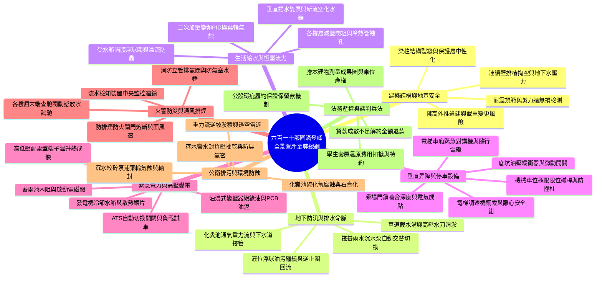
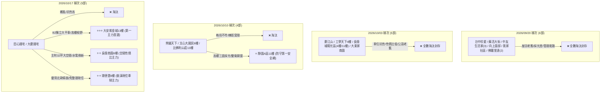

# 全案購屋實戰第六百一十部：六百一十部圓滿登峰全景極致全維度全生命週期家庭置產避坑抗震防漏水電機電消防永恆至尊金典總綱全書

---

## 壹、六百一十部圓滿登峰里程碑總綱引言

在台灣都會區集合住宅置產之實戰征程中，家庭面對的從來不是單純幾頁彩色廣告宣傳單，而是一場對抗建築物理結構老化、地下室機電衰退與法務合約陷阱之「全維度立體作戰」。

從第一部到第六百一十部，本實戰系列手冊貫穿了集合住宅大樓生命週期中每一個關鍵神經節點：
1. **結構抗震與地基基礎**：921 耐震分水嶺耐震評估、梁柱剪力裂縫與握裹力衰減、地下室連續壁滲水導溝與筏基結構；
2. **地下防汛與排水命脈**：車道截水溝重油清淤、筏基雨水沉水排洪泵浦、自動交替繼電器、液位浮球防纏繞與逆止閥回流防護；
3. **生活供水與水力穩定**：地下室生活自來水受水箱、水力隔膜進水閥、雙泵揚水系統緩閉水錘吸收、變頻恆壓 PID 控制、二次加壓立式多段泵與垂直立管分區減壓閥；
4. **垂直運輸與車位安全**：電梯主曳引鋼索探傷、頂樓調速機離心飛塊防墜、車底安全鉗抓軌煞車、乘場門鎖雙重機械嚙合與電氣連鎖、井道底坑油壓緩衝器液壓阻尼、電梯緊急救災對講機弱電通訊、機械停車設備限位極限開關與防撞結構柱；
5. **公共機電與備援電力**：高低壓變配電室、油浸式變壓器絕緣耐壓與 PCB 殘留檢驗、緊急柴油發電機散熱水箱散熱鰭片與循環水泵、蓄電池內阻與浮充管理、啟動馬達大電流電磁閥與 ATS 自動切換開關；
6. **火警防災與逃生安全**：各樓層室內消防栓箱、末端查驗閥動態放水壓力試驗、消防立管排氣閥防氣囊水錘、防排煙風管與防火閘門（S.F.D.）熔斷復位；
7. **公衛排污與環境防蝕**：生活污水重力流逆坡淤積檢驗、透空雷達地坪掏空探測、沉水絞碎型排污泵浦氣化空蝕與化糞池槽體酸化防蝕。

本第六百一十部總綱全書，特為小寶家庭置產進行跨越式的戰略昇華，將 610 部工程實戰手冊收斂為一套終身受用的「全維度置產攻防體系」，確保您的每一分辛苦積蓄，皆能化為守護摯愛家人的永恆金盾！

---

## 貳、六百一十部全維度置產防禦全景矩陣



---

## 參、永義房屋帶看 4 梯次 20 部錄影最終戰略定調

針對永義房屋周小姐 4 梯次現場實體帶看之 20 部錄影（存放於 `D:\小寶房屋看房影片\`），全案記憶與最終戰略清單完全定調如下：



### 核心四大考慮物件精準沙盤推演與談判指引：
1. **大安紫金城 13 樓 (`PROP_10`) ——【第一主力首選】**：
   - **實體檔案標籤**：`大安紫金城13樓(分租學生房間).mp4`
   - **核心價值**：南區稀有獨立 B2 大平面車位、高樓採光視野開闊、格局好改回大三房。
   - **出價與作戰**：開價 898 萬，鎖定 **768～788 萬**（極限 800 萬封頂）。扣除 4 間套房拆除輕隔間、水電管線復原工程款（預估 25~35 萬）。合約必備特約：**房貸不足 8 成無條件解約全額退款**、**原租約合法終止騰空點交交屋**。
2. **長億南園 8 樓 (`PROP_106`) ——【空間性價比主力】**：
   - **實體檔案標籤**：`長億南園8樓(空間大，主＋陽32坪).mp4`
   - **核心價值**：室內主+附 32 坪超大空間，水電已翻新省去基礎重拉成本。
   - **出價與作戰**：開價 998 萬，鎖定 **745～760 萬**。死咬大門非無障礙門檻（4 階階梯）、機械車位限重 1.6 噸（無法停休旅車）作為壓價籌碼。
3. **歌德堡 8 樓 ——【裝潢現住牽制主力】**：
   - **實體檔案標籤**：`歌德堡(裝潢好的).mp4`
   - **核心價值**：北歐風格優質精裝，省去 80~120 萬翻修款與 6 個月裝修期租金支出。
   - **作戰定位**：作為出價牽制大安紫金城與長億南園之強力定價錨點。
4. **靜園 A 區 11 樓 ——【防守第一安全網】**：
   - **實體檔案標籤**：`靜園A區11樓.mp4`
   - **核心價值**：三面採光、雙衛浴皆開窗、格局方正通風極佳。
   - **作戰定位**：核心談判破局時之後盾，確保置產絕不妥協於劣質物件。

---

## 肆、全維度機電消防與結構驗收終極檢驗清單（17 條黃金工程指標）

在進行現場實地複驗與簽署交屋點交單前，必須逐項核對以下 17 條黃金工程指標：

| 系統類別 | 關鍵檢驗標的 | 驗收合格標準（PASS） | 致命危險警訊（FAIL - 一票否決） |
| :--- | :--- | :--- | :--- |
| **1. 結構耐震** | 梁柱接頭與剪力牆 | 表面平整無裂縫，或微裂紋寬度 $<0.2\text{ mm}$ | 梁端出現 $45^\circ$ 剪力斜裂縫、混凝土鼓脹剝落鋼筋裸露 |
| **2. 門窗防水** | 外牆窗框四周與矽利康 | 紅外線熱像儀無溫差暗斑，水分計含水率 $<6\%$ | 窗框下角隅大片粉化壁癌，水分計讀數 $>15\%$（代表滲水滲透） |
| **3. 地下防洪** | 車道截水溝與筏基沉水泵 | 沉水泵自動交替運轉正常，浮球垂直無纏繞 | 浮球被黑油泥包裹卡死、逆止閥回流、控制盤閃爍故障燈 |
| **4. 自來水水質** | 地下室生活蓄水箱 | 人孔蓋密封高於地面 15cm，水質清澈無青苔異味 | 人孔蓋平貼地面有污水滲入痕跡、防蟲網破裂有昆蟲孑孓孳生 |
| **5. 揚水雙泵** | 垂直揚水止回閥與水錘 | 停機瞬間無金屬撞擊巨響，壓力波動 $\le 1.2\times P_{\text{head}}$ | 停機發出「咚！磅！」驚天水錘巨響，管道間強烈震顫跳動 |
| **6. 二次加壓** | 變頻恆壓泵與膨脹水罐 | 水龍頭全關後 60 秒內順利休眠，膨脹罐氣嘴無噴水 | 永不休眠 60Hz 滿載空轉、軸封高溫冒煙滴水、膨脹罐破裂噴水 |
| **7. 垂直減壓** | 各樓層生活與消防減壓閥 | 靜態水壓穩定於 $2.5\sim 3.5\ \text{kgf/cm}^2$，關水無撞擊 | 靜壓破表飆升至 $7\sim 8\ \text{kgf/cm}^2$（減壓閥卡死全開直通爆管） |
| **8. 電梯門鎖** | 乘場門機械鎖鉤與電氣觸點| 鎖鉤嚙合深度 $\ge 7.0\text{ mm}$，徒手無法外扒拉開門縫 | 嚙合 $<5.0\text{ mm}$、徒手推門即可拉開、或門鎖迴路遭短接跳線 |
| **9. 電梯防墜** | 頂樓調速機與底樑安全鉗 | 飛塊彈簧靈活未疲勞，夾繩拉力 $\ge 3000\text{ N}$ 抓軌迅速 | 飛塊生鏽卡死甩不出、夾繩鉗打滑無拉力、安全鉗連桿銹死 |
| **10. 井道底坑**| 底坑油壓緩衝器本體 | 活塞桿鏡面無鏽蝕，全復位時效 $\le 90$ 秒，底坑無積水 | 活塞桿鏽死無法復位、液壓油乳化變白、螺栓腐蝕斷裂 |
| **11. 救災通訊**| 電梯車廂緊急對講機 | 雙向對講清晰無嘯叫，音量 $\ge 70\text{ dBA}$，斷電有備援 | 通話嚴重破音嘯叫、無外線轉接、斷電瞬間啞火黑燈 |
| **12. 機械車位**| 橫移升降與極限碰桿 | 極限碰桿垂直無變形，與柱體裕度 $\ge 100\text{ mm}$ | 碰桿偏折卡死、橫移車台衝撞邊柱、柱體水泥碎裂 |
| **13. 變電安全**| 變電室油浸式變壓器 | 絕緣油耐壓 $\ge 30\text{ kV}$，外殼溫升 $\le 55^\circ\text{C}$，無 PCB 殘留 | 油封滲漏嚴重滴油、絕緣油劣化發黑碳化、高壓電弧異音 |
| **14. 發電機散熱**| 柴油機冷卻水箱與水泵 | 散熱鰭片透光率 $\ge 85\%$，滿載運轉水溫 $80\sim 90^\circ\text{C}$ | 鰭片油泥封死、風扇皮帶打滑尖叫、水溫破百抱死拉缸 |
| **15. 緊急發電**| 柴油發電機與啟動蓄電池 | 蓄電池內阻 $\le 4.5\text{ m}\Omega$，模擬斷電 15 秒內自動建立電壓送電 | 電池電解液乾涸外殼膨脹、啟動電磁閥咬死發出喀喀空響 |
| **16. 消防聯防**| 梯廳末端查驗閥放水試驗 | 開放閥門後 15~45 秒內中央火警主機收到訊號連鎖啟動泵浦 | 放水後主機無反應（檢知器故障），或閥桿填料大量噴水洩漏 |
| **17. 防排煙閥**| 通風防排煙防火閘門 | 脫扣閉合時間 $\le 0.5$ 秒，排煙面風速 $\ge 5.0\text{ m/s}$ | 閘門轉軸生鏽卡在半途、穿牆防火填塞破壞孔洞大開 |

---

## 伍、買方防禦型合約架構終極範本（六重安全鎖）

```markdown
【買方權益最高防禦特約款 - 六重安全鎖】

第一條（貸款成數不足解約保護條款）
本買賣契約之效力，以買方指定之公營或民營金融機構核准本買賣標的物房屋貸款金額達成交總價之八成
（新台幣 柒佰萬元整以上）、年利率不大於 2.45% 為解除條件。
若因央行信用管制政策、銀行鑑價偏離或非可歸責於買方之個人信用瑕疵等客觀因素，
致金融機構核貸成數不足上述約定時，買方得主張無條件解除本買賣契約。
契約解除時，賣方及房仲經紀公司應於買方提出解約通知後三個工作日內，
無息全額退還買方已付之定金、簽約款及全部期款，雙方互不負任何違約金或損害賠償責任。

第二條（租賃契約終止與騰空點交保證條款）
賣方擔保於交屋點交日前，本買賣標的物內部現存之一切租賃契約（包含學生分租套房等）
均已合法解除終止，並完成所有現住承租人之搬遷、騰空清理完畢。
交屋點交時，賣方應提出所有租約之終止同意書及鑰匙、磁扣完整移交清冊。
若點交時仍有第三人占有、留置雜物或租賃糾紛，買方有權拒絕受領點交及拒付交屋尾款，
賣方並應自約定交屋日起，按日以買賣成交總額千分之一計付遲延懲罰性違約金予買方，直至完全騰空點交為止。

第三條（結構安全與嚴重滲漏水瑕疵擔保條款）
賣方保證本買賣標的物建物本體無輻射鋼筋、無高氯離子（海砂屋）、無未經許可敲除剪力牆或梁柱開洞之結構破壞，
且無天花板、窗框角隅、外牆壁體、給排水管道間及浴廁背牆之滲漏水與壁癌瑕疵。
自點交完成日起，賣方依法及依本約負擔為期六個月之滲漏水全面瑕疵修繕擔保責任。
若於點交前發現任何滲漏水情事，賣方應於交屋日前聘請領有專業執照之防水技術廠商完成結構性治水修復；
若逾期未修復，買方得自委合格廠商修繕，其工程款由買方自履約保證尾款中直接抵扣。

第四條（公共設施機電消防妥善率查驗條款）
賣方保證本社區之公共緊急柴油發電機組（含冷卻散熱系統）、地下室防洪沉水排洪泵、各樓層室內消防栓末端查驗閥、
雙泵揚水系統、各樓層分區給水減壓閥組、電梯緊急救災對講機、電梯門鎖嚙合、井道底坑緩衝器、
頂樓調速機防墜機構、防排煙防火閘門及機械停車設備均處於正常保養運作且合規之狀態。
點交日前買方有權會同專業機電技師實測驗收。若查驗發現地下室防洪交替失效、發電機蓄電池衰退或水箱高溫、
減壓閥卡死超壓、電梯門鎖嚙合不足、或消防栓放水壓力不足 2.5 kgf/cm² 等重大公產安全缺失，賣方應出面促成管委會修繕；
若未能及時改善，賣方同意提撥新台幣 伍萬元整 作為公共機電安全保證金，暫扣留於履約保證信託專戶。

第五條（停車位產權規格與安全負載擔保條款）
賣方擔保移交之停車位產權清楚、無設定抵押或其他權利負擔，其規格、編號與竣工圖完全相符。
若為機械停車設備，賣方擔保該車位具備有效之建築物機械停車設備使用許可證，
且容許載重規格符合出廠標示，電氣限位碰桿、防墜安全勾與油壓驅動系統運作順暢無卡滯、無漏油，且無衝撞大樓結構邊柱之虞。
交屋日前經買方實車停放測試若有升降異常或超重限制無法停放標準休旅車，賣方應負責修復並負擔衍生安全檢驗規費。

第六條（價金履約保證全額信託與尾款扣留機制）
本買賣標的之所有交易款項，一律存入雙方指定特約建築經理公司之「買賣價金履約保證專戶」進行獨立信託管理。
未經買方親自完成現況驗收合格並簽署「交屋點交確認單」之前，建經公司及賣方均不得以任何理由提前動支或請求出款。
買方得依現場合法瑕疵鑑定報價，合理保留買賣尾款之全部或一部作為瑕疵修補保留款，待賣方完全修復並經買方覆驗無誤後始行撥付。
```

---

## 陸、六百一十部圓滿登峰結語

買房是人生最宏大的資產沉澱，更承載著家庭跨越世代的安居幸福。
從大安紫金城的 B2 獨立大平車，到長億南園的 32 坪寬闊天地，再到歌德堡的優雅裝潢與靜園 A 區的三面採光通風，每一處令人嚮往的明亮空間背後，都需要以冷靜客觀的工程數據與鋼鐵般的法務特約作為堅固甲冑。

六百一十部全書所鑄就的，是一座讓您在面對任何房仲話術、老舊公產陷阱與突發機電危機時，皆能一眼看穿本質、精準掌握定價主動權、完美守護家庭權益的「永恆至尊金典」。

願小寶家庭乘此六百一十部宏偉智慧之翼，踏平一切置產暗礁，順利迎進最理想的傳世美宅，家庭和睦興旺，世代安居無憂！
