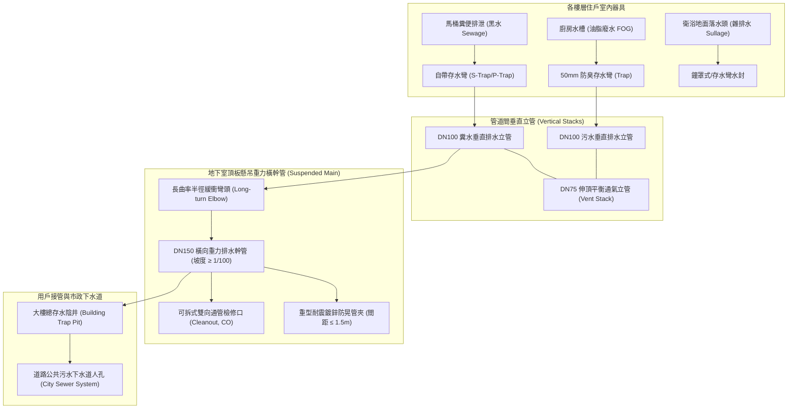
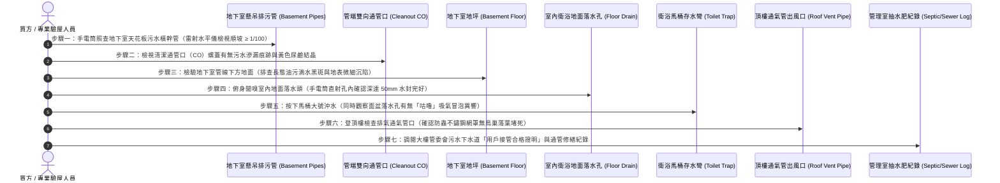

# 全案購屋實戰第六百三十一部：中古大樓社區地下室生活污水下水道用戶接管重力流破管滲漏地盤掏空沉砂淤塞逆坡回沖與惡臭毒氣逆灌室內體檢工序全書

---

## 序章：社區地下暗黑生命線——生活污水重力流排放系統的隱蔽危機

在集合住宅大樓的生活給排水環境工程中，所有住戶每日自廚房、衛浴、洗衣陽台所產生的生活污水（Sullage）與糞尿黑水（Sewage），均仰賴大樓內部的生活排水幹管，順著垂直管道間下墜至地下室最底層（B1 至 B3 頂板或筏基層），再匯流至橫向懸吊之「重力流排水橫幹管（Gravity Drainage Main）」，最終經由「用戶排水設備接管（Building Sewer Lateral Connection）」重力流排入直轄市政府所布設之公共污水下水道管網（Public Sewer System），或排入社區自設之污水處理設施（化糞池/污水處理槽）。

依據中華民國**《下水道法》第十九條至第二十二條**、**《建築技術規則》建築設備編第二章給水排水系統**及**內政部國土管理署「用戶排水設備工程技術規範」**之明文強制標準：
1. **重力流最小流速與洩水坡度紅線**：生活污水重力流管線嚴禁產生積水逆坡。管徑在 DN100（4 吋）以下時，其有效洩水坡度**絕對不得小於 1/50（2.0%）**；管徑在 DN150（6 吋）以上時，洩水坡度**不得小於 1/100（1.0%）**，確保管內污水維持在 **$0.6 \text{ m/s} \sim 1.0 \text{ m/s}$ 之「自清流速（Self-cleansing Velocity）」**，防止油脂（FOG）、泥沙及固體糞渣在管底沉積淤塞。
2. **通氣系統與水封保護（Trap Seal Integrity）**：所有重力流管系必須配備完善的「伸頂通氣管（Stack Vent）」與「共用結合通氣管（Yoke Vent）」，確保排水管內之正負氣壓波動嚴格控制在 **$\pm 25 \text{ mmAq}$（$\pm 250 \text{ Pa}$）之內**，嚴防排水時產生「虹吸抽吸（Induced Siphonage）」或「正壓回沖（Backpressure）」，破壞住戶室內存水彎（Trap）深達 50 mm 至 100 mm 之防臭水封。
3. **管材耐腐蝕強度與懸吊吊卡防震間距**：地下室懸吊之重力污水橫幹管應優先採用耐撞擊硬質聚氯乙烯管（HIVP / PVC-U）、球墨鑄鐵管（DIP）或不鏽鋼管；管路每隔 **1.5 至 2.0 公尺必須強制裝設重型防震管卡與防晃支撐（Sway Bracing）**，嚴禁長跨度懸空下垂。

然而，在屋齡 20 至 35 年的中古大樓中，地下室污水重力流管系常年處於陰暗受潮、承載千家萬戶高濃度油污與腐蝕性洗劑之環境，極易演變為三大高危致命病徵：
- **地震沉陷導致懸吊吊架變形脫落，重力幹管產生「局部逆坡凹陷（Sags / Belly）」**，管底常年積存數公分厚之陳年固化油塊（Fatberg）與泥沙，管內斷面縮減 80% 以上，隨時引發全大樓一樓與地下室污物大逆流；
- **老舊 PVC 膠合接頭脆化開裂、鑄鐵管底部遭酸性污水化學腐蝕穿孔**，污水日夜滲漏滴落至地下室基礎地坪，經由地表裂縫下滲掏空地盤基礎砂土，甚至直接腐蝕筏基鋼筋混凝土結構；
- **通氣立管堵塞或存水彎水封乾涸**，地下管網內厭氧發酵產生之高濃度「硫化氫（$\text{H}_2\text{S}$，劇毒腐蛋臭氣）」與「甲烷（$\text{CH}_4$，易燃易爆沼氣）」，直接逆灌進入低樓層住戶室內，導致住戶長年飽受惡臭折磨、眼鼻黏膜受損，更潛藏下水道瓦斯氣爆火災之巨大隱患！

本冊《全案購屋實戰第六百三十一部》深入剖析大樓地下室重力流污水管網水力坡度學、沉砂油垢水力沉降力學、接管破漏地盤掏空機制與室內水封破壞逆灌原理，並制定現場看屋與地下公設實勘時之實戰查驗標準工序。

---

## 第一章：地下室生活污水重力流管網物理拓撲與三大崩潰失效機制

### 一、重力流排水管網與通氣水封保護拓撲
大樓生活污水重力流排放系統由「各戶器具排水支管」、「垂直排水立管」、「伸頂通氣平衡立管」、「地下室懸吊橫幹管」及「公共下水道銜接陰井」五大部分構成：

---

### 二、三大致命事故機理深入剖析

#### 1. 地震地盤沉陷引發幹管「局部逆坡（Negative Slope）」與油脂固化堵塞
- **致病機制**：
  - 台灣位處地震帶，中古大樓經歷數十年大小地震晃動，懸吊在地下室天花板的重力橫幹管金屬吊桿（Hanger Rods）發生螺栓鬆動、滑脫或角鋼撕裂。
  - 數十公尺長的橫幹管因自重加上滿管污水的重量，在跨距中段產生下垂彎曲，原本應維持向下傾斜的 1% 順坡，局部變成了向上翹起的「負坡度（逆坡 / 反坡）」。
  - 廚房排放之高溫液態動植物油脂進入逆坡低窪處，流速降為零，水溫冷卻後油脂迅速凝固成堅硬如石之白色「脂肪塊（Fatberg）」，並將衛生紙纖維與菜渣泥沙死死包裹。
- **致命後果**：管內通水斷面由 150 mm 逐步萎縮至不足 20 mm。當某個週日全棟住戶集中用水時，水流在低窪處遭遇嚴重瓶頸，污水迅速滿管，沿著立管向上回堵。最靠近地下橫管之**一樓或二樓住戶的馬達與地面落水孔瞬間「狂噴糞水」**，成千上萬公升的黃黑糞水淹滿客廳臥室，裝潢與木地板全數報廢！

#### 2. PVC 膠合介面老化脫膠與鑄鐵管底電化學酸蝕穿孔（地基掏空危機）
- **致病機制**：
  - 早期建商施作地下室重力污水管時，PVC 接頭使用的溶劑型膠合劑（PVC Solvent Cement）在承受數十年生活污水冷熱交變與洗碗精、漂白水之化學侵蝕下，膠合層脆化脫膠；
  - 若採用老式鑄鐵污水管，管底流動的水流常年處於酸性狀態（pH 4.5~6.0），加上管底厭氧菌分解硫酸鹽生成微量硫酸（$\text{H}_2\text{SO}_4$），金屬管底產生劇烈的電化學「溝槽狀穿孔腐蝕（Channel Invert Erosion）」。
- **致命後果**：污水順著管底細縫與接頭微孔常態性滲漏。若管路埋設於地下室地坪下方，數百噸富含化學物質之污水日夜沖刷地坪下方之回填級配砂土層，造成**土壤細料流失、地基下方形成巨大空洞（Underground Void）**！一旦大地震來襲或重型車輛駛過，地下室地坪瞬間大面積塌陷斷裂，甚至危及大樓基樁地樑承載力！

#### 3. 通氣管堵塞引發「水封破壞」與劇毒硫化氫氣體逆灌（慢性中毒與氣爆風險）
- **致病機制**：
  - 大樓頂樓通氣管出風口若遭鳥巢落葉堵死、或管道間通氣立管因裝潢施工被擅自截斷盲封。
  - 當高樓層大量沖水時，重力下墜的水柱在立管內部形成高速運行的「水塞（Piston Effect）」，水塞上方產生高達數百毫米水柱的劇烈負壓真空，將各戶廚房水槽與浴缸存水彎內的 50 mm 防臭水封「強行抽乾拉空（Siphonage Trap Loss）」；
  - 水封一旦乾涸見底，管內原本被水封隔離的氣體便長驅直入。
- **致命後果**：地下污水系統中厭氧腐敗發酵產生的高濃度**「硫化氫（$\text{H}_2\text{S}$）」**與**「甲烷（$\text{CH}_4$）」**，順著排污管道源源不絕逆灌進入室內。住戶每日在臥室聞到惡臭腐蛋味，引發慢性頭痛、眼部發炎、呼吸道病變；若有住戶在浴室內點菸，更隨時可能引發下水道甲烷混合氣體**「瞬間閃燃爆炸」**，將衛浴磁磚炸裂崩塌！

---

## 第二章：四大候選物件之污水排放系統實勘對照與談判戰略

本案目前鎖定之四大候選物件，因屋齡與地下室結構配置不同，其污水管網體質具有顯著差異：

| 物件編號與社區名稱 | 樓層與建物特徵 | 污水重力幹管與水封防臭潛在焦點 | 現場實勘首要手段 | 談判作戰與費用扣除指引 |
| :--- | :--- | :--- | :--- | :--- |
| **大安紫金城 13 樓 (`PROP_10`)** | 13 樓頂樓戶，原為 4 間學生分租套房。 | 13 樓處於整棟排水立管的最高點，頂樓通氣管（Vent Stack）是否順暢直接影響 13 樓存水彎水封；分租套房當初增設 4 間衛浴時，室內橫向排污管若洩水坡度不足或未裝存水彎，室內將常年瀰漫管線惡臭。 | 1. 檢視 13 樓各衛浴地面落水孔與馬桶底座，聞嗅有無沼氣酸臭味。 2. 現場同時沖放所有馬達與面盆水，檢驗落水孔水封是否被吸空或冒氣泡。 3. 登頂樓檢視排水通氣管口有無被雜物遮蔽。 | 若室內分租改建管線有逆坡反臭問題，重配室內衛浴吊管及重作防水約需籌措 **15~25 萬元**，以此作為殺價談判籌碼。 |
| **長億南園 8 樓 (`PROP_106`)** | 30 年老舊大社區，戶數龐大，主附 32 坪大空間。 | 30 年大型社區地下室污水橫幹管跨度極長，懸吊吊管極易出現逆坡下垂；需特別查驗地下室停車場天花板之污水明管有無滲水黑斑、法蘭接頭結晶滴漏。 | 1. 勘查地下室天花板，手電筒順著粗大排污主管照查管身平直度。 2. 檢視地下室地面有無污水滴落形成的白色尿鹼與油污漬。 3. 查閱管委會歷月修繕單有無「通管清淤泥」之頻繁叫修紀錄。 | 地下室污水橫管若嚴重逆坡積泥，全社區幹管高壓水刀通管或局部管線重配費用約需 **10~20 萬元**，向賣方爭取 **5~8 萬元**之防禦折讓。 |
| **歌德堡 8 樓** | 精裝修戶，管理委員會運作規範嚴謹。 | 需確認戶內高級衛浴是否配備具備防臭防蟲防乾涸之「深水封存水彎」，排查天花板吊管有無微漏水漬。 | 踩梯打開天花板檢修口，檢視上一層住戶之排污吊管接頭與存水彎乾燥度。 | 機電維護優良，作為標準對照組，牽制大安紫金城與長億南園。 |
| **靜園 A 區 11 樓** | 均質社區，通風採光頂級，雙衛皆開窗。 | 雙衛皆開窗通風優良，自然通風壓差大，檢視落水頭水封持久度。 | 長時間未用水時檢驗落水頭水封有無完全蒸發乾涸，作為優良基標。 | 優良基準參考標的。 |

---

## 第三章：看屋現場污水管網與水封防臭七步快篩標準工序（SOP）

買方或其驗屋代表在陪同仲介看屋與勘查地下室時，遵循以下 7 步標準工序進行深度檢驗：

### 具體實施指引與合格紅線：
1. **地下室天花板排污橫幹管「坡度與吊架」檢驗（順坡第一關）**：
   - 走入地下停車場，抬頭找到直徑 100~150 mm 之粗大排水橫管。
   - 拿小型雷射水平尺貼在管壁下方測量：
     - **合格標準**：管路必須維持均勻向下傾斜（順坡度 **$\ge 1/100$**，即每 1 公尺落差 $\ge 1 \text{ cm}$），吊架間距在 **$1.5 \text{ m}$ 以內**且無下垂變形。
     - **重大缺陷**：若水平尺氣泡偏向反側（逆坡），或者兩支吊桿中間管身明顯呈「下凹垂肚（Belly）」，鐵證管內長年積泥積油，隨時引發大逆流！
2. **通管檢修口（Cleanout, CO）密封性排查**：
   - 檢視轉彎處與幹管末端特設的帶螺牙金屬/塑膠通管孔（CO 蓋）。
   - 螺蓋周邊必須保持絕對乾燥；若螺牙邊緣滲出黃褐色污水、懸掛白色鹽鹼或被透明矽利康胡亂塗抹封死，代表管內曾頻繁堵塞爆管，且管壓過高外洩！
3. **室內衛浴水封「五官嗅覺與視覺」檢測**：
   - 進入室內衛浴，關閉抽風機，湊近洗臉盆落水孔與地面排水孔聞嗅。
   - **合格標準**：只能聞到乾淨空氣或淡淡清潔劑香味。
   - **重大警訊**：若聞到令人作嘔的腐爛有機酸味、臭雞蛋硫化氫味或潮濕霉爛味，代表室內存水彎水封已經被破壞抽乾，或者分租改建管線根本未配置合格存水彎！
4. **馬桶連鎖沖水「水封抗抽吸」實戰測試**：
   - 將衛生紙揉成團投入馬桶，按下大沖水鍵；在此同時，眼睛死死盯住旁邊的浴缸與面盆落水孔，耳聽動靜。
   - **正常現象**：馬桶水流旋轉順暢吞沒，洗臉盆落水孔靜默無聲。
   - **致命紅線**：若馬桶沖水時，旁邊的浴缸或地面落水孔發出如同喝水噎到的**「咕嚕、咕嚕」巨大空氣吞嚥吸氣聲**，甚至看見落水孔內部水封劇烈跳動晃動被抽空，鐵證大樓通氣管路嚴重堵塞，室內防臭屏障瞬間被撕裂！
5. **頂樓伸頂通氣管（Stack Vent）通暢度排查**：
   - 登上頂樓天台，找到伸出屋頂約 30~50 公分的不鏽鋼或 PVC 排氣管。
   - 用強光手電筒向管口內照射：管口必須加裝不鏽鋼防蟲防鳥罩，且管內通暢無阻；若管口被水塔雜物堆疊覆蓋、或管內塞滿落葉雜草，全棟排水通氣機能將徹底癱瘓。
6. **公共污水下水道「用戶接管」合規性核實**：
   - 向管委會索閱台中市政府水利局出具之**「污水下水道用戶排水設備完工審查合格證明（或廢除化糞池切換證明）」**。
   - 若中古大樓已完成公辦污水接管，大樓地下室不再儲存黑水化糞池，衛生環境大為提升；若大樓仍依賴抽水肥與老舊化糞池，需重點排查化糞池槽體是否有結構滲水與沼氣外溢。

---

## 第四章：地下室污水重力流管網與防臭全面體檢驗收表

本表供買方於看屋公設踏勘或交屋前逐項檢對打勾：

| 檢驗項目 | 規範標準要求 | 實測現況紀錄 | 合格判定 | 缺陷風險處置與修繕成本 |
| :--- | :--- | :--- | :---: | :--- |
| **1. 橫幹管重力洩水坡度** | 管徑 DN100 坡度 ≥ 1/50；DN150 坡度 ≥ 1/100，無反坡下垂。 | ［　　］坡度比例 | □合格 □異常 | 調校懸吊防震吊架高度，消除管身逆坡下垂（約 1.5~3.0 萬元）。 |
| **2. 管路接口密封與外觀** | 接口膠合緊密無滴漏、無油污滲水痕跡、無黃色尿鹼結晶。 | ［　　］狀態 | □合格 □異常 | 局部裁切更換為全新厚肉型 HIVP 管段及耐壓伸縮接頭。 |
| **3. 通管檢修口（CO）** | 清潔口螺蓋旋緊密封無滲水，拆卸通管動線順暢無阻礙。 | ［　　］狀態 | □合格 □異常 | 更換為黃銅高壓密封清潔口螺蓋，更換耐油耐酸迫緊墊圈。 |
| **4. 室內落水孔水封深度** | 存水彎水封有效深度 50~100 mm，室內無硫化氫酸臭沼氣。 | ［　　］mm 水封 | □合格 □異常 | 安裝專利自閉式防臭防蟲深水封地漏芯（約 500~1,500 元/只）。 |
| **5. 馬桶沖水水封穩定度** | 馬達沖水時相鄰地漏無「咕嚕」吸水聲，水封無跳動被抽空。 | ［　　］現象 | □合格 □異常 | 疏通頂樓通氣立管，加裝自動進氣閥（AAV）平衡負壓。 |
| **6. 頂樓通氣管出風口** | 管口出風通暢，加裝 16 目 SUS304 防鳥防蟲不鏽鋼網罩。 | ［　　］狀態 | □合格 □異常 | 清除管口雜物鳥巢，更換原廠鵝頸型不鏽鋼防雨排風罩。 |
| **7. 市政污水用戶接管** | 完成公辦污水下水道接管並由水利主管機關審查合格核備。 | ［　　］年接管合格 | □合格 □異常 | 列入買賣合約交屋前管委會提供接管或化糞池清理合格證明。 |

---

## 第五章：總結與後續工序推進

地下室生活污水重力流排放系統，是深埋於大樓體系中最骯髒、卻最直接牽動居家生活尊嚴與人身健康的隱蔽命脈。在看屋時花費 10 分鐘俯身聞嗅室內水封、手電筒照查地下室天花板橫幹管順坡與通管口，能輕易識破大樓暗藏數十年的反坡積泥與毒氣逆灌重症，為全家爭取清新健康的無毒居住空間，並在總價談判中掌握無可辯駁的殺價底牌！

下一部實戰手冊將依序開展：**《全案購屋實戰第六百三十二部：中古大樓社區地下室生活污水下水道用戶接管沉水式絞碎型排污泵浦氣化空蝕機械軸封砂石刮傷與化糞池槽體酸化滲漏體檢工序全書》**，持續深入污水下水道提升排污動力核心工序！

---
*全案購屋實戰第六百三十一部・全書完・版本控管確認*
