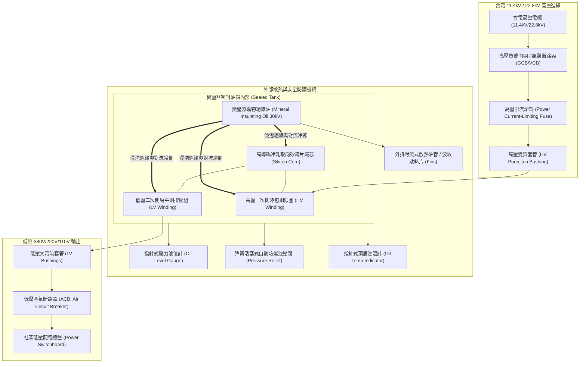
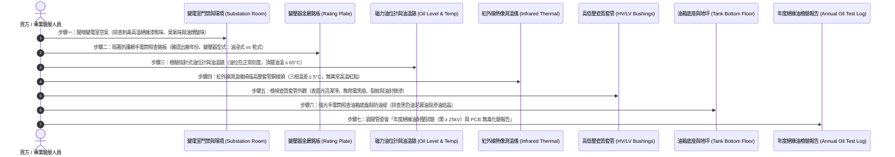

# 全案購屋實戰第六百三十三部：中古大樓社區地下室變電室油浸式變壓器絕緣油耐壓劣化油泥碳化PCB多氯聯苯殘留油封滲漏與高溫爆炸體檢工序全書

---

## 序章：社區千家萬戶電力的母體心臟——變電室油浸式變壓器的致命盲區

在集合住宅大樓的電氣供電工程體系中，台灣電力公司（台電）輸送至社區地下室配電場所的通常為 **11.4 kV（11,400V）或 22.8 kV（22,800V）之高壓三相交流電**。為使全大樓住戶能夠安全使用 110V/220V 的家電設備與 380V 的電梯、給排水馬達動力，整棟社區的所有電能，必須首先匯流進入地下室高壓變電室內之**「受電變壓器（Power Transformer）」**進行降壓轉換。

在屋齡 20 至 35 年的中古大樓中，早期建商受限於建造成本與當時技術條件，絕大多數採用傳統**「油浸式變壓器（Oil-immersed Transformer）」**，其內部灌注有數百公升至上千公升之礦物性電氣絕緣油（Transformer Mineral Insulating Oil），仰賴絕緣油在鐵芯、高低壓銅線圈與散熱油管之間進行對流散熱與高壓電氣絕緣。

依據中華民國**《用戶用電設備裝置規則》（原屋內線路裝置規則）第四百條至第四百三十條**、**CNS 1339（油浸式配電變壓器）**及台電**「高壓用戶受電設備檢驗規範」**之明文強制標準：
1. **絕緣油介質耐壓擊穿極限（Dielectric Breakdown Voltage）**：變壓器絕緣油必須每年定期抽樣進行耐壓試驗。依 ASTM D877 / CNS 標準，新油之耐壓強度應大於 **30 kV 至 35 kV**；運轉中老舊變壓器之絕緣油介電擊穿強度**絕對嚴禁低於 20 kV 至 25 kV**。若擊穿電壓低於 20 kV，絕緣油已失去抑制高壓電弧的能力，隨時將引發相間金屬直接短路放電！
2. **絕緣紙聚合度與溶解氣體分析（DGA, Dissolved Gas Analysis）**：絕緣油內溶解之特徵氣體濃度必須定期化驗。乙炔（$\text{C}_2\text{H}_2$）濃度嚴禁超過 **1~5 ppm**（乙炔為內部產生高能電弧火花的唯一指標氣體）；氫氣（$\text{H}_2$）與一氧化碳（$\text{CO}$）若異常飆高，代表絕緣木質牛皮紙與絕緣漆正在遭受極限熱老化分解。
3. **高壓套管（Bushing）、油封迫緊與洩壓防爆裝置**：高低壓瓷質套管表面必須光亮無龜裂、爬電比距符合規範；變壓器油箱頂部必須配備機械式「自動洩壓閥（Pressure Relief Device, PRD）」；油箱本體與周邊油封（Gasket）必須維持絕對乾燥，嚴禁發生任何油滴滲漏滴落至變電室地坪。

然而，在屋齡 20 至 35 年的老舊社區中，地下變電室處於常年密閉、高溫悶熱、通風不良之惡劣環境，管委會往往因檢驗經費昂貴（每次取樣耐壓化驗需數萬元）而長年「忽視漏檢」，極易掩蓋深層變壓器的三大毀滅性致命病徵：
- **變壓器絕緣油吸濕氧化、油泥（Sludge）析出碳化沉澱於線圈底部**，油泥阻斷內部油路對流，導致鐵芯局部熱點溫度突破 **$140^\circ\text{C} \sim 180^\circ\text{C}$**，絕緣紙炭化脆裂；
- **早期變壓器絕緣油殘留被國際公約嚴格禁用的第一類劇毒致癌物「多氯聯苯（PCB, Polychlorinated Biphenyls）」**，不僅危害人體神經與肝臟免疫系統，且一旦滲漏將面臨環保局天價開罰與強制封閉除污；
- **丁腈橡膠（NBR）油箱密封墊圈長年高溫硬化龜裂、高低壓套管接頭油封常態性滲漏**，油位大幅跌落至安全標線以下，高壓線圈外露暴露於空氣潮氣中，在用電高峰期瞬間引發 **11.4 kV 超高壓相間金屬大短路，產生高達數千度高溫之電弧氣體爆炸（Arc Flash Explosion）**，高溫燃燒絕緣油瞬間噴射，將整座地下變電室炸成火海煉獄，全棟大樓陷入全面斷電黑燈、數百住戶被困濃煙毒氣中的滅頂慘劇！

本冊《全案購屋實戰第六百三十三部》深入剖析大樓地下變電室油浸式變壓器微觀介電化學、油泥碳化沉降動力學、PCB 毒性檢測法規、電弧閃絡高溫爆炸力學，並制定現場看屋與地下機房勘查時的實戰檢驗工序。

---

## 第一章：地下室油浸式變壓器物理拓撲與三大崩潰爆炸機制

### 一、高壓油浸式變壓器內部物理拓撲
油浸式受電變壓器由「矽鋼片鐵芯與銅繞組」、「礦物絕緣油介質」、「密封油箱與波紋散熱片」、「高低壓絕緣套管」及「洩壓安全防禦機構」構成：

---

### 二、三大致命事故機理深入剖析

#### 1. 絕緣油氧化酸化、油泥（Sludge）沉積與鐵芯熱點引發「電弧擊穿（Flashover）」
- **致病機制**：
  - 中古大樓變壓器長年處於 $60^\circ\text{C} \sim 80^\circ\text{C}$ 的高溫重載環境下。礦物絕緣油中的碳氫化合物與空氣中的氧氣發生高溫自由基鏈式反應，生成有機酸、過氧化物與不溶性固體「油泥（Sludge）」；
  - 這些黏稠的黑色油泥沉積在線圈層間與鐵芯內部的油隙通道內，熱阻劇增，局部熱點（Hotspot）溫度可飆升至 **$150^\circ\text{C}$ 以上**；
  - 高溫烘烤使包覆在銅線外部的牛皮絕緣紙聚合度（DP）由 1,000 斷裂暴跌至不足 200（嚴重炭化脆裂成碎屑脫落）。
- **致命後果**：當夏季全社區冷氣同時啟動的高峰期，一次側高壓線圈層間絕緣完全失效，產生微秒級的**高壓電弧短路（Turn-to-turn Flashover）**！數千安培的短路電流在瞬間將絕緣油汽化分解成高壓氫氣與甲烷氣體，若高壓保護熔絲未能在 0.05 秒內切斷，變壓器內部將瞬間累積數十個大氣壓的爆炸衝擊波！

#### 2. 早期變壓器 PCB 多氯聯苯毒性殘留與法規重罰（世紀之毒公害）
- **致病機制**：
  - 台灣在民國 70 年代以前（及部分沿用至 80 年代初期的二手變壓器），廣泛採用不易燃的合成芳香族化合物「阿斯卡雷爾（Askarel，含 40%~60% 多氯聯苯 PCB）」作為變壓器絕緣介質。
  - 依行政院環境保護部（現環境部）《毒性及關注化學物質管理法》明文規定：**變壓器油中 PCB 含量嚴禁超過 50 ppm（管制標準）**。
- **致命後果**：PCB 具備極強的生物蓄積性與脂溶性，可透過呼吸蒸氣或皮膚接觸侵入人體，引發氯痤瘡、肝臟壞死、胎兒畸形、內分泌失調及多種惡性腫瘤（世紀之毒）！若老舊社區地下室變壓器被環保單位抽檢出 PCB 超標且有滲漏，大樓管委會將面臨 **100 萬至 500 萬元以上之天價罰鍰**，且整棟大樓將被列為環境污染列管場址，變壓器必須強制委託具備高溫電漿焚化資質之專業環保機構進行封閉吊運除污，費用動輒上百萬元！

#### 3. 橡膠油封（Gasket）硬化滲漏油位暴跌與油箱高溫物理爆炸
- **致病機制**：
  - 油箱頂蓋法蘭、高低壓套管基座與洩油閥處之丁腈橡膠（NBR）或軟木迫緊墊圈，經 25 至 30 年高溫油浸與老化，橡膠失去回彈彈性，產生硬化、收縮與龜裂；
  - 絕緣油順著螺栓縫隙日夜微量滲漏滴落至變電室地坪，變壓器油箱內部油位持續緩慢下降；
  - 當油位跌破高壓套管下端及線圈頂部時，本應被絕緣油完全包覆的高壓接線端子直接暴露於高濕空氣中。
- **致命後果**：高壓電極在空氣中產生劇烈的「電暈放電（Corona Discharge）」，擊穿空氣產生連續拉弧。高溫電弧瞬間引燃油箱上部聚集的易燃揮發性碳氫氣體，內部壓力在 0.1 秒內突破金屬油箱的屈服極限，**整座重達數噸之變壓器金屬油箱如炸彈般劇烈撕裂炸開**！上千公升滾燙的燃燒絕緣油（火雨）高速噴射整個地下室，引發毀滅性地下火災，將所有供電配電盤與相鄰弱電光纖全數燒毀！

---

## 第二章：四大候選物件之變電設備現場查驗焦點與談判戰略

本案目前鎖定之四大候選物件，因社區建造年限與用電容量不同，地下變電設備之型式與維護狀態具有重大區別：

| 物件編號與社區名稱 | 社區規模與供電容量 | 變電室油浸式/乾式變壓器潛在焦點 | 現場公設實勘首要工序 | 談判籌碼與修繕折讓指引 |
| :--- | :--- | :--- | :--- | :--- |
| **大安紫金城 13 樓 (`PROP_10`)** | 地下 B2 設有獨立高壓受電變電室，總樓層 13 層超高大樓，變壓器容量高達 300~500 kVA。 | 28~30 年高層社區，原始建商配賦之變壓器若為原裝「油浸式」，已逼近 30 年設計壽命極限；需特別查驗油箱本體有無漏油油漬、指針式油位計是否處於正常綠色區間、頂層油溫是否低於 65°C。 | 1. 勘查 B2 變電室，隔著安全防護網以紅外線測溫槍照射變壓器高壓套管接頭與油箱表面。 2. 檢視變壓器外殼金屬銘板（確認出廠年份、型式為油浸式或模鑄乾式）。 3. 照查變壓器底部防油堤與接油盤有無黑色積油。 | 若變壓器老舊油浸式且有油封滲漏，未來全棟大樓更換全新「模鑄式乾式變壓器（Cast Resin Transformer）」工程費用高達 **60~120 萬元**，以此作為殺價扣減之最核心重量級公設折讓籌碼！ |
| **長億南園 8 樓 (`PROP_106`)** | 30 年老舊大社區，戶數龐大，公設變電室負荷沉重。 | 30 年大型舊社區變壓器長年缺乏定期絕緣油抽樣耐壓試驗（Dielectric Test）；若內部油泥嚴重碳化，夏季高峰極易產生交流跳機大停電。 | 1. 檢視變電室門口台電定期檢驗標籤與機電顧問公司年度檢驗報告。 2. 聆聽變壓器運轉聲音（正常為低沉均勻的 60Hz 嗡嗡聲，排查內部「劈啪」局部放電聲）。 | 變壓器若逾齡未驗且油泥老化，要求賣方出具近一年「高壓用電設備檢驗合格申報單」，並向賣方爭取 **8~12 萬元**之防禦折讓。 |
| **歌德堡 8 樓** | 精裝修戶，管理委員會運作規範嚴謹。 | 需確認社區變電室是否已升級更換為安全性極高之「模鑄式乾式變壓器（免除任何油浸火災與漏油風險）」。 | 檢視變電室變壓器本體外觀是否為無油散熱之環氧樹脂模鑄線圈。 | 若已更換為乾式變壓器，公設品質極高，作為模範對照組，牽制大安紫金城與長億南園。 |
| **靜園 A 區 11 樓** | 均質社區，公共設施維護規範嚴謹。 | 檢視年度電氣主任技術員申報紀錄與高壓絕緣電阻測試數據。 | 查核台中市政府經濟發展局高壓用電登記台帳，作為優良標準基標。 | 優良基準參考標的。 |

---

## 第三章：看屋現場變電室與變壓器七步快篩查驗標準工序（SOP）

買方或其驗屋代表在陪同仲介勘查地下室變電室公設時（**注意：變電室內部為 11.4kV 高壓危險重地，必須在合格甲級電匠或機電工程師陪同下，保持至少 1.5 米以上法定安全距離檢驗，絕對嚴禁觸摸任何高壓帶電體！**），遵循以下 7 步標準工序進行深度檢驗：

### 具體實施指引與合格紅線：
1. **變電室氣味與放電聲響判定（初級感官排查）**：
   - 站在變電室門口或通風百葉窗外：
     - **合格環境**：空氣乾爽通風，僅有微弱溫熱氣流與微弱且平穩的「嗡——」交流電磁哼聲。
     - **重大警訊**：若聞到強烈刺鼻的「變質酸性油味」、「電線絕緣漆燒焦味」、或如影印機般的「濃烈臭氧味（Ozone）」；若耳聽內部傳出斷續清脆的「劈啪、劈啪」電弧打火聲，代表內部正在發生嚴重的局部電暈放電，隨時有短路起火危險！
2. **磁力指針油位計（Oil Level Gauge）安全刻度檢驗**：
   - 用強光手電筒照射變壓器側面的指針式油位計。
   - **合格標準**：指針必須穩定落在 **$20^\circ\text{C}$ 至 $25^\circ\text{C}$ 的正常常態綠色刻度區間**。
   - **致命紅線**：若油位計指針低於 "LOW" 最低安全紅線刻度、或者指針玻璃面已泛黃發黑無法看清，代表變壓器內部絕緣油已嚴重滲漏短缺，線圈隨時暴露於空氣中引發爆炸！
3. **頂層油溫錶（Top Oil Temperature）溫升檢核**：
   - 查讀水銀指針式油溫計的讀數。
   - **合格標準**：常態運轉時，頂層油溫必須穩定維持在 **$50^\circ\text{C} \sim 65^\circ\text{C}$ 以下**（最高上限不得超過 $85^\circ\text{C}$）。
   - **異常警訊**：若在一般負載下油溫已逼近 **$80^\circ\text{C} \sim 90^\circ\text{C}$**，代表內部散熱油管嚴重淤塞、或變壓器常態超載運轉。
4. **紅外線非接觸式熱像測溫掃描（Infrared Inspection）**：
   - 在安全圍欄外，以紅外線熱像儀或高精度測溫槍分別掃描一次側高壓套管（$\text{U, V, W}$ 三相）及二次側低壓銅排接頭。
   - **合格標準**：三相接頭溫度必須均衡，相間溫差不得大於 **$5^\circ\text{C}$**，整體溫度不得超過 **$70^\circ\text{C}$**。
   - 若某單相接頭溫度高達 $95^\circ\text{C}$ 以上呈現亮白熱點，代表接線螺栓鬆動氧化，接觸電阻劇增，隨時將燒熔接頭引發短路！
5. **油箱底座與高壓套管「油封滲漏」檢驗**：
   - 拿手電筒仔細照射變壓器下方之混凝土防油堤（Oil Retention Pit）與油箱四個底角。
   - **合格標準**：油箱外表乾燥，防油槽內無積油。
   - **重大缺陷**：若套管法蘭處掛著長年凝結的黑色黏稠油垢石筍、地坪上流淌著數公分深之褐色變壓器油，代表所有橡膠油封已全面脆化崩解，必須全機吊運大修更換迫緊！
6. **年度絕緣油耐壓化驗報告（Dielectric Breakdown Report）審核**：
   - 要求管委會出具由經濟部能源署認可之電力檢驗中心（如台灣大電力研究試驗中心、台灣電力技術顧問等）出具之最新一年**「變壓器絕緣油試驗報告」**。
   - **核心審查數據**：
     - **介電擊穿電壓（Breakdown Voltage）**：實測值必須 **$\ge 25\ \text{kV}$（合格底線 20 kV）**；
     - **中和價（酸價 Acid Number）**：必須 **$\le 0.2\ \text{mg KOH/g}$**；
     - **PCB 多氯聯苯含量**：必須明確標註 **「ND（未檢出）」或「$< 50\ \text{ppm}$（合格）」**。若拿不出報告或數值不及格，該大樓公設電氣體系直接列為最高危險等級！

---

## 第四章：地下室高壓變電室油浸式變壓器全面體檢驗收表

本表供買方於看屋公設踏勘或交屋前逐項檢對打勾：

| 檢驗項目 | 規範標準要求 | 實測現況紀錄 | 合格判定 | 缺陷風險處置與修繕成本 |
| :--- | :--- | :--- | :---: | :--- |
| **1. 變壓器型式與銘板** | 銘板標示清楚，優先推薦無油之「模鑄式乾式變壓器」。 | ［　　］型式 / 年份 | □合格 □異常 | 若為 30 年老舊油浸式，全棟更換乾式變壓器需籌募 60~120 萬元。 |
| **2. 絕緣油耐壓擊穿值** | 絕緣油介電擊穿強度 ≥ 25 kV（絕對嚴禁低於 20 kV）。 | ［　　］kV 耐壓 | □合格 □異常 | 實施絕緣油熱油循環過濾脫水脫氣，或全容量換新油（約 5~10 萬元）。 |
| **3. PCB多氯聯苯含量** | 絕緣油中 PCB 含量符合環保法規 < 50 ppm（或未檢出）。 | ［　　］ppm 含量 | □合格 □異常 | 若 PCB 超標，必須依法通報環保局並委託專業高溫除污焚化。 |
| **4. 磁力油位計安全位** | 指針穩定處於 20°C 正常綠色刻度區間，玻璃清晰無黑垢。 | ［　　］狀態 | □合格 □異常 | 停電檢修補充合格絕緣油，更換磁力油位指示計總成。 |
| **5. 頂層油溫運轉溫升** | 正常供電負載下，油溫計指針 ≤ 65°C（嚴禁超過 85°C）。 | ［　　］°C 油溫 | □合格 □異常 | 加裝變電室強制通風散熱軸流風機，清洗變壓器散熱波紋片。 |
| **6. 油箱與套管密封性** | 油箱外表、高低壓套管接頭乾爽無微滲、防油堤無積油。 | ［　　］狀態 | □合格 □異常 | 重新更換全套耐高溫氟橡膠（FKM）密封油封墊圈（約 3~6 萬元）。 |
| **7. 紅外線套管端子溫差** | 高低壓接線端子三相相間溫差 ≤ 5°C，整體溫度 ≤ 70°C。 | ［　　］°C 溫差 | □合格 □異常 | 停電實施高壓母排端子除氧化層研磨，重新塗抹導電膏並以扭力扳手緊固。 |

---

## 第五章：總結與後續工序推進

地下室變電室油浸式變壓器，是全大樓所有光明、動力與電器運轉的源頭母體，更是老舊社區潛在毀滅性電氣火災與高壓電弧爆炸的最危險核心。在購屋決策中，花費 10 分鐘隔著安全防護網以手電筒與紅外線測溫槍掃描變壓器銘板、油位計、套管與防油堤，並調閱管委會絕緣油耐壓化驗單，能以極具專業威懾力的科學證據，徹底擊破仲介「大樓水電都很正常」的敷衍託詞，在總價斡旋中斬獲數十萬至上百萬元的實質讓步，並為全家人一生的居住安全奠定最穩固的基石！

下一部實戰手冊將依序開展：**《全案購屋實戰第六百三十四部：中古大樓社區電梯昇降路井道底坑油壓緩衝器液壓油乳化活塞桿鏽蝕微動極限開關接觸不良與安全防護體檢工序全書》**，持續深入電梯垂直昇降底層最後防線！

---
*全案購屋實戰第六百三十三部・全書完・版本控管確認*
