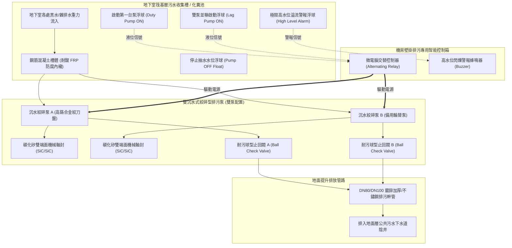
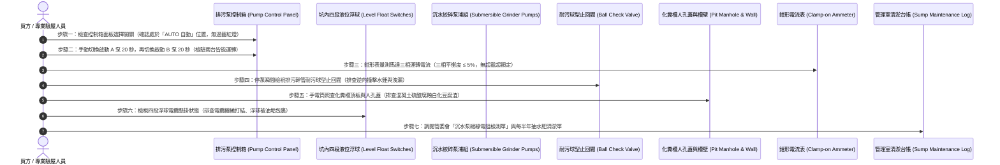

# 全案購屋實戰第六百三十二部：中古大樓社區地下室生活污水下水道用戶接管沉水式絞碎型排污泵浦氣化空蝕機械軸封砂石刮傷與化糞池槽體酸化滲漏體檢工序全書

---

## 序章：社區地下最深處的污物提升心臟——沉水排污泵與化糞池槽體防線

在集合住宅大樓的排水拓撲中，地下室各樓層（B1 至 B4）之衛生設備（如地下室管理室洗手間、司機休息室、停車場集水井）以及部分地勢較低之整棟生活污水，因其出水標高低於道路公共污水下水道幹管人孔之底標高，**無法依賴重力流自然流出**，必須匯集至地下室最底層（通常位於筏基內部）之「污廢水收集坑（Sewage Sump Pit）」或「自設化糞池/污水處理槽」，再透過大功率之**「沉水式絞碎型排污泵浦（Submersible Grinder Sewage Pump）」**強力加壓提升，沿著垂直排污幹管揚升至地面層外排。

依據中華民國**《建築技術規則》建築設備編第二章給水排水系統**、**《下水道法》**及**台灣自來水與污水工程設備標準規範**：
1. **雙泵備援與交替粉碎原則**：地下室污水坑必須強制配置**至少兩台同容量之沉水式排污泵浦（Duty & Standby Pumps）**，由自動交替控制盤控制，每次抽水自動輪流切換；泵浦吸入口必須配備由高鉻耐磨合金鋼（High Chrome Alloy）或碳化鎢鑄造之**「高速旋轉旋切絞碎刀盤（Grinder Cutter Mechanism）」**，能將毛巾、濕紙巾、衛生棉及固體糞渣在進入葉輪前瞬間絞碎至 5 mm 以下之細微漿狀顆粒，杜絕管路卡阻。
2. **耐腐蝕雙端面機械軸封與油室潤滑防護**：排污泵浦馬達與水力葉輪之間，必須配備置於潤滑油室（Oil Chamber）內之**「耐酸耐磨碳化矽（SiC）雙端面機械軸封」**，並配置油室漏水感應檢知器（Seal Leakage Sensor），嚴防水中腐蝕性污水或石英砂粒磨穿密封端面導致馬達線圈進水短路燒毀。
3. **化糞槽槽體防腐蝕內襯與筏基結構隔離**：鋼筋混凝土化糞池與污水集水槽內部，必須施作耐強酸強鹼之**無縫玻璃纖維樹脂（FRP Lining）或厚塗型聚脲（Polyurea）防腐內襯**，厚度不得小於 2.0 mm 至 3.0 mm；槽體外壁必須與筏基樑柱維持獨立空氣檢修空間，嚴防槽內長期產生的有機酸腐蝕混凝土、中性化剝落與鋼筋銹蝕斷裂。

然而，在屋齡 20 至 35 年的中古大樓中，地下底層沉水排污系統處於全大樓最陰暗、最骯髒、空氣中充斥高濃度硫化氫與甲烷之惡劣環境，極易演變為三大高危盲區：
- **污水中挾帶之裝潢泥沙、石英砂粒高速沖刷磨損絞碎刀口，刮傷碳化矽機械軸封**，污水長驅直入馬達油室，造成三相線圈絕緣崩潰瞬間跳脫；
- **化糞池內厭氧菌分解蛋白質產生高濃度硫化氫（$\text{H}_2\text{S}$），與空氣凝結水化合生成高腐蝕性「稀硫酸（$\text{H}_2\text{SO}_4$）」**，直接酸蝕穿透混凝土槽壁，高濃度黑水滲漏進入筏基基礎水箱，掏空筏基地樑；
- **排污泵浦吸入口被泥沙淤塞、有效淨正吸入水頭不足觸發劇烈「氣化空蝕（Cavitation）」**，葉輪被啃蝕成海綿蜂窩狀，泵浦空轉狂吼卻抽不動污水，導致地下室集水坑污水滿溢，糞水淹沒整個地下室停車場與配電室！

本冊《全案購屋實戰第六百三十二部》深入剖析沉水式絞碎排污泵浦之固體力學切割機制、碳化矽雙端面軸封水力磨損學、化糞槽混凝土酸化剝蝕動力學，並制定現場看屋與地下機房勘查時的實戰檢驗工序。

---

## 第一章：沉水式絞碎型排污泵與化糞池核心拓撲與三大崩潰失效機制

### 一、地下室污水提升與化糞池槽體物理拓撲
地下室排污提升系統由「污水收集坑」、「雙沉水絞碎泵浦組」、「自動液位浮球開關」、「防腐蝕提升幹管」及「控制安全警報盤」構成：

---

### 二、三大致命事故機理深入剖析

#### 1. 機械軸封（Mechanical Seal）遭石英砂粒劃傷與馬達線圈進水燒毀
- **致病機制**：
  - 住戶裝潢施工時，工人常違規將洗滌水泥抹刀之泥漿、磁磚填縫泥砂直接傾倒入排水管；
  - 這些高硬度石英砂粒（莫氏硬度高達 7）隨污水沉入地下室集水坑底。沉水泵啟動時，砂粒在葉輪強大離心力驅動下高速旋轉，強行擠入機械軸封動環（Rotary Ring）與靜環（Stationary Ring）之間微米級的密封面。
  - 碳化矽鏡面端面被劃出無數道深溝，潤滑油室內的變壓器絕緣油迅速乳化變黑。
- **致命後果**：污水經由軸承滲入三相感應馬達內部，浸泡漆包線圈。馬達線圈對地絕緣阻抗由正常的 $>100\ \text{M}\Omega$ 瞬間暴跌至零，送電瞬間產生劇烈的「匝間短路電弧（Turn-to-turn Short）」，電磁接觸器跳脫、熱過載保護電驛燒燬，排污泵徹底癱瘓報廢！

#### 2. 化糞槽混凝土「生物硫酸腐蝕（Biogenic Sulfuric Acid Corrosion）」與結構滲漏
- **致病機制**：
  - 化糞池內常年維持厭氧環境，硫酸鹽還原菌（SRB）將水中的硫酸鹽轉化為劇毒的硫化氫氣體（$\text{H}_2\text{S}$）；
  - 硫化氫逸散至槽體頂部未浸水之氣相空間，附著在潮濕混凝土壁面上；混凝土表面的好氧性硫氧化菌（Thiobacillus）將硫化氫進一步氧化轉化為強酸性的**「稀硫酸（$\text{H}_2\text{SO}_4$）」**！
  - 硫酸與混凝土中的水化矽酸鈣和氫氧化鈣發生劇烈化學反應，生成膨脹性的二水石膏（$\text{CaSO}_4 \cdot 2\text{H}_2\text{O}$）與鈣礬石，混凝土表面如粉狀豆腐渣般層層剝落（腐蝕速率高達每年 3~5 mm）。
- **致命後果**：槽壁混凝土有效厚度大幅減薄，鋼筋失去鹼性保護膜徹底銹蝕膨脹斷裂。高濃度腐蝕性黑水沿著貫穿裂縫湧入筏基底層，在地下室底板積存數寸厚之酸性毒水，嚴重掏空破壞大樓地樑基礎結構，帶來不可逆的結構安全危機！

#### 3. 排污吸入口沉積淤泥引發劇烈「氣化空蝕」與斷刀卡死（地下室糞水漫灌）
- **致病機制**：
  - 沉水泵長時間未定期實施高壓水刀清淤，集水坑底部的泥沙、油脂與纖維沉澱厚達數十公分，將泵浦下方的吸水孔隙死死包覆。
  - 泵浦啟動時，吸入側水流阻力極大，泵腔內部產生極度真空負壓，水流瞬間汽化產生劇烈「氣化空蝕（Cavitation）」，合金葉輪被微射流衝擊啃蝕成千瘡百孔之蜂窩狀；
  - 同時，未被充分破碎的抹布、濕紙巾纖維纏繞在高速旋轉的合金絞刀軸上，絞刀承受極限扭矩直接「咬死崩齒」。
- **致命後果**：排污馬達堵轉過載發燙，但控制盤若無過載跳脫保護或被不良人員強迫旁路，馬達線圈高溫燒燬。此時全棟住戶依然在源源不斷排水，集水坑在數小時內滿溢，**巨量惡臭糞水自地下室人孔蓋噴湧而出，漫過地下停車場，淹沒停放的豪車底盤與地下變電箱**，全社區面臨數百萬元巨大財損！

---

## 第二章：四大候選物件之排污提升系統現場實勘對照與談判戰略

本案目前鎖定之四大候選物件，因社區規模與建造年份不同，其地下室沉水排污泵與化糞槽體質差異極大：

| 物件編號與社區名稱 | 社區型態與地下深度 | 沉水排污泵與化糞池槽體潛在焦點 | 現場公設實勘首要工序 | 談判籌碼與修繕折讓指引 |
| :--- | :--- | :--- | :--- | :--- |
| **大安紫金城 13 樓 (`PROP_10`)** | 地下深達 B2，高樓層總戶數多，地下室排污提升揚程約 8~12 米。 | 28~30 年高層社區，需查驗地下室污水坑雙沉水泵浦是否仍維持正常自動交替運轉；排查化糞池頂板混凝土有無硫酸腐蝕粉化剝落；檢視 B2 車位周邊空氣有無刺鼻硫化氫臭味。 | 1. 勘查 B2 排污坑控制盤，檢查選擇開關是否處於「AUTO 自動」位置。 2. 現場手動分別啟動 A 泵與 B 泵（各跑 20 秒），檢驗運轉平順度與電流平衡。 3. 照查排污坑人孔蓋密閉性與周邊地坪白華。 | 若排污雙泵已有一台損壞且槽體滲漏，整套雙泵更新、高壓清淤與 FRP 防腐重施費用約需 **15~25 萬元**，以此作為殺價堅定客觀依據。 |
| **長億南園 8 樓 (`PROP_106`)** | 30 年大社區，戶數規模龐大，每日產出排污量極為驚人。 | 大型老舊社區化糞槽長年承受超負荷運轉，槽體酸化滲漏風險極高；若雙泵交替控制盤故障改為單泵手動硬撐，隨時有集水坑大溢流之高危風險。 | 1. 檢視排污控制箱有無「過載 Fault」紅燈被膠帶貼住或蜂鳴器被剪斷。 2. 查閱管委會歷月機電維修單核對「抽水肥與更換沉水泵」紀錄。 | 排污系統若處於高危癱瘓邊緣，將直接威脅地下室衛生與地盤完整性，向賣方強烈爭取 **6~10 萬元**之防禦折讓。 |
| **歌德堡 8 樓** | 精裝修戶，管理委員會運作良善。 | 需確認地下室排污管路之耐污球型止回閥（Ball Check Valve）密封性，防止停泵時高壓污水倒灌回坑。 | 檢視排污管路外觀漆面與管架防晃支撐。 | 機電維護優良，作為標準對照組，牽制大安紫金城與長億南園。 |
| **靜園 A 區 11 樓** | 均質社區，公共設施維護規範嚴謹。 | 檢視化糞池年度清理台帳與污水排放水質檢驗報告。 | 查核台中市政府環保局廢水排放核備函，作為優良標準基標。 | 優良基準參考標的。 |

---

## 第三章：看屋現場沉水排污泵與化糞槽七步快篩查驗標準工序（SOP）

買方或其驗屋代表在陪同仲介勘查地下室最底層排污坑時，遵循以下 7 步標準工序進行深度檢驗：

### 具體實施指引與合格紅線：
1. **控制盤自動交替模式與過載排查（雙泵防禦第一關）**：
   - 進入地下室機房，找到「地下排污泵 / 污廢水控制箱」。
   - **檢查重點**：兩台泵浦之運轉選擇開關（Selector Switch）必須全部旋轉在**「AUTO 自動」**狀態。
   - **重大警訊**：若開關被切在「手動（MANUAL）」、或者其中一台被切在「停止（OFF）」且面板「過載跳脫（Overload Trip）」亮紅燈，鐵證其中一台泵浦早已燒毀卡死，系統正在以單泵硬撐冒險運轉！
2. **手動雙泵試轉與聲音震動辨識**：
   - 在陪同管理員同意下，切至手動，分別短暫啟動 A 泵 20 秒，再啟動 B 泵 20 秒。
   - 仔細聆聽排水管震動與水流聲：
     - **合格聲音**：平順低沉的流體沖刷聲與絞刀切割聲；
     - **嚴重缺陷**：若發出劇烈金屬尖叫摩擦聲、或者「轟隆轟隆」如同攪拌石子之空蝕爆裂聲，代表絞刀崩齒或機械軸封已徹底咬死磨損！
3. **運轉電流與絕緣電阻量測（Electrical Check）**：
   - 以鉗形電流表勾住馬達主電源線，實測運轉電流必須低於馬達銘板標示之滿載額定電流（FLA）。
   - 若運轉電流高出額定值 20% 以上，代表葉輪被纖維死死纏繞，馬達隨時將高溫燒燬。
4. **耐污球型止回閥（Ball Check Valve）密封性**：
   - 停泵瞬間站在垂直排污管旁。
   - 專用球型止回閥內部之丁腈橡膠（NBR）包覆鋼球應迅速平順落回閥座，管路無劇烈晃動。若停泵後伴隨沉重的金屬撞擊巨響、且垂直管路劇烈晃動，代表止回閥橡膠球磨損變形，高壓污水正在高速逆流倒灌！
5. **化糞槽混凝土頂板「硫酸腐蝕」透視**：
   - 掀開化糞池或排污坑上方的人孔蓋，拿強光手電筒直射槽體上部與頂板混凝土表面。
   - **合格標準**：混凝土表面平整堅實、或覆蓋完整的綠色/灰色耐酸防腐塗層。
   - **致命紅線**：若混凝土頂板佈滿鬆散脫落的黃白色「豆腐渣狀粉末」、露出的鋼筋生鏽膨脹如麻花、且空氣中散發令人窒息的濃烈腐蛋惡臭，代表槽體正遭受極度嚴重的**生物硫酸腐蝕**，隨時有結構塌陷穿孔滲漏危機！
6. **四段浮球開關狀態檢視**：
   - 探頭照向坑內懸掛的 4 顆浮球（停泵、第一啟動、第二並聯啟動、極限高水位警報）。
   - 浮球本體表面應相對潔淨，電纜垂直自然懸垂；若浮球被厚達數公分的油垢泥漿黏糊包裹成一個大泥團、或電纜互相扭結纏繞，浮球將徹底失去傾斜翻轉開閉功能，引發大淹水！
7. **機電絕緣電阻保養記錄審核**：
   - 查驗機電合約中每半年量測沉水泵「絕緣電阻值（高阻計 / 兆歐錶）」之紀錄單。
   - 合格標準對地絕緣阻抗必須 **$\ge 2.0\ \text{M}\Omega$（新泵 $>100\ \text{M}\Omega$）**。若紀錄顯示阻抗已跌至不足 $0.5\ \text{M}\Omega$，代表機械軸封已經漏水進馬達，隨時將觸發短路跳機！

---

## 第四章：地下室沉水排污泵與化糞池槽體全面體檢驗收表

本表供買方於看屋公設踏勘或交屋前逐項檢對打勾：

| 檢驗項目 | 規範標準要求 | 實測現況紀錄 | 合格判定 | 缺陷風險處置與修繕成本 |
| :--- | :--- | :--- | :---: | :--- |
| **1. 雙泵交替控制機能** | 控制盤在 AUTO 模式下，每次抽水確實自動輪替運轉。 | ［　　］狀態 | □合格 □異常 | 更換微電腦排污雙泵交替控制模組（約 6,000~10,000 元）。 |
| **2. 備用泵浦備便狀態** | 手動啟動備用泵運轉順暢，電流平衡，無過載跳脫。 | ［　　］狀態 | □合格 □異常 | 吊起泵浦解體清除纏繞纖維，更換高鉻絞刀盤（約 1.2~2.0 萬元）。 |
| **3. 機械軸封密封阻抗** | 馬達對地絕緣電阻 ≥ 2.0 MΩ，油室無乳化變質。 | ［　　］MΩ | □合格 □異常 | 更換碳化矽（SiC）耐酸耐磨雙端面機械軸封及耐高溫絕緣油。 |
| **4. 耐污球型止回閥** | 停泵時止回閥平順落座無劇烈水錘撞擊，無逆向洩漏。 | ［　　］現象 | □合格 □異常 | 更換全新鑄鐵/不鏽鋼球型排污專用止回閥（約 8,000~15,000 元/只）。 |
| **5. 化糞槽結構防腐蝕** | 槽壁與頂板混凝土堅固無硫酸腐蝕白化豆腐渣粉化。 | ［　　］狀態 | □合格 □異常 | 實施高壓水刀除鏽，重新批填耐酸耐鹼環氧砂漿並施作 FRP 防腐內襯（約 15~30 萬元）。 |
| **6. 四段浮球靈敏度** | 浮球表面無厚重油垢包裹，電纜無纏繞，翻轉動作精準。 | ［　　］狀態 | □合格 □異常 | 清除油垢，更換耐油耐腐蝕水銀/微動浮球開關組（約 4,000~8,000 元）。 |
| **7. 高水位超限警報器** | 頂部警報浮球上浮時，機房與管理室蜂鳴器立即響亮報警。 | ［　　］狀態 | □合格 □異常 | 修復控制盤警報迴路，更換高分貝防水警報蜂鳴器。 |

---

## 第五章：總結與後續工序推進

地下室沉水排污泵與化糞池槽體，是維繫全大樓在極限用量下正常排泄、守護地下空間免遭糞水滅頂之隱蔽心臟。在看屋時花費 10 分鐘照亮地下室最底層的排污控制盤、手動實測雙泵交替機能、透視化糞槽頂板有無硫酸粉化剝蝕，能精準洞察老舊大樓隱匿數十年的公設潰敗病徵，守護家人的居住尊嚴與地盤結構安全，並在總價談判中掌握壓倒性的殺價主動權！

下一部實戰手冊將依序開展：**《全案購屋實戰第六百三十三部：中古大樓社區地下室變電室油浸式變壓器絕緣油耐壓劣化油泥碳化PCB多氯聯苯殘留油封滲漏與高溫爆炸體檢工序全書》**，持續深入全社區垂直供電核心變電高壓電力防線！

---
*全案購屋實戰第六百三十二部・全書完・版本控管確認*
