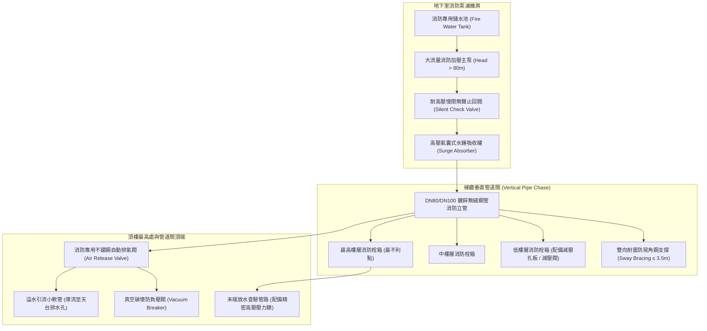
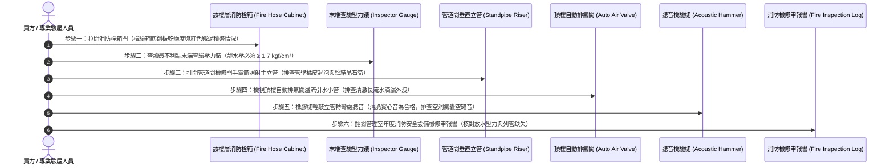

# 全案購屋實戰第六百三十八部：中古大樓社區消防送水幹管排氣閥橡膠塞老化洩漏立管水錘震盪末端放水試驗壓力不足與管壁穿孔體檢工序全書

---

## 序章：高層建築火災滅火的垂直動脈——消防送水立管與自動排氣消除體系

在現代集合住宅大樓的消防滅火與生命救助系統中，「消防送水幹管（Fire Standpipe Riser System，包含室內消防栓系統與自動撒水系統垂直立管）」是連接地下室消防加壓主泵、屋頂重力式消防輔助水箱與各樓層消防栓箱的垂直高壓動脈。

依據中華民國**《各類場所消防安全設備設置標準》**、**《建築技術規則》建築設備編第三章消防設備**及內政部消防署之強制技術規範：
1. **立管管徑、工作壓力與機械強度紅線**：室內消防栓立管管徑不得小於 63 mm（2½ 吋），系統最高工作壓力通常介於 **$7.0 \text{ kgf/cm}^2$ 至 $14.0 \text{ kgf/cm}^2$（0.7~1.4 MPa）**；垂直幹管及其閥門配件必須具備承受至少 **$14.0 \text{ kgf/cm}^2$ 以上（或最高工作壓力 1.5 倍）之水壓耐抗強度**。
2. **自動排氣閥與水錘吸收裝置強制配置**：消防立管最高頂端或長水平配管末端，必須強制安裝「消防專用自動排氣閥（Air Release Valve）」與「真空破壞消除閥」；在地下室主泵吐出端與垂直立管轉彎處，必須並聯耐高壓「活塞式水錘消除罐（Surge Tank）」，確保在消防加壓泵浦啟動、急停或火警放水時，管內空氣能順暢排出，並吸收高達數十個大氣壓的**毀滅性停泵水錘衝擊波（Water Hammer Shockwave）**。
3. **最不利點末端查驗閥壓力與流量紅線**：在大樓最高樓層（或各分區最頂部最不利點）之末端放水查驗閥（Inspector's Test Valve），其靜水壓必須維持在 **$1.7 \text{ kgf/cm}^2$（0.17 MPa）以上**，放水量**不得小於 $130 \text{ L/min}$**；自動撒水系統最不利點末端放水壓力亦**不得小於 $1.0 \text{ kgf/cm}^2$（0.1 MPa）**。

然而，在屋齡 20 至 35 年的中古大樓中，消防送水幹管常年處於高壓靜水（死水）狀態，且垂直管道間通風不良、水質酸化，極易演變為三大致命公害重症：
- **立管頂部自動排氣閥內部三元乙丙橡膠（EPDM）密封塞硬化龜裂、浮球水垢卡阻**，排氣閥無法密閉，微量高壓自來水常年順著管道間外壁漫流下滲，造成高樓層住戶室內牆面嚴重壁癌、發霉發黑；
- **排氣閥閥孔堵塞失去排氣功能，管內積存大量可壓縮之「空氣口袋（Air Pockets）」**，在每半年例行消防安檢泵浦啟動瞬間引發劇烈「氣爆型水錘」，管路劇烈晃動，震斷防晃角鋼支撐，撕裂閥門法蘭墊片；
- **鍍鋅鋼管（GIP）或黑鐵無縫鋼管內部產生嚴重的電化學「氧氣濃差孔蝕（Pitting Corrosion）」**，管壁厚度由原本的 4.5 mm 局部減薄至不足 0.8 mm，在消防泵浦加壓瞬間管壁直接穿孔炸裂，成千上萬噸消防黑水狂瀉樓梯間與電梯昇降路，引發全社區數百萬元之毀滅性裝潢與機電泡水慘劇！

本冊《全案購屋實戰第六百三十八部》深入剖析大樓消防垂直立管水力學、自動排氣閥微觀橡膠老化機制、氣囊水錘衝擊力學、管壁氧氣濃差孔蝕穿孔動力學，並制定現場看屋與管道間實勘之實戰檢驗工序。

---

## 第一章：消防送水立管與自動排氣系統核心拓撲與三大崩潰失效機制

### 一、垂直消防立管與氣囊消除物理拓撲
消防送水立管總成由「地下室消防加壓主泵」、「管道間耐震垂直立管」、「各樓層消防栓箱」、「頂部自動排氣閥組」及「最不利點末端放水查驗閥」構成：

---

### 二、三大致命事故機理深入剖析

#### 1. 自動排氣閥 EPDM 橡膠密封塞脆化硬化與浮球卡阻（管道間慢性滲水壁癌）
- **致病機制**：
  - 自動排氣閥內部依靠一個精密不鏽鋼浮球與耐高壓 EPDM 橡膠密封墊圈。當管內充水時，浮球上浮帶動槓桿將排氣孔密閉；
  - 消防管內長年充塞不流動的「死水」，水質呈微酸性且富含鐵鏽膠體微粒，碳酸鈣結晶在浮球導向滑桿上沉澱膠結，導致浮球卡滯無法上升至頂點；
  - 同時，橡膠密封塞在 20 至 30 年長年高壓熱氣烘烤下，增塑劑揮發殆盡，橡膠硬度由邵氏 60 度暴增至 90 度以上，脆化龜裂。
- **致命後果**：排氣閥處於「假閉合、真滲漏」狀態！高達 $7 \sim 10 \text{ kgf/cm}^2$ 的消防高壓死水，化為涓涓細流自排氣孔常態性滲出。水流順著管道間立管外壁緩慢下淌，滲入與管道間相鄰的高樓層客廳或主臥室背牆，引發大面積牆體油漆起泡、發霉、黑斑壁癌，住戶往往耗費數十萬元重作外牆防水，卻不知禍根竟來自公共消防排氣閥！

#### 2. 管內空氣口袋（Air Pockets）引發劇烈「氣爆型水錘（Air Hammer）」
- **致病機制**：
  - 當排氣閥孔堵死無法排氣時，立管上部與各分歧管盲端積存大量受壓縮空氣。
  - 當地下室消防加壓主泵因定檢啟動或管網壓力微降而瞬間啟動補水時，高速水柱推動管內水流，將空氣氣囊極度壓縮；
  - 空氣氣囊在高壓下瞬間蓄積巨大能量，隨後以聲速（超過 $1,000 \text{ m/s}$）劇烈反彈擴張，引發高頻震盪的**「氣爆型水錘衝擊波」**！
- **致命後果**：立管內部瞬時尖峰壓力高達正常工作壓力的 **3 至 4 倍（可達 $25 \sim 35 \text{ kgf/cm}^2$）**！整根垂直立管劇烈晃動甩動，如同攻城錘般猛烈撞擊管道間壁體，固定立管的膨脹螺栓被強行拔出，法蘭橡膠墊片被瞬間衝爆撕裂，大量黑水噴湧！

#### 3. 幹管內部「氧氣濃差孔蝕（Differential Aeration Pitting）」與管壁穿孔爆管
- **致病機制**：
  - 早期建商施作消防立管多採用熱浸鍍鋅鋼管（GIP）或黑鐵管。
  - 消防水常年停滯不流動，管底沉積大量鐵鏽泥沙。泥沙覆蓋處金屬表面氧氣濃度極低，形成電化學陽極；未被覆蓋處水流中溶解氧較高，形成陰極；
  - 兩者構成強烈的微觀腐蝕原電池，陽極區的鐵原子以數十倍速率快速離子化溶解，形成垂直向管外穿透之錐狀「孔蝕坑（Pitting Pits）」。
- **致命後果**：管壁由原本的 $4.5 \text{ mm}$ 局部急劇減薄至不足 $0.5 \text{ mm}$！在某次年度消防檢查加壓試驗時，管壁瞬間如被雷管炸開般穿孔爆裂！每分鐘高達數千公升的消防黑水自高樓層管道間狂洩而出，淹滿梯廳樓梯，直灌電梯車廂與昇降井道，造成電梯控制板全毀，整棟大樓損失高達數百萬元！

---

## 第二章：四大候選物件之消防立管系統實勘對照與談判戰略

本案目前鎖定之四大候選物件，因建物設計樓層高度與維護管理水平不同，消防幹管潛在風險各異：

| 物件編號與社區名稱 | 樓層與建物特徵 | 消防立管與排氣閥潛在風險焦點 | 現場實勘首要手段 | 談判籌碼與修繕折讓指引 |
| :--- | :--- | :--- | :--- | :--- |
| **大安紫金城 13 樓 (`PROP_10`)** | 13 樓超高層頂樓戶，為全棟消防送水最不利點所在層。 | 13 樓直接緊鄰立管最高點自動排氣閥與末端查驗閥，管內若有積氣或排氣閥漏水，13 樓室內牆面首當其衝；末端壓力錶讀數直接揭露全棟消防管網健康度。 | 1. 打開 13 樓梯廳末端查驗閥箱，檢查壓力錶靜水壓是否達 1.7 kgf/cm²。 2. 檢查 13 樓管道間內部排氣閥排水導管有無水痕。 3. 檢視分租套房室內與公共管道間交接牆面有無壁癌。 | 若末端壓力不足且管道間有滲水鏽蝕，全棟消防立管高壓清洗或更新分段閥門約需籌募 **20~40 萬元**，以此作為砍價強烈理由！ |
| **長億南園 8 樓 (`PROP_106`)** | 8 樓為該社區高樓層區段，管齡已達 30 年，戶數規模龐大。 | 大型舊社區消防管多採用鍍鋅鋼管，長年未更換消防死水，管內孔蝕情況普遍，需確認管委會近 3 年有無「消防水管破裂搶修」之修繕支出紀錄。 | 1. 檢視 8 樓消防栓箱內部是否有鐵鏽剝落、水帶接頭鏽死。 2. 要求翻閱管委會歷月維修明細，排查「管道間消防漏水」通報。 | 消防管網若已屆穿孔高風險期，將面臨全棟外露明管重配之鉅額工程，要求賣方保證室內無暗管滲漏並折讓房價 **10~15 萬元**。 |
| **歌德堡 8 樓** | 精裝修三房，公共梯廳整潔。 | 裝潢天花板內可能包覆自動撒水支管，需確認木作天花板檢修孔位置，並使用手電筒排查撒水頭（Sprinkler Head）有無滴漏微滲。 | 踩梯打開天花板檢修孔，以手電筒照看撒水支管管身有無泛黃水漬或生鏽。 | 若裝潢內部撒水管有老舊接頭滲漏，需重配不鏽鋼壓接管，防範交屋後裝潢被毀。 |
| **靜園 A 區 11 樓** | 11 樓次頂層，通風良好，管理嚴謹。 | 檢查公共走道與安全梯間消防栓箱內之放水查驗管路與手動排氣旋鈕。 | 輕轉排氣閥側邊手動洩氣閥，觀察有無混濁黑水噴出或純空氣排出。 | 機電維護優良，作為核定其他社區消防保養水平之基準坐標。 |

---

## 第三章：看屋現場消防幹管與自動排氣六步快篩查驗標準工序（SOP）

買方或其驗屋代表在陪同仲介看屋與勘查公共梯廳時，遵循以下 6 步標準工序進行深度檢驗：

### 具體實施指引與合格紅線：
1. **消防栓箱底板「乾濕與鐵泥」排查（第一防線）**：
   - 走至該樓層梯廳，拉開紅色不鏽鋼消防栓箱門。
   - 觀察箱底金屬板：
     - **合格標準**：箱底乾爽潔淨，無水痕，水帶乾燥捲曲整齊。
     - **重大缺陷**：若箱底生鏽穿孔、堆積厚達數公分的紅褐色鐵鏽泥漿、或者角閥出水口下方有水珠持續滴落，代表箱內 65 mm 消防閥心填料已嚴重老化滲漏！
2. **最不利點末端查驗壓力錶指針讀數（法定生死線）**：
   - 在大樓最高樓層（如大安紫金城 13 樓、靜園 11 樓），找到「末端放水查驗閥箱（Test Valve Box）」。
   - 查讀壓力錶指針：
     - **合格標準**：常態靜水壓必須穩定維持在 **$1.7 \text{ kgf/cm}^2 \sim 3.5 \text{ kgf/cm}^2$（0.17~0.35 MPa）**。
     - **致命紅線**：若壓力錶指針歸零、或數值低於 **$1.0 \text{ kgf/cm}^2$**，鐵證全棟消防幹管嚴重洩壓漏水、或頂樓消防輔助水箱缺水、或地下室補壓泵浦（Jockey Pump）故障，火災時噴不出半滴水！
3. **管道間垂直立管「橘皮起泡與石筍」檢驗**：
   - 探頭進入公共梯廳管道間，拿強光手電筒直射垂直粗大立管。
   - **檢查重點**：管身表面油漆是否平整光潔；若管壁油漆呈「橘皮狀凸起起泡」、表面懸掛著白色碳酸鈣或綠色硫酸銅結晶「石筍」，此為管壁內部**孔蝕已經貫穿、微量滲漏**之確鑿鐵證！
4. **自動排氣閥溢流引流管滴漏排查**：
   - 登上頂樓最高處，找到消防立管頂端的自動排氣閥。
   - 檢視排氣閥下方特設的透明小排水軟管：管口周邊必須保持絕對乾燥；若軟管持續有清澈水滴滴出、或排水溝邊緣佈滿黃綠色水垢，代表排氣閥內部 EPDM 橡膠密封塞已失靈，正在常態性漏水滲透樓下！
5. **橡膠槌敲擊立管「氣囊聽音測試（Acoustic Test）」**：
   - 以檢驗槌或橡膠棒輕輕敲擊垂直立管外壁。
   - **聲音判定**：傳出沉重厚實之「咚、咚」實心水聲為合格；若傳出清脆空洞之「噹、噹」金屬空罐音，表示立管內部未充滿水，聚集了極大體積之危險空氣口袋，隨時將觸發氣爆水錘！
6. **年度消防檢修申報書審閱**：
   - 務必向管理室索閱消防局最近一次審查通過之**「消防安全設備檢修申報書」**，翻到「室內消防栓設備查核表」，確認**「放水壓力」、「放水量」及「綜合檢查」**欄位是否為合格打勾，有無「建議管路耐壓試驗有壓降」之附註。

---

## 第四章：消防幹管與排氣系統現場體檢驗收表

本表供買方於看屋或點交驗屋時逐項檢對：

| 檢驗項目 | 規範標準要求 | 現況數值 / 現象紀錄 | 合格判定 | 缺陷風險處置與修復成本 |
| :--- | :--- | :--- | :---: | :--- |
| **1. 末端查驗閥靜水壓** | 最高層最不利點靜水壓 ≥ 1.7 kgf/cm²（0.17 MPa）。 | ［　　］kgf/cm² | □合格 □異常 | 檢查頂樓消防水箱水位及加壓補壓泵運作。 |
| **2. 自動排氣閥密封性** | 閥體周圍無滲水、溢流管無長流水、橡膠密封良好。 | ［　　］狀態 | □合格 □異常 | 更換為 SUS304 不鏽鋼消防專用排氣閥（約 5,000 元/只）。 |
| **3. 幹管外觀與腐蝕** | 管壁無橘皮狀鐵瘤、無綠色水痕、無壁厚嚴重孔蝕。 | ［　　］狀態 | □合格 □異常 | 實施局部超音波管厚檢測，必要時實施明管重配。 |
| **4. 管道間支撐吊架** | 垂直幹管雙向耐震防晃支撐（Sway Brace）緊固無脫落。 | ［　　］狀態 | □合格 □異常 | 補強熱浸鍍鋅角鋼防震支撐與不鏽鋼 U 栓。 |
| **5. 消防栓箱角閥填料** | 開關手輪旋轉順暢，閥桿密封填料無滲水滴漏。 | ［　　］狀態 | □合格 □異常 | 更換四氟乙烯（PTFE）石墨自潤式迫緊墊圈。 |
| **6. 消防水帶與瞄子** | 水帶經耐壓檢驗合格，無黴爛、脆化，接頭橡膠圈無變形。 | ［　　］狀態 | □合格 □異常 | 責成管委會更新消防認證水帶組。 |
| **7. 消防申報複查紀錄** | 最近一期消防安檢申報經主管機關備查無重大列管缺失。 | ［　　］年度核備 | □合格 □異常 | 列入買賣合約交屋前管委會限期修繕條款。 |

---

## 第五章：總結與後續工序推進

消防送水立管與自動排氣消除系統，平時靜默無聲隱蔽於暗處，但一旦失效，輕則毀滅室內裝潢造成長年壁癌，重則於火災時無水可救釀成人倫悲劇。買方唯有在進場前徹底識破管路健康狀態，方能立於置產不敗之地。

下一部實戰手冊將依序開展：**《全案購屋實戰第六百三十九部：中古大樓社區各樓層生活給水垂直幹管減壓閥組閥芯水垢卡死超壓震盪水錘消除器氣囊破裂與低樓層水管爆裂體檢工序全書》**，持續深入生活自來水垂直分區減壓核心防線！

---
*全案購屋實戰第六百三十八部・全書完・版本控管確認*
