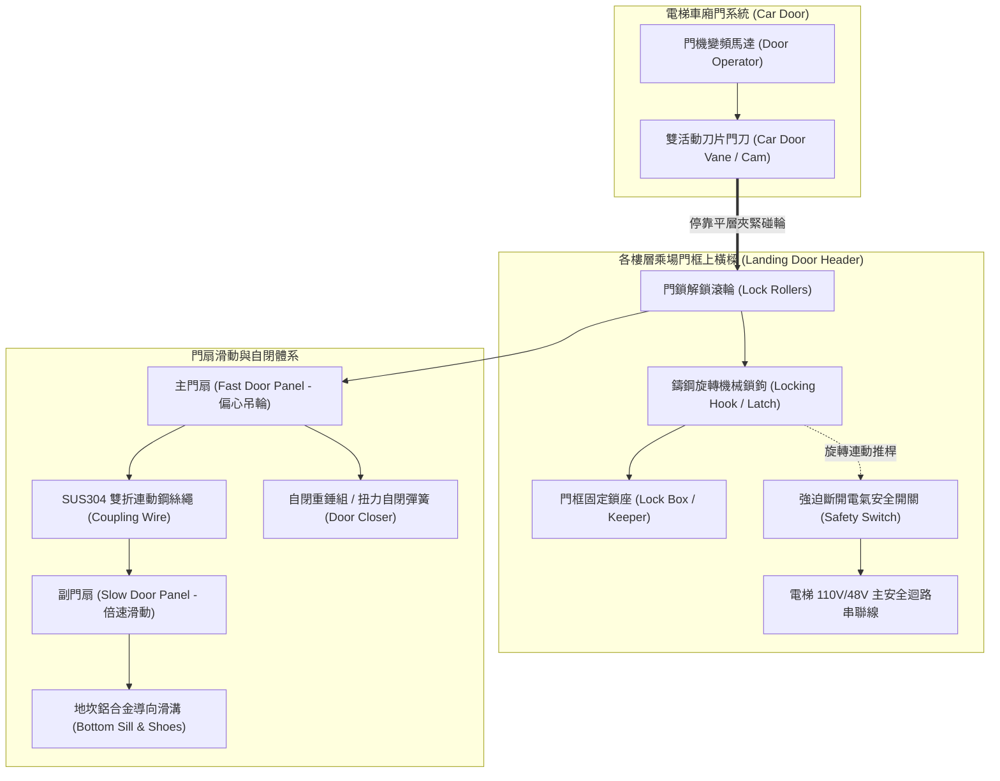
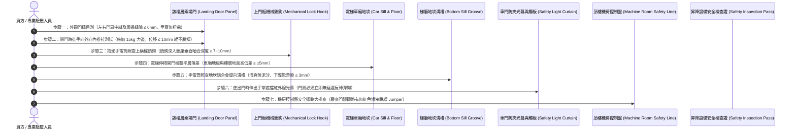

# 全案購屋實戰第六百三十六部：中古大樓社區電梯乘場門門鎖裝置機械咬合嚙合深度不足電氣安全觸點氧化積碳與剪切夾人事故體檢工序全書

---

## 序章：梯廳與垂直井道的實體物理隔離門神——乘場門安全聯鎖總成

在現代高層集合住宅的垂直交通動線中，住戶每日進出家門最頻繁接觸的公設介面，莫過於各樓層梯廳的「電梯乘場門（Landing Door，外門）」。

電梯乘場門在平時扮演著隔絕深達數十公尺垂直落差井道的「物理防墜屏障」；在電梯車廂抵達時，則透過車門門刀（Car Door Vane）的聯鎖帶動同步開啟。

依據中華民國國家標準 **CNS 10594（電梯）**、內政部國土管理署**《建築物昇降設備設置及檢查管理辦法》**及國際標準 **EN 81-20** 之強制法規要求：
1. **電氣與機械雙重連鎖強制原則（Dual Interlock Protection）**：各樓層乘場門必須同時具備「實體機械鎖扣」與「強迫斷開型電氣安全觸點開關」。只有在機械鎖鉤深入鎖座達 **7 mm 以上（建議 8~10 mm）** 的有效嚙合深度後，電氣安全開關觸點方被允許閉合導通；只要任何一扇乘場門被推開超過 **6 mm**，電梯控制主迴路必須在 **0.05 秒內強制斷電**，抱閘抱死，絕對嚴禁開門運轉！
2. **防推開抗衝擊強度規範**：乘場門扇在閉鎖狀態下，於門扇中央垂直施加 **300 N（約 30 kgf）** 之靜態推力時，門扇彈性變形量**嚴禁超過 15 mm**，且推力釋放後必須完全復原，絕對不得產生永久變形或導致鎖鉤脫扣。
3. **副門連動與自閉重錘安全係數**：對於側開雙折門（2S）或中分雙折門（2CO），帶動副門同步滑動的連動鋼絲繩（Coupling Wire Rope）其破斷安全係數**不得小於 8**；當電梯車廂離開該樓層平層區時，乘場門必須依賴自閉重錘（Counterweight）或機械彈簧，在無任何電力驅動下**「自動滑順閉合並完全上鎖」**。

然而，在屋齡 20 至 35 年的中古大樓中，乘場門長年遭受推車撞擊、裝潢建材推擠、清潔拖地廢水腐蝕地坎溝槽，極易演變為三大致命公害重症：
- **門扇下垂導致機械鎖鉤嚙合深度退縮至不足 2~3 mm（假性鎖閉）**，住戶倚靠外門或孩童推擠時，鎖鉤瞬間滑脫脫扣，外門大開，人員直接踏空跌落十幾層樓深之底坑粉身碎骨；
- **電氣安全觸點表面硫化積碳打火、或被不良保養人員以導線在機房「直接短接門鎖迴路（Fatal Jumper）」**，使電梯在門未關好狀態下誤判已鎖死而全速啟動，造成乘客在進出瞬間慘遭電梯地板與門楣「上下剪切腰斬」；
- **副門連動鋼絲繩鏽蝕斷股或自閉重錘導軌卡死**，主門關閉但副門敞開留下一大半缺口，形成致命的「張嘴陷阱」！

本冊《全案購屋實戰第六百三十六部》深入剖析電梯乘場門機械鎖扣微觀嚙合力學、電氣安全觸點電弧氧化動力學、短接跳線危害偵測，並制定現場看屋與梯廳檢驗時之實戰查驗標準工序。

---

## 第一章：電梯乘場門安全連鎖總成物理拓撲與三大崩潰失效機制

### 一、乘場門鎖總成核心物理拓撲
乘場門安全聯鎖總成由「上門框機械鎖座」、「旋轉鎖鉤連桿」、「強迫斷開電氣觸點」、「車廂活動門刀聯動滾輪」及「副門鋼索重錘自閉機構」構成：

---

### 二、三大致命事故機理深入剖析

#### 1. 地坎泥沙卡滯與偏心吊輪磨損導致「鎖鉤嚙合不足（假性鎖扣）」
- **致病機制**：
  - 各樓層乘場門懸掛於上橫樑之偏心吊輪（Eccentric Hanger Rollers）上，門扇底端插入地面地坎（Sill）之鋁合金導向溝槽內。
  - 長年梯廳清潔拖地廢水、沙塵與裝潢水泥碎屑掉入地坎溝槽內，尼龍下導靴（Guide Shoes）磨損，門扇因重力逐漸向外向下傾斜下垂；
  - 上橫樑機械鎖鉤在關門時插入鎖座的垂直咬合深度，原本由標準的 **8~10 mm 嚴重退縮至不足 2 mm**，形成極度危險之「假性鎖扣（False Latch）」。
- **致命後果**：當電梯車廂離開該樓層後，若有住戶背靠外門等待、或孩童追逐撞擊門扇，僅搭接 1~2 mm 的鎖鉤瞬間滑脫脫扣，外門隨即被撞開！受害者毫無防備直接踏空跌落深達十餘層樓之電梯井道底坑，粉身碎骨當場慘死！

#### 2. 電氣安全觸點氧化積碳與機房非法短接（剪切夾人致命罪魁）
- **致病機制**：
  - 微動開關內部銀合金觸點暴露於梯廳濕熱氣流中，高頻開閉產生微小電弧，使觸點表面生成高電阻之黑色氧化物與碳化層；
  - 接觸電阻過大導致電梯頻繁發生「無故卡樓急停」，不良維保廠商因查不出是哪一樓層門鎖接觸不良，為免遭管委會罰款投訴，**竟然在頂樓機房主電腦板端子排上以導線直接短接門鎖安全迴路（Jumper Bypass）**！
- **致命後果**：電梯安全系統被徹底閹割！即使某樓層外門完全敞開或正在進出乘客，主電腦仍判定「外門已鎖死」，驅動馬達照常啟動全速上下運轉。進出乘客身體被卡在車廂與樓層門楣之間，遭受高達數千公斤推力之**「垂直上下剪切（Shearing Hazard）」**，身體瞬間被截斷腰斬，血濺梯間！

#### 3. 副門連動鋼絲繩鏽蝕斷股與脫軌（「張嘴敞開陷阱」）
- **致病機制**：
  - 雙折門系統中，副門扇（慢門）依賴直徑 3~4 mm 之鍍鋅鋼絲繩透過轉向滑輪由主門（快門）牽引聯動。
  - 鋼絲繩長年缺乏潤滑脂，在反覆彎折疲勞與潮濕空氣侵蝕下，內部鋼絲產生「應力腐蝕斷股（Strand Snapping）」。
- **致命後果**：主門在門機帶動下順利關閉並完成鎖定，但副門扇因連動鋼索斷裂而卡在半途中無法閉合，梯廳留下寬達 40 至 60 公分之巨大空隙。老人或孩童在光線昏暗下誤以為電梯已到達，踏入空隙直墜昇降井道！

---

## 第二章：四大候選物件之乘場門系統實勘對照與談判戰略

本案目前鎖定之四大候選物件，因屋齡、樓層與使用密度不同，其乘場門系統體質各具特性：

| 物件編號與社區名稱 | 樓層與建物特徵 | 乘場門鎖裝置與地坎滑動潛在焦點 | 現場實勘首要工序 | 談判籌碼與修繕折讓指引 |
| :--- | :--- | :--- | :--- | :--- |
| **大安紫金城 13 樓 (`PROP_10`)** | 13 樓超高層頂樓戶，梯速達 105 m/min。 | 曾作為 4 間學生套房出租，各樓層乘場門進出頻繁；頂樓戶受梯井煙囪氣流風壓影響大，門扇關閉時受阻力大；需查驗 13 樓與 B2 車位乘場門鎖鉤咬合深度及門縫垂直度。 | 1. 檢視 13 樓乘場門閉合時門縫間隙（需 ≤ 6mm）。 2. 雙手在外門中央施加 15kg 推力，測試鎖鉤有無鬆動位移。 3. 登頂樓機房排查控制盤端子排有無紅色短接跳線。 | 若乘場門下導靴磨損晃動且門鎖有跳線短接痕跡，整棟電梯門鎖開關翻新與門刀校正約需籌募 **6~10 萬元/台**，以此作為堅定砍價折讓籌碼！ |
| **長億南園 8 樓 (`PROP_106`)** | 30 年老舊大社區，戶數龐大，高頻頻繁運轉。 | 30 年老社區梯廳地坎鋁合金溝槽磨損變形嚴重，泥沙堆積常年未清；乘場門自閉重錘拉索生鏽卡滯風險高。 | 1. 手電筒照射 8 樓外門地坎滑溝，檢查有無卡阻泥沙與凹槽變形。 2. 電梯開門後輕推外門，檢查自閉彈簧能否順暢帶動門扇閉合。 | 乘場門若晃動劇烈且有金屬摩擦刮擦異音，向賣方出具安全隱患事實，爭取 **4~6 萬元**之防禦折讓。 |
| **歌德堡 8 樓** | 精裝修戶，梯廳公共空間明亮。 | 需確認室內裝修期間重型板材進出是否曾撞擊乘場門框，造成開門門刀與解鎖碰輪間隙偏心。 | 搭乘電梯全行程運行時，貼近車廂門細聽有無「門刀擦碰各樓外門碰輪」之金屬刮擦聲。 | 機電維護良善，作為標準對照組，牽制大安紫金城與長億南園。 |
| **靜園 A 區 11 樓** | 均質社區，公共設施維護規範嚴謹。 | 檢視高樓層乘場門防夾光幕與自閉機構靈敏度。 | 測試防夾感應條與平層高低落差（≤±5mm），作為優良標準基標。 | 優良基準參考標的。 |

---

## 第三章：看屋現場乘場門機械咬合與電氣防剪切七步快篩標準工序（SOP）

買方或其驗屋代表在現場看屋搭乘電梯與梯廳候梯時，遵循以下 7 步標準工序進行深度檢驗：

### 具體實施指引與合格紅線：
1. **乘場門閉合間隙與垂直度判定（縫隙第一關）**：
   - 站在梯廳外門正前方，目測兩扇門閉合時的中縫。
   - **合格標準**：兩扇門之間、以及門扇與兩側門柱之間的間隙必須均勻平直，間隙寬度**嚴禁超過 6 mm**。
   - **重大缺陷**：若中縫呈現「上窄下寬」或「上寬下窄」之倒八字形、縫隙超過 8~10 mm，代表偏心懸掛吊輪螺栓鬆脫、門扇下垂，內部鎖鉤嚙合已嚴重退縮！
2. **手動推拉「抗開門與假性鎖扣」極限測試**：
   - 在電梯車廂尚未到達該樓層時，雙手握住門扇邊緣或中縫，向內側推擠、隨後向外側拉開（施加約 15 kgf 力道）。
   - **合格標準**：門扇應堅固卡死，前後晃動位移量**不得超過 10 mm**，且絕對不可扳出縫隙。
   - **致命紅線**：若雙手輕輕一推便能推開超過 2~3 公分縫隙、甚至聽見鎖鉤「脫扣彈開」聲，鐵證鎖鉤僅微幅搭接！此電梯隨時有住戶推門墜井之極度致命危險！
3. **上門框機械鎖鉤「嚙合深度」手電筒直射透視**：
   - 拿強光手電筒透過門頭上方的縫隙（或電梯開門時由車內斜角向上照查上橫樑）。
   - **合格標準**：鎖鉤深入鎖盒內的垂直金屬重疊咬合長度**必須達到 7 mm 以上（理想為 8~10 mm）**。
   - 若發現鎖鉤尖端僅搭接 2~3 mm，或鎖座固定螺栓已有明顯鬆脫滑移金屬刮痕，必須立即責成限期整修！
4. **平層高低落差精度（Leveling Accuracy）**：
   - 電梯停妥開門後，低頭檢視車廂地板與梯廳地坪之高低銜接。
   - **合格標準**：垂直落差必須在 **$\pm 5 \text{ mm}$ 以內**。
   - 若高低差達到 1.5 至 2.0 公分以上，不僅極易絆倒長輩孩童造成髖骨骨折，更證實煞車抱閘打滑或平層磁簧感應開關失準！
5. **地坎鋁合金導向溝槽（Bottom Sill）清潔度**：
   - 手電筒照射下方的地坎金屬槽。
   - 槽內應乾淨無雜物；若槽內塞滿裝潢砂石、果核硬幣，會導致下導靴劇烈磨損；用手輕搖門扇底端，前後晃動游隙若大於 **3 mm**，地震時門扇極易脫軌跳出！
6. **雙重防夾安全防線測試（光幕 + 安全觸板）**：
   - 在門扇即將閉合時，以手掌（切勿用身體阻擋）在門扇中間上下揮動切斷多道紅外線光幕：門扇應立即無延遲反轉開啟；
   - 輕碰金屬安全觸板，觸板應在微動行程內迅速觸發開門。
7. **機房門鎖安全迴路「短接跳線（Jumper）」死刑排查**：
   - 在頂樓機房檢查電梯控制板端子排上的「門鎖安全開關（DOOR LOCK SWITCH）」串聯端子。
   - **絕對禁忌**：若發現端子排上有任何外接之導線跳接（短路跳線），**100% 證明該社區電梯門鎖開關早已損壞，目前正在違規「帶病運轉」！** 此乃重大公共安全隱患，可直接向建管處提出檢舉！

---

## 第四章：電梯乘場門門鎖裝置全面體檢驗收表

本表供買方於看屋公設踏勘或交屋前逐項檢對打勾：

| 檢驗項目 | 規範標準要求 | 實測現況紀錄 | 合格判定 | 缺陷風險處置與修繕成本 |
| :--- | :--- | :--- | :---: | :--- |
| **1. 門扇閉合垂直縫隙** | 門扇中縫及四周門框間隙均勻，縫隙寬度 ≤ 6 mm。 | ［　　］mm 縫隙 | □合格 □異常 | 調校上橫樑偏心吊輪高度與垂直導軌。 |
| **2. 機械鎖鉤嚙合深度** | 鎖鉤深入鎖座垂直有效嚙合深度 ≥ 7 mm（建議 8~10mm）。 | ［　　］mm 嚙合 | □合格 □異常 | 重新校正鎖盒基座位置並以扭力扳手緊固防鬆螺帽。 |
| **3. 徒手推拉抗開門力** | 施加 15kgf 推拉力，門扇位移 ≤ 10 mm 且絕不脫扣開啟。 | ［　　］狀態 | □合格 □異常 | 調整門鎖復位拉簧張力，排除假性鎖扣。 |
| **4. 電氣安全觸點電阻** | 觸點光亮無氧化積碳，常閉迴路接觸電阻 ≤ 0.5 Ω。 | ［　　］Ω 電阻 | □合格 □異常 | 以專用觸點清潔劑清洗或更換全新微動聯鎖開關（約 1,500~2,500 元/只）。 |
| **5. 副門連動鋼索張力** | 連動鋼絲繩無斷股、無起毛刺、無鏽蝕，開閉同步。 | ［　　］狀態 | □合格 □異常 | 更換全新 SUS304 高抗拉不鏽鋼門機專用鋼絲繩。 |
| **6. 平層落差精度檢核** | 車廂地板與樓層地面高度差穩定維持在 ±5 mm 以內。 | ［　　］mm 落差 | □合格 □異常 | 重新調校平層磁簧感應開關與變頻器減速曲線。 |
| **7. 機房安全迴路完整** | 端子排門鎖迴路嚴禁任何人工短接跨接跳線（Jumper）。 | ［　　］無短接線 | □合格 □異常 | 強制拆除所有非法跳線，查明故障點並恢復原廠安全迴路。 |

---

## 第五章：總結與後續工序推進

電梯乘場門門鎖裝置與電氣安全聯鎖，是維繫全社區數百住戶免遭踏空墜井、免遭上下剪切腰斬的最基本物理安全防線。在看屋與候梯過程中，花費 3 分鐘親手推拉門扇、檢視鎖鉤嚙合、排查地坎溝槽與機房短接跳線，能以最嚴密的科學標準識破老舊電梯的致命危機，為全家人未來的垂直出入安全築起銅牆鐵壁，並在總價談判中掌握壓倒性的殺價主動權！

下一部實戰手冊將依序開展：**《全案購屋實戰第六百三十七部：中古大樓社區電梯調速機夾繩鉗磨損飛塊離心彈簧疲勞失準與超速溜梯下墜安全鉗制動體檢工序全書》**，持續深入電梯垂直超速防護核心防線！

---
*全案購屋實戰第六百三十六部・全書完・版本控管確認*
