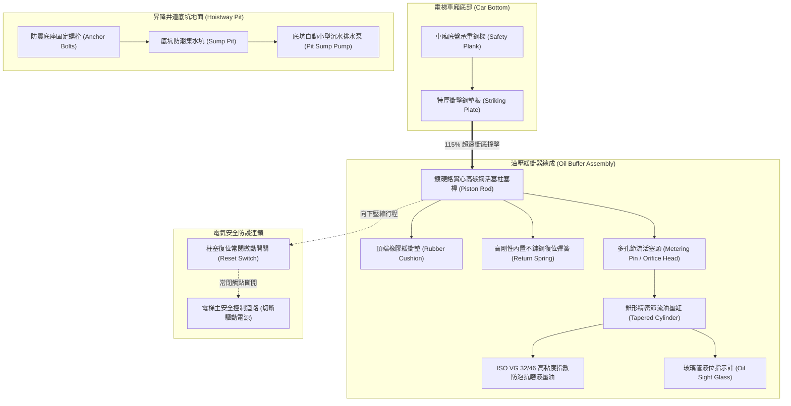
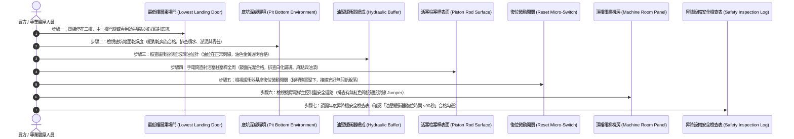

# 全案購屋實戰第六百三十四部：中古大樓社區電梯昇降路井道底坑油壓緩衝器液壓油乳化活塞桿鏽蝕微動極限開關接觸不良與安全防護體檢工序全書

---

## 序章：垂直昇降失控墜落的最後實體吸能防線——油壓緩衝器

在現代集合住宅大樓的垂直交通運輸體系中，電梯車廂每日承載全社區住戶高達數百次至數千次之上下穿梭。在正常的電梯安全控制中，調速機（Governor）、安全鉗（Safety Gear）與驅動主機煞車抱閘（Brake）構成了多道防止電梯超速失控的防線。

然而，一旦電梯主纜繩打滑、變頻控制系統失控或制動煞車嚴重打滑，導致電梯在接近最底層樓時未能正常平層減速而「直衝井道最底層（超行程衝底 / 墩底）」，此時，安裝於昇降井道底坑最底部之**「油壓緩衝器（Oil Buffer / Hydraulic Buffer）」**，便成為**整部昇降機保護車廂內全體乘客免遭巨大衝擊力致死致殘的「最後一道實體物理吸能防禦機構」**！

依據中華民國國家標準 **CNS 10594（電梯）**、內政部國土管理署**《建築物昇降設備設置及檢查管理辦法》**及國際標準 **EN 81-20/50** 之明文強制標準：
1. **梯速分級與緩衝器型式強制規範**：電梯額定梯速（Rated Speed, $V$）在 **$1.0 \text{ m/s}$（60 m/min）以上**之電梯，**嚴禁採用單純的蓄能型彈簧緩衝器（Spring Buffer）**，必須強制安裝「耗能型油壓緩衝器（Energy Dissipation Oil Buffer）」；當電梯車廂以額定速度之 **115%** 衝擊緩衝器時，其產生的平均減速度（Average Retardation）**嚴禁超過 $1.0\ \text{g}$（$9.81 \text{ m/s}^2$）**，且減速度超過 $2.5\ \text{g}$ 之持續時間不得超過 **0.04 秒**，以確保車廂內人體頸椎與內臟免受毀滅性撞擊骨折！
2. **油壓柱塞桿行程與防護安全裕度**：油壓緩衝器之柱塞最小行程（Stroke, $S$）必須符合重力加速度公式計算：
   $$S \ge \frac{(1.15 \cdot V)^2}{2 \cdot g} \approx 0.0674 \cdot V^2$$
   （例如梯速 105 m/min 之高速電梯，緩衝器有效油壓行程必須達 **200 mm 至 450 mm 以上**）；當車廂完全壓縮緩衝器後，底坑地面至車廂底樑最突出部位之垂直安全淨空間（Clearance）**絕對不得小於 0.5 公尺**，以保障可能在底坑作業之維修保養技術人員的生命安全。
3. **電氣安全開關連鎖與自動復位時間**：油壓緩衝器頂部或基座旁必須配備「常閉式柱塞復位電氣安全開關（Buffer Reset Safety Switch）」，一旦緩衝器被壓縮，微動開關必須立即切斷電梯安全主迴路；當車廂被吊起離開後，內部重力復位彈簧或蓄壓氣體必須確保活塞桿在 **90 秒之內完全自動復位（Full Return）**，若未能完全復位，電梯控制電腦絕對嚴禁啟動運轉。

然而，在屋齡 20 至 35 年的中古大樓中，電梯昇降路底坑（Pit）位於全社區最幽暗、最潮濕的地下最深處，加上社區長年缺乏維護基金，極易演變為三大高危致命病徵：
- **地下室土壤外水或消防廢水滲漏湧入底坑形成長年積水，緩衝器整座泡在污水中，液壓油嚴重「乳化變質起泡」**，黏度驟降，完全喪失液壓阻尼吸能阻抗，衝底時如同直接撞擊實心鐵塊；
- **鍍鉻高碳鋼活塞桿長年受潮生鏽麻點、表皮剝落變形**，密封油封撕裂，活塞桿死死卡滯咬死在汽缸內部，被壓縮後根本「無法回彈復位」；
- **不良保養廠商因復位微動開關氧化接觸不良或柱塞無法彈回，為免電梯停機被住戶投訴，竟在控制機房內以導線「直接短接緩衝器安全迴路」**！使電梯在完全喪失最後防線的裸奔狀態下持續載客，隨時面臨衝底人亡之慘絕事故！

本冊《全案購屋實戰第六百三十四部》深入剖析電梯井道底坑油壓緩衝器流體節流阻尼力學、液壓油乳化水力學、活塞桿電化學鏽蝕穿孔機制與安全迴路短接偵測，並制定現場看屋與公設實勘之實戰檢驗工序。

---

## 第一章：電梯井道底坑油壓緩衝器核心拓撲與三大崩潰失效機制

### 一、耗能型油壓緩衝器內部物理拓撲
油壓緩衝器由「高強度活塞柱塞桿」、「錐形多孔節流缸筒」、「特種耐磨液壓油室」、「內部復位螺旋彈簧」及「電氣復位連鎖安全開關」構成：

---

### 二、三大致命事故機理深入剖析

#### 1. 底坑積水浸泡引發液壓油「乳化起泡（Emulsification）」與阻尼崩潰（鐵撞鐵慘劇）
- **致病機制**：
  - 中古大樓底坑常年低於地下水位，地下室連續壁若未施作高壓注漿防水，地下水極易自底板裂縫湧入；
  - 緩衝器柱塞防塵油封在長期浸泡於酸性積水中老化硬化，水分子穿透密封唇口進入油壓缸內部。
  - 當液壓油中水分含量超過 **0.5% 至 1.0%** 時，原本澄清透明的抗磨液壓油迅速「乳化（Milk-like Emulsion）」，油品黏度暴跌，內部充滿微小氣泡。
- **致命後果**：當電梯失速衝底時，柱塞高速向下壓縮，液壓油內的氣泡在高壓下被瞬間壓縮（氣體具彈性），水性乳化油在節流孔內無法建立高達數十個大氣壓的液壓阻尼力。**緩衝器在瞬間被「直接打到底（Bottoming Out）」**，柱塞頭猛烈撞擊缸底金屬，衝擊力道幾乎未經衰減，高達 **$5\ \text{g} \sim 10\ \text{g}$ 的瞬間加速度**直接傳導至車廂地板，車內乘客雙腿瞬間粉碎性骨折、脊椎斷裂！

#### 2. 鍍鉻柱塞桿受潮電化學鏽蝕凹坑與卡死拒動（衝底無效）
- **致病機制**：
  - 活塞桿表面雖有 20~30 微米之鍍硬鉻層，但在底坑高濕（濕度 $>90\%$）且含有微量硫化物氣體的環境下，鍍層產生微觀針孔腐蝕（Pinhole Corrosion）；
  - 鉻層下方的碳鋼基體生成體積膨脹數倍的三氧化二鐵鐵鏽，將表面鍍鉻層頂起剝落，活塞桿表面變得如砂紙般粗糙，佈滿深達數毫米的鏽蝕凹坑；
  - 粗糙的鏽蝕金屬將缸口銅質導向襯套（Guide Bushing）死死拉傷咬住。
- **致命後果**：當車廂撞擊緩衝器時，生鏽的活塞桿在強大衝擊力下被壓入缸內；但當電梯被救援吊起後，復位彈簧根本無法克服鏽蝕咬死的巨大摩擦力，**柱塞桿「卡在缸底完全無法回彈復位」**！緩衝器行程縮短為零，若電梯再次運行失控，車廂將直接砸向實心底座，喪失全部吸能保護能力！

#### 3. 復位微動開關觸點氧化短接跳線（惡質維保引發帶病運轉）
- **致病機制**：
  - 柱塞復位開關安裝於油箱外側，直接暴露於底坑潮濕灰塵中，銀合金接點嚴重硫化發黑氧化，導致常閉迴路接觸電阻暴增至數千歐姆，電梯主電腦判定「緩衝器被壓縮未復位」而頻繁停機；
  - 不良維保廠商為圖省事，竟直接在機房控制盤內**以紅色跳線（Jumper Wire）將該樓號之緩衝器開關接點「永久短接導通」**！
- **致命後果**：微動開關徹底失去安全監控功能。即使緩衝器活塞桿已經卡死在缸底、或者內部早已漏光液壓油，電梯電腦依然誤判「一切正常」，照常全速載客行駛，將全社區數百住戶的性命置於懸崖邊緣！

---

## 第二章：四大候選物件之電梯底坑與緩衝器實勘對照與談判戰略

本案目前鎖定之四大候選物件，因建物設計樓層高度、梯速與維護管理水平不同，底坑緩衝器潛在風險各異：

| 物件編號與社區名稱 | 樓層與梯速特徵 | 底坑油壓緩衝器潛在風險焦點 | 現場實勘首要手段 | 談判籌碼與修繕折讓指引 |
| :--- | :--- | :--- | :--- | :--- |
| **大安紫金城 13 樓 (`PROP_10`)** | 總樓層 13 樓超高大樓，梯速達 105 m/min（1.75 m/s），必須強制配置**大型長行程耗能型油壓緩衝器**。 | 高梯速下衝底動能極大（$E_k \propto V^2$）；大安紫金城地下達 B2，需查驗昇降路底坑是否曾有地下水滲漏積水紀錄；油壓緩衝器柱塞桿鍍鉻層是否光亮無斑點、安全開關有無短接跳線。 | 1. 要求仲介協調管理員開啟一樓乘場門，以強光手電筒向底坑深處照射。 2. 檢視底坑地面是否乾爽、有無安裝自動沉水泵。 3. 照查緩衝器玻璃油位計，油品是否清澈透明。 | 若底坑常年積水且緩衝器液壓油乳化、柱塞生鏽，整組油壓緩衝器拆換、底坑防水灌注費用約需 **8~15 萬元/台**，列為總價談判有力扣除籌碼。 |
| **長億南園 8 樓 (`PROP_106`)** | 8 樓中層建築，梯速約 60~90 m/min，戶數眾多，高頻率使用。 | 30 年老舊大社區，底坑排水多缺乏常態抽排，底坑潮氣易使緩衝器彈簧鏽蝕疲勞；需確認昇降機許可證上「緩衝器復位試驗」是否合格。 | 1. 檢視電梯近半年維保紀錄中「緩衝器油量油質」檢查欄位有無打勾簽名。 2. 檢視電梯搭乘至最低樓層開門時底坑有無霉爛發臭氣味。 | 緩衝器若老化失修且底坑潮濕，要求賣方出具第三方專業昇降設備檢驗合格清單，並向賣方爭取 **5~8 萬元**之防禦折讓。 |
| **歌德堡 8 樓** | 精裝修戶，梯廳公共空間明亮。 | 需確認電梯機況良好，乘場門與底坑定期保養台帳齊全。 | 搭乘至最低樓層體會煞車制動平穩度，排查電梯下行減速平層有無抖動。 | 機電維護良善，作為標準對照組，牽制大安紫金城與長億南園。 |
| **靜園 A 區 11 樓** | 均質社區，公共設施管理嚴謹。 | 檢視電梯機房與底坑定檢合格標章。 | 查核昇降設備年度安全檢查合格證，作為優良標準基標。 | 優良基準參考標的。 |

---

## 第三章：看屋現場電梯底坑與油壓緩衝器七步快篩查驗標準工序（SOP）

買方或其驗屋代表在陪同仲介勘查電梯公設時，可遵循以下 7 步標準工序進行客觀嚴密的健康度查驗：

### 具體實施指引與合格紅線：
1. **底坑「乾燥與積水」第一鐵律（絕不妥協防線）**：
   - 電梯升至上方樓層，在合格人員引導下由最底層門縫或觀景窗以強光手電筒直射井道底坑最底部。
   - **合格標準**：底坑地坪必須保持完全乾燥、乾淨無雜物，防潮集水坑配備完好的自動沉水泵。
   - **致命紅線**：若底坑地面泡著黑臭積水、漂浮煙蒂油污、壁面長滿青苔水漬，**緩衝器下半部直接泡在水中！** 此為極度危險之大樓，底坑混凝土已失去防潮功能，機電部件已全面加速腐蝕！
2. **玻璃油位指示計（Oil Level Sight Glass）油質透視**：
   - 手電筒照射油壓缸側面的玻璃管油位計。
   - **合格油品**：液壓油位應處於刻度線正常區間，油品呈現清澈透亮的**「琥珀金黃色」**。
   - **嚴重劣質警訊**：若油位計內部呈現混濁不堪的**「乳白色、奶咖色豆漿狀」**，或者油位乾涸見底，鐵證液壓油早已嚴重乳化進水或漏光，阻尼吸能功能徹底歸零！
3. **活塞柱塞桿（Piston Rod）表面光潔度檢測**：
   - 強光照射直徑數十公分的實心鍍鉻活塞桿。
   - **合格標準**：整根柱塞表面光亮如鏡，無任何刮傷、凹痕與鏽斑，頂部橡膠墊圈完整無破裂。
   - **重大缺陷**：若柱塞表面呈現粗糙的紅褐色鐵鏽顆粒、鍍鉻層起泡剝落如魚鱗、或缸口密封油封翻唇漏油，代表活塞桿已隨時處於咬死卡阻邊緣！
4. **柱塞自動復位時間（Reset Time ≤ 90s）規範審查**：
   - 依 CNS 標準，油壓緩衝器受壓縮後，完全回彈復位的時間**必須在 90 秒之內完成**。若柱塞彈出緩慢、甚至卡在半空中留有一大截行程無法復位，該緩衝器直接判定為廢品！
5. **復位微動開關外觀與短接排查**：
   - 檢視緩衝器基座旁的電氣極限微動開關。
   - 開關外殼必須密封完好，觸點碰桿在柱塞完全彈起時應處於閉合狀態。若發現開關電線被剪斷、或者開關被鐵絲捆綁在常通位置，代表安全迴路已被非法旁路。
6. **頂樓機房主控制盤「跨接跳線（Fatal Jumper）」大排查**：
   - 進入頂樓電梯機房，站在電梯控制盤（Inverter Control Cabinet）前方。
   - 仔細檢視主板端子排上的安全迴路（標註 "SAFETY CIRCUIT / BUFFER" 區域）：
   - **絕對禁忌**：若端子排上插著一條私自加裝的紅色、黃色外接「短接跨接線（Jumper Wire）」，**100% 證實廠商為了掩蓋緩衝器開關損壞而進行了非法短接！** 此電梯處於極端危險狀態，應立即通報主管機關！
7. **年度安全檢查紀錄表核驗**：
   - 查驗由中華民國昇降設備安全檢查協會出具之年度檢查表，核對**「油壓緩衝器行程測試」、「柱塞復位試驗」及「油量油質」**欄位是否全數合格打勾並蓋有合格安檢員代碼章。

---

## 第四章：電梯井道底坑油壓緩衝器全面體檢驗收表

本表供買方於看屋公設踏勘或交屋前逐項檢對打勾：

| 檢驗項目 | 規範標準要求 | 實測現況紀錄 | 合格判定 | 缺陷風險處置與修繕成本 |
| :--- | :--- | :--- | :---: | :--- |
| **1. 底坑積水與防潮** | 底坑地面保持絕對乾爽，無地下水滲漏積水、無青苔淤泥。 | ［　　］乾爽狀態 | □合格 □異常 | 底坑施作高壓親水性發泡止水灌注，加裝防潮沉水泵（約 3~6 萬元）。 |
| **2. 液壓油乳化與油位** | 液位在刻度範圍，油品呈清澈金黃色，無乳化白濁起泡。 | ［　　］顏色/油位 | □合格 □異常 | 徹底清洗油缸內部乳化油泥，重新加注全新 ISO VG 32/46 抗磨液壓油（約 5,000~8,000 元/台）。 |
| **3. 活塞柱塞表面狀態** | 實心柱塞鍍硬鉻層光潔如鏡，無紅褐色斑點、無脫皮刮痕。 | ［　　］表面品相 | □合格 □異常 | 拆卸柱塞拋光研磨，嚴重鏽蝕剝落者更換全新柱塞桿總成（約 2.5~4.0 萬元）。 |
| **4. 柱塞自動復位時間** | 車廂離開後，柱塞完全自動回彈復位時間 ≤ 90 秒。 | ［　　］秒復位 | □合格 □異常 | 更換內部不鏽鋼復位彈簧與高壓密封油封圈。 |
| **5. 復位微動安全開關** | 開關靈敏，常閉觸點導通電阻 ≤ 0.5 Ω，絕緣良好。 | ［　　］Ω 電阻 | □合格 □異常 | 更換為 IP67 級防塵防水型重型微動開關（約 2,500 元/只）。 |
| **6. 機房安全迴路完整** | 安全迴路端子排嚴禁任何外接短接跳線（Jumper Bypass）。 | ［　　］無短接線 | □合格 □異常 | 強制拆除所有非法跳線，全面查明安全故障點並修復原廠電路。 |
| **7. 昇降機定檢合格證** | 具備合格昇降設備檢查機構年度合格標章，在有效期限內。 | ［　　］年/月有效 | □合格 □異常 | 責成賣方於交屋點交前完成昇降設備年度安檢合格認證。 |

---

## 第五章：總結與後續工序推進

電梯昇降井道底坑油壓緩衝器，是全體住戶在面臨電梯重力失控、衝底墜井絕境中保全生命與脊椎肢體的最後一道物理吸能長城。在購屋決策中，花費短短 5 分鐘手電筒照射底坑乾燥度、透視玻璃油位計成色、排查柱塞桿鏽蝕與機房短接跳線，能以無法辯駁的科學證據識破大樓暗藏的垂直生命風險，為全家未來數十年每日平安上下構築銅牆鐵壁，並在總價斡旋中斬獲實質讓步！

下一部實戰手冊將依序開展：**《全案購屋實戰第六百三十五部：六百三十五部圓滿跨越全景極致全維度全生命週期家庭置產避坑抗震防漏水電機電消防永恆至尊金典總綱全書》**，持續深入全案置產至尊金典體系！

---
*全案購屋實戰第六百三十四部・全書完・版本控管確認*
