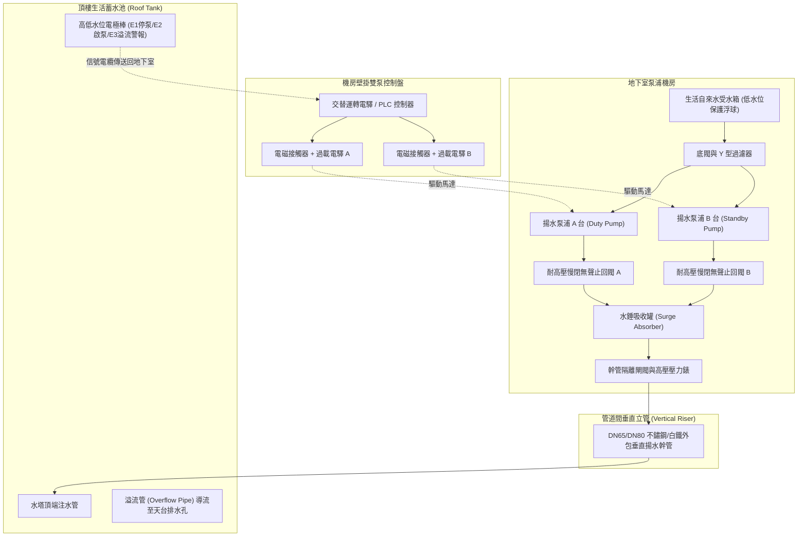
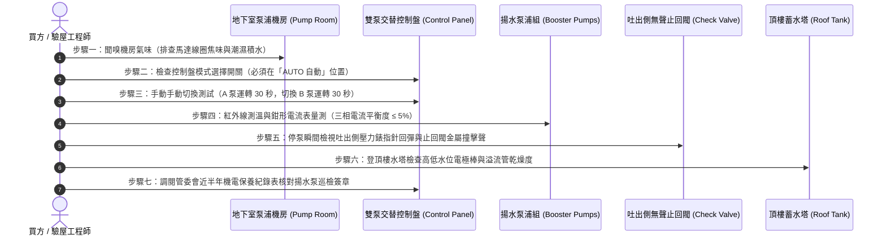

# 全案購屋實戰第六百二十一部：中古大樓社區地下室生活自來水雙泵揚水系統止回閥逆向洩漏低頻水錘震盪雙泵自動交替控制器故障與高樓層水塔溢流體檢工序全書

---

## 序章：社區生活命脈的垂直動脈——揚水泵浦與水錘防護防線

在集合住宅大樓的生活自來水給水架構中，「垂直揚水系統（Domestic Water Booster / Lifting Pump System）」負責將自來水事業單位輸送至地下室受水箱（Suction Tank）之低壓水源，經由揚水泵浦強力加壓，沿著數十公尺至上百公尺之垂直揚水幹管，克服重力位能揚程（Static Head）與管路摩擦阻力，克服性地灌注至頂樓生活蓄水池（Roof Water Tank）。

依據中華民國**《建築技術規則》建築設備編第二章給水排水系統**及**台灣自來水公司用戶用水設備內線工程技術規範**之明文強制標準：
1. **雙泵備援與交替運轉原則**：生活揚水泵浦必須設置**兩組完全同等容量之泵浦組（Duty & Standby Pumps）**，並由「雙泵自動交替控制盤（Alternating Pump Controller）」控制，每次啟動交替輪流運轉，確保泵浦磨損均勻，且在任一泵浦過載跳脫（Overload）時，控制盤必須在 1 秒內無縫切換啟動備援泵並發出警報。
2. **高壓逆向止回與水錘吸收**：揚水泵浦吐出側必須串聯安裝「慢閉無聲止回閥（Silent Check Valve / Non-Slam Check Valve）」與專用耐高壓「水錘吸收罐（Surge Absorber）」，防止停泵瞬間垂直數十公尺水柱重力倒灌造成泵浦高速逆轉倒轉損壞電機，並消除反射回衝波。
3. **頂樓水塔滿水溢流與低水位安全連鎖**：頂樓水塔必須配備三段或四段式「浮球水位電極液位控制器（Level Electrodes / Float Switches）」，分別設定「停泵水位」、「啟泵水位」與「極限滿水溢流警報水位（Overflow Alarm）」，並在控制盤上具備強制斷電停泵互鎖邏輯，杜絕水塔溢流狂洩水淹頂樓天台。

然而，在屋齡 20 至 35 年的中古大樓中，地下室揚水系統長年處於高溫潮濕地下環境，且因全棟每日數百人用水而反覆頻繁啟動，極易衍化為三大高危惡疾：
- **吐出側無聲止回閥橡膠閥瓣老化、閥桿水垢卡阻或彈簧斷裂**，導致止回閥「逆向微洩漏」，頂樓高壓水柱在停泵時猛烈反沖，引發整根垂直揚水管路震顫劇烈、發出「轟隆」低頻水錘震盪，更使夜間低樓層住戶飽受牆體水管共振噪音折磨；
- **雙泵交替運轉控制器（晶片型交替電驛或微電腦 PLC）繼電器接點碳化積碳**，導致自動交替失效，單台泵浦長年單打獨鬥超負荷運轉直至燒毀，備援泵浦則因長年未動而機械軸封與葉輪生鏽卡死；
- **頂樓水塔液位控制器電極棒碳酸鈣結垢短路、或浮球開關被水垢纏繞卡死**，信號失靈，地下室揚水泵浦在水塔已滿時「持續狂抽不停」，數十噸自來水自頂樓溢流管如瀑布般狂灌天台與逃生梯間，造成天花板大漏水與電梯機房全損慘劇！

本冊《全案購屋實戰第六百二十一部》深度剖析大樓地下室雙泵揚水系統、止回閥水力機制、交替控制電路與頂樓溢流連鎖體系，並制定現場看屋與公設查驗時之實戰檢驗工序。

---

## 第一章：地下室生活自來水揚水系統核心架構與三大崩潰失效機制

### 一、垂直生活揚水管網與控制系統物理拓撲
揚水系統由「地下室受水箱」、「雙揚水泵浦機組」、「止回與水錘吸收閥組」、「垂直揚水立管」及「頂樓蓄水池液位連鎖」五大部分構成：

---

### 二、三大致命事故機理深入剖析

#### 1. 吐出側無聲止回閥橡膠老化與水垢卡滯（逆向水流與停泵水錘打擊）
- **致病機制**：無聲止回閥主要依靠不鏽鋼復位彈簧與橡膠包覆閥瓣，在水流停止的瞬間（正向流速為零時）迅速關閉。由於長年抽取含有礦物質的水源，水垢堆積在閥座滑動導向柱上，導致閥瓣動作遲緩延遲關閉（延遲 0.2 至 0.5 秒）；或閥瓣密封橡膠經數萬次撞擊後磨損破裂。
- **致命後果**：當泵浦切斷電源瞬間，揚水立管內高達數十公尺的水柱在重力作用下以極高速度倒灌逆流，猛烈撞擊未及時閉合的止回閥閥瓣，引發毀滅性的**「撞擊型停泵水錘（Slam Water Hammer）」**！管道間發出宛如鐵鎚砸牆的巨大金屬鈍擊聲，瞬間尖峰水壓飆升至工作壓力的 2 至 3 倍，極易震裂止回閥鑄鐵閥體或撕裂立管固定防震吊架。

#### 2. 雙泵交替電驛（Alternating Relay）觸點積碳燒結（單泵單打獨鬥與雙泵癱瘓）
- **致病機制**：傳統中古社區多採用步進式棘輪交替電驛或電子式交替開關。地下室濕氣重，繼電器接點在高頻切換感性負載（電磁接觸器線圈）時產生微小電弧，導致接點表面嚴重氧化、積碳甚至金屬熔焊黏連（Contact Welded）。
- **致命後果**：控制盤永遠只啟動同一台泵浦（例如 A 台），另一台 B 台長年閒置。經過 1~2 年，A 台馬達軸承高溫燒毀、機械軸封漏水磨損；此時控制系統切換到 B 台，卻發現 B 台因長年靜置，水中水垢已使葉輪與泵殼死死「咬死（Seized）」，馬達送電瞬間引發堵轉過載跳脫！結果兩台泵浦同時失去供水能力，全大樓無預警陷入大停水危機。

#### 3. 頂樓水塔浮球電極棒碳酸鈣結垢鈍化（信號短路與水淹天台樓梯間）
- **致病機制**：頂樓水塔內部常年高溫多霧，水質蒸發使不鏽鋼電極棒（E1 停泵棒、E2 啟泵棒、E3 接地棒）表面包覆厚厚一層碳酸鈣與氧化物絕緣水垢；或水銀浮球開關電纜因水流擾動而互相纏繞打結。
- **致命後果**：當水塔水位已上升至 E1 停水線時，電極棒因水垢阻絕而無法導電感應，地下室控制盤誤判「水塔尚未滿水」，揚水馬達持續加壓狂抽。頂樓水塔迅速滿溢，自來水自溢流管狂瀉而出，若天台排水孔被落葉堵塞，大水便自安全梯通道、管道間及電梯機房天井狂灌而下，形成數十萬元裝潢損失與電梯電腦板燒毀之慘劇！

---

## 第二章：四大候選物件之揚水系統現場查驗焦點與議價戰略

針對目前本案鎖定之四大候選物件，因社區規模、總樓層與管理維護程度不同，其揚水設備所面臨之維護焦點各異：

| 物件編號與社區名稱 | 社區型態與供水樓高 | 揚水泵浦與水錘系統潛在風險焦點 | 現場公設實勘首要手段 | 談判作戰與費用折讓指引 |
| :--- | :--- | :--- | :--- | :--- |
| **大安紫金城 13 樓 (`PROP_10`)** | 總樓層 13 樓超高層大樓，揚程需求高達 45~55 公尺，揚水壓力約 5.5~7.0 kgf/cm²。 | 13 樓戶緊鄰頂樓水塔，揚水管注水進入頂樓時的震動與水流聲對頂樓戶最為敏感；高揚程立管之無聲止回閥若失效，水錘衝擊波將沿著管道間向上傳遞，引發 13 樓室內牆體共振。 | 1. 勘查 B2 泵浦機房，檢視揚水雙泵本體、止回閥品牌與高壓錶指針。 2. 現場測試手動切換 A 泵與 B 泵，確認兩台皆能正常平順運轉。 3. 登頂樓水塔旁檢視溢流管出口有無長流水痕與電極棒外觀。 | 若揚水泵浦運轉有軸承尖叫異音且止回閥漏水，更換全新 SUS304 立式多段揚水泵及靜音止回閥約需籌措 **12~20 萬元**，以此作為砍價折讓強大籌碼。 |
| **長億南園 8 樓 (`PROP_106`)** | 8 樓中層建築，戶數龐大，全天候揚水頻率極高（每日啟動數十次）。 | 30 年老舊大社區，地下室泵浦交替控制盤多已老舊氧化，需重點確認雙泵是否仍維持「自動交替運轉」，還是早已改為「單台手動常態運轉」的殘廢模式。 | 1. 檢視地下室揚水泵控制箱面板燈號，查看有無「過載 Fault」警報被旁路短接。 2. 停泵瞬間站在泵浦旁聆聽有無止回閥金屬撞擊聲（Slam）。 | 揚水系統若處於單泵硬撐狀態，全棟面臨隨時斷水風險，要求賣方出具機電保養改善承諾，並爭取 **8~12 萬元**之防禦折讓。 |
| **歌德堡 8 樓** | 精裝修戶，管理委員會運作穩定。 | 需確認地下室揚水管路之防震軟管（Flexible Rubber Joint）有無硬化龜裂，杜絕泵浦震動藉由水管傳導至全棟柱樑結構。 | 檢視地下室泵浦吸水與吐出側防震接頭彈性與避震彈簧基座。 | 機電維護優良，作為標準對照組，牽制大安紫金城與長億南園。 |
| **靜園 A 區 11 樓** | 11 樓高樓層，水箱維護頻率高。 | 頂樓水塔周邊防水與防蟲網維護良善度排查。 | 檢視水塔人孔蓋密閉性與溢流管防蟲網完整性。 | 優良基準參考標的。 |

---

## 第三章：看屋現場與地下室揚水系統七步快篩查驗工序（SOP）

買方或其驗屋代表在勘查地下室公設與頂樓水塔時，遵循以下 7 步標準工序進行深度檢驗：

### 具體實施指引與合格紅線：
1. **控制盤自動交替模式查驗（切勿處於手動模式）**：
   - 進入地下室機房，找到「生活給水揚水控制箱」。
   - **核心判據**：選擇開關（Selector Switch）必須處於**「AUTO 自動」**狀態。若開關被切在「手動（MANUAL）」位置，或開關上方貼有「A 泵故障請勿切換」的便條紙，代表交替控制系統或某一台泵浦已經損壞停擺！
2. **雙泵手動強制切換運轉實測**：
   - 在陪同管理員同意下，將開關切至手動，分別啟動 A 泵 30 秒，再切換啟動 B 泵 30 秒。
   - 仔細聆聽兩台馬達運轉聲響：正常聲音應為平順低沉的電磁嗡嗡聲；若發出刺耳的金屬尖叫聲或「喀啦喀啦」碎石滾動聲，代表軸承滾珠磨損或葉輪氣蝕損壞。
3. **馬達溫升與電流平衡（Electrical & Thermal Check）**：
   - 以紅外線測溫槍照射馬達外殼散熱鰭片，正常運轉溫度應低於 **65°C**（B級/F級絕緣極限為 105°C~130°C，但超過 80°C 即屬散熱不良）。
   - 檢查控制箱內電流錶，啟動瞬間過衝後，運轉電流必須低於馬達銘板額定滿載電流（FLA）。
4. **無聲止回閥停泵撞擊測試（Slam Shockwave Test）**：
   - 當手動關閉運轉中之泵浦瞬間，站在吐出側止回閥旁靜聽。
   - **合格標準**：閥瓣應於水流即將逆流前輕柔平靜閉合，僅發出極微弱的「噗」聲。
   - **嚴重缺陷**：若發出巨大的「噹！」金屬敲擊巨響，且整根立管產生劇烈晃動，代表止回閥彈簧斷裂或閥芯卡死，管內承受極度危險之停泵水錘！
5. **止回閥逆向洩漏檢測（Backflow Leakage Test）**：
   - 當 A 泵單獨運轉時，觸摸或觀察 B 泵的吐出側壓力錶與管壁；反之亦然。若非運轉中的泵浦吐出側產生發熱或逆向旋轉，代表其止回閥已無法完全密閉，高壓水正自備用泵逆流洩漏回受水箱。
6. **頂樓水塔溢流管「乾濕判斷」**：
   - 登頂樓檢視生活蓄水池。溢流管口若掛滿青苔、周邊地面有長期潮濕流水痕跡，代表頂樓液位電極棒早已失準，水塔經常性發生溢流浪費自來水現象。
7. **機電保養紀錄對照**：
   - 查驗機電維護合約中是否包含「每季清洗水塔電極棒」、「每月量測揚水馬達絕緣電阻（高阻計量測絕緣電阻需 > 2 MΩ）」之強制保養條款。

---

## 第四章：地下室揚水泵浦與水錘消除系統體檢驗收表

本表供買方看屋公設踏勘或交屋前檢對打勾：

| 檢驗項目 | 規範標準要求 | 實測數值 / 現況現象 | 合格判定 | 缺陷風險處置與修繕成本 |
| :--- | :--- | :--- | :---: | :--- |
| **1. 雙泵交替控制運作** | 控制盤處於 AUTO 模式，每次啟動確實自動輪流交替運轉。 | ［　　］狀態 | □合格 □異常 | 更換微電腦雙泵自動交替控制器（約 6,000~10,000 元）。 |
| **2. 備援泵浦備便狀態** | B 泵手動啟動順暢，無過載跳脫、無軸承咬死卡滯。 | ［　　］狀態 | □合格 □異常 | 泵浦解體除鏽、更換全新深溝滾珠軸承與機械軸封。 |
| **3. 慢閉無聲止回閥** | 停泵瞬間平順無撞擊巨響，無逆向洩漏，無管路晃動。 | ［　　］現象 | □合格 □異常 | 更換為 SUS304 耐高壓慢閉消音止回閥（約 8,000~15,000 元/只）。 |
| **4. 馬達運轉表面溫升** | 連續運轉 10 分鐘，馬達機殼表面溫度 ≤ 65°C。 | ［　　］°C | □合格 □異常 | 清除馬達風扇外罩灰塵雜物，重繞線圈或更換新馬達。 |
| **5. 絕緣電阻值（兆歐錶）**| 馬達線圈對地絕緣電阻值 ≥ 2 MΩ（理想值 > 10 MΩ）。 | ［　　］MΩ | □合格 □異常 | 實施線圈烘烤除濕或整組馬達更換。 |
| **6. 頂樓水塔液位電極棒** | 電極棒光亮無結厚水垢，水位達高位時立即精準斷電停泵。 | ［　　］狀態 | □合格 □異常 | 使用細砂紙研磨清除碳酸鈣水垢，更換不鏽鋼電極棒組。 |
| **7. 頂樓水塔溢流管狀態** | 溢流管口乾燥無滴漏、配備防蟲不鏽鋼絲網罩無破損。 | ［　　］狀態 | □合格 □異常 | 重新校準停泵水位線，補裝 16 目不鏽鋼防蟲防鳥網。 |

---

## 第五章：總結與後續工序推進

地下室揚水系統是維繫全大樓數百口人每日生活起居的源頭動脈。看屋時花費 15 分鐘深入地下室泵浦機房與頂樓水塔進行客觀驗證，不仅能徹底排除「買下後每晚忍受水錘噪音」或「大樓無預警停水、水淹天台」的慘烈噩夢，更是向賣方爭取數十萬元公設機電維修折讓的強大利器！

下一部實戰手冊將依序開展：**《全案購屋實戰第六百二十二部：中古大樓社區地下室生活自來水二次加壓變頻泵浦PID控制恆壓傳送器漂移葉輪氣蝕剝落與機械軸封高溫乾磨體檢工序全書》**，持續深入生活自來水恆壓供水核心工序！

---
*全案購屋實戰第六百二十一部・全書完・版本控管確認*
