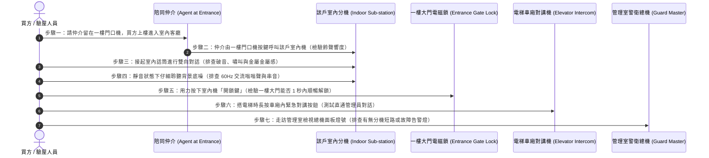

# 全案購屋實戰第六百二十七部：中古大樓社區各樓層電梯對講機室內分機音訊放大IC老化破音直流供電壓降雜訊干擾與主機面板通訊中斷體檢工序全書

---

## 序章：社區神經中樞與防盜避難生命線——大樓弱電對講系統之重要性

在集合住宅大樓的智慧化與安全防衛體系中，「緊急對講與門禁保全系統（Building Intercom & Emergency Security System，俗稱對講機系統）」構成了連接「管理室警衛總機（Guard Master Station）」、「一樓梯廳門禁門口機（Entrance Door Station）」、「各樓層住戶室內分機（Indoor Intercom Sub-station）」以及「電梯車廂緊急求救對講機（Elevator Emergency Intercom）」的四維立體神經網絡。

依據中華民國**《建築技術規則》建築設備編第五章電氣設備**、國家標準 **CNS 14353** 及內政部國土管理署**《智慧建築評估手冊》**之明文規範：
1. **電梯雙向對話強制要求（CNS 10594 / 建築物昇降設備安全規範）**：電梯車廂內部必須強制設置具備獨立備用電源（電池待機至少 1 小時以上）之「雙向語音對講裝置」，在電梯車廂受困故障或斷電時，乘客按下求救鈕，必須能在 **10 秒內無障礙接通管理員室或 24 小時委外維保監控中心**，且語音傳輸必須清晰無破音、無嚴重背景底噪干擾。
2. **直流集中供電壓降與負載匹配紅線**：大樓對講系統多採用 DC 12V 至 DC 24V 之集中式直流開關電源（SMPS）。沿著垂直弱電管道間長達數十米至上百米的線路傳輸，其端點室內分機與門口機的實測工作電壓降**嚴禁超過標稱電壓之 10%**（例如 DC 12V 系統，最末端分機供電不得低於 **10.8V**）；若低於此電壓，解鎖繼電器將無法吸合開門，音訊放大電路產生嚴重削頂失真（Clipping Distortion）。
3. **電磁相容性（EMC）與訊號遮蔽接地隔離**：音訊、影像同軸電纜（或雙絞線 UTP/STP）與開門控制線，必須與強電電力電纜（380V/220V/110V）維持至少 **30 公分至 50 公分以上之物理隔離間距**，且金屬導線管或遮蔽層必須實施單點接地（接地電阻 $\le 100\ \Omega$），嚴防電梯變頻器（VFD）高頻諧波與大樓加壓馬達啟動時對語音線路產生毀滅性之「交流嗡嗡聲（60Hz Hum）」干擾。

然而，在屋齡 20 至 35 年的中古大樓中，弱電對講系統往往是公設中最易被管委會忽視、卻對日常居住品質造成極大困擾的重災區：
- **室內分機主機板上之音訊功率放大 IC（如 LM386、TDA2822 等）與電解電容長年通電老化乾涸**，導致對講聲音極度微弱、金屬破音撕裂、甚至發出持續性尖銳哮叫（嘯叫自激振盪）；
- **地下室或弱電井直流電源供應器濾波電容鼓包失效、線路接點銅綠氧化阻抗飆升**，引發嚴重直流供電壓降，住戶按「開鎖鍵（Door Release）」按了五、六次一樓大門鐵捲門或磁力鎖依然毫無反應；
- **管理室總機主控面板微處理器（MCU）當機、矩陣按鍵接觸不良、或大樓匯流排（RS-485 / 多芯線匯流排）局部短路**，導致全社區多戶或全棟通訊徹底中斷，快遞送件無法通知、訪客無法呼叫，更在夜間突發急症或火警時無法呼叫警衛馳援！

本冊《全案購屋實戰第六百二十七部》深入剖析大樓對講系統音訊電路、直流壓降、電磁干擾機理與總機通訊協定，並制定買方於看屋現場及梯廳實測時之標準七步快篩檢驗工序。

---

## 第一章：大樓弱電對講系統核心拓撲與三大崩潰失效機制

### 一、大樓集中式對講系統物理拓撲
典型集合住宅對講系統（包含傳統多芯線式如「4+n」系統，以及現代匯流排數位式系統）之架構如下：

```mermaid
flowchart TD
    subgraph GuardStation ["管理室警衛管理主機"]
        GuardMaster["警衛管理總機 (Guard Master)"] --> PowerSupply["DC 12V/24V 集中線性/開關電源"]
        GuardMaster --> AudioAmp["主機雙向音訊放大模組"]
        GuardMaster --> VideoMatrix["視訊矩陣切換器 (Video Matrix)"]
    end

    subgraph EntranceDoor ["一樓梯廳門口機與門禁"]
        EntranceStation["一樓梯廳門口機 (Panel & Keypad)"] --> MagneticLock["陽極鎖 / 斷電開型磁力鎖"]
        EntranceStation --> DoorMicSpk["門口機麥克風與全音域揚聲器"]
        MagneticLock -.->|開門繼電器控制| EntranceStation
    end

    subgraph ElevatorCar ["電梯車廂內部"]
        CarStation["電梯專用對講副機 (Car Intercom)"] --> ElevTravelingCable["電梯隨行電纜專用弱電屏蔽雙絞線"]
        ElevTravelingCable --> GuardMaster
    end

    subgraph VerticalChase ["各樓層垂直弱電管道間"]
        PowerSupply ==>|直流主幹線 (Power Bus)| RiserBox["各樓層弱電接線箱 (Terminal Box)"]
        GuardMaster -.->|音訊與數位指令匯流排| RiserBox
        EntranceStation -.->|視訊/音訊總線| RiserBox
    end

    subgraph IndoorApartment ["各住戶室內分機 (Indoor Sub-station)"]
        RiserBox --> SubStation["室內壁掛對講分機 (Indoor Intercom)"]
        SubStation --> AudioIC["音訊功放 IC (LM386) + 濾波電解電容"]
        SubStation --> UnlockButton["機械式開鎖按鈕 (Door Release Button)"]
    end
```

---

### 二、三大致命病徵機理深入剖析

#### 1. 室內分機音訊放大 IC 擊穿老化與電解電容電解液乾涸（「破音與無聲」）
- **致病機制**：
  - 室內分機長年 365 天處於通電待機狀態。主機板上的音訊運算放大器或低功率音訊放大 IC（如 LM386、MC34119）長期處於微熱狀態；
  - 核心濾波電解電容（Electrolytic Capacitor）內部液態電解液經 15 至 25 年長年高溫蒸發乾涸，等效串聯電阻（ESR）由正常的 $<1\ \Omega$ 暴增至數十歐姆，容量衰減超過 80%。
- **致命後果**：當管理室或門口機呼叫時，室內機鈴聲沙啞微弱；通話時，揚聲器發出嚴重失真、尖銳金屬破音撕裂聲，雙方完全聽不清對方說話；嚴重者甚至因直流偏置電壓偏移，直接燒毀揚聲器微細音圈，室內機徹底淪為啞巴！

#### 2. 垂直主幹線線徑不足與直流供電壓降（「按開鎖鍵無反應」）
- **致病機制**：
  - 早期建商為節省成本，弱電供電線路往往採用細小的 0.5 mm（24 AWG）銅線，長度若達 50 至 80 公尺（由地下室直達十幾樓），直流線路電阻高達數歐姆。
  - 當住戶按下「開鎖鈕」瞬間，一樓大門的電磁陽極鎖或陰極鎖瞬間需要抽載 $0.8 \sim 1.5\text{ A}$ 的突波啟動電流。依歐姆定律 $\Delta V = I \cdot R$，瞬間線路壓降高達 $3 \sim 5\text{ V}$！
- **致命後果**：送達一樓鎖具或高樓層分機的電壓瞬間跌落至不足 **8.5V**（低於繼電器吸合門檻 10.2V）。住戶在室內按了半天開門鍵，一樓大門電磁閥根本拉不動，訪客被關在門外，長輩孩童必須親自搭電梯下樓手動開門，造成極度困擾！

#### 3. 強弱電同管並行電磁感應與通訊匯流排短路（「60Hz 交流嗡嗡聲與全棟盲癱」）
- **致病機制**：
  - 管道間施工雜亂，弱電對講線路與走道照明強電線（110V/220V）、甚至電梯動力主纜線擠在同一個管道井或無遮蔽金屬線槽內。強電的交變磁場在未絞合、無屏蔽的對講音訊線上感應出強烈的 $60\text{ Hz}$ 工頻干擾電壓。
  - 同時，若某戶裝潢施工時電線短路、或某一樓層分機進水，導致匯流排通訊線（Data Bus）對地短接。
- **致命後果**：所有住戶拿起話筒皆傳出震耳欲聾的「嗡——」巨大交流干擾噪聲；更嚴重者，整棟大樓的數位位址編碼完全錯亂，管理室呼叫 8 樓卻響在 13 樓，全棟對講通訊系統徹底癱瘓！

---

## 第二章：四大候選物件之對講系統實勘對照與談判戰略

本案目前鎖定之四大候選物件，因屋齡與梯廳配置差異，弱電對講維護狀態各有千秋：

| 物件編號與社區名稱 | 樓層與建物特徵 | 對講與弱電通訊潛在風險焦點 | 現場實勘首要手段 | 談判籌碼與修繕折讓指引 |
| :--- | :--- | :--- | :--- | :--- |
| **大安紫金城 13 樓 (`PROP_10`)** | 13 樓頂樓戶，原為 4 間學生分租套房。 | 分租套房改裝過程中，原始室內對講分機極可能被拆除、移位、或分接至各套房內部，造成弱電阻抗不匹配；13 樓處於整棟供電主幹線的最末端，直流壓降最為嚴重。 | 1. 檢視客廳玄關對講室內機是否仍完好留存。<br>2. 現場請陪同房仲由一樓門口機或管理室直撥 13 樓，測試鈴聲響度與通話清晰度。<br>3. 實測室內機按「開鎖鍵」一樓大門能否立即彈開。 | 若對講線路遭破壞或分機故障無聲，重新拉設專用弱電訊號線與更換數位影像室內機，費用約 **1.5~2.5 萬元**，以此作為砍價折讓籌碼。 |
| **長億南園 8 樓 (`PROP_106`)** | 30 年老舊大社區，戶數規模龐大。 | 大型舊社區對講主機多已停產，零件難尋；常年維護不足，音訊電容老化，戶間串音（Crosstalk）與交流底噪嚴重；需排查電梯車廂內緊急對講機是否能直通管理室。 | 1. 搭乘電梯時，親自長按車廂內「緊急呼叫鈕」測試警衛通話。<br>2. 拿起 8 樓室內對講機話筒聽有無「嗡嗡」工頻交流噪聲。 | 大樓若對講系統全面癱瘓且管委會籌議全面更新（每戶攤提 1~2 萬元），以此作為強大殺價依據，爭取 **3~5 萬元**之防禦折讓。 |
| **歌德堡 8 樓** | 精裝修三房，室內美輪美奐。 | 需確認裝潢包板時是否將弱電接線盒死封在木作牆內，導致日後無法檢修更換；確認分機與管理室通話品質。 | 檢視室內對講機後方木作牆面，確認留有活動檢修蓋板。 | 機電維護良善，作為標準比對標的，牽制長億南園與大安紫金城。 |
| **靜園 A 區 11 樓** | 均質優質社區，管理嚴謹。 | 檢視管理室管理主機運作狀態與電梯對講雙向通話清晰度。 | 測試一樓大門門禁刷卡與對講連動，作為優良標準基標。 | 優良基準參考標的。 |

---

## 第三章：看屋現場大樓對講系統七步快篩查驗標準工序（SOP）

買方看屋時，透過下列 7 個標準步驟即可在 3 分鐘內精準判定該戶室內分機與全樓通訊網絡之健康度：



### 具體實施指引與合格紅線：
1. **一樓門口機呼叫與鈴聲強度測試**：
   - 買方在屋內，請房仲在一樓梯廳門口機輸入該戶房號呼叫。
   - **合格標準**：室內機鈴聲應清脆響亮（音量應在 **$70 \sim 80 \text{ dB}$**），即使在緊閉的臥室內亦能清晰聽見。
   - **異常警訊**：若鈴聲如蚊子叫、時響時不響，或發出沙啞的嘶嘶聲，代表振鈴推動電路電容老化或揚聲器受損。
2. **雙向語音辨識度與音質純淨度**：
   - 拿起話筒通話，請對方朗讀一組數字（例如「13579」）。
   - **音質判定**：語音必須自然真實；若伴隨刺耳的高頻「吱吱」金屬自激音，代表音訊放大 IC 內部反饋電阻失真；若語音嚴重含混不清，則為麥克風駐極體電容老化。
3. **60Hz 工頻交流噪聲排查（電磁干擾檢查）**：
   - 在通話狀態下，雙方暫停講話，仔細聆聽耳筒聽筒。
   - **合格標準**：背景應保持純淨寂靜。
   - **重大缺陷**：若聽筒傳出強烈持續的「嗡——」低頻共鳴聲，代表垂直弱電井內部存在嚴重的「強弱電混搭拉線」或地迴路電位差干擾！
4. **開鎖按鈕（Door Release）動作靈敏度（關鍵實戰指標）**：
   - 通話中按下室內機的「開鎖鍵」。
   - **合格標準**：一樓大門的電鎖必須伴隨乾脆俐落的「咔噠」跳脫聲，大門在 1 秒內順暢被推開。
   - **致命紅線**：若連續狂按開門鍵 3 至 5 次，一樓大門毫無反應，或者必須兩隻手死命猛按才能偶爾解鎖一次，此為典型**「末端直流供電壓降嚴重超標」或「開鎖微動接點金屬疲勞」**！
5. **電梯車廂緊急求救對講驗證（生命安全防線）**：
   - 搭乘電梯時，按住黃色求救對講鈴鐺鈕 3 秒鐘。
   - 車廂揚聲器應響起通話接通提示音，管理員必須在 10 秒內應答。
   - 仔細確認電梯在行進運行中，語音是否受電梯變頻馬達干擾而產生高頻噪音。
6. **管理室總機面板告警檢查**：
   - 前往管理室，禮貌檢視管理員桌上的對講總機主機（如俞氏、宇慶、歐益、明谷等）。
   - 檢視面板 LED 矩陣燈：正常應全數熄滅或呈現綠色待機；若某排指示燈持續長亮紅燈，代表該棟或該迴路之弱電訊號線早已發生「總線短路接地」。

---

## 第四章：大樓弱電對講與門禁系統全面體檢驗收表

本表供買方於現場看屋或交屋前逐項檢對打勾：

| 檢驗項目 | 規範標準要求 | 實測現況紀錄 | 合格判定 | 缺陷風險處置與修繕成本 |
| :--- | :--- | :--- | :---: | :--- |
| **1. 呼叫振鈴音量響度** | 呼叫時室內機鈴聲清脆響亮，聲壓級 ≥ 70 dB。 | ［　　］dB / 現象 | □合格 □異常 | 更換分機內部壓電蜂鳴片或振鈴放大電容。 |
| **2. 雙向對話清晰度** | 語音傳輸清晰飽滿，無金屬破音、無嚴重削頂失真。 | ［　　］音質狀態 | □合格 □異常 | 更換音訊放大 IC（LM386）及周邊濾波電解電容。 |
| **3. 開鎖按鍵反應靈敏** | 按下開鎖鈕 1 秒內一樓電磁鎖順暢解鎖，無延遲啞彈。 | ［　　］次解鎖成功 | □合格 □異常 | 更換分機開鎖微動輕觸開關，加裝開鎖輔助中繼繼電器。 |
| **4. 工頻交流干擾噪聲** | 靜音待機與通話時，聽筒無 60Hz 交流嗡嗡背景噪聲。 | ［　　］底噪狀態 | □合格 □異常 | 檢查弱電管道間線槽，強弱電實施 30cm 隔離並重新單點接地。 |
| **5. 室內分機實體外觀** | 機殼無泛黃龜裂、話筒聽筒彈簧伸縮線無脫膠黏手。 | ［　　］外觀品相 | □合格 □異常 | 全新更換原廠相容數位/類比室內分機（約 1,500~3,500 元）。 |
| **6. 電梯車廂緊急對講** | 按下求救鈕 10 秒內直通管理室，行進中語音清晰無雜音。 | ［　　］秒接通 | □合格 □異常 | 檢修電梯隨行電纜音訊遮蔽層，更換對講專用話筒模組。 |
| **7. 集中直流供電電壓** | 最末端分機實測工作直流電壓 ≥ 10.8V DC（12V系統）。 | ［　　］V DC | □合格 □異常 | 調高集中開關電源輸出電壓（可微調至 13.5V），更換老化電源箱。 |

---

## 第五章：總結與後續工序推進

大樓弱電對講系統是守護家庭生活隱私、日常開門便利與火災受困緊急求援的無形防線。在看屋過程中花費 3 分鐘親自實測雙向對話、破音辨識與一樓開鎖反應，能輕易揪出老舊社區弱電系統暗藏的退化危機，為未來的居住品質提供堅實防護，並在總價談判中再下一城！

下一部實戰手冊將依序開展：**《全案購屋實戰第六百二十八部：中古大樓社區地下室生活自來水受水箱進水水力浮球閥主閥隔膜微裂紋導閥濾網水垢淤塞洩壓孔堵塞與自來水狂流溢流淹水體檢工序全書》**，持續深入生活自來水進水控制核心工序！

---
*全案購屋實戰第六百二十七部・全書完・版本控管確認*
