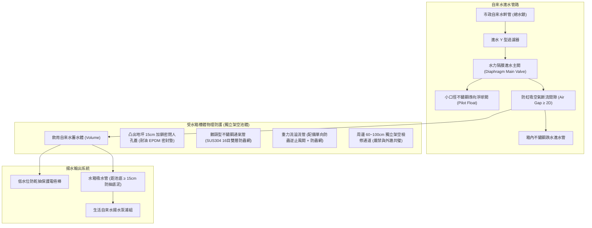
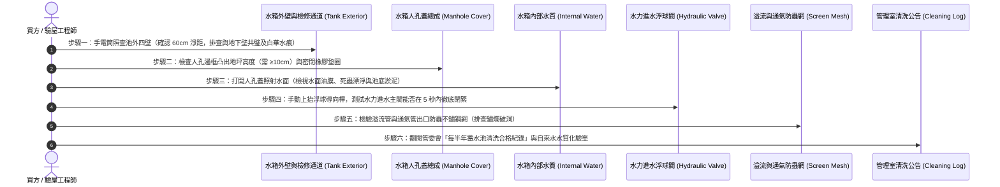

# 全案購屋實戰第六百二十三部：中古大樓社區地下室生活自來水受水箱蓄水池池體裂縫滲水進水浮球閥卡阻無效溢流管防蟲網破裂與水質二次污染體檢工序全書

---

## 序章：社區生活飲用水源頭防線——地下受水箱的隱蔽衛生與結構危機

在集合住宅大樓的生活自來水給水架構中，自來水事業單位之配水幹管水壓通常僅能供應至地面一至二樓。為維持全棟各住戶之充沛供水，所有自來水必須首先經由道路總錶引流注入**「地下室生活自來水受水箱（Underground Domestic Suction Tank / Receiving Water Tank）」**，暫行蓄存後，再由揚水泵浦抽送至頂樓水塔或由二次加壓變頻泵直供全戶。

地下室受水箱是全社區數百位居民每日飲用、烹飪、洗滌之生命源頭。依據中華民國**《建築技術規則》建築設備編第二章給水排水系統**、**《自來水法》**及**內政部國土管理署「建築物蓄水池水塔水質檢驗及清洗維護規範」**之明文強制標準：
1. **獨立池體與「防二次污染空間距離」紅線**：生活自來水受水箱之池底、池壁與池頂，**絕對嚴禁直接利用建築物之外牆、地下室連續壁、筏基地樑或地板共用（嚴禁兼用）**！池體外壁與地下室其他構造物之間，必須保持至少 **60 公分至 100 公分以上之獨立空氣淨距與檢修通道**；水箱頂部與上方天花板樑底亦須留設至少 **60 公分至 80 公分之作業空間**，嚴防地下室土壤外水、化糞污水或筏基滲水經由混凝土毛細裂縫滲透交叉污染自來水。
2. **進水浮球閥與大流量水力隔膜閥密封性**：受水箱進水管口必須配置具備防虹吸（Anti-Siphon）與防倒流功能之「水力進水浮球閥組（Hydraulic Float Control Valve）」，且溢流管口（Overflow Pipe）與進水管出水口之間，必須維持至少等於進水管徑 2 倍（且不得小於 50 mm）之**「空氣斷流間隙（Air Gap）」**，杜絕虹吸回流。
3. **通風管、人孔蓋與溢流管防蟲防污密封**：受水箱之人孔（Manhole）必須高出周邊地坪至少 **10 公分至 20 公分**，並配備密閉式加鎖人孔蓋與防污水倒灌橡膠密封墊圈；所有通氣管（Vent Pipe）與溢流管出口，必須全面強制加裝孔徑在 16 目（Mesh）以上之**「不鏽鋼耐腐蝕防蟲防鼠防鳥濾網」**。

然而，在屋齡 20 至 35 年的中古大樓中，地下受水箱長年處於暗無天日、潮濕閉塞之底層空間，極易演變為三大致命公害重症：
- **早年違規「共璧式」鋼筋混凝土水箱因地震剪力產生貫穿性裂縫**，地下室污泥廢水甚至鄰近化糞池滲漏液經由毛細孔滲入受水箱，全社區長年飲用含有大腸桿菌與重金屬之毒水；
- **進水大口徑浮球閥導向連桿遭碳酸鈣水垢卡死咬住**，進水閥無法完全關閉，自來水常態性溢流狂洩，每月全體住戶平攤數萬元冤枉公攤水費；
- **人孔蓋鏽蝕穿孔、溢流管防蟲網破損脫落**，老鼠、蟑螂、壁虎及飛蟲沿管爬入水箱溺斃腐爛，水底沉積數寸厚之黑泥死菌，嚴重威脅全家大小腸胃健康與生命安全！

本冊《全案購屋實戰第六百二十三部》深入剖析地下室受水箱之土木結構共璧隱患、水力進水浮球閥失效機理、水質二次污染檢測指引，並制定現場看屋與公設查驗時之實戰查驗標準工序。

---

## 第一章：地下室受水箱核心結構拓撲與三大致命污染事故機制

### 一、生活受水箱合規配置與水力拓撲
合規且衛生的地下室生活自來水受水箱，必須具備「架空獨立池體」、「標準空氣間隙」、「水力隔膜進水閥」與「多道防蟲密封體系」：

---

### 二、三大致命衛生與結構破壞機理深入剖析

#### 1. 早期「共璧式」水池貫穿性裂縫與污水交叉滲透（集體中毒與頑疾隱患）
- **致病機制**：
  - 早期 921 地震前之中古大樓，營造廠為節省模板工資與地下室空間，普遍將受水箱底板直接座落於筏基底板上，兩側池壁則直接「共用地下室外牆或承重外壁（共璧式建築）」。
  - 經歷數十年反覆地震剪力與地下水位浮力反覆變動，混凝土產生非線性微裂紋與沉陷裂縫。
  - 當豪雨來襲時，大樓外側土壤中的高濁度地下水、重金屬溶出液，甚至是鄰近老舊化糞池滲漏之黑水，因外側地下水位高於水箱內部水位，在水力壓差驅動下，污水沿著混凝土蜂窩縫隙源源不絕滲入受水箱內！
- **致命後果**：自來水中大腸桿菌群、總菌落數、濁度嚴重超標。住戶長年以含有致病菌之毒水洗澡、刷牙、煮飯，極易誘發全社區集體性急性腸胃炎、皮膚不明過敏發癢與免疫系統病變！

#### 2. 水力進水浮球閥主閥隔膜微裂與導管卡阻（「長流溢水與天價公攤水費」）
- **致病機制**：大型社區受水箱多採用 DN50 至 DN100 之隔膜式水力進水控制閥。水力閥利用水箱上方小型不鏽鋼浮球閥（導閥 Pilot Valve）啟閉控制室水壓，帶動橡膠隔膜下壓關閉主閥。
- **致命後果**：自來水中的鐵泥砂石堵塞了細微的導壓針閥孔，或橡膠隔膜老化失去彈性開裂。當水箱水位達到最高設定水位時，浮球雖已浮起，但控制室無法建立足夠高壓推動主閥芯關閉，主閥維持「常態半開或全開」！源源不斷的自來水經由溢流管直接排入地下室集水坑，再由沉水泵抽排至道路雨水溝。全棟住戶在毫不知情下，每期公攤水費高達數萬元甚至十數萬元！

#### 3. 溢流管防蟲網銹爛與人孔密封失效（「老鼠壁虎腐屍煮湯」惡夢）
- **致病機制**：早期建商所配備之溢流管防蟲網多採用廉價鐵絲網或尼龍紗網。在地下室陰暗潮濕高含硫環境下，鐵絲網在 3 至 5 年內徹底鏽爛脫落；水箱上方人孔蓋僅隨意覆蓋一片薄鐵皮，邊緣無迫緊橡膠圈且未上鎖。
- **致命後果**：地下室繁衍之美洲蟑螂、大老鼠、壁虎及飛蟻順著溢流管或人孔蓋縫隙鑽入水箱，掉入水中溺斃。動物屍體在數十噸常溫水中泡脹發爛、滋生蛆蟲與惡臭。住戶打開家中水龍頭，甚至流出毛髮、蟲卵與腐臭肉屑，對家庭精神與身心健康造成無法磨滅的毀滅性打擊！

---

## 第二章：四大候選物件之地下受水箱現場查驗焦點與談判戰略

針對目前本案鎖定之四大候選物件，因建造年份與管委會治理水平不同，受水箱維護體質具有顯著差異：

| 物件編號與社區名稱 | 建築型態與池體特徵 | 受水箱與水質二次污染潛在焦點 | 現場實勘首要手段 | 談判作戰與費用扣除指引 |
| :--- | :--- | :--- | :--- | :--- |
| **大安紫金城 13 樓 (`PROP_10`)** | 28~30 年高層建築，地下達 B2，需確認受水箱是否為獨立懸吊式水箱或架空水池。 | 早期超高層地下室受水箱容量大，若曾發生過池體外牆滲漏修補，需查驗環氧樹脂（Epoxy）塗層有無大片剝落、變質溶出雙酚A毒性；檢查進水浮球閥溢流狀態。 | 1. 勘查 B2 蓄水池外壁，確認有無與地下連續壁共璧共用。 2. 爬梯檢視人孔蓋密閉性與加鎖狀態。 3. 檢視溢流管出口防蟲網是否為 SUS304 完整不鏽鋼網。 | 水箱池體若有貫穿裂縫或老舊 Epoxy 剝落，全池重新聚脲（Polyurea）食品級無毒防水內襯約需 **25~45 萬元**，以此作為殺價重要防線。 |
| **長億南園 8 樓 (`PROP_106`)** | 30 年老舊大社區，戶數規模龐大，水箱容量極高。 | 大型社區受水箱沉砂量極大，若每年未依規定清洗二次以上，池底鐵鏽沉泥可厚達 5~10 公分；進水閥卡阻造成公攤水費異常偏高之風險極大。 | 1. 要求調閱近一年水費收據，排查「公攤水費」每戶是否異常高於 150~300 元。 2. 檢視自來水公司清洗水池水塔申報合格紀錄表。 | 若公攤水費異常且水箱進水閥滲漏，要求管委會限期更換水力進水閥，並向賣方爭取 **5~8 萬元**之折讓。 |
| **歌德堡 8 樓** | 精裝修戶，梯廳公設明亮。 | 需確認地下室受水箱周邊環境衛生，排查周圍有無堆放廢棄雜物或鄰近污廢水排污坑。 | 檢視受水箱周邊檢修通道是否乾燥潔淨、照明充足，且距化糞池至少維持 3 公尺以上衛生距離。 | 機電衛生維護良好，作為模範對照組，牽制大安紫金城與長億南園。 |
| **靜園 A 區 11 樓** | 管理嚴謹，住戶均質。 | 檢視公共受水箱之水質自主送驗檢驗報告（大腸桿菌群、濁度、餘氯量）。 | 查驗管委會公布欄最近一期飲用水檢驗合格證明書。 | 作為安全基標。 |

---

## 第三章：看屋現場地下室受水箱六步快篩查驗標準工序（SOP）

買方或其驗屋代表在陪同仲介勘查地下室受水箱時，遵循以下 6 步關鍵查驗工序：

### 具體實施指引與合格紅線：
1. **水箱外壁「獨立性與漏水痕跡」判定（絕不買共璧毒水池）**：
   - 圍繞受水箱四周巡視。
   - **黃金標準**：水箱四壁必須為獨立鋼筋混凝土或不鏽鋼組合水箱，四周必須留有至少 **60 公分**之走道，池底架空於筏基之上。
   - **致命紅線**：若水箱某一側直接貼死地下室外牆（共璧），且壁面上佈滿白色碳酸鈣結晶（壁癌白華）甚至有水流滲出痕跡，此為地下水滲透之確鑿鐵證，切勿輕易忽視！
2. **人孔蓋密封與防溢流防護**：
   - 受水箱上方人孔蓋基座必須高出水箱頂板或地坪至少 **10 至 15 公分**，防止地面拖地水或消防水漫過人孔縫隙流入水箱。
   - 掀開人孔蓋檢查邊緣：必須配備完整無缺之耐候性橡膠密封墊圈，且平時必須具備加鎖防護，防止外人投毒或孩童誤入。
3. **水體目視與聞嗅檢驗（水質第一感官）**：
   - 以強光手電筒直射水箱內部深處：
     - **合格水質**：水質清澈見底，能清晰看見池底磁磚接縫或防腐塗層，且無任何刺鼻發霉異味，僅有正常微弱自來水餘氯消毒水味。
     - **異常警訊**：水面漂浮微細油膜、黃褐色泡沫，水底堆積褐色腐植泥；若聞到土壤泥腥味、發酵酸臭味或沼氣味，代表水箱已遭嚴重交叉污染！
4. **水力進水閥密封截水測試**：
   - 在水箱進水補水時，以手輕輕向上托起浮球閥之金屬連桿至水平停水位置。
   - **正常反應**：主進水管之噴水聲應於 3 至 5 秒內迅速減小至完全靜音停水。
   - **重大缺陷**：若浮球抬至頂點後，主閥出水口仍持續大量噴水或發出劇烈刺耳哨音，代表主閥隔膜破損卡垢，正在常態性漏水溢流！
5. **溢流管與通風孔防蟲濾網檢查**：
   - 找到伸出水箱外部之溢流管口與「鵝頸型通氣管（Gooseneck Vent）」。
   - 用手觸摸管口金屬網：必須為 **SUS304/SUS316 不鏽鋼編織網**，孔徑不得大於 1 mm（16目以上）。若發現防蟲網已鏽蝕碎裂成大洞、或僅用脆弱尼龍絲襪隨意套住，蟑螂老鼠隨時可暢行無阻！
6. **年度清洗水塔清洗證明書審查**：
   - 依建築法規，大樓蓄水池必須**每半年至少清洗消毒一次**，並張貼台中市政府衛生局或自來水事業單位認證之清洗水質檢驗合格單（含濁度、餘氯、大腸桿菌群檢測值）。若管委會拿不出近一年的水質檢測單，代表公設管理處於嚴重失職狀態。

---

## 第四章：地下室受水箱蓄水池體檢驗收表

本表供買方於看屋公設實勘或交屋前逐項查對打勾：

| 檢驗項目 | 規範標準要求 | 實測現況紀錄 | 合格判定 | 缺陷風險處置與修繕成本 |
| :--- | :--- | :--- | :---: | :--- |
| **1. 水箱獨立空間淨距** | 四周及頂部留設 ≥ 60 cm 檢修空間，嚴禁與地下外壁共璧。 | ［　　］cm 淨距 | □合格 □異常 | 若為早期共璧水箱，需重新施作內嵌式 SUS304 不鏽鋼水箱（約 30~50 萬元）。 |
| **2. 水箱外壁結構裂縫** | 池壁乾爽無裂痕、無白華結晶石筍、無外水滲漏。 | ［　　］狀態 | □合格 □異常 | 高壓灌注無毒親水性聚氨酯止水，重新施作食品級無毒防水層。 |
| **3. 人孔蓋基座與密封** | 人孔凸出地坪 ≥ 10 cm，加配耐油橡膠迫緊密封墊且上鎖。 | ［　　］cm 凸出 | □合格 □異常 | 更新為 SUS304 雙層防雨加鎖不鏽鋼人孔蓋總成（約 8,000~15,000 元）。 |
| **4. 進水水力浮球閥** | 浮球抬起時 5 秒內完全切斷進水，無漏水長流水現象。 | ［　　］秒停水 | □合格 □異常 | 更換水力隔膜進水閥或導閥微針閥（約 1.2~2.5 萬元/組）。 |
| **5. 溢流管防蟲網規格** | 溢流管與通氣管裝設 SUS304 16目不鏽鋼防蟲防鼠網。 | ［　　］目/狀態 | □合格 □異常 | 立即重新包覆安裝雙層不鏽鋼防蟲網罩。 |
| **6. 水體目視清澈度** | 水質清澈見底、無油膜、無腐屍、池底泥砂沉積 ≤ 5 mm。 | ［　　］清澈度 | □合格 □異常 | 責成管委會立即委託合格業者進行高壓清洗與紫外線消毒。 |
| **7. 半年度清洗化驗單** | 每半年清洗一次並出具第三方合格水質化驗申報單。 | ［　　］年檢合格 | □合格 □異常 | 列入買賣合約交屋前管委會提供合格證明條款。 |

---

## 第五章：總結與後續工序推進

地下室生活自來水受水箱是全家每日生活飲用水的最後一道安全陣地。在購屋決策中，花費短短 10 分鐘照亮地下受水箱的幽暗角落，檢視其池體結構、進水閥門與防蟲防護，不僅能夠守護全家人數十年的身體健康，更能藉由公設機電的真實缺陷，在價格斡旋中斬獲實質讓步！

下一部實戰手冊將依序開展：**《全案購屋實戰第六百二十四部：中古大樓社區地下室機械通風防排煙風管防火閘門熔斷手動復位卡死微動開關定位失效與風量衰減體檢工序全書》**，持續深入全棟防火防煙救命安全體系！

---
*全案購屋實戰第六百二十三部・全書完・版本控管確認*
