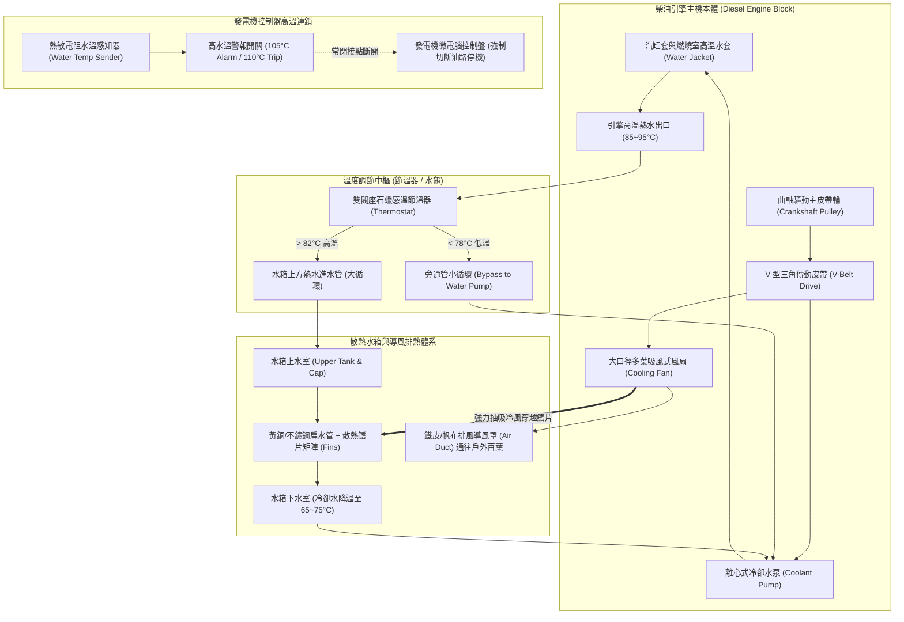
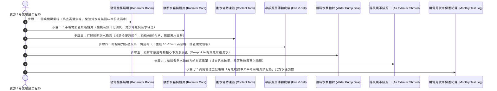

# 全案購屋實戰第六百二十九部：中古大樓社區地下室緊急柴油發電機冷卻水箱散熱鰭片鋁蝕淤塞冷卻風扇皮帶打滑水泵軸封滲漏與過熱高溫抱死體檢工序全書

---

## 序章：社區大停電與火災絕境的備用動力心臟——緊急柴油發電機散熱體系

在現代集合住宅大樓的公共安全與防災電力架構中，「緊急柴油發電機組（Emergency Diesel Generator Set, EDG）」是整棟社區在遭遇台電區域性大停電、地震引發電網崩潰或火災斷電時，**唯一能夠自給自足提供關鍵生命線負載電力**的最後心臟。

依據中華民國**《各類場所消防安全設備設置標準》**、**《建築技術規則》建築設備編第四章電氣設備**及內政部消防署**「緊急發電機組消防安全設備審核認可規範」**之明文強制標準：
1. **緊急啟動與帶載時間紅線**：市電中斷時，大樓自動切換開關（ATS, Automatic Transfer Switch）必須發出啟動訊號，發電機組必須在 **10 秒之內自動點火啟動成功、轉速穩定達額定 1,800 RPM（60 Hz），並在 15 至 30 秒之內全面承接消防泵浦、排煙風機、緊急昇降機（消防電梯）及避難指示照明等一級火警負載**。
2. **冷卻系統連續全負載運轉標準**：發電機在額定連續全載（Continuous Full Load）輸出條件下，其封閉循環散熱水箱（Radiator）必須確保柴油引擎之冷卻水出口水溫嚴格控制在 **$80^\circ\text{C}$ 至 $95^\circ\text{C}$ 之間**；冷卻水溫**絕對嚴禁超過 $105^\circ\text{C}$（高水溫警報閥值）或 $110^\circ\text{C}$（高溫過熱強制跳脫保護點）**。系統必須具備在滿載狀態下連續運轉至少 **2 小時（消防法規）至 8 小時（建築法規備用油箱容量）** 之散熱餘裕能力。
3. **皮帶傳動、軸封與防凍冷卻液化學規範**：水箱冷卻風扇與循環水泵大多仰賴曲軸皮帶輪（Crankshaft Pulley）透過 V 型三角皮帶或多槽皮帶（Serpentine Belt）帶動，皮帶撓度與張力必須嚴格符合規範；冷卻水必須強制添加具備防腐蝕、防氣蝕與抑制水垢功能之**專業長效型乙二醇防凍防銹冷卻液（Concentrated Glycol Coolant，濃度 30%~50%）**，嚴禁常年直接灌注未經處理之自來水或地下水。

然而，在屋齡 20 至 35 年的中古大樓中，緊急柴油發電機長年靜置於陰暗、高溫、通風受限之地下室底層機房，絕大多數社區管委會平日僅做「無載發動空轉 3 分鐘」的敷衍保養，極易掩蓋深層冷卻系統的三大致命隱疾：
- **水箱散熱銅管/鋁製散熱鰭片遭地下室潮濕硫化氫氣體腐蝕、氧化粉化脫落，內部水道被硬水碳酸鈣水垢與鐵鏽水泥完全堵塞（有效散熱面積折損超過 50%）**；
- **冷卻風扇傳動三角皮帶經 10 至 20 年未換，橡膠嚴重硬化龜裂、打滑空轉**，風扇轉速不足，無法在密閉機房內形成足夠的散熱抽風風壓；
- **冷卻水循環泵浦機械陶瓷軸封磨損滲漏、節溫器（Thermostat / 水龜）卡死在小循環位置**，大停電或火災一旦真正爆發，發電機承接數百千瓦高負載運轉不到 15 至 20 分鐘，引擎水溫瞬間飆破 115°C，活塞與汽缸套劇烈熱膨脹「高溫咬死（Piston Seizure / 抱瓦抱軸）」，發電機劇烈拉弧噴煙自爆，全社區瞬間陷入全面黑燈、消防滅火泵癱瘓、受困住戶被鎖死於火海濃煙中的萬劫不復絕境！

本冊《全案購屋實戰第六百二十九部》深入剖析大樓地下室緊急柴油發電機散熱水箱微觀結構、鰭片電化學腐蝕動力學、皮帶打滑水力學與引擎過熱抱死機制，並制定現場看屋與地下機房勘查時的實戰檢驗工序。

---

## 第一章：緊急發電機散熱冷卻系統物理拓撲與三大崩潰失效機制

### 一、封閉式強制水冷循環柴油發電機拓撲
柴油引擎散熱冷卻總成由「缸體水套循環」、「節溫器大小循環切換」、「散熱水箱與排風導風罩」及「監控安全停機連鎖」四大組件構成：

---

### 二、三大致命事故機理深入剖析

#### 1. 散熱鰭片「白化粉化（White Rust）」與水箱管道泥沙碳酸鈣水垢結晶（熱阻飆升）
- **致病機制**：
  - 地下室濕度常年超過 80%，加上發電機排煙管逸散之二氧化硫與汽機車尾氣，在散熱水箱表面形成微酸性凝結水膜。鋁合金散熱鰭片產生嚴重的電化學「粉末狀白化腐蝕（White Rust）」，金屬鰭片變形倒伏、粉碎脫落，空氣流道被腐蝕物死死堵死；
  - 另一方面，多數老社區維護經費缺乏，未按規範添加 50% 防凍防銹冷卻液，而是長期隨意加注自來水補充揮發量。高溫運轉下，自來水中的鈣、鎂離子迅速在扁平散熱銅管內壁析出，形成導熱係數極低的「緻密碳酸鈣（$\text{CaCO}_3$）硬水垢」（水垢導熱係數僅為銅的 1/50）。
- **致命後果**：散熱水箱總傳熱係數（$U$）急劇下降 **60% 以上**！空載測試時因發熱量小看似正常；一旦真遇大停電接上消防泵浦與電梯全載，散熱水箱根本無法將數十萬 BTU 的燃燒熱導出，水箱迅速「大滾翻鍋（Boiling Over）」，蒸汽自水箱洩壓蓋瘋狂噴射，機房在數分鐘內瀰漫滾燙白霧！

#### 2. 風扇傳動 V 型三角皮帶老化打滑與張力鬆弛（風量暴跌）
- **致病機制**：
  - 發電機皮帶長期承受發電機房環境高低溫交變應力與橡膠自然氧化。
  - 橡膠內部簾布層金屬纖維疲勞拉伸，皮帶垂度（Deflection）超標；皮帶兩側的工作摩擦錐面產生硬化、拋光如鏡面般光滑（Glazing），或表面出現無數道深度超過 2 mm 的橫向龜裂縫。
- **致命後果**：當發電機啟動瞬間或高速運轉時，曲軸皮帶輪與水箱風扇皮帶輪之間產生嚴重的「動態打滑（Slippage）」，滑差率高達 **30% 至 50%**，伴隨刺耳之橡膠尖叫摩擦聲！風扇轉速從額定的 1,800 RPM 暴跌至不足 1,000 RPM，穿透散熱水箱的冷卻風量衰減超過 60%，引擎熱量完全被悶在散熱器內，引發快速熱堆積。

#### 3. 水泵碳化矽軸封腐蝕漏水與節溫器卡死小循環（瞬間過熱抱軸）
- **致病機制**：
  - 冷卻水循環水泵的旋轉軸封（Water Pump Mechanical Seal）長期遭受水垢結晶微粒刮傷，動靜環端面磨耗產生溝槽；水泵軸承在冷卻水滲入後生鏽晃動。
  - 同時，安裝於引擎出口的石蠟感溫元件節溫器（Thermostat / 水龜），其閥芯導向桿被鐵泥水垢牢牢卡死在「全關閉（僅小循環）」位置。
- **致命後果**：冷卻水根本無法進入散熱水箱進行散熱，僅在引擎內部自生自滅循環。引擎汽缸套溫度在 5 分鐘內衝破 **$120^\circ\text{C} \sim 150^\circ\text{C}$**！機油迅速黏度歸零、油膜破裂燒焦。鋁合金活塞受極度高溫熱膨脹，活塞裙部與鑄鐵汽缸壁直接發生劇烈金屬摩擦乾磨，瞬間「咬死熔焊（Piston Seizure）」！連桿被強行扭曲扯斷，直接擊穿柴油引擎曲軸箱缸體，發電機宣告徹底報廢，全社區陷入長達數週無備用電力的滅頂癱瘓！

---

## 第二章：四大候選物件之發電機冷卻系統現場實勘對照與談判戰略

本案目前鎖定之四大候選物件，因社區規模與建造年份不同，發電機設備之維護現況具有極大落差：

| 物件編號與社區名稱 | 社區規模與機房位置 | 發電機冷卻與散熱潛在風險焦點 | 現場公設實勘首要工序 | 談判籌碼與修繕折讓指引 |
| :--- | :--- | :--- | :--- | :--- |
| **大安紫金城 13 樓 (`PROP_10`)** | 地下 B2 設有獨立柴油發電機房，地上 13 層超高大樓，發電機容量高達 250~400 kW。 | 28~30 年高層社區，發電機已屆高齡更換期；大安紫金城若發生大停電，頂樓 13 樓住戶完全仰賴緊急電梯上下，發電機散熱水箱是否曾大修通管、排風風管是否鏽爛是重大關鍵。 | 1. 勘查 B2 發電機房散熱水箱正面，手電筒照查鋁鰭片有無白化倒伏。 2. 檢查水箱補水副水箱（Surge Tank）液位與冷卻液顏色（必須為螢光綠色，絕不可為褐色鐵鏽水）。 3. 現場用手按壓風扇三角皮帶測試下垂度（需 ≤10mm）。 | 發電機若水箱淤塞嚴重、水泵漏水且啟動困難，全套水箱拆卸酸洗通管、更換水泵與風扇皮帶費用約需 **6~12 萬元**（若整組發電機更新更達百萬元以上），列為堅定殺價之公設重大瑕疵依據。 |
| **長億南園 8 樓 (`PROP_106`)** | 30 年大社區，戶數龐大，公設機電負荷沉重。 | 大型老舊社區發電機多長年缺乏真正帶載測試（Load Bank Test），水箱散熱鰭片積滿厚厚油垢灰塵；冷卻水泵軸封滴水與皮帶鬆弛打滑情況普遍。 | 1. 檢視發電機基座下方接油盤有無綠色冷卻液滴落水痕。 2. 檢視近三年消防設備申報書中「緊急電源」運轉測試紀錄表。 | 發電機若處於過熱高風險狀態，大樓消防列管無法通過，要求賣方協調管委會限期大保養，並向賣方爭取 **5~8 萬元**之防禦折讓。 |
| **歌德堡 8 樓** | 精裝修戶，管理委員會維護體質良好。 | 需確認地下室發電機房導風排熱風管帆布軟管接頭有無破裂漏風，排熱百葉是否能正常連動推開。 | 檢視水箱前導風罩密閉性與戶外排風百葉開啟狀態。 | 機電維護優良，作為標準對照組，牽制大安紫金城與長億南園。 |
| **靜園 A 區 11 樓** | 均質社區，公共設施管理嚴謹。 | 檢視發電機每月定期試車台帳（水溫、油壓、電壓、頻率紀錄完整）。 | 查核機電公司月保養單簽署完整性，作為優良標準基標。 | 優良基準參考標的。 |

---

## 第三章：看屋現場發電機冷卻散熱系統七步快篩查驗標準工序（SOP）

買方或其驗屋代表在陪同仲介勘查地下室緊急發電機房時，遵循以下 7 步關鍵標準工序進行深度檢驗：

### 具體實施指引與合格紅線：
1. **散熱鰭片透光度與白化粉化檢查（散熱第一關）**：
   - 進入發電機房，走到散熱水箱正面（吸風面）。
   - 拿強光手電筒自水箱後方照射，由前方觀察光線穿透度。
   - **合格標準**：整面散熱片矩陣應排列整齊、透光均勻，金屬表面呈現乾淨金屬光澤。
   - **致命紅線**：若散熱片大面積呈現如白霜般的「粉末狀腐蝕」、鰭片嚴重倒伏倒貼死在銅管上、或下半部糊滿油泥黑垢（透光率不足 50%），代表有效散熱面積早已嚴重喪失！
2. **副水箱防凍防銹冷卻液化學品質檢驗**：
   - 找到發電機旁半透明的聚乙烯塑膠「副水箱（Expansion / Recovery Tank）」。
   - **合格水質**：液位應處於 "COLD FULL" 刻度線；顏色必須為鮮豔透明的**螢光綠色（傳統乙二醇）或鮮粉紅色（長效有機酸 OAT）**，無懸浮雜質。
   - **嚴重劣質警訊**：若副水箱乾涸見底、或者內部呈現混濁不堪的「紅褐色鐵鏽泥漿水」、甚至漂浮一層黑油膜，鐵證該大樓長年只加自來水！引擎水道與散熱器內部已完全被鐵鏽水垢塞滿！
3. **風扇 V 型三角皮帶張力與表面硬化測試**：
   - 在發電機完全停機且切斷啟動電源開關安全狀態下，以大拇指在兩個皮帶輪中心點用力下壓（施加約 $10 \text{ kgf}$ 力道）。
   - **合格標準**：皮帶下垂撓度（Deflection）應介於 **$10 \sim 15 \text{ mm}$** 之間。
   - **重大缺陷**：若輕輕一壓下垂超過 25 mm，代表張力完全鬆弛；反折皮帶內側檢視：若出現縱向裂紋、橫向斷裂齒痕或硬化打滑如塑膠，此皮帶在高速帶載運轉時必將劇烈打滑！
4. **循環水泵洩水孔（Weep Hole）滴漏檢測**：
   - 拿手電筒照射冷卻水泵軸承座下方特設的「微小洩水觀察孔（Weep Hole）」。
   - 水泵機械軸封若正常，洩水孔應保持絕對乾燥。若孔口周圍懸掛一圈乾涸的綠色/藍色化學結晶物、或有連續水滴滴在發電機鋼樑底座上，代表水泵機械軸封已經失效滲漏，冷卻水正在持續流失！
5. **排風導風罩（Radiator Duct Shroud）密閉性**：
   - 散熱水箱吹出的熱風必須透過金屬風管或耐高溫帆布軟管，強制排至大樓外部通風井。
   - 檢視軟管接頭：若帆布軟管老化破爛斷開、或排風口百葉窗被雜物死死擋住，高達 $60^\circ\text{C}$ 以上的排出熱風將直接倒灌回發電機房內部，形成「高溫熱風短循環」，引擎在 10 分鐘內必定過熱跳脫！
6. **年度消防檢修申報書水溫數據審核**：
   - 翻閱管委會「消防安全設備檢修申報書」之「緊急電源設備（柴油發電機組）檢修表」。
   - 審閱**「連續運轉測試」項目之「冷卻水溫」欄位**：正常全載運轉水溫應落在 **$82^\circ\text{C} \sim 95^\circ\text{C}$**。若記載水溫超過 $100^\circ\text{C}$、或有「建議散熱水箱清洗」之備註，代表該機組已亮起隨時罷工之紅燈！

---

## 第四章：地下室緊急發電機冷卻系統全面體檢驗收表

本表供買方於看屋公設踏勘或交屋前逐項檢對打勾：

| 檢驗項目 | 規範標準要求 | 實測現況紀錄 | 合格判定 | 缺陷風險處置與修繕成本 |
| :--- | :--- | :--- | :---: | :--- |
| **1. 水箱散熱鰭片透光** | 散熱鰭片整齊平直無倒伏、無白化粉狀氧化，透光率 ≥ 80%。 | ［　　］% 透光 | □合格 □異常 | 拆卸散熱水箱，實施專業高壓水刀除油垢與化學酸洗除垢（約 1.8~3.5 萬元）。 |
| **2. 冷卻液化學成分** | 乙二醇防凍防銹冷卻液濃度 30~50%，呈透明螢光綠/粉紅。 | ［　　］顏色/狀態 | □合格 □異常 | 全系統排空沖洗鐵鏽泥，重新加注長效型防凍防腐冷卻液（約 6,000~10,000 元）。 |
| **3. 風扇傳動皮帶張力** | 拇指下壓撓度 10~15 mm，表面無橫向龜裂、無打滑硬化。 | ［　　］mm 下垂 | □合格 □異常 | 更換整組原廠耐高溫高抗拉三角皮帶（多條必須成套配對更換）。 |
| **4. 循環水泵軸封密封** | 水泵檢驗洩水孔（Weep Hole）乾爽無水痕滴漏結晶。 | ［　　］狀態 | □合格 □異常 | 拆解水泵，更換全新耐磨機械碳化矽軸封與高速滾珠軸承（約 8,000~15,000 元）。 |
| **5. 導風罩排熱密閉性** | 水箱帆布導風罩密封完整無破損，熱風完全排出戶外無回流。 | ［　　］狀態 | □合格 □異常 | 更換加厚耐溫三防布導風接頭，修復排熱電動百葉窗。 |
| **6. 節溫器（水龜）作動** | 引擎水溫達 82°C 時大循環全開，上下水管溫差在 5~10°C 內。 | ［　　］°C 溫差 | □合格 □異常 | 更換全新原廠雙閥座石蠟感溫節溫器總成（約 3,500~6,000 元）。 |
| **7. 消防有載試車紀錄** | 最近一次帶載測試連續運轉 30 分鐘，出口水溫穩定 ≤ 95°C。 | ［　　］°C 水溫 | □合格 □異常 | 責成管委會委託專業發電機柴油引擎原廠實施年度大保養。 |

---

## 第五章：總結與後續工序推進

地下室緊急柴油發電機冷卻散熱系統，是維繫全大樓在劇烈天災大停電與火災絕境中生存的終極生命線。看屋時花費 10 分鐘進入地下發電機房，實地查驗水箱鰭片、副水箱防凍液成色、皮帶張力與水泵滴水，能輕易刺破管委會「平時都有發動」的表面敷衍謊言，為全家未來居住在垂直高樓上的生命安全築起銅牆鐵壁，並在買賣契約與總價談判中掌握壓倒性的主動權！

下一部實戰手冊將依序開展：**《全案購屋實戰第六百三十部：六百三十部圓滿登峰全景極致全維度全生命週期家庭置產避坑抗震防漏水電機電消防永恆至尊金典總綱全書》**，全面總攬第 626 部至第 629 部之大成，構築至尊置產防護金典！

---
*全案購屋實戰第六百二十九部・全書完・版本控管確認*
