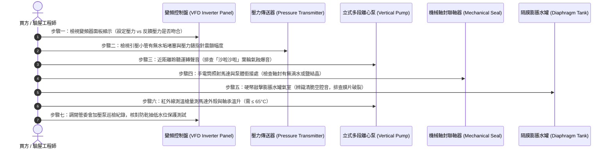

# 全案購屋實戰第六百二十二部：中古大樓社區地下室生活自來水二次加壓變頻泵浦PID控制恆壓傳送器漂移葉輪氣蝕剝落與機械軸封高溫乾磨體檢工序全書

---

## 序章：現代大樓恆壓供水的心臟——二次加壓變頻系統與流體動力學極限

在現代高層集合住宅的給水系統中，除傳統的「地下水箱重力揚水至屋頂水塔」再向下分流外，越來越多中古大樓在管線更新或特殊水壓需求下，於地下室或中間機房設置**「二次加壓變頻恆壓泵浦系統（Variable Frequency Drive Booster Pump System, VFD Booster）」**，甚至針對中高樓層直供戶，直接採用「變頻多段立式離心泵」維持全社區或分區住戶入戶水壓之恆定。

依據中華民國**《建築技術規則》建築設備編第二章給水排水系統**及**電機工程水力自來水管路設備標準規範**：
1. **閉環恆壓控制（Closed-Loop PID Control）精度要求**：變頻二次加壓供水系統必須透過安裝於吐出側總幹管之高精度「壓力傳送器（Pressure Transmitter / Transducer，輸出 4~20 mA 或 0~10 V DC）」，將實測管壓反饋至微電腦變頻器（VFD/Inverter）之比例-積分-微分（PID）演算法模組。系統在面對 1 戶至數十戶同時用水之劇烈流量變動時，出口工作水壓波動範圍**必須強制穩定於設定值（如 $2.5 \text{ kgf/cm}^2$）之 $\pm 0.2 \text{ kgf/cm}^2$ 以內**，杜絕忽大忽小與驟冷驟熱。
2. **葉輪氣蝕（Cavitation）防禦與淨正吸入水頭（NPSH）**：加壓泵浦之安裝位置與吸入管路阻力，必須確保「有效淨正吸入水頭（$NPSHa$）」大於泵浦製造廠規範之「必需淨正吸入水頭（$NPSHr$）」加上至少 **0.5 至 1.0 公尺**之安全餘裕（$NPSHa > NPSHr + 1.0\text{m}$），以杜絕液體在低壓區汽化產生微氣泡、並在進入葉輪高壓區時爆裂產生高達上萬個大氣壓之微射流（Micro-jet），造成金屬葉輪蜂窩狀氣蝕穿孔。
3. **機械軸封（Mechanical Seal）潤滑與無水防乾抽（Dry-Run Protection）**：加壓泵浦主軸旋轉密封全面採用耐磨碳化矽（SiC）、硬質合金（Tungsten Carbide）或碳精環之「機械軸封」。系統必須配備靈敏之「進水端低水位電極或低水壓壓力開關」，在地下受水箱缺水或吸入管斷流時，控制系統必須在 **1 秒內強制切斷變頻馬達**，防止密封面因缺乏水膜潤滑而瞬間飆升至 200°C 以上產生高溫乾磨炸裂。

然而，在屋齡 20 至 35 年的中古社區中，二次加壓變頻泵浦長年處於 24 小時連續運轉高壓狀態，管委會往往只在「完全沒水」時才找水電搶修，極易衍化為三大高危盲區：
- **壓力傳送器壓電陶瓷晶片漂移或引壓管水垢卡死**，傳送器反饋錯誤假信號，導致變頻器誤判而以 60 Hz 全速超頻狂轉，引發低樓層住戶爆管或變頻器過載燒燬；
- **吸入側管徑縮小、底閥濾網被鐵鏽泥沙淤塞**，使 $NPSHa$ 暴跌觸發嚴重「氣蝕剝落」，葉輪邊緣被啃蝕成海綿狀，出水水壓急降並伴隨如同敲擊碎石的劇烈沙沙爆音；
- **進水端無水保護失效或冷卻循環不良**，使機械軸封碳精環高溫熱裂、動靜環端面咬死，高壓自來水自馬達聯軸器縫隙呈傘狀高速噴射，水淹地下室機房與發電機配電盤！

本冊《全案購屋實戰第六百二十二部》深入剖析大樓二次加壓變頻系統內部 PID 回路反饋、流體氣蝕動力學、機械軸封高溫乾磨機制，並制定現場看屋與地下機房勘查時的實戰七步快篩標準工序。

---

## 第一章：二次加壓變頻系統核心物理架構與三大崩潰失效機制

### 一、變頻恆壓二次加壓系統物理拓撲
二次加壓系統由「地下蓄水池」、「吸入側隔離防負壓管段」、「立式多段不鏽鋼離心泵組」、「PID 壓力閉環反饋」及「氣壓式緩衝膨脹水罐」構成：

```mermaid
flowchart TD
    subgraph WaterSource ["地下室生活自來水受水箱"]
        SuctionTank["生活自來水受水箱 (低水位保護棒)"] --> LowLevelSwitch["防乾抽無水保護開關 (Dry-Run Protection)"]
        LowLevelSwitch --> InletStrainer["進水端 Y 型大流量過濾器"]
    end

    subgraph PumpSystem ["二次加壓泵浦機組 (立式多段離心泵)"]
        InletStrainer --> PumpA["立式多段泵 A (SUS304/SUS316 葉輪)"]
        InletStrainer --> PumpB["立式多段泵 B (備援泵)"]
        PumpA --> MechSealA["碳化矽雙端面機械軸封 (Mechanical Seal)"]
        PumpB --> MechSealB["碳化矽雙端面機械軸封"]
        PumpA --> CheckA["靜音緩閉止回閥 A"]
        PumpB --> CheckB["靜音緩閉止回閥 B"]
    end

    subgraph FeedbackControl ["變頻恆壓智能控制盤"]
        VFD["變頻器模組 (VFD Inverter 0~60Hz)"] --> PID["內建 PID 微電腦反饋模組"]
        Transmitter["4~20mA 壓電陶瓷壓力傳送器"] -.->|即時水壓信號| PID
        PID -.->|調頻驅動指令 (赫茲調節)| VFD
        VFD ==>|三相變壓變頻電源| PumpA
        VFD ==>|三相變壓變頻電源| PumpB
    end

    subgraph DischargeHeader ["吐出側總幹管與緩衝系統"]
        CheckA --> DischargePipe["吐出側不鏽鋼總幹管 (Discharge Header)"]
        CheckB --> DischargePipe
        DischargePipe --> Transmitter
        DischargePipe --> DiaphragmTank["隔膜式預充氮氣膨脹水罐 (Pressure Tank)"]
        DischargePipe --> SupplyRiser["住戶入戶生活自來水加壓垂直立管"]
    end
```

---

### 二、三大致命事故機理深度剖析

#### 1. 壓力傳送器（Transmitter）零點漂移與引壓孔水垢淤塞（超頻暴壓爆管）
- **致病機制**：壓力傳送器核心為微米級壓電陶瓷或矽壓電阻擴散晶片。長期受水質中鐵鏽微粒撞擊，加上連接主幹管之細小引壓紫銅管（$\phi 6 \sim 8 \text{ mm}$）內部被碳酸鈣硬水垢堵塞，管內水壓無法真實傳遞給感應晶片。晶片輸出信號出現嚴重「負向漂移（Zero Drift）」（例如實際管壓已達 $4.5 \text{ kgf/cm}^2$，傳送器反饋電流卻顯示僅 $1.2 \text{ kgf/cm}^2$）。
- **致命後果**：變頻器 PID 控制器誤以為管網極度缺水，立即將輸出頻率強制拉升至上限 **$60 \text{ Hz}$ 極限運轉**，加壓泵全馬力狂壓！吐出側壓力瞬间飆升至 **$6.0 \sim 9.0 \text{ kgf/cm}^2$**，超壓衝破各樓層水管接頭與住戶熱水器內膽，引發全社區連鎖爆管淹水！

#### 2. 吸入水頭不足觸發劇烈「流體氣蝕（Cavitation）」與葉輪金屬剝落
- **致病機制**：
  - 吸入管路過長、彎頭過多，或進水 Y 型過濾器被鐵鏽砂石嚴重淤塞，造成吸入端水頭損失（$h_f$）劇增。
  - 當吸入側絕對壓力低於該水溫對應之飽和蒸汽壓（$P_{sat}$）時，水瞬間在常溫下沸騰汽化，形成數以億計的微小蒸汽氣泡。
  - 氣泡隨流體進入葉輪高壓區時，在高壓擠壓下於數微秒內極速內爆（Implosion），產生局部高達 **$10,000 \text{ kgf/cm}^2$** 的微射流金屬衝擊波！
- **致命後果**：葉輪不鏽鋼金屬表面產生嚴重的金屬疲勞剝落，原本平整光滑的葉輪邊緣被啃蝕成海綿狀孔洞。泵浦揚程急劇暴跌 30%~50%，出水量微弱，且機房內持續發出如同高速翻炒砂石的「沙啦沙啦」刺耳摩擦噪音，幾個月內葉輪即徹底崩裂解體。

#### 3. 機械軸封高溫乾磨（Dry Running）與碳精動環熱裂噴水
- **致病機制**：立式多段泵機械軸封仰賴被輸送的水流在旋轉動環（Rotary Face）與固定靜環（Stationary Face）之間形成一層僅數微米厚的極薄水膜（Fluid Film）進行冷卻與潤滑。當地下受水箱進水不及導致吸空、或排氣閥未開造成泵腔積氣時，水膜瞬間蒸發中斷。
- **致命後果**：在每分鐘 2,900 至 3,500 轉的高速旋轉摩擦下，軸封面溫度在 30 秒內突破 **$200^\circ\text{C}$**！石墨動環瞬間龜裂熱裂紋（Thermal Cracking），碳化矽靜環斷裂破碎，輔助氟橡膠 O 型密封圈高溫碳化融化。水流隨即自聯軸器防護罩下方高速呈扇形向外狂噴，噴淋周圍高壓電箱引發短路走火！

---

## 第二章：四大候選物件之二次加壓供水實勘對照與談判戰略

針對目前本案鎖定之四大候選物件，因社區建築年代、供水架構及是否有二次加壓設備，必須採取精準對位之查驗策略：

| 物件編號與社區名稱 | 供水架構與樓層特性 | 二次加壓變頻泵系統潛在風險焦點 | 現場實勘首要工序 | 談判籌碼與修繕折讓指引 |
| :--- | :--- | :--- | :--- | :--- |
| **大安紫金城 13 樓 (`PROP_10`)** | 總樓層 13 樓頂樓戶，原為頂樓水塔重力供水，需確認室內是否曾因水壓不足加裝獨立變頻加壓泵。 | 13 樓若室內或管道間私裝小型加壓馬達，馬達振動易透過樓板傳導引發共振低頻噪音；若大樓地下室採全棟變頻直供，需排查壓力傳送器有無漂移導致頂樓水壓忽高忽低。 | 1. 檢視 13 樓水錶箱與管道間有無小型加壓馬達運轉痕跡。<br>2. 現場測試熱水器與花灑同時開啟時的水壓恆定度。<br>3. 勘查地下室加壓泵變頻器頻率顯示是否在 30~50Hz 區間平順調節。 | 若加壓泵軸封滴水且變頻器面板顯示過載警告，整組變頻泵浦更換約需提撥 **8~15 萬元**，以此作為砍價談判籌碼。 |
| **長億南園 8 樓 (`PROP_106`)** | 30 年老舊大社區，8 樓為典型中高樓層。 | 社區地下室二次加壓系統若年久失修，加壓泵葉輪極易氣蝕磨損，出水壓力不足導致熱水器點火不穩；需確認泵浦防乾抽保護開關是否正常動作。 | 1. 檢視地下室加壓泵浦基座有無鐵鏽水痕與油垢積聚。<br>2. 聆聽泵浦運轉時有無「炒砂石」之氣蝕雜音。 | 加壓泵葉輪氣蝕與軸封老化者，列為公設重大機電折舊，向賣方爭取 **5~10 萬元**之防禦折讓。 |
| **歌德堡 8 樓** | 精裝修三房，全室高級龍頭與花灑。 | 需確認入戶水壓是否維持在 2.0~2.5 kgf/cm² 恆定無水錘，避免加壓泵變頻反饋失常震壞高級衛浴陶瓷閥芯。 | 於廚房裝設便攜壓力錶，觀察開水瞬間壓力指針震盪幅度是否在 ±0.2 kgf/cm² 內。 | 機電維護優良，作為標準對照組，牽制大安紫金城與長億南園。 |
| **靜園 A 區 11 樓** | 11 樓次頂層，水質清澈，管理良善。 | 檢視公共管道間之加壓系統壓力錶讀數與隔膜膨脹水罐預充氣壓。 | 輕敲隔膜膨脹罐確認氣室無積水，作為優質基準坐標。 | 優良基準參考標的。 |

---

## 第三章：看屋現場與地下室加壓泵浦七步快篩查驗工序（SOP）

買方或其驗屋代表在陪同仲介勘查地下室泵浦機房時，遵循以下 7 步標準工序進行深度檢驗：



### 具體實施指引與合格紅線：
1. **變頻器面板反饋水壓比對（恆壓控制核心指標）**：
   - 打開地下室加壓控制盤，觀察變頻器（如台達、安川、富士）螢幕顯示。
   - **核心判據**：螢幕上的**「目標壓力設定值（SV）」**與**「傳送器反饋值（PV）」**必須完全一致或在 $\pm 0.1 \text{ kgf/cm}^2$ 內；變頻器輸出頻率應隨住戶開水與否在 **25 Hz 至 55 Hz 之間平滑調頻**。
   - **重大警訊**：若螢幕頻率長期死鎖在 $60.0 \text{ Hz}$ 上限不動，且幹管壓力錶指針嚴重超標，代表系統 PID 回路已失控漂移！
2. **葉輪氣蝕聲音辨識（Acoustic Cavitation Check）**：
   - 戴上聽診棒或拿長柄螺絲起子，一端頂住泵浦葉輪泵殼（Pump Casing），另一端貼近耳廓。
   - 正常運轉應為平穩連續的流體流動聲；若傳出清脆斷續的「劈啪、劈啪」爆裂聲或如同「絞碎石子」的粗糙雜音，即為典型的**「嚴重流體氣蝕現象」**，葉輪內部已面臨穿孔剝落。
3. **機械軸封滴漏與甩水痕跡（Seal Leakage Check）**：
   - 拿強光手電筒透過馬達與泵浦連接架（Bracket）的金屬防護網，仔細照射旋轉主軸周圍。
   - **合格標準**：機械軸封運轉時應維持表面乾燥，允許微量蒸發（每分鐘滴水不得超過 3 至 5 滴）。
   - **嚴重缺陷**：若軸封下方出現連續滴水、或防護罩內壁甩出白色碳酸鈣結晶環、鐵鏽水漬，代表機械軸封碳精環已嚴重磨損開裂，隨時將引發大噴水！
4. **隔膜式膨脹水罐（Diaphragm Expansion Tank）狀態**：
   - 膨脹水罐負責在微小流量用水時維持管壓，防止變頻泵頻繁起停。
   - 以硬幣輕敲水罐上半部金屬外殼，若發出沉悶的「咚咚」實心聲，代表內部橡膠隔膜早已破裂，水罐已被死水灌滿，失去蓄能緩衝彈性。
5. **馬達軸承溫升量測（Thermal Inspection）**：
   - 以紅外線熱像儀或測溫槍測量馬達前後軸承蓋溫度，運轉溫度必須低於 **$70^\circ\text{C}$**，若超過 $85^\circ\text{C}$ 代表潤滑黃油乾涸或軸承滾珠磨耗，隨時有抱死燒燬危險。
6. **防乾抽保護開關查驗（Dry-Run Protection）**：
   - 檢視受水箱進水側之低水位浮球電纜或壓力開關，確認控制箱面板之「無水警報（Water Low Fault）」警報指示燈具備連鎖停機功能。

---

## 第四章：地下室二次加壓變頻泵浦系統體檢驗收表

本表供買方看屋公設踏勘或交屋前檢對打勾：

| 檢驗項目 | 規範標準要求 | 實測數值 / 現況現象 | 合格判定 | 缺陷風險處置與改善費用 |
| :--- | :--- | :--- | :---: | :--- |
| **1. 恆壓反饋偏差** | 反饋壓力（PV）與設定壓力（SV）偏差 ≤ ±0.2 kgf/cm²。 | ［　　］kgf/cm² | □合格 □異常 | 重新校準壓力傳送器零點，疏通引壓紫銅管水垢。 |
| **2. 變頻平滑調頻** | 頻率在 25~55 Hz 之間平順隨用水量調節，無跳頻失控。 | ［　　］Hz 範圍 | □合格 □異常 | 調校變頻器 PID 增益參數（P/I/D 積分時間與比例增益）。 |
| **3. 葉輪氣蝕異音** | 泵體無「炒石子」爆裂異音，運行震動速度 ≤ 2.8 mm/s。 | ［　　］現象 | □合格 □異常 | 清洗吸入端 Y 型過濾網，排查進水管阻力並更換葉輪。 |
| **4. 機械軸封密封度** | 軸封處乾燥無連續滴水，無甩水結晶痕跡（滴水 ≤ 3滴/分）。 | ［　　］滴/分 | □合格 □異常 | 更換全新碳化矽（SiC）耐磨耐高溫雙端面機械軸封。 |
| **5. 膨脹水罐氣室完整** | 硬幣敲擊發出清脆空腔音，預充氮氣壓力達 1.5~2.0 kgf/cm²。 | ［　　］音色 | □合格 □異常 | 更換義大利原裝耐高壓隔膜式壓力蓄能罐（約 6,000~12,000 元）。 |
| **6. 馬達表面運轉溫升** | 連續運轉 15 分鐘，馬達機殼散熱鰭片溫度 ≤ 65°C。 | ［　　］°C | □合格 □異常 | 清除風扇外罩油垢棉絮，更換深溝低噪音滾珠軸承。 |
| **7. 防乾抽低水連鎖** | 受水箱低水位時立即強制停泵並鎖定警報，杜絕空轉。 | ［　　］狀態 | □合格 □異常 | 修復進水端低水位電極棒或浮球微動開關。 |

---

## 第五章：總結與後續工序推進

二次加壓變頻系統是維護全社區生活自來水出水穩定、保護室內衛浴軟管免遭超壓爆管的科技屏障。在看屋時深入機房辨識傳送器指針、細聽葉輪有無氣蝕破裂音、觀察軸封滴水痕跡，能精準洞悉大樓機電真實健康度，將隱形風險轉化為數十萬元的議價折讓！

下一部實戰手冊將依序開展：**《全案購屋實戰第六百二十三部：中古大樓社區地下室生活自來水受水箱蓄水池池體裂縫滲水進水浮球閥卡阻無效溢流管防蟲網破裂與水質二次污染體檢工序全書》**，持續深入生活供水水源蓄水池健康體檢！

---
*全案購屋實戰第六百二十二部・全書完・版本控管確認*
