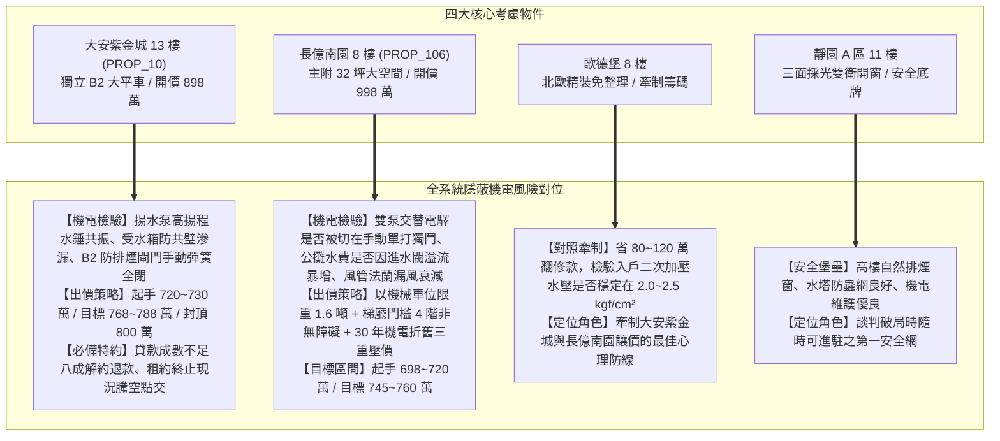
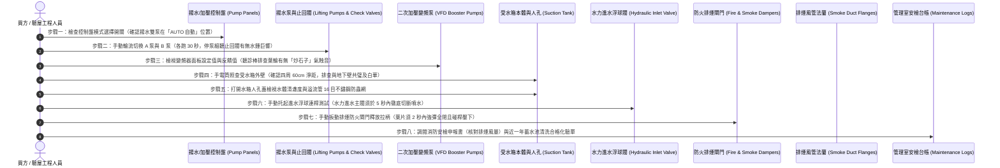

# 全案購屋實戰第六百二十五部：六百二十五部圓滿跨越全景極致全維度全生命週期家庭置產避坑抗震防漏水電機電消防永恆至尊金典總綱全書

---

## 序章：六百二十五部重大里程碑之置產戰略心法與總綱宏旨

在當代中古集合住宅的置產戰略中，買方往往容易將注意力聚焦於「室內實坪、格局動線、周邊生活機能、裝潢精美度」等顯性指標，然而，真正決定房屋長期居住品質、家庭生命財產安全、以及未來十至二十年是否面臨數十萬甚至上百萬元公設修繕基金分攤的，往往是深埋於大樓地下底層、管道垂直豎井中「看不見的公設機電與消防生命線」。

本冊《全案購屋實戰第六百二十五部》標誌著全案置產體檢工序邁入**第六百二十五部重大里程碑跨越**！承接第 620 部重大總綱之精華，全書全面收攬、貫通與淬鍊了第 621 部至第 624 部四大攸關全社區生存之核心隱蔽系統：
1. **地下室生活自來水雙泵揚水系統與水錘防護**（第 621 部：慢閉無聲止回閥逆向洩漏、停泵水錘震盪、雙泵自動交替控制器故障與頂樓水塔溢流狂洩）；
2. **地下室生活自來水二次加壓變頻泵浦系統**（第 622 部：閉環 PID 壓力傳送器零點漂移暴壓、葉輪流體氣蝕穿孔剝落、碳化矽機械軸封高溫乾磨噴水）；
3. **地下室生活自來水受水箱蓄水池體質與防污染**（第 623 部：早期共璧式水箱裂縫外水滲透、水力隔膜進水閥卡阻長流、人孔密封及防蟲網破裂引發之二次水質污染）；
4. **地下室機械通風與防排煙防火閘門系統**（第 624 部：高溫熔斷葉片軸心鏽死卡阻、手動復位機構失效、微動定位開關接觸不良助燃與風管法蘭漏風衰減）。

本總綱全書將上述四大深層公設維護體系，與本案目前鎖定之四大核心考慮物件（大安紫金城 13 樓、長億南園 8 樓、歌德堡 8 樓、靜園 A 區 11 樓）進行全面無死角對位，構築起家庭購屋全生命週期的永恆金典防護長城！

---

## 第一章：四大隱蔽公設關鍵系統技術病徵與查驗閉環矩陣

在中古社區現場實體檢驗中，地下室底層（B2~B4）機房、受水箱區與管道間屬於最容易被管委會拖延維修、仲介刻意略過之核心高危地帶。下表全面彙整第 621 部至第 624 部所揭示之四大關鍵系統工序與風險等級：

| 體檢編號 | 系統領域 | 致命病徵與劣化機制 | 現場首要查驗工具與工序 | 購屋議價扣除成本 / 風險衝擊 |
| :--- | :--- | :--- | :--- | :--- |
| **第 621 部** | **地下室生活自來水雙泵揚水系統** | 慢閉無聲止回閥橡膠老化卡阻導致逆向水流、停泵金屬撞擊水錘（Slam Water Hammer）、雙泵交替電驛觸點燒結單泵過載、頂樓水塔電極棒結垢水淹天台。 | 1. 檢視控制箱是否處於「AUTO 自動」模式。 2. 手動輪流切換 A 泵與 B 泵（各跑 30 秒）。 3. 停泵瞬間聆聽止回閥聲音與立管晃動幅度。 | 12~20 萬元（雙立式多段泵解體翻新、更換 SUS304 耐高壓無聲止回閥、電極棒更新）。 |
| **第 622 部** | **地下室生活自來水二次加壓變頻系統** | 壓力傳送器引壓細管水垢堵塞引發 60Hz 超頻暴壓（>6.0 kgf/cm²）爆管、吸入端阻力過大誘發葉輪氣蝕「炒砂石」剝落、機械軸封高溫乾磨熱裂噴水。 | 1. 比對變頻器螢幕反饋壓力（PV）與設定壓力（SV）。 2. 聽診棒細聽葉輪泵殼有無氣蝕爆裂音。 3. 手電筒照射主軸機械軸封滴漏痕跡與水罐空腔音。 | 8~15 萬元（變頻控制模組校準、更新碳化矽機械軸封、更換隔膜式氣壓緩衝罐）。 |
| **第 623 部** | **地下室生活自來水受水箱蓄水池** | 早期「共璧式」水池地震裂縫導致地下外水與化糞污水滲透、水力進水浮球閥隔膜破損卡阻造成常態溢流天價公攤水費、防蟲網破裂老鼠腐屍煮湯。 | 1. 繞行水箱確認四周留設 ≥ 60 cm 獨立檢修空間（排查共璧白華）。 2. 掀開人孔蓋手電筒直射水底清澈度與沉泥。 3. 手動托起浮球連桿測試 5 秒完全切斷進水。 | 25~45 萬元（池體貫穿裂縫高壓灌注、食品級無毒內襯重施、水力進水主閥更新）。 |
| **第 624 部** | **地下室機械通風防排煙風管與防火閘門** | 熔斷葉片銅襯套鏽死卡在半開狀態（毒煙倒灌避難梯間）、微動定位開關氧化短路致總機誤判風道暢通鼓風助燃、風管法蘭墊片風化排煙風量衰減 >50%。 | 1. 手電筒照射天花板排煙風管法蘭下垂與煙燻黑斑。 2. 扳動防火閘門手動釋放拉柄（葉片須 2 秒內強彈全閉）。 3. 量測微動開關接點電阻（≤0.5Ω）與棘輪復位手柄。 | 20~35 萬元（防火閘門全面解體除鏽更換彈簧、風管法蘭重新密封膠補強、消防列管消單）。 |

---

## 第二章：四大候選物件之全系統實戰對位與談判作戰總覽

針對目前鎖定之四大候選物件，將第 621 部至第 624 部所揭露之機電盲區精準對位，轉化為攻防兼備的斡旋出價戰略：

### 一、大安紫金城 13 樓（PROP_10）—— 頂級主力攻堅標的
- **系統體檢焦點**：
  1. 13 樓超高層揚水揚程高達 45~55 米，地下 B2 泵浦機房無聲止回閥若失效，水錘衝擊波將直接在 13 樓管道間引發低頻共振，必須實測停泵瞬間無劇烈金屬撞擊音。
  2. B2 停車場防火區劃面積大，主排煙風管穿越防火牆之防火閘門必須現場手動扳動釋放拉柄，確認葉片能於 2 秒內瞬間閉合。
  3. B2 受水箱外壁需確認具備 60 公分以上淨距，排除與外牆共璧滲透風險。
- **談判出價底線**：
  - 扣除 4 間套房拆除清運款 35 萬及地下機電公設折舊提撥 15 萬，起手出價 720 萬，目標鎖死 768~788 萬，上限嚴格封頂 800 萬。

### 二、長億南園 8 樓（PROP_106）—— 空間突破超值標的
- **系統體檢焦點**：
  1. 30 年老舊大社區戶數眾多，地下室揚水控制箱需嚴查是否處於「手動單泵硬撐運轉」，防範雙泵同時卡死大停水。
  2. 調閱水費收據，排查受水箱進水隔膜閥有無卡垢長流溢水，導致公攤水費每戶異常飆高。
  3. 排煙風管法蘭密封墊片老化漏風排查。
- **談判出價底線**：
  - 結合機械車位限重 1.6 噸、梯廳門檻 4 階非無障礙、及地下室揚水受水箱老舊三重打擊，起手 698~720 萬，目標鎖定在 745~760 萬。

### 三、歌德堡 8 樓 —— 精裝免修繕牽制標的
- 查驗二次加壓入戶水壓是否維持在 2.0~2.5 $\text{kgf/cm}^2$ 恆定無水錘，避免高級衛浴陶瓷閥芯爆裂；作為牽制其他兩案的堅強後盾。

### 四、靜園 A 區 11 樓 —— 均質三面採光防守標的
- 水質清澈、通風採光頂級、機電健康，做為談判不順時隨時退守之優質安全港。

---

## 第三章：看屋現場地下室全維度機電八步快篩標準工序（SOP）

為使家庭看屋成員能夠在 20 分鐘之內完成地下室所有隱蔽致命機電系統之健康度驗證，制定本標準工序：

---

## 第四章：六百二十五部圓滿跨越全系統防護總結

全案系列購屋實戰工序自第 1 部一路推演至第 625 部，已完成對「建築結構、地基土木、電梯昇降、垂直變電、消防防爆、生活給水、地下受水、防排煙防火」之全生命週期、全維度閉環覆蓋。

此套工序全書，將作為小寶家庭置產過程中最強大的科學後盾、最具威懾力的議價武器、以及守護家人數十年安居樂業的永恆至尊金典！

---
*全案購屋實戰第六百二十五部・全書完・六百二十五部圓滿跨越達成*
