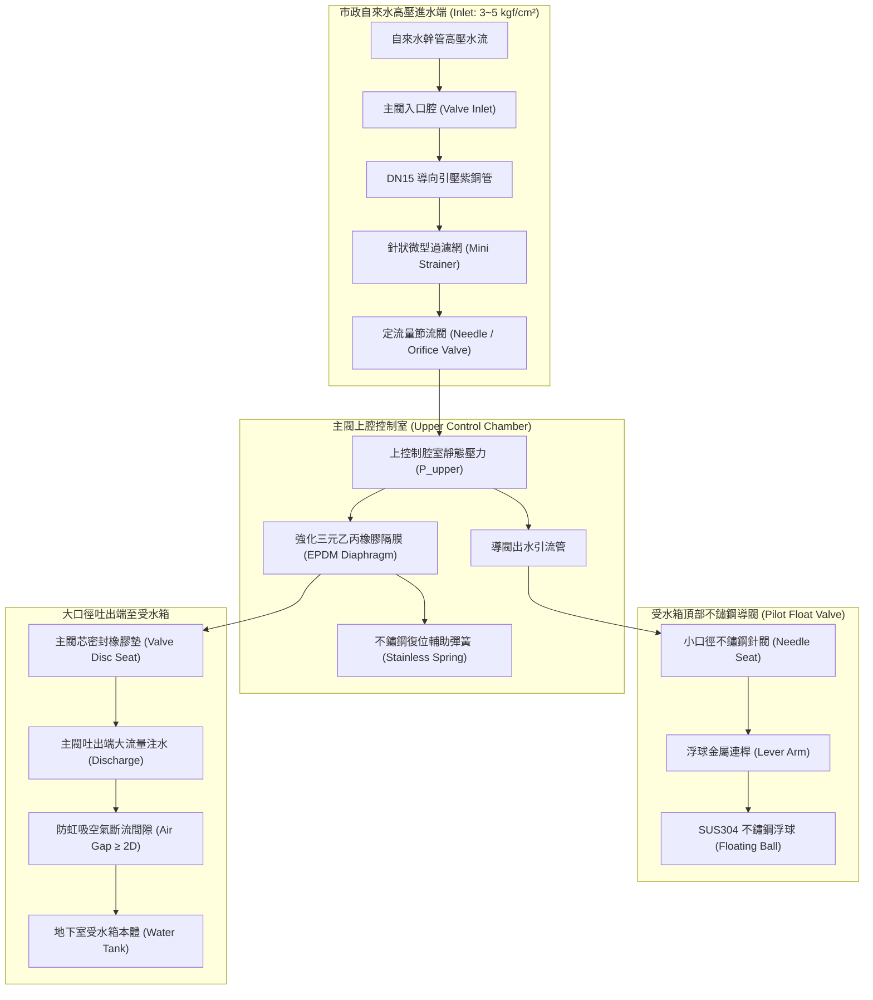
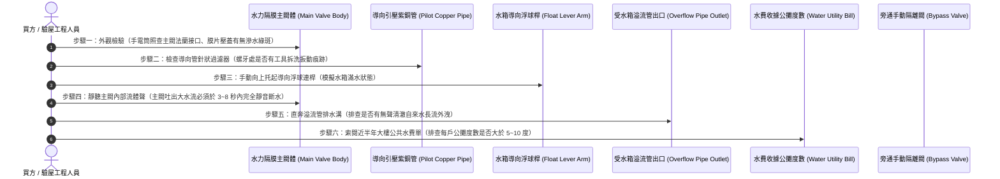

# 全案購屋實戰第六百二十八部：中古大樓社區地下室生活自來水受水箱進水水力浮球閥主閥隔膜微裂紋導閥濾網水垢淤塞洩壓孔堵塞與自來水狂流溢流淹水體檢工序全書

---

## 序章：社區生命之泉的總閘門——大口徑水力隔膜進水閥的極限水力學

在現代集合住宅大樓的生活自來水給水架構中，自來水事業單位（如台灣自來水公司）之自來水市政配水幹管經由道路總水錶引入地下室後，首先必須注入「地下生活自來水受水箱（Underground Domestic Receiving Tank）」。

由於全棟住戶每日用水量高達數十噸至數百噸，傳統小型機械槓桿式浮球閥（Brass Ball Float Valve）因通徑小（$\le 2$ 吋）、水流阻力大、關閉扭矩不足，在高達 $3.0 \sim 5.0 \text{ kgf/cm}^2$ 之自來水市政水壓衝擊下，極易產生閥口劇烈震顫、密封橡膠撕裂及關不緊等問題。因此，現代中大型中古大樓（總戶數 50 戶以上）全面強制採用**「水力隔膜式進水浮球控制閥（Hydraulic Diaphragm Float Control Valve，俗稱隔膜式水力進水主閥）」**。

依據中華民國**《建築技術規則》建築設備編第二章給水排水系統**、**台灣自來水公司用戶用水設備內線工程技術規範**及 CNS 相關閥門標準規範：
1. **水力自主驅動與全流量截斷原則**：水力隔膜閥本體無任何外部馬達或電力驅動，完全依靠流體自身之靜水壓差運作。主閥內部以上腔控制室（Upper Control Chamber）之強化橡膠隔膜（Reinforced EPDM Diaphragm）上下移動來控制閥芯之啟閉；水箱內僅需安裝一組直徑僅 1/2 吋或 3/4 吋之小型「不鏽鋼導向浮球閥（Pilot Valve）」。當水位達到設定之停水水位時，導閥閉合，控制室內部迅速建立高壓，迫使大口徑主閥在 **3 至 8 秒內平順無水錘完全截斷（Bubble-tight Shutoff）**。
2. **防逆流與雙重空氣斷流間隙（Air Gap）**：水力進水主閥吐出管端至受水箱最高溢流水位（Maximum Overflow Level）之間，必須強制保留至少 **2 倍管徑（且不得小於 50 mm）之實體空氣斷流間隙**，杜絕因自來水幹管負壓抽吸引發之虹吸倒流（Back-siphonage）污染市政管網。
3. **導向管路微細濾網防護**：連接主閥入口至導向控制室之紫銅管或不鏽鋼引水導管上，必須配備可拆洗之**「針狀微型過濾器（Strainer / Needle Valve Filter）」**，濾網孔徑不得大於 60 目（Mesh），以防止水中碳酸鈣水垢、鐵鏽砂粒侵入控制室。

然而，在屋齡 20 至 35 年的中古大樓中，地下受水箱長年處於高濕陰暗環境，自來水停滯水質中析出的大量礦物質，極易使水力隔膜主閥演化為三大致命盲區：
- **主閥強化橡膠隔膜反覆彎折疲勞產生微細針孔裂紋（Pinhole Fissures）**，控制室無法累積足夠高壓，主閥在水箱已滿時「完全喪失截水能力」，進水管狂噴不止；
- **微型導閥進水濾網被鐵泥水垢死死淤塞、或內部精密洩壓節流孔（Orifice Plug）遭砂粒卡死**，導閥雖浮起關閉，水壓卻無法進入上腔室，閥門持續常開大流；
- **數十噸甚至上百噸自來水自水箱溢流管狂瀉入地下室集水坑**，若地下室沉水排水泵故障或暴雨倒灌，大水便自地下室漫過發電機房、變電室及電梯機坑，引發數百萬元之毀滅性公設泡水慘劇，且伴隨每月數萬至十數萬元之天價暴增公攤水費！

本冊《全案購屋實戰第六百二十八部》深入剖析水力隔膜進水閥水力控制拓撲、隔膜疲勞破壞力學、導閥洩壓微孔堵塞機制，並制定現場看屋與地下公設實勘之實戰檢驗工序。

---

## 第一章：水力隔膜進水閥核心水力拓撲與三大崩潰失效機制

### 一、水力隔膜進水控制閥內部拓撲與水力動態平衡
水力隔膜閥由「鑄鐵/球墨鑄鐵主閥體」、「強化橡膠隔膜總成」、「彈簧復位室」、「導壓過濾銅管組」及「水箱導向小浮球閥」五大部分構成：

---

### 二、三大致命事故機理深入剖析

#### 1. 橡膠隔膜（Diaphragm）微裂紋貫穿洩壓（主閥無法關閉狂流溢水）
- **致病機制**：
  - 水力主閥之截水力學依據「面積差壓原理」：隔膜上表面受壓面積大於下表面閥芯開口面積（約 $1.3 \sim 1.5$ 倍）。當上控制腔充滿高壓水時，向下的推力大於向上推力，主閥緊密關閉。
  - 強化三元乙丙橡膠（EPDM）或夾織尼龍隔膜在中古大樓中常年承受數萬次「開-閉」拉伸形變，加上地下室水溫在夏季高溫潮濕、水中殘餘餘氯加速橡膠分子鏈氧化斷裂。
  - 隔膜周圍邊緣或中心壓板處產生肉眼難以察覺的「微米級針孔裂紋（Pinhole Fissures）」。
- **致命後果**：當水箱水滿、導閥閉合後，原本應在上腔室積蓄高壓的水流，經由隔膜微裂紋直接洩漏滲透至下腔吐出端，上腔室永遠無法建立足夠關閉壓力！主閥芯始終被進水水壓頂起在「半開或全開」位置。**自來水 24 小時以每小時數十噸之驚人流量狂注入水箱**，水箱水位漫過溢流管，巨量自來水如暴雨般排入排水溝，全體住戶每期被迫平攤數萬元之冤枉水費！

#### 2. 微型導閥過濾器鐵鏽淤塞與洩壓微孔堵塞（「假性關閉與拒動開閉」）
- **致病機制**：
  - 進水管路中的自來水常年挾帶老舊市政鐵管剝落之紅褐色三氧化二鐵（$\text{Fe}_2\text{O}_3$）顆粒與碳酸鈣結晶水垢。
  - 安裝在引壓銅管前段的微型過濾網（Mini Strainer）長達 10 年未拆洗，濾網孔隙被鐵泥硬垢完全塞死；或者節流閥內徑僅 $1.0 \sim 1.5\text{ mm}$ 的精密金屬洩壓小孔被一粒微小砂石死死卡住。
- **致命後果**：
  - 若進水孔堵死：高壓水無法進入上腔室，即使浮球已經浮到天花板，主閥依然**「永遠無法關閉」**，造成狂流溢流；
  - 若洩壓孔堵死：當水箱缺水、浮球下沉時，上腔室積存的高壓水無法經由導閥排洩出去，主閥**「拒動無法打開補水」**，全社區在地下水箱明明有水的情形下，卻因進水閥打不開而無預警發生全棟大停水！

#### 3. 導閥連桿樞軸水垢卡死與浮球配重漏水（「永不浮起假缺水」）
- **致病機制**：
  - 水箱內部濕氣高達 95% 以上，且空氣中常伴隨化糞池逸散之微量硫化氫。不鏽鋼導閥連桿的旋轉銷軸（Pivot Pin）表面產生嚴重的化學腐蝕結晶與硬水垢膠結，轉動摩擦阻力劇增；
  - 此外，沖壓焊接的不鏽鋼浮球球體若存在微細沙孔焊縫，長期浸泡在高壓水中，水汽緩慢滲透進入浮球內部（「浮球喝水」），浮球自身重量增加數倍。
- **致命後果**：當水箱水位上升漫過正常停水線時，浮球因內部進水過重且連桿銷軸卡死，**根本無法順利上浮抬起**！導向針閥始終保持敞開洩壓狀態，主閥視同「水箱極度缺水」，全開狂灌自來水直衝溢流管，釀成持續性大淹水！

---

## 第二章：四大候選物件之進水水力控制現場實勘對照與談判戰略

本案目前鎖定之四大候選物件，因社區建造年限與公設維護細膩度不同，受水箱進水閥之健康狀況大有不同：

| 物件編號與社區名稱 | 社區規模與受水箱配置 | 水力進水浮球閥潛在風險焦點 | 現場公設實勘首要手段 | 談判作戰與費用扣除指引 |
| :--- | :--- | :--- | :--- | :--- |
| **大安紫金城 13 樓 (`PROP_10`)** | 地下 B2 大蓄水池，高樓層供水需求大，採用 DN80 或 DN100 大通徑水力隔膜閥。 | 28~30 年高層社區，若原廠隔膜閥已逾 20 年未曾拆解更換內部橡膠膜片，隔膜微裂紋導致微量滲漏溢流之風險極高；需檢視溢流管排水溝是否有長流水痕。 | 1. 勘查 B2 受水箱上方進水管主閥體外觀有無銅綠鏽斑。 2. 現場手動托起導向浮球，檢查主閥吐出管是否在 5 秒內徹底斷水。 3. 檢視引壓紫銅管針閥濾網螺栓是否有定期拆洗痕跡。 | 若進水主閥隔膜老化洩漏且無法閉緊，更換全新進口不鏽鋼水力隔膜控制閥組約需籌募 **2.5~4.5 萬元**，以此作為砍價折讓之客觀鐵證。 |
| **長億南園 8 樓 (`PROP_106`)** | 30 年大社區，戶數龐大，水箱進水頻繁。 | 30 年老舊大社區自來水鐵泥沉積嚴重，微型過濾器與導向針閥極易卡垢；公攤水費是否因浮球閥失效常態溢流是重大疑點。 | 1. 要求調閱近三期水費單核對「公共用水度數」有無異常飆高。 2. 爬上受水箱檢視浮球連桿有無生鏽卡死、「浮球喝水」下沉現象。 | 若公攤水費暴增且水箱溢流不止，要求賣方出具管委會機電維修保證，並直接爭取 **5~8 萬元**之防禦折讓。 |
| **歌德堡 8 樓** | 精裝修戶，管理委員會運作規範嚴謹。 | 需確認地下室受水箱進水管路是否配備手動雙旁通隔離閥（Bypass Valves），確保主閥維修時供水不中斷。 | 檢視進水水力閥前後之手動閘閥與旁通球閥密封性。 | 機電維護優良，作為標準對照組，牽制大安紫金城與長億南園。 |
| **靜園 A 區 11 樓** | 均質社區，水箱清洗與閥門保養台帳齊全。 | 檢視水箱進水閥定期維保檢驗紀錄卡。 | 查核機電公司半年巡檢簽名，作為優良標準基標。 | 優良基準參考標的。 |

---

## 第三章：看屋現場水力進水浮球閥六步快篩查驗標準工序（SOP）

買方或其驗屋代表在陪同仲介勘查地下室受水箱時，遵循以下 6 步標準工序進行深度檢驗：

### 具體實施指引與合格紅線：
1. **水力主閥外觀與隔膜壓蓋密封性**：
   - 走至受水箱進水管上方，強光手電筒照向水力隔膜閥（通常為藍色或紅色鑄鐵閥體）。
   - **檢查重點**：圓形上腔室金屬壓板與主閥體夾緊處，是否有水珠微滲、或垂掛白色碳酸鈣結晶「石筍」。若有結晶水垢，代表夾層隔膜已開裂，水流已穿透螺栓孔向外滲漏！
2. **手動上托導閥浮球實戰截水測試（核心關鍵工序）**：
   - 爬上水箱檢修梯，找到伸入水箱內部的不鏽鋼導向小浮球。
   - 在水箱正在進水（主閥大口徑噴水）時，戴上手套，**以手將浮球連桿向上輕輕托起至水平停水位置**，並保持不動。
   - **合格標準**：大口徑主閥內原本如雷轟鳴的進水瀑布聲，應在 **3 至 8 秒內迅速收窄，隨後「啪」一聲完全靜音斷水**；主閥吐水口絕對不得有滴漏長流水。
   - **致命紅線**：若將浮球托至最高極限位置超過 15 秒，主閥噴水聲依然毫無衰減、或者僅略微減小但依然大量狂噴，**鐵證隔膜已經破裂或導向過濾器卡死！該進水系統已徹底失控！**
3. **浮球「喝水重量與銷軸活動性」檢查**：
   - 用手指握住不鏽鋼浮球輕輕搖晃：浮球內部應完全空心乾燥，若聽見內部有水流「晃盪」水聲，代表浮球焊縫滲水（喝水），浮力大減，隨時將引發大溢水。
   - 上下轉動連桿銷軸：手感必須絲滑無阻，若感覺乾澀、卡阻或發出金屬摩擦尖叫，銷軸已嚴重結垢。
4. **導壓銅管與微型過濾網檢查**：
   - 檢視連接主閥前後的小口徑紫銅管。
   - 檢查銅管中間之 Y 型針閥微過濾器六角螺帽：正常維護的社區螺帽外觀乾淨且有扳手拆裝痕跡；若螺帽積滿厚厚灰塵油泥，甚至已被油漆死死封住，代表建商交屋 20 年來**「從未拆洗過濾網」**，內部隨時有堵死危險！
5. **受水箱溢流管出口「長流排查」**：
   - 沿著受水箱底部找到粗大之重力溢流管（通常為 DN100 以上 PVC 管）通往地下室集水坑之出水口。
   - 在水箱未進水或夜間低峰時段，管口必須保持完全乾燥。若管口持續有如大拇指粗細之清澈水流不斷流出，代表進水閥正在常態性漏水外洩，白白浪費珍貴自來水！
6. **大樓公攤水費單核算分析**：
   - 要求房仲或賣方提供最近兩期自來水公司收據。
   - 檢視收據上的**「公共用水分攤度數（或金額）」**。正常 50~100 戶規模社區，每戶每期公攤水費應在 **100 至 200 元（約 5~10 度）** 以內。若每戶公攤水費高達 **500 至 1,000 元以上（甚至公攤度數超過室內自用度數）**，100% 代表受水箱進水閥卡死溢流、或地下管網嚴重暗漏！

---

## 第四章：地下受水箱水力隔膜進水閥體檢驗收表

本表供買方於看屋公設踏勘或交屋前逐項檢對打勾：

| 檢驗項目 | 規範標準要求 | 實測現況紀錄 | 合格判定 | 缺陷風險處置與修繕成本 |
| :--- | :--- | :--- | :---: | :--- |
| **1. 主閥截水閉合時間** | 浮球托起後 3~8 秒內完全切斷進水，無滴漏噴水。 | ［　　］秒停水 | □合格 □異常 | 拆解主閥，更換全新強化夾織 EPDM 橡膠隔膜總成（約 1.2~2.5 萬元）。 |
| **2. 隔膜壓蓋與法蘭密封** | 閥體外表乾爽無水珠微滲、無碳酸鈣白華結晶石筍。 | ［　　］狀態 | □合格 □異常 | 更換主閥體無石棉耐壓密封墊片並緊固不鏽鋼螺栓。 |
| **3. 導向浮球內部狀態** | 浮球完全乾燥無進水（無晃盪水聲），表面無腐蝕沙孔。 | ［　　］狀態 | □合格 □異常 | 更換全新 SUS316 食品級鏡面無縫沖壓不鏽鋼浮球。 |
| **4. 導閥連桿銷軸靈活性** | 連桿上下旋轉活動自如無卡阻，銷軸無綠色水垢卡死。 | ［　　］狀態 | □合格 □異常 | 清除銷軸水垢，更換耐腐蝕四氟乙烯自潤滑襯套。 |
| **5. 導壓銅管微型濾網** | 微型濾網螺栓可順暢拆裝，濾網孔隙清潔無鐵泥堵塞。 | ［　　］狀態 | □合格 □異常 | 拆卸微型過濾器，以草酸溶液超音波震盪清除碳酸鈣硬垢。 |
| **6. 溢流管口乾燥無漏水** | 停泵非補水狀態下，溢流管出口乾燥無持續水流。 | ［　　］狀態 | □合格 □異常 | 排除主閥與浮球漏水，重新調準停水水位線。 |
| **7. 大樓公攤水費合理性** | 每戶每期公攤用水量 ≤ 10 度（或公攤金額 ≤ 200元）。 | ［　　］度/戶 | □合格 □異常 | 列入買賣合約交屋前管委會查明漏水與修復條款。 |

---

## 第五章：總結與後續工序推進

地下室生活自來水受水箱進水水力隔膜閥，是控制全社區每日生命飲水進出、守護公共用水基金免遭天價溢流吞噬的無形重關。在購屋看屋時，花費 5 分鐘親手托起導向浮球、聆聽主閥截水聲響與查驗水費公攤度數，不僅能為全家人長期的水質衛生與財務安全嚴格把關，更能將機電系統的客觀衰退轉化為議價斡旋時的絕對談判優勢！

下一部實戰手冊將依序開展：**《全案購屋實戰第六百二十九部：中古大樓社區地下室緊急柴油發電機冷卻水箱散熱鰭片鋁蝕淤塞冷卻風扇皮帶打滑水泵軸封滲漏與過熱高溫抱死體檢工序全書》**，持續深入全社區重大停電災害緊急備援電力防線！

---
*全案購屋實戰第六百二十八部・全書完・版本控管確認*
