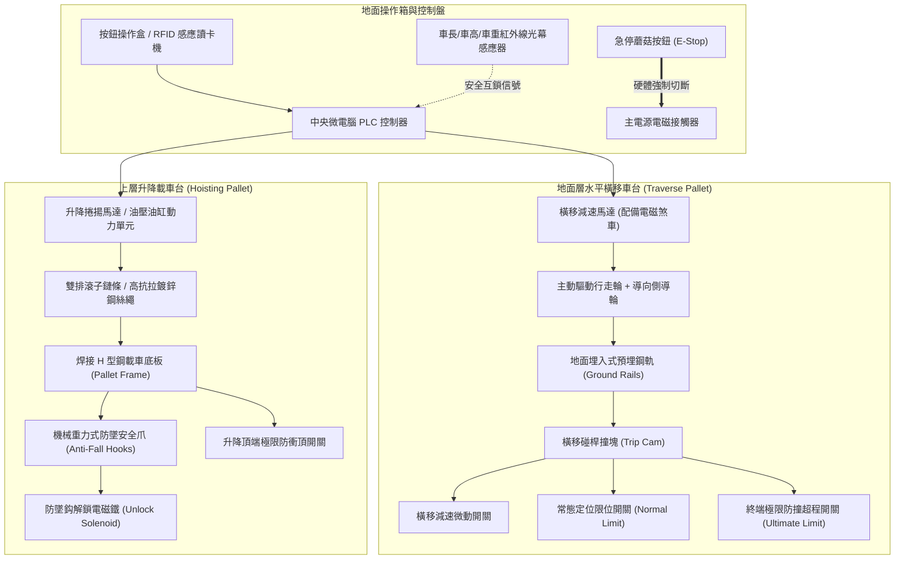
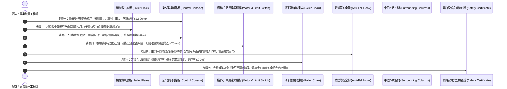

# 全案購屋實戰第六百二十六部：中古大樓社區地下室機械停車設備車位限位極限開關碰桿變形接點氧化短路與橫移車台衝撞邊柱體檢工序全書

---

## 序章：集合住宅地下空間的機械力學重地——機械立體停車設備與安全防線

在都會區高密度集合住宅大樓中，受限於基地面積與法定停車位數量規範，大量中古社區（屋齡 20 至 35 年）普遍在地下室（B1 至 B4）設置了「機械立體停車設備（Mechanical Parking System）」。其中最常見的型式為**「二層至三層升降橫移式（Puzzle Parking System）」**與**「二層上下升降式（Stacker Parking System）」**。

依據中華民國**《建築法》第七十七條之四**、內政部國土管理署**《建築物附設停車空間機械停車設備規範》**及國家標準 **CNS 14353（機械停車設備）** 之明文強制標準：
1. **限位與極限保護雙重防線原則**：機械車台在垂直升降（Hoisting）與水平橫移（Traversing）之終點行程處，必須強制設置**「減速減速開關（Deceleration Switch）」**、**「常態行程限位開關（Normal Limit Switch）」**以及最後一道**「終端極限超行程安全開關（Ultimate Limit Switch / Over-travel Limit Switch）」**。當車台超越正常停止位置 20 至 30 mm 時，終端極限開關必須透過硬體安全迴路強制切斷主驅動馬達之電源接觸器與機械煞車抱閘，絕對嚴禁仰賴軟體 PLC 判定。
2. **車台容許規格與超載超長檢知防護**：設備入口處必須清楚標示容許停放車輛之「車長、車寬、車高、車重（含油水人員）」四項極限指標（中古社區常見限重僅 **$1,600 \text{ kg}$ 至 $1,800 \text{ kg}$**，車高限 $1,550 \text{ mm}$）；設備必須配備光電式或超音波「超長、超高、超重檢知裝置」，任一數值超標時，控制盤必須立即鎖定並發出蜂鳴警報，嚴禁車台啟動運轉。
3. **防止墜落與鋼索/鏈條鏈齒安全係數**：載車台之吊升鋼絲繩（Wire Rope）或滾子鏈條（Roller Chain），其抗拉破斷安全係數**不得小於 7（鋼索）或 5（鏈條）**；每個升降車台下方必須強制配備機械式「防墜落安全鈎（Anti-Fall Safety Hooks / Locking Pawls）」，車台升至定位後，防墜鈎必須確實卡入支撐橫樑，釋放懸吊鏈條之長期靜態張力。

然而，在屋齡 20 至 35 年的中古大樓中，機械車位長年處於地下室潮濕、車輛底盤滴落之酸性雨水與機油油泥侵蝕環境，加上現代休旅車（SUV）、純電動車（EV，重量普遍達 2.0 至 2.5 噸）普及引發的嚴重常態性超載，機械停車設備極易衍化為三大高危致命病徵：
- **橫移與升降之碰桿金屬疲勞變形、微動開關接點氧化拉弧積碳**，或因接點黏連導致「極限開關失效」，橫移車台在切換位置時失控衝撞地下室鋼筋混凝土承重柱或相鄰邊柱，造成車台骨架扭曲變形、百萬名車被強行擠壓撕裂；
- **防墜落安全鈎軸承鏽蝕卡死、驅動電磁鐵（Solenoid）燒燬咬死**，車台升至上層時安全鈎未能順利卡入，數千公斤重的車台全靠單薄老化的懸吊鏈條懸空苦撐，隨時有「斷鏈下墜壓扁下層車輛」之滅頂危機；
- **馬達煞車器（Brake）摩擦襯墊磨耗殆盡、油壓泵浦內漏洩壓**，車台在停放過程中產生「慢性溜車下沉」，導致下層車輛倒車入庫時車頂被隱蔽下垂之機械底板削頂撞毀！

本冊《全案購屋實戰第六百二十六部》深度剖析地下室機械停車設備之碰桿幾何機構、微動極限電氣短路機理、鏈條拉伸安全係數、防墜落連鎖機制，並制定現場看屋與點交車位時之實戰查驗標準工序。

---

## 第一章：升降橫移機械停車設備核心拓撲與三大崩潰失效機制

### 一、升降橫移式機械車位物理拓撲與傳動連鎖
二層升降橫移式機械停車設備（以典型「地上二層、地下一層」或「地面層橫移、上層升降」為例）之核心機械拓撲如下：

---

### 二、三大致命事故機理深入剖析

#### 1. 限位碰桿衝撞變形與微動開關接點氧化短路（衝撞承重柱事故）
- **致病機制**：
  - 橫移車台的行程控制依賴安裝於車架下方的鍍鋅金屬碰桿，在運行至定位時壓下安裝於地面導軌旁的微動極限開關。
  - 長年遭受住戶輪胎碾壓、地下室推車碰撞，碰桿螺栓鬆動並產生 **15 至 30 度的歪斜扭曲變形**；
  - 同時，微動開關內部銀觸點在地下室高濕氣與車輛酸性尾氣環境下，表面生成厚達數十微米的硫化銀（$\text{Ag}_2\text{S}$）絕緣層，或因微動拉弧高溫使動靜觸點金屬熔焊「燒結黏死（Contact Welded）」。
- **致命後果**：當橫移車台移動到位時，變形的碰桿根本碰觸不到開關滾輪，或者開關接點早已黏死無法斷開信號。橫移馬達在全扭矩下持續推動，車台以 $0.2 \text{ m/s}$ 的速度高速直接衝撞地下室鋼筋混凝土大柱或邊界限位鋼檔！巨大的動能直接將車台型鋼撕裂扭曲，若車內有人或相鄰車位有車，將造成毀滅性的車體壓扁擠爛！

#### 2. 機械防墜落安全鈎鏽蝕卡死或驅動電磁鐵燒燬（懸空溜梯斷鏈砸落）
- **致病機制**：
  - 升降車台升至上層定位後，左右兩側的安全鈎必須依靠重力或復位彈簧，自動「咔嗒」咬入導柱上的鋼製承托槽內，承擔車輛的靜態全重。
  - 在中古社區中，安全鈎的旋轉鉸鏈銷軸長年未加注耐水潤滑脂，軸心鏽蝕膨脹咬死；或者負責解鎖的直流行程電磁鐵（Solenoid Coil）因高溫老化線圈燒燬、銜鐵受卡阻。
- **致命後果**：安全鈎因卡阻未能進入咬合槽，甚至被不良維保人員用鐵絲直接綁住固定在「常開解鎖位置」！車台上停放著重達 2 噸之車輛，所有的重力全由老化疲勞的雙排鏈條承受。一旦鏈條出現單邊斷銷或鏈片拉伸疲勞斷裂，重達數噸的載車板瞬間如自由落體般砸向下層車位，將下層車輛拍扁成鐵餅，若下方剛好有住戶在取物，後果不堪設想！

#### 3. 滾子鏈條延伸率超標與鏈輪跳齒（車台傾斜懸掛卡死）
- **致病機制**：
  - 依 CNS 規範，機械停車設備滾子鏈條之伸長率（Elongation Rate）**絕對嚴禁超過額定節距之 2.0%**（例如 20 節鏈條長度延伸超標即須強制報廢）。
  - 當車主長期停放超出原設計限重（例如 1.6 噸規格卻常態停放 2.3 噸電動休旅車），鏈條銷軸與襯套承受極限剪應力，磨損急劇加劇，鏈條伸長率達到 3.5%~5.0%。
- **致命後果**：拉長後的鏈條與驅動鏈輪（Sprocket）齒形嚴重失配。在升降啟動瞬間，鏈條在鏈輪上產生劇烈的「跳齒（Tooth Skipping）」甚至脫鏈。載車台瞬間呈現一邊高一邊低（左右傾斜落差達 30 公分以上），車輛輪胎自防滑槽滑脫，車身傾斜撞擊兩側垂直導軌立柱卡死，既無法升也無法降，面臨全社區車輛集體癱瘓！

---

## 第二章：四大候選物件之停車設備現場查驗焦點與談判戰略

本案目前鎖定之四大候選物件中，車位型式差異極大，直接決定了未來的日常用車便利性、維修分攤基金與資產抗跌性：

| 物件編號與社區名稱 | 車位型態與規格特徵 | 機械/平面車位潛在風險焦點 | 現場實勘首要工序 | 談判籌碼與修繕折讓指引 |
| :--- | :--- | :--- | :--- | :--- |
| **大安紫金城 13 樓 (`PROP_10`)** | **地下 B2 獨立大型「坡道平面大車位」**！全案最頂級車位配置。 | **完全無任何機械車位故障、限重、斷鏈與砸車風險！** 但需查驗 B2 平車上方有無公共污水幹管或消防撒水管滲漏滴水，避免水垢碳酸鈣腐蝕車漆。 | 1. 勘查車位地面有無樑柱阻擋開門，確認大休旅車能倒車順暢入庫。 2. 抬頭檢視車位上方管線有無鏽蝕漏水白華痕跡。 3. 檢視地坪坡度與積水排水溝狀態。 | 平面大車位市場價值較機械車位高出 **100~150 萬元**，此乃大安紫金城最堅固之核心護城河，出價 720~730 萬具有極強性價比支撐！ |
| **長億南園 8 樓 (`PROP_106`)** | **地下室「機械式車位」**！規格老舊，限重僅約 1.6 噸。 | 30 年老舊升降橫移機械結構，**無法停放現代主流 SUV、電車或大型休旅車**；且需長期負擔機械保養費；需查驗橫移限位碰桿有無變形、防墜鈎是否有效。 | 1. 現場操作機械車位按鈕，測試升降橫移運行順暢度。 2. 檢視載車板鋼板有無生鏽穿孔、波浪狀變形。 3. 查閱管委會機械車位年度安全檢驗合格證。 | 機械車位限制極大且修繕成本高，以此作為最強大殺價籌碼，結合門檻 4 階非無障礙，**強烈要求折讓 100~150 萬元之車位價值差額**（起手 698 萬）！ |
| **歌德堡 8 樓** | 配備車位型態需依合約確認（多為坡道機械或平面）。 | 若為機械車位，需確認是否為「平移式」或「固定上/下層」，並檢驗其煞車馬達有無溜車下沉跡象。 | 檢視車位操作箱面板警報燈號有無故障閃爍，詢問管理室車位故障叫修頻率。 | 作為標準比對標的，牽制長億南園機械車位之重大缺陷。 |
| **靜園 A 區 11 樓** | 配備車位現況檢核。 | 車位動線寬敞度與地下室進出坡道斜率檢驗。 | 實車測試進出地下室有無磨底盤。 | 優良基準參考標的。 |

---

## 第三章：看屋現場機械停車設備七步快篩查驗標準工序（SOP）

買方或其驗屋代表在勘查地下室機械車位時，遵循以下 7 步標準工序進行深度檢驗：

### 具體實施指引與合格紅線：
1. **車位規格銘板與現代車輛相容性（關鍵實用紅線）**：
   - 走至機械車位操作箱前，仔細閱讀金屬銘板之四項規格：
     - **車長（Length）**：標準多為 4,700 ~ 5,000 mm；
     - **車寬（Width）**：標準多為 1,850 ~ 1,900 mm；
     - **車高（Height）**：上層車位多受限於 **1,500 ~ 1,550 mm（轎車限高，休旅車完全進不去！）**；
     - **容許載重（Weight）**：中古社區多標示 **$1,600 \text{ kg}$ 或 $1,800 \text{ kg}$**。
   - **重大警訊**：若買方或家庭未來預計購買中大型休旅車（如 RAV4、CR-V、Model Y），重量多在 1.7 至 2.1 噸，高度在 1,650 mm 以上，**此機械車位將完全廢棄無法停放！**
2. **載車板結構鏽蝕與下垂變形（Structural Sagging）**：
   - 用強光手電筒照射載車板的鍍鋅鋼浪板。
   - 車輪常態停放的兩條壓痕槽，底板不得出現下凹超過 **15 mm** 之波浪狀永久塑性變形。
   - 蹲下照看載車架底部的主承重槽鋼與角鐵焊縫：若有紅褐色鐵鏽成片脫落、焊道開裂或底板被輪胎雨水鏽穿透光，該車架隨時有斷裂坍塌危險！
3. **橫移碰桿垂直度與微動開關定位精度**：
   - 觀察車台橫移至極限位置時的動作：
     - 碰桿必須平正垂直，開關滾輪接觸碰桿斜面時，車台馬達應平順減速並精準切斷電源。
     - **合格標準**：停止時車台軌道與相鄰車道之對齊偏差不得大於 **$\pm 5 \text{ mm}$**。
     - **致命紅線**：若碰桿歪斜彎曲，車台在停正前發生劇烈「震盪顛簸」、或車架外緣距離地下室水泥柱不足 **10 公分**，代表限位開關早已嚴重位移！
4. **防墜安全鈎咬合動作（Anti-Fall Pawl Engagement）**：
   - 操作上層車台升至最高點。
   - 仔細聆聽並抬頭觀看：當馬達停轉瞬間，兩側立柱上的厚鋼板防墜鈎必須伴隨清脆的「咔噠」聲，精準且深沉地咬入導柱方形支撐孔內（咬合深度需 $\ge 25 \text{ mm}$）。
   - 若發現防墜鈎懸在半空未卡入、或被鐵絲綑綁，絕對屬於極度危險之違規重大瑕疵！
5. **滾子鏈條保養與延伸率量測**：
   - 檢查懸吊載車台的雙排鏈條：鏈條表面應有乾淨的潤滑油膜，不可覆蓋乾燥硬化的黑油泥，更不可呈現乾磨生鏽紅斑。
   - 用游標卡尺量測 10 節鏈條的中心距長度，若伸長量超過新品長度之 **2%**，表示鏈條金屬疲勞已屆極限，面臨隨時斷裂風險。
6. **年度安全檢驗合格證有效性**：
   - 檢視操作盤外殼黏貼之**「機械停車設備使用許可證」**。
   - 確認檢查機構（如中華民國立體停車場協會、台灣停車設備暨昇降設備安全協會）之認證鋼印、檢驗員簽章及有效期限。若許可證已過期數月甚至數年未驗，代表該設備未受政府監管，隨時有被勒令停用或發生意外無保險理賠之風險！

---

## 第四章：地下室機械停車設備全面體檢驗收表

本表供買方於看屋公設踏勘或交屋前逐項檢對打勾：

| 檢驗項目 | 規範標準要求 | 實測現況紀錄 | 合格判定 | 缺陷風險處置與修繕成本 |
| :--- | :--- | :--- | :---: | :--- |
| **1. 車位容許載重規格** | 銘板標示容許載重 ≥ 1,800~2,000 kg（符合買方車種需求）。 | ［　　］kg 限重 | □合格 □異常 | 若僅限重 1,600kg 且限高 1,550mm，列為重大議價折讓依據。 |
| **2. 載車板鋼構與焊縫** | 底板鍍鋅防滑板無穿孔破洞、主槽鋼焊縫無開裂撕裂。 | ［　　］狀態 | □合格 □異常 | 重新補焊型鋼加強肋，除鏽噴塗環氧防鏽漆（約 1.5~3.0 萬元）。 |
| **3. 橫移限位開關定位** | 碰桿平正無變形，微動開關定位精準，軌道偏差 ≤ ±5 mm。 | ［　　］mm 偏差 | □合格 □異常 | 校正碰桿角度，更換 IP67 防水重型行程極限開關。 |
| **4. 防墜安全鈎連鎖** | 車台升頂時防墜鈎自動咬合入槽，咬合深度 ≥ 25 mm。 | ［　　］mm 咬合 | □合格 □異常 | 清除銷軸鏽蝕，加注二硫化鉬耐磨脂，更換解鎖電磁鐵。 |
| **5. 傳動鏈條延伸率** | 鏈條表面潤滑良好無生鏽，10 節伸長率 ≤ 2.0%。 | ［　　］% 伸長 | □合格 □異常 | 全面更換全新高強度雙排重型滾子鏈條（約 2.0~3.5 萬元/台）。 |
| **6. 馬達煞車抱閘制動** | 停電或停轉瞬間煞車迅速抱死，載車台無溜車下滑位移。 | ［　　］狀態 | □合格 □異常 | 調校電磁煞車器間隙（0.25~0.35 mm），更換石棉煞車摩擦片。 |
| **7. 官方使用許可證** | 具備合格檢驗機構年度安全檢查合格標章，在有效期限內。 | ［　　］年/月有效 | □合格 □異常 | 責成賣方於交屋前完成年度安檢合格換證手續。 |

---

## 第五章：總結與後續工序推進

地下室機械停車設備是集合住宅中高頻率運轉的重型機械載具。在購屋決策中，清楚掌握機械車位與平面大車位之間高達上百萬元的資產價值落差，並在現場透過碰桿、防墜鈎、鏈條伸長與載重銘板的專業查驗，不僅能確保全家人未來的用車安全與便利，更能將機械車位的客觀瑕疵化為談判桌上的壓倒性議價王牌！

下一部實戰手冊將依序開展：**《全案購屋實戰第六百二十七部：中古大樓社區各樓層電梯對講機室內分機音訊放大IC老化破音直流供電壓降雜訊干擾與主機面板通訊中斷體檢工序全書》**，持續深入全社區弱電通訊安全生命線！

---
*全案購屋實戰第六百二十六部・全書完・版本控管確認*
