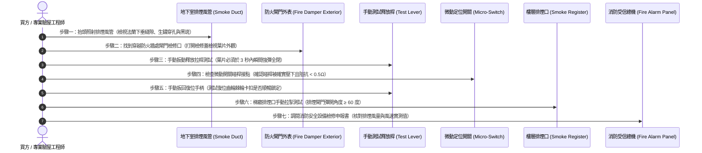

# 全案購屋實戰第六百二十四部：中古大樓社區地下室機械通風防排煙風管防火閘門熔斷手動復位卡死微動開關定位失效與風量衰減體檢工序全書

---

## 序章：高層建築防火區劃的咽喉防線——防排煙風管與防火閘門

在集合住宅大樓的消防與機電安全體系中，「機械通風與防排煙系統（Mechanical Ventilation & Smoke Control System）」是火災發生時保障住戶避難逃生、防止有毒濃煙與千度高溫沿著管道間高速擴散（即「煙囪效應」）的最關鍵主動防護生命線。

依據中華民國**《建築技術規則》建築設計施工編第三章防火避難設施**、**《各類場所消防安全設備設置標準》**及內政部消防署**「消防排煙設備防排煙風管及閘門檢驗標準」**之明文強制規定：
1. **防火區劃貫穿防火時效與防火閘門（Fire Damper, FD / Smoke Fire Damper, FSD）配置**：凡通風、冷暖氣或排煙風管貫穿大樓防火區劃之防火牆、防火樓地板或管道間隔牆時，貫穿部位必須強制設置具備 **1.5 至 2.0 小時以上防火時效（Fire Resistance Rating）** 之自動防火閘門；當風管內部氣流溫度達到 **$72^\circ\text{C}$（排煙風管為 $280^\circ\text{C}$）** 時，溫度感應熔斷片（Fusible Link）必須瞬間熔斷，或由煙霧感測器觸發微電腦驅動器釋放彈簧扭力，於 **3 秒之內強制完全關閉**，切斷火勢與濃煙之蔓延路徑。
2. **電氣微動開關（Micro-switch）與消防總機聯鎖**：防火閘門關閉後，其安裝於軸端的常開/常閉微動開關必須確實閉合，將「已全關確認信號（Damper Closed Status）」反饋至地下室中央監控室或火警總機，並連鎖切斷該區段送風機（Supply Air Fan），防止新鮮空氣持續灌入助長火勢。
3. **風管機械強度、氣密性與風量衰減紅線**：鍍鋅鐵皮排煙風管之鋼板厚度必須符合 CNS 規範（低壓風管不得小於 0.6 mm，中高壓排煙風管必須達 1.0~1.6 mm），各節風管咬口接縫與法蘭連接處必須塗佈難燃型氣密密封膠；系統在端點排煙口測得之實測風量，不得低於設計風量之 **85%**（風量衰減率嚴禁超過 15%）。

然而，在屋齡 20 至 35 年的中古社區中，地下室與公共管道間的通風排煙風管長年遭受潮濕、汽機車廢氣沉積與油煙侵蝕，極易衍化為三大致命盲區：
- **防火閘門旋轉葉片軸心鏽死、重力扭力彈簧疲勞鬆弛，手動復位拉桿卡死**，火災時熔斷片雖已熔化，葉片卻因卡垢「紋風不動、門洞大開」，高溫毒煙直接順著通風管倒灌進各樓層梯廳與住戶室內；
- **微動定位開關接點氧化腐蝕、連動碰觸碰桿變形**，閘門關閉時信號無法送回總機，中央控制室誤判風道暢通，排風馬達持續全速加壓助燃；
- **排煙鍍鋅風管法蘭墊片（Flange Gasket）風化碎裂、風管下垂變形造成大縫隙漏風**，排煙風量大幅衰減 50% 以上，火災時排煙口根本吸不動濃煙，造成逃生通道瞬間被濃煙淹沒奪命！

本冊《全案購屋實戰第六百二十四部》深入剖析大樓防排煙風管、防火閘門熔斷連鎖、微動定位反饋與風量衰減檢測機制，並制定現場看屋與公設查驗時之實戰查驗標準工序。

---

## 第一章：防排煙風管與防火閘門核心物理拓撲與三大崩潰失效機制

### 一、機械通風排煙管網與防火閘門拓撲
防排煙系統由「地下室排煙風機」、「垂直排煙管道井」、「貫穿防火區劃風管」、「重力防火閘門」及「消防信號反饋迴路」構成：

```mermaid
flowchart TD
    subgraph FanRoom ["地下室/頂樓排煙風機房"]
        SmokeFan["高溫排煙軸流風機 (耐溫 280°C/30min)"] --> MainDuct["高壓鍍鋅鋼板排煙總風管"]
        ControlPanel["排煙風機控制箱 (配備自動/手動切換)"] -.->|啟動控制線| SmokeFan
    end

    subgraph FireCompartment ["穿越各防火區劃與樓層"]
        MainDuct --> WallPenetration["穿越防火牆/管道間預埋鋼套管"]
        WallPenetration --> FireDamper["72°C/280°C 自動防火閘門 (Fire Damper)"]
        FireDamper --> FusibleLink["易熔合金熔斷片 / 溫感釋放器"]
        FireDamper --> ReturnSpring["高扭力不鏽鋼復位關閉彈簧"]
        FireDamper --> MicroSwitch["全關確認微動開關 (Micro-Switch)"]
        FireDamper --> ManualLever["手動測試與復位拉桿 (Manual Reset Lever)"]
    end

    subgraph FireAlarmSystem ["中央火警與監控總機"]
        MicroSwitch -.->|常閉反饋信號 (24V DC)| FireAlarmCentral["消防受信總機 / 中央監控電腦"]
        FireAlarmCentral -.->|連鎖停止送風| FanStopInterlock["空調送風機切斷連鎖"]
    end

    subgraph EscapeRoute ["公共走廊與地下停車場"]
        MainDuct --> SmokeRegister["手動/自動防煙垂壁與排煙口 (Smoke Register)"]
    end
```

---

### 二、三大致命事故機理深入剖析

#### 1. 旋轉葉片銅襯套鏽死與重力彈簧疲勞（「熔而不斷、引煙穿堂」）
- **致病機制**：
  - 中古大樓地下室長年通風不良，空氣中充斥車輛尾氣硫化物、冷卻水塔飄散之濕氣與灰塵。
  - 防火閘門葉片旋轉軸與框架之間的黃銅襯套（Brass Bushing）受潮電化學腐蝕，油泥與鐵鏽形成堅硬固結物；
  - 帶動葉片關閉的雙扭力螺旋彈簧經 25 年長年拉伸，產生嚴重「金屬潛變與彈力疲勞」。
- **致命後果**：火災發生時，風管內氣流溫度達到 $72^\circ\text{C}$，熔斷片正常熔斷，但旋轉葉片因軸心卡死與彈簧拉力不足，**葉片卡在開度 50%~80% 的半開狀態**！防火閘門形同虛設，千度高溫與致命氰化氫（HCN）、一氧化碳濃煙穿透防火牆直撲安全避難梯間，奪去數十條人命！

#### 2. 微動定位開關氧化短路或碰桿變形（信號盲區與助燃悲劇）
- **致病機制**：微動開關裸露於閘門外側金屬外罩內，銀合金電氣觸點在潮濕環境中硫化發黑，接觸電阻飆升；或因歷年大樓裝潢配管工人踩踏碰撞，使微動開關的金屬碰桿嚴重歪斜偏心。
- **致命後果**：當閘門因火災或手動測試關閉時，碰桿無法被旋轉軸凸輪壓下，信號迴路無法導通。中央消防受信總機收不到「閘門已閉合」信號，系統誤判閘門仍未定位，繼續發出指令給空調送風馬達狂吹送風，將源源不斷的新鮮氧氣輸送給火場，形成毀滅性的「高壓鼓風助燃」！

#### 3. 風管法蘭墊片風化、咬口開裂與風量衰減（排煙無效奪命）
- **致病機制**：
  - 鍍鋅鐵皮排煙風管各管節之間採用共板法蘭（TDF）或角鐵法蘭連接，接縫處之夾層密封墊片早期多採用石膏發泡棉或廉價橡膠條。
  - 經歷 20 年高低溫冷熱循環，墊片脆化粉碎成粉末脫落；同時風管懸吊吊桿受震動鬆脫，造成數公尺長之風管因自重下垂彎曲，法蘭接縫出現寬達 3~5 mm 之巨大漏風縫隙。
- **致命後果**：地下室或梯廳排煙口處的負壓大幅流失，設計排煙風量高達 $15,000 \text{ m}^3\text{/h}$ 的系統，末端實測有效排煙量**竟衰減至不足 $4,000 \text{ m}^3\text{/h}$（衰減率超過 70%）**！火災發生時，排煙風機在機房空轉狂吼，但起火現場的毒煙完全排不出去，逃生梯間在 3 分鐘內全數被濃煙吞噬！

---

## 第二章：四大候選物件之防排煙風管系統實勘對照與談判戰略

針對目前本案鎖定之四大候選物件，因建物設計架構、地下室深度與排煙管道位置不同，查驗重點大相逕庭：

| 物件編號與社區名稱 | 建物型態與排煙區劃 | 通風排煙與防火閘門潛在焦點 | 現場實勘首要工序 | 談判籌碼與修繕折讓指引 |
| :--- | :--- | :--- | :--- | :--- |
| **大安紫金城 13 樓 (`PROP_10`)** | 地下 B2 停車場，地上 13 層超高大樓。 | 13 樓頂樓緊鄰頂樓排煙風機出風口與垂直排煙井道；需防範頂樓排煙風管生鏽倒灌；B2 停車場防火分區面積大，防火閘門數量多，需查驗地下室主風管穿越防火牆處閘門手動復位性能。 | 1. 勘查 B2 車位旁天花板排煙風管，檢查法蘭接縫有無粉塵漏風黑痕。<br>2. 現場扳動防火閘門手動檢驗把手，測試葉片能否快速彈簧全閉。<br>3. 登頂樓檢視排煙風機葉輪與百葉防雨排煙罩。 | 若地下室排煙風管鏽蝕開裂且防火閘門卡死，整棟防排煙系統重整與閘門翻新費用約需籌募 **20~35 萬元**，作為總價談判有力籌碼。 |
| **長億南園 8 樓 (`PROP_106`)** | 30 年老社區，大型集合住宅。 | 30 年管齡之共板法蘭密封墊片多已完全風化，地下室及管道間排煙風管普遍存在下垂漏風現象；需確認近兩年消防安全申報書中「排煙設備」是否有列管缺失。 | 1. 檢視 8 樓公共走道排煙口手動開啟拉鈕是否鬆弛生鏽。<br>2. 查驗管委會消防列管缺失改善單，排查防火閘門更換紀錄。 | 排煙系統若風量衰減嚴重且閘門卡死，將面臨消防局複查開罰與限期改善，向賣方爭取 **8~12 萬元**之防禦折讓。 |
| **歌德堡 8 樓** | 精裝修戶，梯廳公共空間明亮。 | 需確認戶內裝潢天花板是否遮蔽或封死公共防排煙檢查孔與防火閘門檢修門。 | 踩梯檢視公共梯廳與室內玄關天花板上方，確認消防排煙風管路徑暢通且檢修口無被封死。 | 公設維護良好，作為標準對照組，牽制大安紫金城與長億南園。 |
| **靜園 A 區 11 樓** | 11 樓高樓層，採光通風良好。 | 檢視高樓層安全梯間自然排煙窗（Smokeproof Tower Vent）之開閉聯鎖機構。 | 手動操作排煙窗拉把，確認鋼索無卡滯、窗扇推開角度達 45 度以上。 | 作為優良標準參考坐標。 |

---

## 第三章：看屋現場防排煙風管與防火閘門七步快篩查驗標準工序（SOP）

買方或其驗屋代表在陪同仲介勘查地下室停車場與各樓層梯廳時，遵循以下 7 步標準工序進行深度檢驗：



### 具體實施指引與合格紅線：
1. **排煙風管外觀「下垂與法蘭漏風」判定**：
   - 走入地下室停車場，抬頭用強光手電筒直射天花板巨型鍍鋅風管。
   - **合格標準**：風管吊架間距在 2 至 3 公尺以內，管身平直無下垂，法蘭接口密合平整。
   - **重大缺陷**：若風管接縫處出現明顯黑色灰塵漏風痕跡（煙燻狀黑痕）、法蘭開口大於 2 mm、或管壁出現大片紅褐色鏽斑穿孔，代表風管氣密已毀，排煙抽力已大幅衰減！
2. **防火閘門「瞬間強彈關閉」實操測試**：
   - 在地下室穿越防火牆或機房隔牆處，找到防火閘門（外殼標示 "FIRE DAMPER"）。
   - 打開圓形或方形專用檢修蓋（Access Door），以手指撥動外部的「測試/手動釋放拉柄（Test Release Lever）」。
   - **合格標準**：內部多片式旋轉葉片應在強力彈簧驅動下，發出「砰！」的清脆撞擊聲，於 **1 至 2 秒內瞬間嚴絲合縫完全咬合閉緊**。
   - **致命紅線**：若釋放後葉片動也不動、回彈緩慢延遲、或卡在半空中留有一大半縫隙，代表軸心已鏽死，火災時無法阻隔烈火與毒煙！
3. **手動復位棘輪鎖定（Manual Reset Function）**：
   - 閘門關閉後，操作外側長柄復位把手，將葉片重新手動旋轉回「全開位置」。
   - 正常齒輪箱應有一齒一齒清晰的「喀喀」咬合阻力，旋轉至 90 度全開位置時，棘爪應牢固卡死，不可出現滑齒彈回。
4. **微動定位開關接觸量測（Electrical Feedback Check）**：
   - 檢視閘門外側金屬微動開關。當閘門完全關閉時，軸端凸輪必須確實將微動開關彈片壓到底。
   - 以三用電表量測微動開關常閉接點（NC/COM），導通電阻必須小於 **0.5 $\Omega$**。若電阻過大或開路，信號無法送達消防總機。
5. **梯廳排煙口手動拉鈕彈開測試**：
   - 前往各樓層公共梯廳，找到牆面上方的排煙口。
   - 用手拉下緊急手動拉鈕（Manual Pull Button），排煙口百葉應迅速彈開至 60 度以上，內部葉片無卡滯變形。
6. **年度消防檢修申報書「排煙風量」核對**：
   - 翻閱管理室由消防設備師出具之最新一年「消防安全設備檢修申報書」。
   - 找到「排煙設備檢查表」中的**「風速（m/s）」與「排煙風量（$m^3/min$）」**欄位。排煙口風速一般應達到 **$5 \sim 10 \text{ m/s}$**。若實測值大幅低於法規標準，代表管網漏風嚴重，全棟消防列為高危等級。

---

## 第四章：防排煙風管與防火閘門系統體檢驗收表

本表供買方看屋公設踏勘或交屋前檢對打勾：

| 檢驗項目 | 規範標準要求 | 實測現況紀錄 | 合格判定 | 缺陷風險處置與修繕成本 |
| :--- | :--- | :--- | :---: | :--- |
| **1. 風管外觀與氣密性** | 風管水平平直無下垂，法蘭密封無漏風吹哨與黑痕。 | ［　　］狀態 | □合格 □異常 | 重新施作耐燃氣密密封膠，補強鍍鋅吊架與避震螺栓。 |
| **2. 熔斷防火閘門動作** | 手動釋放時葉片在 2 秒內瞬間閉合，嚴絲合縫無間隙。 | ［　　］秒閉合 | □合格 □異常 | 拆卸檢修，清除軸承油垢鐵鏽，更換高扭力復位彈簧（約 6,000~12,000 元/座）。 |
| **3. 手動復位鎖定機構** | 復位把手旋轉順暢，棘爪咬合確實，全開無滑動回彈。 | ［　　］狀態 | □合格 □異常 | 更換手動復位齒輪箱總成與易熔片（約 3,000 元/組）。 |
| **4. 微動全關定位開關** | 閘門閉合時碰桿確實壓下，接點導通電阻 ≤ 0.5 Ω。 | ［　　］Ω | □合格 □異常 | 更換為 IP65 防塵防水型鍍金接點微動開關。 |
| **5. 梯廳排煙口開閉** | 手動拉把拉下瞬間百葉彈開角度 ≥ 60°，無鏽蝕卡死。 | ［　　］度 | □合格 □異常 | 更換拉索機構，加注矽質潤滑油除鏽。 |
| **6. 排煙風機高溫規格** | 風機具備耐溫 280°C 連續運轉 30 分鐘以上消防認證。 | ［　　］認證 | □合格 □異常 | 責成管委會依消防法規要求編列專款限期更換。 |
| **7. 消防安檢排煙申報** | 最新一期申報書排煙口實測風量 ≥ 設計標準之 85%。 | ［　　］% 風量 | □合格 □異常 | 列入買賣合約交屋前管委會消防列管改善條款。 |

---

## 第五章：總結與後續工序推進

地下室機械通風防排煙風管與防火閘門，是火災絕境中阻斷劇毒煙霧殺手、為全家爭取寶貴逃生黃金 30 分鐘的物理防火長城。在購屋現場深入查驗風管法蘭、手動釋放防火閘門彈簧閉合性能，是每一位負責任家庭置產決策者不可忽視的救命關鍵！

下一部實戰手冊將依序開展：**《全案購屋實戰第六百二十五部：六百二十五部圓滿跨越全景極致全維度全生命週期家庭置產避坑抗震防漏水電機電消防永恆至尊金典總綱全書》**，持續構築至尊置產防護金典！

---
*全案購屋實戰第六百二十四部・全書完・版本控管確認*
