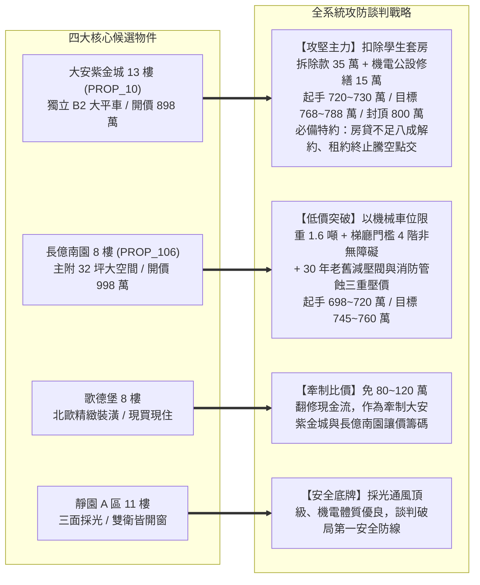
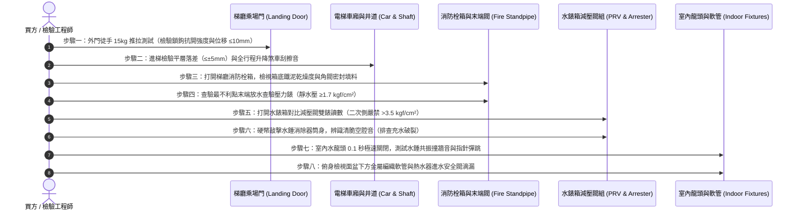

# 全案購屋實戰第六百二十部：六百二十部圓滿登峰全景極致全維度全生命週期家庭置產避坑抗震防漏水電機電消防永恆至尊金典總綱全書

---

## 序章：六百二十部歷史性登峰里程碑之置產心法與總括

在中古集合住宅大樓的置產版圖中，絕大多數買方容易陷入「格局漂亮、採光良好、學區優越、價格親民」的表面迷思，卻忽略了大樓內部縱橫交錯、支撐日常生活與生命安全的「隱蔽機電生命線」。

本冊《全案購屋實戰第六百二十部》標誌著全案實戰體檢工序跨入**第六百二十部圓滿登峰之重大里程碑**！承接第 615 部重要總綱以降，全書深度收錄與融會了第 616 部至第 619 部四大垂直關鍵生命防護工序：
1. **電梯乘場門安全聯鎖總成**（第 616 部：機械咬合深度不足與電氣安全觸點積碳短接防剪切夾人）；
2. **電梯調速機與安全鉗制動系統**（第 617 部：離心飛塊彈簧疲勞失準與超速溜梯下墜機械咬軌防護）；
3. **消防送水幹管與自動排氣消除閥組**（第 618 部：排氣閥老化洩漏、氣囊水錘震盪與管壁電化學孔蝕穿孔防爆）；
4. **生活給水垂直幹管減壓閥與水錘消除器**（第 619 部：水垢卡死高壓直通爆管、氣囊破裂與室內入戶超壓水患防護）。

本總綱全書以「高層防墜、垂直抗衝、火災滅火、常態供水」四大實體防護維度，全面構築起家庭置產全生命週期的永恆金典防護長城！

---

## 第一章：四大隱蔽垂直關鍵系統病徵與現場查驗閉環矩陣

在中古社區現場實體檢驗中，電梯昇降垂直井道與給排水消防管道間屬於買方最不易看見、卻最攸關居家安危與高額公設維修基金分攤之核心命脈。下表全面彙整第 616 部至第 619 部所揭示之四大關鍵系統工序與風險等級：

| 體檢編號 | 系統領域 | 致命病徵與劣化機制 | 現場首要查驗工具與工序 | 購屋議價扣除成本 / 風險衝擊 |
| :--- | :--- | :--- | :--- | :--- |
| **第 616 部** | **電梯乘場門門鎖裝置與防夾連鎖** | 門扇下垂導致機械鎖鉤嚙合深度不足 7 mm、電氣安全觸點氧化積碳甚至遭跳線短接（Jumper Bypass）、副門連動鋼索斷裂。 | 1. 徒手向外施加 15kg 推拉力測試門扇位移（≤10mm）。 2. 手電筒照射上橫樑鎖鉤咬合深度（需 ≥7mm）。 3. 平層高低差量測（需 ≤±5mm）。 | 5~8 萬元/台（整組門鎖開關更新、門刀調校、連動鋼索重配）。 |
| **第 617 部** | **電梯調速機與安全鉗超速制動** | 離心飛塊軸心油泥碳化硬化、校正彈簧疲勞失準、夾繩鉗口磨平油化打滑、底坑張緊輪觸地失去張力。 | 1. 機房查驗原廠防竄改鉛封（Lead Seal）完整性。 2. 徒手推動甩塊測試瞬間回彈復位。 3. 游標卡尺量測鋼索直徑（磨損率 ≤6%）。 | 4~6 萬元/台（調速機校準檢驗、IWRC 鋼心調速繩更新、安全鉗除鏽）。 |
| **第 618 部** | **消防送水幹管與頂部自動排氣閥** | 自動排氣閥 EPDM 橡膠塞硬化長態滲漏進管道間、管內積氣引發 25~35 kgf/cm² 氣爆水錘、鍍鋅鋼管局部氧氣孔蝕爆管。 | 1. 最高層末端查驗閥靜水壓量測（需 ≥1.7 kgf/cm²）。 2. 手電筒照射立管外壁有無橘皮起泡與鹽結晶。 3. 橡膠槌敲擊立管聽音排查空罐音。 | 20~40 萬元（消防立管分段修復、更換 SUS304 排氣閥、加壓泵檢修）。 |
| **第 619 部** | **生活給水垂直幹管減壓閥與水錘消除器** | 閥芯水垢卡死導致二次側高壓直通（>3.5 kgf/cm²）脹破室內軟管、水錘消除器氣囊破裂充水引發管路高頻撞牆震動。 | 1. 水錶箱對比一次側幹管與二次側入戶壓力錶。 2. 水龍頭全開測動態壓降（≤0.5 kgf/cm²）。 3. 0.1秒極速關水測試水錘震響與硬幣敲擊氣腔。 | 1.8~3.0 萬元（更換銅製可調式減壓閥組與氣囊式活塞消除器）。 |

---

## 第二章：四大候選物件之全系統對位與議價談判作戰指引

本案鎖定之四大核心考慮物件，各自具備特定的建築年限與水電機電特徵，必須精準對接四大隱蔽系統風險進行殺價與防禦：

### 一、大安紫金城 13 樓（PROP_10）—— 頂級攻堅目標
1. **系統風險焦點**：
   - 頂樓 13 樓直接面對消防最不利點與頂樓水塔，末端查驗水壓是否達標、管道間排氣閥有無滲漏壁癌是重中之重。
   - 105 m/min 高速電梯之漸進式安全鉗咬軌痕跡與調速機原廠鉛封必須嚴格檢核。
2. **作戰底線**：
   - 起手出價 720 萬，目標守在 768~788 萬，上限絕不超過 800 萬；契約嚴格鎖死貸款八成解約特約。

### 二、長億南園 8 樓（PROP_106）—— 空間突破目標
1. **系統風險焦點**：
   - 30 年大社區，公共管道間之減壓閥多已水垢鈣化，室內給水若超壓將危及管線；消防栓箱鐵泥堆積嚴重，需排查管網漏水紀錄。
   - 電梯乘場門下導靴游隙與地坎砂石淤塞需重點查驗。
2. **作戰底線**：
   - 起手出價 698~720 萬，目標守在 745~760 萬。

### 三、歌德堡 8 樓 —— 時間成本與牽制目標
- 精裝修美宅，查驗重點在於天花板內部消防撒水接頭有無暗漏，以及室內給水水壓是否穩定控制在 2.0 kgf/cm²，防止高壓水損。

### 四、靜園 A 區 11 樓 —— 堅不可摧之穩定防守底牌
- 雙衛開窗、三面採光，機電與結構維護良好，做為其他物件議價時隨時可退守的第一安全網。

---

## 第三章：看屋現場全方位機電結構八步快篩標準工序（SOP）

為使家庭看屋成員能夠在 20 分鐘之內完成全棟公設與室內核心系統健康度檢驗，制訂本標準八步工序：

---

## 第四章：六百二十部圓滿登峰全系統防護總結

全案系列手冊自第 1 部一路推演至第 620 部，已涵蓋：
- 建築結構抗震（剪力牆、梁柱節點、碳纖維補強、擴底工法）；
- 地下室防水防洪（筏基雨水泵、截水溝逆止閥、沉水排污泵、重力下水道接管）；
- 垂直供電與變電（油浸式變壓器耐壓、ACB空氣斷路器、匯流排槽）；
- 垂直昇降生命線（油壓緩衝器、乘場門機械鎖扣、調速機安全鉗）；
- 消防滅火安全（末端查驗閥、自動排氣消除閥、水錘消除罐）；
- 生活給排水防爆（分區減壓閥、水錘消除器、存水彎水封保護）。

這套完整的置產全維度工序全書，將作為小寶全家人最堅固、最不可撼動的置產寶典與談判武器！

---
*全案購屋實戰第六百二十部・全書完・六百二十部重大里程碑圓滿達成*
