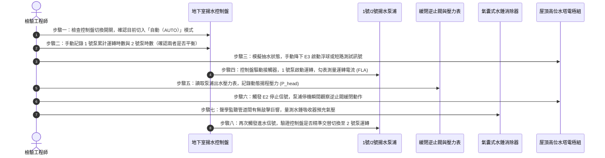

# 全案購屋實戰第六百零一部：中古大樓社區地下室生活自來水雙泵揚水系統止回閥逆向洩漏低頻水錘震盪雙泵自動交替控制器故障與高樓層水塔溢流體檢工序全書

---

## 壹、前言與核心體檢宗旨

生活自來水是集合住宅維繫全體住戶每日飲用、烹飪、洗沐與衛生的命脈系統。
在多數屋齡 20～35 年之中古集合住宅大樓中，自來水給水架構係採「地下室生活受水箱 $\rightarrow$ 雙泵揚水泵浦組（Duplex Lift Pumps）垂直加壓提水 $\rightarrow$ 屋頂高位水塔（Gravity Water Tank） $\rightarrow$ 重力流或分區減壓閥配水至各戶」。

然而，揚水系統長年置身於地下室泵浦房與垂直管道間內，長年承受數十公尺水柱靜水頭壓與啟閉動態應力，常年暗藏以下致命工程隱患：
1. **多功能無水錘緩閉止回閥（Slow-Closing Check Valve）逆向洩漏**：橡膠密封墊片磨損、彈簧疲勞或水垢卡阻，導致停機瞬間高達十數層樓之高壓水柱高速倒灌回流，產生巨大低頻撞擊水錘巨響（Water Hammer），震裂管道吊架甚至震斷閥體。
2. **揚水雙泵自動交替控制器（Alternating Duplex Controller）機械接點黏死**：控制盤內電磁接觸器或交替繼電器燒蝕，導致單一泵浦日夜孤軍過載運轉，軸封高溫乾磨漏水，備用泵浦則因長年不動而轉子鏽蝕卡死。
3. **屋頂高位水箱進水電極棒結垢短路與溢流無效倒灌**：屋頂水箱高低水位液位電極棒被石灰質水垢包覆，訊號失真無法向地下室發出「高水位停機（High Cut）」指令，致使揚水泵浦持續瘋狂注水，自來水自屋頂溢流管瘋狂狂洩漫流，甚至灌入頂樓住戶天花板與電梯機房。

本工序全書旨在深入剖析揚水系統止回閥水錘吸收、交替邏輯控制及屋頂水箱防溢流連鎖體系，提供買方與社區完整的檢驗指引。

---

## 貳、地下室揚水雙泵與屋頂高位水塔控制架構

```mermaid
flowchart TD
    A["地下室生活自來水受水箱"] --> B["揚水雙泵組 (1號泵 / 2號泵 多段沉水式或臥式離心泵)"]
    B --> C["緩閉式逆止閥 (帶微動阻尼緩衝器)"]
    C --> D["氣囊式水錘消除器 (Water Hammer Arrestor)"]
    D --> E["垂直揚水幹管 (DN50~DN80 不銹鋼管 / 鍍鋅鋼管)"]
    E --> F["屋頂高位生活蓄水箱"]
    
    G["屋頂液位控制電極棒組 (5芯水銀浮球或不銹鋼棒)"] -->|E1 超高水位溢流警報| H["地下室揚水控制盤 (PLC / Relay)"]
    G -->|E2 停止進水液位| H
    G -->|E3 啟動揚水液位| H
    G -->|E4 極低水位警報| H
    G -->|E5 接地參考| H
    
    H -->|交替驅動輸出| B
    H -.->|高水位強迫跳脫| B
    F -->|溢流管 (Overflow Pipe)| I["屋頂落水孔 / 雨水立管 (排出至戶外)"]
```

---

## 參、中古社區現場五大常見致命病徵與工程成因

| 病徵分類 | 現場常見故障現象 | 工程深層成因分析 | 對家庭置產之潛在危害 |
| :--- | :--- | :--- | :--- |
| **一、停機水錘震裂** | 揚水泵浦停止瞬間，地下室與低樓層管道間發出「咚！磅！」沉重金屬巨響 | 逆止閥閥瓣回閉速度失調（關閉過慢），高空水柱倒流逆衝產生斷流空化復合水錘，峰值壓力暴增 3~5 倍。 | 水錘破壞力震裂立管法蘭、震鬆膨脹螺栓，嚴重者造成主管爆管，地下室機房滅頂。 |
| **二、交替控制器卡死** | 永遠只有單一台泵浦在狂抽，另一台外表積滿厚灰塵、轉軸生鏽咬死 | 控制盤內雙泵自動交替控制器（Alternating Relay）內部電磁線圈燒斷或機械棘輪卡阻。 | 主力泵浦疲勞燒毀瞬間，備用泵因軸承生鏽跳脫無法接手，全社區瞬間斷水停擺。 |
| **三、屋頂水箱狂溢流** | 屋頂水箱溢流管日夜不停噴水，水費暴增，水沿外牆流下形成黃黑水漬 | 屋頂 E2/E3 電極棒附著厚重水垢碳酸鈣，形成虛擬高電阻，控制盤誤判「水箱缺水」而持續強迫補水。 | 浪費公產水費，溢流水溢入頂樓樓板造成頂樓住戶室內漏水，甚至浸泡電梯機房牽引機。 |
| **四、軸封高溫滴漏** | 泵浦機體下方基座嚴重積水，軸心旋轉處高速甩水、鏽蝕斑斑 | 軸封（Mechanical Seal）動靜環碳化矽受微砂研磨刮傷，或長時間空轉高溫燒損失去彈性。 | 自來水滲入軸承座使潤滑油乳化，軸承高溫燒死造成馬達過載燒燬。 |
| **五、出水壓力不足** | 泵浦持續運轉抽水超過 1 小時，屋頂水位卻毫無上升，機身異常滾燙 | 葉輪流道因自來水含砂或氣蝕（Cavitation）磨損穿孔，或止回閥嚴重內漏，水抽上去又倒流回地下水箱。 | 泵浦長時間過載空轉，耗電量暴增數倍，且面臨隨時無預警停水危機。 |

---

## 肆、標準揚水雙泵與水錘防護八步體檢工序



### 關鍵檢驗數據與判定標準表：

| 檢驗項目 | 標準健康數值 | 異常警告數值 | 致命故障特徵（一票否決） |
| :--- | :--- | :--- | :--- |
| **1. 雙泵時數平衡度** | 兩台泵浦運轉時數差異 $\le 15\%$ | 差異 $20\% \sim 50\%$ | 其中一台時數為 0，或差異超過 100%（長期單泵孤軍運轉） |
| **2. 停機水錘震盪波** | 停機瞬間壓力表波動 $\le 1.2 \times P_{\text{head}}$ | 波動達到 $1.3 \sim 1.5 \times P_{\text{head}}$ | 壓力指針狂甩超過 $2.0 \times P_{\text{head}}$ 伴隨強烈震牆巨響 |
| **3. 逆止閥倒流密封性** | 停機後出水端壓力維持 3 分鐘不降 | 1 分鐘內壓力緩慢微降 $<0.5\ \text{kgf/cm}^2$ | 停機瞬間壓力指針瞬間歸零，聽到池內劇烈倒灌水聲 |
| **4. 水錘消除器預充壓力** | 氣囊預充氣壓 = 揚程靜壓之 $0.9$ 倍 | 氣壓偏離額定值 $20\%$ | 氣嘴按壓噴出水滴（氣囊內部橡膠已破裂進水失效） |
| **5. 機械軸封滴水量** | 正常運轉時每分鐘滴水 $< 5$ 滴 | 每分鐘滴水 $10 \sim 30$ 滴 | 水柱成線狀連續噴射，或基座水深超過 5 公分 |

---

## 伍、買方看屋 3 分鐘生活給水實戰查驗表

| 查驗位置 | 實地觀察重點 | 合格健康特徵 | 致命隱患警訊（高危險折價項） |
| :--- | :--- | :--- | :--- |
| **1. 頂樓公共水塔外觀** | 觀察屋頂水箱通氣孔與溢流管口 | 通氣孔設有防蟲銅網，溢流管乾燥無水流 | 溢流管如瀑布般狂噴水，水塔周圍青苔遍布、地面嚴重積水泡水 |
| **2. 地下室泵浦房外觀** | 檢視揚水泵浦基座與止回閥閥體 | 機座無生鏽乾涸水痕，逆止閥緩閉阻尼油壓缸無漏油 | 泵浦機體嚴重鏽蝕成黃褐色紅鏽塊，止回閥法蘭螺栓滴水不絕 |
| **3. 低樓層管道間聲音** | 於一樓或地下室梯廳傾聽管道間 | 僅有輕微水流聲，停機時安靜平穩 | 抽水停機瞬間傳來如同大鐵鎚重擊牆壁的「碰！」沉重巨響 |
| **4. 控制盤面板開關** | 檢視地下室生活水給水控制盤 | 1號/2號開關皆切在「自動（AUTO）」位置，雙泵運轉指示燈正常 | 其中一台切在「停止（OFF）」，或貼著黃色膠帶「故障待修」 |
| **5. 室內水龍頭開關測試** | 全開浴室水龍頭與蓮蓬頭水流 | 水流平穩、水量充沛，關閉時管路無彈跳聲音 | 關閉瞬間水龍頭與牆壁內部水管產生強烈跳動震動與金屬敲擊聲 |

---

## 陸、購屋特約條款範本：給水公共設施安全擔保

> **社區公共揚水供水設備與水錘防護擔保特約：**  
> 「賣方保證本買賣標的所屬社區之公共自來水給水系統（包含地下室生活受水箱、揚水雙泵組、自動交替控制盤、屋頂水箱液位電極及多功能防微動水錘止回閥）功能健全，且無因水錘震盪損毀管線或屋頂水塔溢流漏水之情事。  
> 點交日前若經查驗發現雙泵交替失效、逆止閥回流內漏、水錘吸收器破裂或水箱溢流，賣方應督促社區管委會於交屋日前修復完成；若未於期限內改善，賣方同意提撥新台幣 **參萬元整** 作為公共水電修繕暫扣款，自本標的買賣尾款中扣留，待管委會維修完畢檢驗合格後始行結清。」

---

## 柒、結語

水是生命之源，更是建築每日循環呼吸的血脈。揚水系統的每一座泵浦、每一只止回閥與每一根電極棒，均關係著上百戶家庭的生活尊嚴與資產保全。
看屋時推開機房大門，聆聽水泵啟停的聲音，審視逆止閥與控制盤的每一個數據，方能真正確保所購之屋是一座讓家人住得安穩舒心、水源永無後顧之憂的長治久安之邸！
