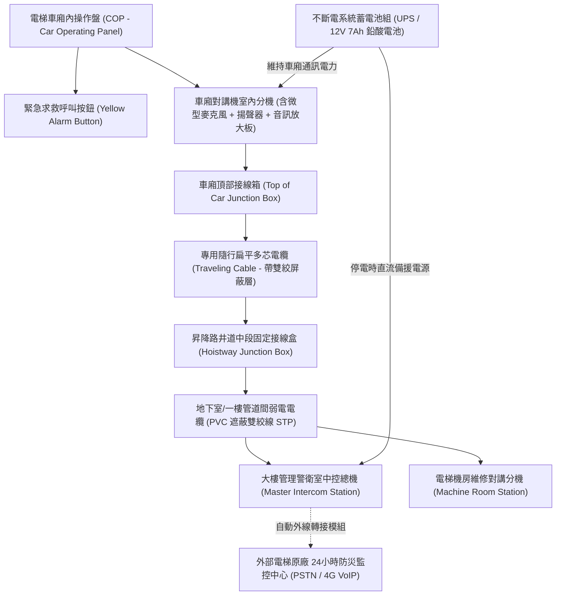
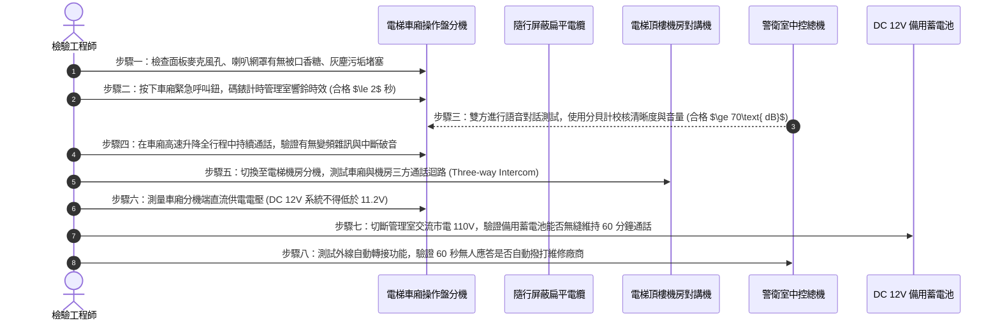

# 全案購屋實戰第六百零七部：中古大樓社區各樓層電梯對講機室內分機音訊放大IC老化破音直流供電壓降雜訊干擾與主機面板通訊中斷體檢工序全書

---

## 壹、前言與核心體檢宗旨

在現代集合住宅大樓中，「電梯車廂緊急對講機系統（Elevator Emergency Intercom System）」是當發生停電、機械卡死、安全鉗動作跳脫、地震受困等重大危機時，受困住戶與管理員中控室、警衛室及外部電梯專業維護廠商之間**唯一合法、且具備實體線路保障之生命救援通話通道**。

依據我國《建築物昇降設備設置及檢查管理辦法》與 CNS 10594 升降機國家標準，電梯車廂內必須設置與外界雙向對話之通訊設備，且應具備備用電源支援。

然而，在屋齡 20～35 年之中古集合住宅大樓中，由於長年缺乏對弱電通訊線路與語音電路模組之深層預防性維護，導致以下致命工程暗病長年隱匿：
1. **車廂對講機音訊放大 IC 老化與自激震盪破音**：語音運算放大器（如 LM386 / TDA2822 等音訊功放晶片）內部矽半導體結晶老化、退耦電解電容乾涸漏液，通話時傳出尖銳刺耳之嘯叫回授聲或嚴重破音，救援人員完全無法聽清受困老人、孩童之微弱求救聲音。
2. **隨行電纜（Traveling Cable）屏蔽層斷裂與直流供電壓降**：電梯長達數十年之高頻上下往復彎折，導致隨行電纜內之音訊遮蔽銅網疲勞斷裂，直流 DC 12V/24V 供電端子在長距離傳輸下壓降超過 30%，引發嚴重 60Hz 交流蜂鳴底噪干擾。
3. **管理室主機面板選擇開關接點氧化與通訊全面中斷**：管理室警衛總機之多路分機按鍵金屬片氧化銹蝕，按壓車廂「CALL」緊急呼叫鈕時，管理室端完全無聲無鈴，形同「孤島陷阱」。

本工序全書旨在深入剖析電梯緊急對講機電氣迴路、隨行電纜衰減、音訊功放晶片及主機通訊連鎖體系，提供一套完整精準的實地檢測工序。

---

## 貳、電梯緊急通訊對講機系統電氣架構

---

## 參、中古社區現場五大常見致命病徵與工程成因

| 病徵分類 | 現場常見故障現象 | 工程深層成因分析 | 對住戶家庭置產之潛在危害 |
| :--- | :--- | :--- | :--- |
| **一、語音嘯叫破音** | 按下對講鍵通話時，車廂內爆發刺耳尖銳嘯叫（Feedback），完全聽不清人聲 | 麥克風與揚聲器聲學隔離海綿老化粉化，音訊放大電路增益失調、濾波電解電容爆漿。 | 受困者恐慌加劇，心臟病發或哮喘發作時無法向管理員精準傳達病況。 |
| **二、交流底噪嗡鳴** | 只要電梯變頻器一啟動運轉，對講機即傳來巨大「滋滋、嗡嗡」背景電流聲 | 隨行電纜外層銅編織屏蔽網斷裂、未妥善單端接地，大功率變頻驅動雜訊耦合進音訊線。 | 通話訊號被強烈電磁干擾淹沒，根本無法聽清對方指示。 |
| **三、直流嚴重壓降** | 平時通話微弱，在電梯降至地下最底層時，對講機燈號熄滅、徹底斷音 | 供電導線線徑過細（僅 0.5mm²），加上接線端子螺栓氧化鬆動，終端電壓由 12V 跌落至 7.5V 以下。 | 往往在最需要救援的地下室事故深處，通訊直接罷工斷線。 |
| **四、管理室鈴聲啞火** | 車廂內警鈴按鈕按到底，車廂內蜂鳴器在響，但管理室警衛毫無反應 | 隨行電纜內部信號線芯疲勞微斷（隱形斷線），或警衛室總機主板繼電器線圈燒毀。 | 住戶受困時呼叫無門，只能徒手扒門或狂踹車廂，極易引發墜落井道悲劇。 |
| **五、斷電無備用電力** | 台電停電時，電梯內車廂一片漆黑，對講機指示燈全滅，按下呼叫毫無反應 | 對講機專用 UPS 電池長達 5 年以上未換，電解液乾涸，斷電瞬間直流電壓歸零。 | 遭遇停電困梯時，手機在封閉金屬車廂內又無訊號，陷入徹底絕望孤立。 |

---

## 肆、標準電梯對講機系統八步精密體檢工序

### 關鍵檢驗數據與判定標準表：

| 檢驗參數 | 標準健康安全值 | 臨界警告值 | 致命危險特徵（一票否決） |
| :--- | :--- | :--- | :--- |
| **1. 車廂終端直流電壓** | $\text{DC } 11.5\text{V} \sim 13.8\text{V}$ | $\text{DC } 10.5\text{V} \sim 11.4\text{V}$ | $< 9.5\text{V}$（音訊放大 IC 進入非線性失真區） |
| **2. 通話音量聲壓級** | 車廂內距離操作盤 1米 $\ge 70\text{ dBA}$ | $60\text{ dBA} \sim 69\text{ dBA}$ | $< 55\text{ dBA}$（細若蚊蚋，完全聽不清） |
| **3. 背景底噪訊噪比 (SNR)** | $\text{SNR} \ge 45\text{ dB}$ | $30\text{ dB} \sim 44\text{ dB}$ | $< 20\text{ dB}$（交流嗡鳴電流聲蓋過人聲） |
| **4. 斷電備用供電續航** | 模擬斷電維持通話 $\ge 60$ 分鐘 | 維持 $20 \sim 59$ 分鐘 | 斷電瞬間直接黑燈啞火（電池完全掛死） |
| **5. 隨行電纜線芯線阻** | 單芯導線迴路電阻 $\le 8\ \Omega$ | 電阻 $9\ \Omega \sim 25\ \Omega$ | 電阻 $>50\ \Omega$ 或內部斷線（電阻無窮大） |
| **6. 三方通話連鎖性** | 車廂、機房、管理室三方暢通 | 二方通話正常、一方微弱 | 僅單向發話，對方無法回話（半雙工損壞） |

---

## 伍、買方看屋現場 3 分鐘電梯對講機實戰快檢表

買方隨仲介搭乘電梯看屋時，無須專業工具，只需透過以下「一按、二聽、三問」實測手法，即可 100% 摸清電梯通訊底細：

| 查驗步驟 | 操作手法與檢驗動作 | 合格優質特徵 | 致命隱患警訊（高危險折價項） |
| :--- | :--- | :--- | :--- |
| **1. 實測按下求救鈕** | 徵得仲介同意後，輕按操作盤黃色對講按鈕 2 秒 | 管理室值班警衛於 5 秒內清晰接聽：「請問有何狀況？」 | 按了 30 秒毫無反應、管理室無人接聽，或傳出陣陣盲音空響 |
| **2. 仔細傾聽語音品質** | 仔細聆聽喇叭傳出的管理員聲音 | 語音飽滿清晰、音量宏亮、無雜音、無回音 | 聲音嘶啞破裂、帶有強烈尖銳金屬震顫音，如同恐怖片變聲 |
| **3. 行進中雜音聆聽** | 在電梯高速上升與下降過程中對話 | 背景乾淨安靜，通話無任何中斷抽搐 | 電梯一動就發出劇烈「滋拉滋拉」爆裂雜音，甚至通話斷線 |
| **4. 檢查斷電緊急照明** | 觀察車廂操作盤上的緊急照明小燈 | 燈珠外殼乾淨透亮，標示清楚 | 燈罩發黑燒焦，或根本未配置車廂緊急照明 |
| **5. 詢問外線自動轉接** | 詢問管理員：「夜間警衛巡邏不在時，對講機是否轉接電梯保養公司手機？」 | 回答：「有設定自動外撥，超過 1 分鐘無人接聽會轉原廠」 | 回答：「沒有啦，警衛不在就只能在裡面等巡邏回來」 |

---

## 陸、購屋特約條款範本：電梯救災通訊妥善率保障

> **電梯車廂緊急通訊系統妥善率與維護擔保特約：**  
> 「賣方保證本買賣標的所屬大樓電梯之車廂內部緊急對講機系統（包含車廂操作盤分機、隨行通訊電纜、管理室中控主機及停電緊急備用電源）功能完全健全，通話音量清晰無雜訊，並符合現行建築物昇降設備安全檢查規範。  
> 點交日前若經實地檢驗發現車廂對講機無法呼通管理室、音訊嚴重失真破音、斷電無備援電力或三方通話迴路中斷，賣方應於交屋日前督促管理委員會及電梯專業維護廠商修復完畢；若未能於期限內改善，賣方同意自買賣尾款中提撥新台幣 **貳萬元整** 作為電梯通訊修繕暫扣款，交由履約保證專戶保管，待完全修復經買方實測合格後撥付。」

---

## 柒、結語

電梯車廂是一個高空懸吊、四面封閉的鋼鐵盒子。當災害來臨時，那顆黃色的對講機按鈕，是受困者與外界連結的唯一生命希望。
買房不僅要看電梯外觀是否新穎、梯廳大理石是否氣派，更必須親手按下那顆按鈕，確保線路的另一端永遠有清晰、可靠的守護之聲，為家人每一次的垂直穿梭提供最安心的終極保障！
